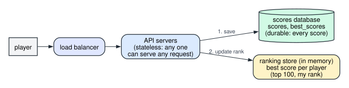
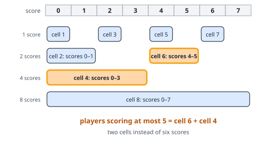

# How to Approach System Design

System design is planning how the parts of a large app fit together, such as the servers, the databases and the connections between them, before anyone builds it. Apps like WhatsApp or a bank app have to keep working for millions of people at once, and that takes a plan. This lesson gives you a simple step-by-step method for working out that plan, the same one used in job interviews.

## Before you start
<!-- bite: 8c1e2289-72a2-45ca-a189-0fcbde08a0f1 -->

**On SWE 103 week 1?** Do the week's design first: the URL shortener, 45 minutes, out loud, before reading this. This lesson doesn't design a URL shortener, but reading it first would change how your attempt goes, and the point is to find your own gaps.

You can already:

- Describe how a request travels from a browser to a server and a database and back → [[backend/01-foundations/03-the-request-lifecycle/index|the request lifecycle]].
- Do arithmetic with powers of ten in your head: 10 million × 5 is 50 million, and a day has about 100,000 seconds.
- Run a TypeScript test file with Node 26 (`node --test`).

After this lesson you will be able to:

1. Run the five steps on a problem you haven't seen, in 45 minutes, knowing roughly how long each step gets.
2. Turn requirements into numbers (average and peak requests a second, storage and bandwidth) and say which number decides the design.
3. Choose the one or two components worth a deep dive, and justify the choice from the requirements.
4. State a tradeoff in the form "I chose X, which costs Y, and that's acceptable here because Z".

**Study route:** read the kid version and sections 1–2, then stop at the prediction in section 3 and try it before reading on. Section 4 is the lab.

## The kid version
<!-- bite: 199cfe22-284b-4487-a0b5-85a91e63082d -->

You're planning a birthday party. Before buying anything, you ask how many children are coming, whether anyone has allergies, and whether it's indoors or out. Then you do rough sums: 20 children eating two slices each is 40 slices, about five pizzas. Then you sketch the room: food here, games there, parents by the door. Then you spend most of your effort on the hardest part, such as a cake for the child who can't eat nuts. Last, you ask what could go wrong: if it rains, the garage is ready.

**Where the analogy stops working.** A party happens once, and you can fix things on the day. A system keeps running while its numbers grow and its requirements change. That's why the estimates and assumptions get written down: so you can tell when they stop being true.

## 1. Why this exists
<!-- bite: 36f45414-4c76-463a-90bf-11e89b85975a -->

Someone asks you to design a leaderboard for a mobile game. The obvious design comes straight to mind: a `scores` table, `ORDER BY score DESC LIMIT 100` for the top of the board, and `SELECT COUNT(*) FROM best_scores WHERE score > $mine` for a player's rank. With 1,000 players it's perfect.

Now ask how many players there are. Say there are 50 million with a score, and at peak 3,500 people a second open the screen that shows their rank. Each rank query counts the players above you, about 25 million rows for a middling player. That's tens of billions of rows a second, which no single database can do. The obvious design isn't wrong in general. It's wrong for these numbers, and you only learn the numbers if you ask.

Under pressure, the usual mistake is jumping to a solution ("Kafka and microservices!") before understanding the problem. The fix is a **method you run every time**, so the process carries you when inspiration doesn't. It also happens to be what a system-design interview scores: interviewers mostly judge how you reach a design, not whether it matches theirs.

## Terms used in system design
<!-- bite: a4d46a24-112e-428c-af5f-63ff5426b35b -->

1. **Functional requirement**: This is something the system does, written from the user's side. "A player can see their rank" is one.
2. **Non-functional requirement**: This is a quality the system must have while doing it, such as how many users it serves, how fast it answers, how often it may be down, or how fresh its data must be. These are what decide the architecture.
3. **DAU (daily active users)**: The letters stand for those three words. It is the number of different people who use the system on a typical day, and it is the usual starting point for an estimate.
4. **Back-of-the-envelope estimate**: This is a rough calculation, right to within a few times, done to choose between designs. Its value is the order of magnitude: gigabytes or petabytes, hundreds or millions of requests a second.
5. **Requests per second**: This is also known as **QPS**, for queries per second. It is how many requests arrive each second, and it is quoted as an average over the day and as a peak.
6. **Peak-to-average ratio**: This is how much busier the busiest period is than the day's average. Traffic is uneven, and a system must survive the peak, not the average.
7. **Read-to-write ratio**: This is how many reads there are for each write. A system with many more reads than writes is called **read-heavy**, and it is usually helped by caching and copies of the data. A **write-heavy** one needs the write path itself to scale.
8. **High-level design**: This is the boxes-and-arrows picture of the main components and how a request flows between them, with the main API calls and data model.
9. **Deep dive**: This is a detailed design of the one or two components that are hardest or most important for this particular system.
10. **Bottleneck**: This is the part that limits the whole system, the first thing to run out as load grows.
11. **Single point of failure**: This is a component whose failure stops the whole system, because nothing else can do its job.
12. **Tradeoff**: This is a choice that gains one quality by giving up another, such as freshness for speed, or simplicity for scale. Every design is made of them, and the skill is choosing them on purpose.

## 2. The five steps, and the time each gets
<!-- bite: 39c8011b-30fd-44ae-989c-38202703d83c -->

In a 45-minute interview, the time splits roughly like this. Outside interviews the proportions still hold; only the clock is longer.

| Step | Minutes | What you have at the end |
|---|---|---|
| 1. Clarify requirements | 5 | 3–5 functional requirements, and the non-functional ones as numbers |
| 2. Estimate | 5 | peak reads and writes a second, storage, bandwidth, and the number that decides the design |
| 3. High-level design | 10 | boxes and arrows, the main API calls, the data model |
| 4. Deep dive | 15 | one or two components designed in detail |
| 5. Bottlenecks and tradeoffs | 5–10 | single points of failure, what breaks at 10 times the load, tradeoffs said out loud |

### Step 1: Clarify requirements (don't skip this)

Pin down *what* you're building before *how*. **Functional requirements** say what the system does; scope them to a few, because you can't build everything in 45 minutes, and agree the rest is out of scope. **Non-functional requirements** are the qualities that shape the architecture: expected scale (users, requests a second, data volume), latency targets, availability, read-to-write ratio and consistency. *These drive every later decision.* A read-heavy system at 10 requests a second and a write-heavy one at a million a second are entirely different designs.

The most important question is **"What are we optimising for?"** You can't design well without knowing which qualities matter most here.

### Step 2: Estimate

Turn the requirements into numbers: requests a second, storage a year, bandwidth, memory for caching. You need the *order of magnitude*, because that decides whether one database is enough or you need [[architecture/02-building-blocks/03-databases-at-scale|sharding]]. Two habits make it quick. A day has 86,400 seconds, so call it 100,000. And keep the [latency numbers every engineer should know](https://gist.github.com/jboner/2841832) in mind to judge what's feasible: reading main memory takes about 100 nanoseconds, a solid-state disk read tens of microseconds, a round trip inside a data centre about half a millisecond, and one across an ocean about 150 milliseconds.

Then say which number matters. Usually one of them decides the design, and the rest only confirm that nothing else is a problem.

### Step 3: High-level design

Draw the big boxes and how requests flow through them: client → [[architecture/02-building-blocks/01-load-balancing-and-proxies/index|load balancer]] → application servers → [[architecture/02-building-blocks/02-caching/index|cache]] and [[architecture/02-building-blocks/03-databases-at-scale|database]], plus [[architecture/02-building-blocks/04-messaging-and-async/index|queues]] for slow work. Write the main API calls and the data model. Get the *shape* right before optimising any piece; the deep dive needs something to attach to.

### Step 4: Deep dive

Zoom into the one or two components that are hardest or most important for *this* system's requirements: how to shard the database, the caching strategy, how to keep a feed fresh, how to handle a write hotspot. Choose by asking which requirement the obvious design fails. This is where the interesting engineering, and most of the interview signal, lives.

### Step 5: Bottlenecks and tradeoffs

Find the single points of failure, the hot paths and the scaling limits, and address them with [[architecture/01-system-design-fundamentals/03-availability-and-reliability|redundancy]], [[architecture/02-building-blocks/02-caching/index|caching]] or [[architecture/02-building-blocks/03-databases-at-scale|replication]]. Above all, **say the tradeoffs out loud**: "I'm choosing eventual consistency here to stay available, which means a user might briefly see a stale count. That's fine for likes, not for an account balance." There is no perfect design, only tradeoffs you chose on purpose and ones that surprised you later.

## 3. Worked example: a game leaderboard, start to finish
<!-- bite: ea9d77a5-9498-4369-a4f7-d72840dbb285 -->

### Step 1: Requirements

The questions to ask, with the answers we'll assume:

- *Who uses it, and how often?* 10 million players a day, each playing about five games and opening the leaderboard about ten times. 50 million players have ever played.
- *What must it do?* Submit a score after each game. Show the global top 100. Show a player their own rank and best score.
- *What's out of scope?* Friends-only boards, weekly resets and cheat detection. Say you'd come back to them.
- *How fast and how fresh?* The leaderboard screen should load in under 200 ms for 99% of requests, and a new best score should show in a player's rank within a few seconds.
- *What can't be lost?* A submitted score. A leaderboard that's unavailable for a minute is annoying; a lost personal best is a complaint.

So we're optimising for **fast rank lookups, durable scores and ranks that are fresh within seconds**.

### Step 2: Estimates

In words first: writes a second are players × games each ÷ seconds in a day, and the peak is that times how much busier evenings are. Then the numbers:

```text
writes:  10,000,000 players × 5 games  ÷ 86,400 s ≈   579 a second, × 3 at peak ≈ 1,736
reads:   10,000,000 players × 10 views ÷ 86,400 s ≈ 1,157 a second, × 3 at peak ≈ 3,472
ratio:   2 reads per write
storage: 50 million scores a day × 50 bytes × 365 days ≈ 910 GB of history
egress:  3,472 reads × 2 KB for the top 100 ≈ 6.9 MB a second at peak
```

**Predict before reading on.** Which of these numbers decides the design? Is 3,472 reads a second the problem?

<details>
<summary>After your prediction</summary>

None of them on its own. A few thousand simple reads a second, 1,736 writes a second, 910 GB and 7 MB a second are all within reach of one well-provisioned database and a few servers. The number that decides the design is the **cost of one rank lookup**. With the obvious query it's a count over everyone above you, up to 50 million rows. At 3,472 lookups a second that's up to 1.7 × 10^11 rows a second. That's what needs a deep dive, and none of the headline numbers shows it.

</details>

### Step 3: High-level design

The player's request goes through the load balancer to any API server, which saves the score first and then updates the ranking store.



- `POST /scores` with `{ playerId, score }` saves the score and answers `202 Accepted`.
- `GET /leaderboard/top?limit=100` returns the top 100.
- `GET /players/{id}/rank` returns `{ rank, bestScore }`.
- Data model: `scores(player_id, score, played_at)` keeps every game, written once and never changed. `best_scores(player_id, score)` keeps one row per player.

### Step 4: Deep dive, the rank lookup

There are three candidate designs:

1. **Count in the database.** An index on `score` helps find the top 100, but "how many scores are above mine" still has to count every index entry above yours, which is millions of entries for a middling player. It fails the latency requirement at this scale.
2. **Work out every rank in a batch job every few minutes.** Reads become a cheap lookup, but ranks are minutes old. It fails freshness.
3. **Keep best scores in a structure that can count "how many are higher" in logarithmic time.** Redis's sorted set does exactly this: `ZADD` to record a score and `ZREVRANK` for a rank are both documented as O(log N). At roughly 100 bytes per player, 50 million players need about 5 GB of memory, which fits on one machine.

Choose the third. The lab builds a small version, a **Fenwick tree**, to show why it's fast. Scores are whole numbers from 0 to a maximum. Each cell of the tree holds how many players have a score in one range of scores, and the range sizes are powers of two. To count the players scoring *at most* some score, you add up a handful of cells. With scores from 0 to 7, counting those at most 5 adds cell 6 (scores 4–5) and cell 4 (scores 0–3): two cells, not six scores. A player's rank is 1 + (players − those scoring at most mine). With scores up to 1,000,000, that's never more than 20 cells. The lab checks this against a full scan of 200,000 players.

The write path: the API server writes the score to the database first, then updates the ranking store. If the ranking store is lost, it's rebuilt from `best_scores`, 5 GB, in minutes. Tied players share a rank.

### Step 5: Bottlenecks and tradeoffs

- **The ranking store is a single point of failure.** Run a replica, and keep the rebuild from the database as the last resort.
- **What breaks at 10 times the load?** 500 million players would need about 50 GB of memory, still possible on one large machine. Beyond that, split the players across several stores by score range, so a rank becomes the store's local rank plus the count of everyone in the higher ranges.
- **Tradeoff, said out loud:** "I write to the database first and the ranking store second, so a crash between the two leaves a score saved but not yet ranked, until a repair job catches it. That's acceptable because the score isn't lost. The other order could rank a score that was never saved."
- **Tradeoff:** "Ranks can lag a write by a moment, because the ranking store is updated after the database. That's fine for a game. It wouldn't be for a bank balance."

## Seeing the Fenwick tree cells
<!-- bite: ec325aec-992c-441a-acf2-0d6d9173d290 -->

Each blue bar is one cell, and it counts the players whose score falls in its range. To count players scoring at most 5, you add just the two orange cells.



## 4. Runnable example: the numbers and the rank structure
<!-- bite: 132b8694-2ad5-408c-89ef-fc20116c5293 -->

The lab has three files. `estimate.ts` does step 2's arithmetic, with each assumption written down. `leaderboard.ts` is the deep dive's Fenwick tree, plus the obvious full scan to compare against. `approach.test.ts` checks the worked example's numbers and the rank structure.

```ts
// estimate.ts — back-of-the-envelope arithmetic for a design, with every assumption written down.
// The answers only need to be right to within a factor of a few: they decide between designs, not budgets.

export const SECONDS_PER_DAY = 86_400; // "about 100,000" is close enough when estimating in your head

export interface Assumptions {
  dailyActiveUsers: number;
  writesPerUserPerDay: number;
  readsPerUserPerDay: number;
  peakToAverage: number; // how much busier the busiest hour is than the day's average
  bytesPerWrite: number; // what each write adds to storage
  keptForDays: number;
  bytesPerRead: number; // the size of one response
}

export interface Estimate {
  writesPerSecond: { average: number; peak: number };
  readsPerSecond: { average: number; peak: number };
  readsPerWrite: number;
  storageBytes: number;
  peakEgressBytesPerSecond: number; // bytes sent to clients a second, at peak
}

export function estimate(a: Assumptions): Estimate {
  const writes = (a.dailyActiveUsers * a.writesPerUserPerDay) / SECONDS_PER_DAY;
  const reads = (a.dailyActiveUsers * a.readsPerUserPerDay) / SECONDS_PER_DAY;
  return {
    writesPerSecond: { average: writes, peak: writes * a.peakToAverage },
    readsPerSecond: { average: reads, peak: reads * a.peakToAverage },
    readsPerWrite: a.readsPerUserPerDay / a.writesPerUserPerDay,
    storageBytes: a.dailyActiveUsers * a.writesPerUserPerDay * a.bytesPerWrite * a.keptForDays,
    peakEgressBytesPerSecond: reads * a.peakToAverage * a.bytesPerRead,
  };
}

/** Bytes to two significant figures, in powers of 1,000 as disks and networks are sold: 912,500,000,000 → "910 GB". */
export function humanBytes(bytes: number): string {
  const units = ["B", "KB", "MB", "GB", "TB", "PB"];
  let i = 0;
  while (bytes >= 1000 && i < units.length - 1) {
    bytes /= 1000;
    i++;
  }
  return `${Number(bytes.toPrecision(2))} ${units[i]}`;
}
```

```ts
// leaderboard.ts — the deep dive: "what's my rank?" among millions of players, answered in about 20 steps.
// Scores are whole numbers from 0 to maxScore. A Fenwick tree (binary indexed tree) keeps, for each score,
// how many players have it, arranged so that "how many players scored at most s" takes log2(maxScore) steps.

export class Leaderboard {
  private readonly best = new Map<string, number>(); // each player's best score
  private readonly tree: number[];
  private readonly maxScore: number;
  steps = 0; // the work the last rank() did, to compare with scanning every player

  constructor(maxScore: number) {
    this.maxScore = maxScore;
    this.tree = new Array<number>(maxScore + 2).fill(0);
  }

  get players(): number {
    return this.best.size;
  }

  /** Records a score. Only a player's best counts, so a lower score changes nothing and returns false. */
  submit(player: string, score: number): boolean {
    if (!Number.isInteger(score) || score < 0 || score > this.maxScore) {
      throw new RangeError(`score must be a whole number from 0 to ${this.maxScore}, got ${score}`);
    }
    const old = this.best.get(player);
    if (old !== undefined && score <= old) return false;
    if (old !== undefined) this.add(old, -1);
    this.add(score, +1);
    this.best.set(player, score);
    return true;
  }

  /** 1 + the number of players with a strictly higher best score, so tied players share a rank. */
  rank(player: string): number | undefined {
    const score = this.best.get(player);
    if (score === undefined) return undefined;
    this.steps = 0;
    return 1 + this.players - this.countAtMost(score);
  }

  private add(score: number, delta: number): void {
    for (let i = score + 1; i < this.tree.length; i += i & -i) this.tree[i] += delta;
  }

  private countAtMost(score: number): number {
    let count = 0;
    for (let i = score + 1; i > 0; i -= i & -i) {
      count += this.tree[i];
      this.steps++;
    }
    return count;
  }
}

/** The obvious way, and what `SELECT COUNT(*) … WHERE score > $mine` does without help: look at everyone. */
export function rankByScan(scores: Iterable<number>, mine: number): { rank: number; steps: number } {
  let higher = 0;
  let steps = 0;
  for (const s of scores) {
    steps++;
    if (s > mine) higher++;
  }
  return { rank: 1 + higher, steps };
}
```

```ts
import { test } from "node:test";
import assert from "node:assert/strict";
import { estimate, humanBytes } from "./estimate.ts";
import { Leaderboard, rankByScan } from "./leaderboard.ts";

// The worked example: a leaderboard for a mobile game with 10 million daily players.
const game = estimate({
  dailyActiveUsers: 10_000_000,
  writesPerUserPerDay: 5, // five games a day, one score each
  readsPerUserPerDay: 10, // the leaderboard opened ten times a day
  peakToAverage: 3, // evenings are three times the daily average
  bytesPerWrite: 50, // player id, score, time, and some overhead
  keptForDays: 365, // a year of score history
  bytesPerRead: 2_000, // the top 100, about 20 bytes each
});

test("the estimate: order of magnitude, not precision", () => {
  assert.equal(Math.round(game.writesPerSecond.average), 579);
  assert.equal(Math.round(game.writesPerSecond.peak), 1736);
  assert.equal(Math.round(game.readsPerSecond.peak), 3472);
  assert.equal(game.readsPerWrite, 2); // read-heavy, but not overwhelmingly
  assert.equal(humanBytes(game.storageBytes), "910 GB"); // history fits on one disk
  assert.equal(humanBytes(game.peakEgressBytesPerSecond), "6.9 MB"); // a second: small
});

test("why the obvious rank query can't work at this scale", () => {
  const players = 50_000_000; // everyone who has ever played has a best score
  const comparisonsPerSecond = Math.round(game.readsPerSecond.peak) * players; // a full scan per rank lookup
  assert.equal(comparisonsPerSecond, 173_600_000_000); // 1.7 × 10^11 a second: no single database does this
  assert.equal(humanBytes(players * 100), "5 GB"); // best scores at ~100 bytes each fit in memory on one machine
});

test("ranks: ties share a rank, and only a player's best score counts", () => {
  const board = new Leaderboard(1_000);
  board.submit("ada", 100);
  board.submit("bo", 250);
  board.submit("cy", 250);
  board.submit("di", 90);
  assert.deepEqual(["bo", "cy", "ada", "di"].map((p) => board.rank(p)), [1, 1, 3, 4]);
  assert.equal(board.submit("ada", 80), false); // lower than her best: ignored
  assert.equal(board.rank("ada"), 3);
  assert.equal(board.submit("ada", 300), true);
  assert.deepEqual(["ada", "bo", "cy", "di"].map((p) => board.rank(p)), [1, 2, 2, 4]);
  assert.equal(board.rank("nobody"), undefined);
  assert.throws(() => board.submit("ed", 1_001), RangeError);
  assert.throws(() => board.submit("ed", 2.5), RangeError);
});

test("the deep dive pays off: about 20 steps instead of one per player", () => {
  const maxScore = 1_000_000;
  const board = new Leaderboard(maxScore);
  const scores: number[] = [];
  for (let i = 0; i < 200_000; i++) {
    const score = (i * 7_919) % (maxScore + 1); // spread out, and the same on every run
    scores.push(score);
    board.submit(`p${i}`, score);
  }
  for (const i of [0, 1, 12_345, 199_999]) {
    const scan = rankByScan(scores, scores[i]);
    assert.equal(board.rank(`p${i}`), scan.rank); // the same answer...
    assert.ok(board.steps <= 20, `${board.steps} steps`); // ...in at most log2(1,000,001) ≈ 20 steps
    assert.equal(scan.steps, 200_000); // ...where the scan looks at every player
  }
});
```

**Lab:** the code is in [`architecture/01-system-design-fundamentals/01-how-to-approach-system-design/labs/typescript/`](https://github.com/kingsleydaprime/knowledgebase/tree/main/architecture/01-system-design-fundamentals/01-how-to-approach-system-design/labs/typescript). From the vault root, `python3 labs/run.py how-to-approach-system-design/typescript` runs the tests and checks this page still shows the same code. Inside the folder, `node --test` runs the tests alone. Expect four passing tests.

## Common pitfalls
<!-- bite: 7be62b50-b17f-4cfa-94ff-60829843aea3 -->

1. **Designing before asking.** The first five minutes decide which design is right. Without numbers, every design is a guess.
2. **Estimating to three significant figures.** Precision wastes time. You're choosing between "one database" and "many", not writing a budget.
3. **Designing for the average.** Traffic peaks. Size for the busiest hour, and say what the peak-to-average ratio is.
4. **Stopping at the headline numbers.** The deciding number is often the cost of one operation times its rate, as with the rank query.
5. **A deep dive on the easy part.** Polishing the load balancer while the hard requirement goes unmet. Pick the component the obvious design fails.
6. **Tradeoffs left unsaid.** A choice without its cost sounds like you didn't notice the cost.

## Check your understanding
<!-- bite: 83b1fee1-f5eb-471c-a3b1-221010908dce -->

Try each one before you open the answer.

1. <!-- q: open id="d0f64ce5" -->
   In system design, functional requirements say what a system does, and non-functional requirements are the qualities it must have, such as scale, speed and availability. Why do the non-functional requirements decide the architecture more than the functional ones?

   <details><summary>Answer</summary>

   Most functional requirements can be met by the simplest design: one server and one database. What makes one system need sharding, caching or queues and another not is its scale, latency, availability and consistency, which are the non-functional requirements.

   </details>

2. <!-- q: exact id="047f8744" answer="2083.33333333" sigfigs="2" accept="1800" -->
   A system has 4 million daily users who each make 15 requests a day. Evenings are three times busier than the day's average. Using 86,400 seconds in a day, roughly how many requests a second arrive at peak?

   <details><summary>Answer</summary>

   About 2,100. 4,000,000 × 15 = 60 million requests a day. 60,000,000 ÷ 86,400 ≈ 694 a second on average, and × 3 ≈ 2,083 at peak.

   </details>

3. <!-- q: mcq id="4000e580" -->
   A design gets 3,000 rank lookups a second. Each lookup, done the obvious way, counts every player above you, up to 40 million rows. What decides the design here?

   - [ ] The 3,000 requests a second, because that is too many for one database
   - [x] The cost of one lookup times its rate, because millions of rows per lookup adds up to about 10^11 rows a second
   - [ ] The storage, because 40 million rows will not fit on one disk
   - [ ] Nothing, because one well-provisioned database handles it

   <details><summary>Answer</summary>

   A few thousand simple reads a second is within reach of one database. What breaks is that each read counts millions of rows, so the cost of one operation times its rate is the deciding number.

   </details>

4. <!-- q: gap id="450c8e5a" answers="clarify requirements|requirements;estimate|estimates;deep dive" -->
   Fill in the gaps. The five steps of the method are: ___, ___, high-level design, ___, and bottlenecks and tradeoffs.

   <details><summary>Answer</summary>

   Clarify requirements, estimate, high-level design, deep dive, then bottlenecks and tradeoffs. In a 45-minute interview the deep dive gets the most time, about 15 minutes.

   </details>

5. <!-- q: mcq id="cff4f4c5" -->
   A leaderboard saves each score to a database, which is the durable record, and also to an in-memory ranking store. Why write to the database first?

   - [x] A crash between the two writes then leaves a saved score that isn't ranked yet, which a repair job can fix
   - [ ] The database is faster than the in-memory store
   - [ ] The ranking store can only be written after the database answers 202 Accepted
   - [ ] It doesn't matter which goes first

   <details><summary>Answer</summary>

   With the other order, a crash could leave the ranking store showing a score that was never saved. Database first means the worst case is a short delay before ranking, and the score is never lost.

   </details>

6. <!-- q: open id="fc374f21" -->
   Rewrite "we'll use a cache" as a stated tradeoff, in the form "I chose X, which costs Y, and that's acceptable because Z".

   <details><summary>Answer</summary>

   For example: "I'll cache the top 100 for 2 seconds. That cuts reads on the ranking store by orders of magnitude, at the cost of the top of the board being up to 2 seconds old, which is acceptable because players won't notice."

   </details>

## Check your understanding: worked problems
<!-- bite: 4a244697-e775-4a30-947a-1500d5458cd7 -->

Work each one out on paper first, then type your answer.

1. <!-- q: gap id="e92f23ff" answers="925.925925926;2314.81481481" sigfigs="2" -->
   Fill in the gaps. A photo app has 20 million daily users who each upload 4 photos a day. The peak is 2.5 times the average. Using 86,400 seconds in a day, the average is about ___ uploads a second and the peak is about ___ uploads a second.

   <details><summary>Answer</summary>

   20,000,000 × 4 = 80 million uploads a day. 80,000,000 ÷ 86,400 ≈ 926 a second, and × 2.5 ≈ 2,315 at peak.

   </details>

2. <!-- q: exact id="c563db03" answer="35.04" sigfigs="2" -->
   The same app stores 80 million records a day, each 400 bytes, and keeps them for 3 years of 365 days. How many terabytes is that? (1 TB = 10^12 bytes.)

   <details><summary>Answer</summary>

   About 35 TB. 80,000,000 × 400 × 365 × 3 = 3.504 × 10^13 bytes, which is 35 TB.

   </details>

3. <!-- q: exact id="eaf53a64" answer="250" -->
   At peak, a service answers 5,000 reads a second and each response is 50 KB (1 KB = 1,000 bytes). How many megabytes a second does it send out? (1 MB = 1,000,000 bytes.)

   <details><summary>Answer</summary>

   250 MB a second. 5,000 × 50,000 bytes = 250,000,000 bytes a second.

   </details>

4. <!-- q: exact id="dcd50cde" answer="361" -->
   A ranking structure holds 1,000 players. A player's rank is 1 + (players − players scoring at most mine), so tied players share a rank. 640 players scored at most as much as Ada, Ada included. What is Ada's rank?

   <details><summary>Answer</summary>

   361. 1 + (1,000 − 640) = 361: there are 360 players with a strictly higher score.

   </details>

5. <!-- q: sketch id="afe949d6" -->
   Draw the high-level design for a photo-sharing app on paper. Phones upload photos (about 3 MB each) and scroll a feed of photos from people they follow. Reads are 50 times more common than uploads, the same popular photos are viewed millions of times, and an uploaded photo must never be lost. Draw the boxes (client, load balancer, servers, stores) and the arrows between them, and label where the photo files and the photo details live.

   <details><summary>Answer</summary>

   

   What to check:
   - The servers are stateless behind a load balancer, so any server can take any request.
   - The big photo files live in object storage, not in the database; the database holds only the small details (who, when, which file).
   - Image downloads go through a CDN, because the same popular photos are read millions of times.
   - A cache sits beside the servers for hot feed reads, since reads far outnumber writes.

   </details>

## Practice — independent task
<!-- bite: 25102fe5-2441-44af-9efe-b0fb2bc73bbc -->

**Redo the URL shortener with the method, then write down the gap.**

You did the URL shortener cold at the start of the week. Now do it again with the five steps, using these assumptions or your own: 100 million new short links a month, 100 reads for every link created, links kept for five years, 500 bytes stored per link, and peak traffic three times the average.

1. Write the requirements: 3–5 functional, and the non-functional ones as numbers.
2. Copy `estimate.ts` into a scratch folder and write a test that pins your estimates: writes and reads a second (average and peak), storage over five years, and peak bandwidth.
3. Draw the high-level design and write the API calls and data model.
4. Pick one or two components for a deep dive. Say which requirement the obvious design fails, and why that makes them the components to design in detail.
5. State three tradeoffs in the form "I chose X, which costs Y, and that's acceptable because Z".

**A smaller step if you're stuck:** change the worked leaderboard to reset every Monday. Which of the five steps change, and what happens to the 910 GB storage figure and the 5 GB of memory?

**Done when:** you have one page with the five steps, your estimates are checked by a passing test, your deep dive names the requirement it serves, and you've written a short list of what your cold attempt missed. That list is the week's notebook entry.

## Tradeoffs, limits and extensions
<!-- bite: 0ba48f3c-92ed-4196-b14a-51699eb80c3c -->

- **The method is a scaffold, not a script.** Some interviewers want the API first, or jump straight to a deep dive. Follow them, and keep the steps as a checklist so nothing is skipped.
- **Real design work is slower.** At work, the same steps become a design document that others review over days, with measured numbers rather than estimates. [[architecture/interview/01-system-design-round|The system design round]] covers the interview version in more depth.
- **Estimates hide assumptions.** Writing them as named inputs, as `estimate.ts` does, makes it obvious which one to check when reality disagrees.
- **The Fenwick tree needs bounded whole-number scores.** For arbitrary scores, a sorted set built on a skip list or a balanced tree gives the same logarithmic rank. Redis uses a skip list.

## Before moving on
<!-- bite: 0bd604a6-19b8-4328-a749-ed0a5ee09f24 -->

You can run the five steps on a new problem within 45 minutes, back your design with estimates, choose and justify a deep dive, and state tradeoffs with their costs.

**Recap.** Clarify requirements first, and ask what you're optimising for. Estimate to the order of magnitude, and find the number that decides the design, which is often the cost of one operation times its rate. Draw the high-level design before optimising anything. Spend most of the time on the one or two components the obvious design fails. Finish with single points of failure, what breaks at 10 times the load, and tradeoffs said out loud. System design has no single right answer. It rewards **structured reasoning about tradeoffs** under specific requirements, and every other lesson in this course is an input to this method.

**Next.** [[architecture/01-system-design-fundamentals/02-scalability-and-performance/index|Scalability and performance]], which explains what to do when step 5 finds the system can't keep up: telling a slow system from one that doesn't scale, and the moves that fix each.

## Related
<!-- bite: 4aa2133f-c509-4266-9628-f0383b679440 -->
- [[architecture/01-system-design-fundamentals/02-scalability-and-performance/index|Scalability & Performance]] — the scaling tradeoffs step 5 navigates
- [[architecture/interview/01-system-design-round|The system design round]] — the interview version of this method
- [[architecture/05-case-studies/01-designing-real-systems|Designing Real Systems]] — this method applied to concrete problems
- [[architecture/system-design-reference|System Design Reference]] — the dense cheat-sheet

## About this lesson
<!-- bite: 6931e612-dbb8-4b58-9ae8-0f0df51582c9 -->

**Level:** Beginner. **Covers:** From the roadmap.sh system-design roadmap. A repeatable five-step method for designing a system, explaining one, or getting through a system-design interview: requirements, estimates, a high-level design, a deep dive, then bottlenecks and tradeoffs. The worked example designs a leaderboard for a game with 10 million daily players, from the first question to the tradeoffs. Its lab checks the estimates and builds the structure the deep dive picks.
