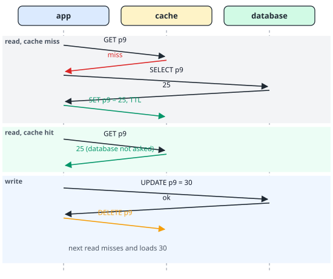

# Caching

Caching is keeping a copy of data somewhere faster, so the system doesn't have to fetch or work it out again every time. Your phone already does this when an app shows yesterday's feed straight away while the new posts load. This lesson shows where caches go in a system and the problems they cause when the copy goes out of date.

## Before you start
<!-- bite: b9f9d08d-e9c9-46be-96e5-bfc5d39e91e6 -->

You can already:

- Find a system's bottleneck from its stages' capacities, and say why a database is usually the first one → [[architecture/01-system-design-fundamentals/02-scalability-and-performance/index|scalability and performance]].
- Read p50 and p99, and work out how busy a server is from its arrival rate and work time (same lesson).
- Write async TypeScript with `await` and `Promise.all`, and run a test file with Node 26 (`node --test`).

After this lesson you will be able to:

1. Work out the hit ratio a system needs from its read rate and its database's capacity, and what that does to the average read time.
2. Explain why skewed traffic lets a cache holding a fifth of the data answer four reads in five.
3. Choose a strategy for keeping cache and database in step (cache-aside, read-through, write-through, write-behind) and say what each risks.
4. Trace how a stale value gets into a cache after a write, and how a stampede hits the database when a hot key expires, and name the fix for each.

**Study route:** sections 1–4 build the model. Stop at the predictions in sections 7 and 8 and try them before reading on. Section 9 is the worked example and section 10 the lab. If you're doing week 2's "by Sunday" question, *where would you put a cache in the URL shortener, and what goes stale?*, answer it before reading this lesson and again after.

## The kid version
<!-- bite: 5847267b-fd48-46f1-bc3b-0ccd2cb79dda -->

Doing homework in a library, you keep the books you're using on your desk instead of walking down to the basement for each fact. The desk is small, so when it's full you send back the book you haven't opened for longest. Most of what you need is in the same few books, so a small desk saves most of the walking. The catch: if the library gets a new edition of a book, the copy on your desk is now out of date, and nobody tells you.

**Where the analogy stops working.** In a real system there are many desks: every server, every browser and the edge network can each hold their own copy, and each goes out of date separately. Also, the basement in the analogy never gets crowded. A real database does, so if all the desks are cleared at once, everyone goes down to the basement together and it stops coping. Most of this lesson is about those two problems.

## 1. Why this exists
<!-- bite: 7592d189-691b-421b-9ee3-8e6737976dde -->

Week 1's shop has a product catalogue of 50,000 items. At peak, product pages ask for 5,000 products a second. Each lookup takes the database about 20 ms, and the database can serve about 2,000 of these reads a second before it's full. So the database is the bottleneck: it gets 5,000 reads a second and can do 2,000. A bigger database helps only up to a point, and the next sale will be bigger. But most of those 5,000 reads ask for the same few hundred popular products, whose details barely change from one minute to the next. Asking the database the same question thousands of times a second, and getting the same answer every time, is the waste a cache removes.

## Terms used in caching
<!-- bite: 632df34f-d9b1-46e7-b560-918ce622ee29 -->

1. **Cache**: This is a small, fast store, usually memory, that keeps copies of the results of slow work (a database query, a computation, a rendered page) so repeat requests can skip that work.
2. **Source of truth**: This is the store that holds the real, authoritative data, usually the database. The cache only ever holds copies of it.
3. **Hit**: This is a request the cache can answer, because it holds the value.
4. **Miss**: This is a request the cache can't answer, so the value must be loaded from the source of truth.
5. **Hit ratio**: This is the share of requests that are hits. A hit ratio of 0.8 means 4 in 5 requests are answered from the cache.
6. **Stale**: A cached value is stale when the source of truth has changed and the cache still holds the old value.
7. **TTL (time to live)**: The letters stand for those words. This is how long an entry may be served before it counts as expired and the next request is treated as a miss. It puts an upper limit on how stale a value can get.
8. **Eviction**: This is removing an entry to make room for a new one when the cache is full.
9. **LRU (least recently used)**: The letters stand for those words. This is an eviction rule that removes the entry that has gone longest without being read.
10. **LFU (least frequently used)**: The letters stand for those words. This is an eviction rule that removes the entry read the fewest times.
11. **Invalidation**: This is removing or updating a cached entry because its source of truth has changed.
12. **Working set**: This is the set of items that are being asked for over a period of time. If the working set fits in the cache, almost every request is a hit.
13. **Hot key**: This is one cache entry that receives a large share of all requests, such as the product on the front page during a sale.
14. **Cold cache**: This is a cache that is empty or nearly empty, for example just after it restarts, so almost every request is a miss.
15. **Stampede**: This is also known as the **thundering herd**. It happens when a hot key expires and every request that arrives before it's reloaded misses and goes to the database at the same moment.
16. **Request coalescing**: This is letting concurrent misses for one key share a single load from the database instead of each making its own.
17. **Jitter**: This is a small random amount added to a TTL, so entries written at the same moment don't all expire at the same moment.

## 2. Where caches live
<!-- bite: 925c4a45-6f70-44a4-9842-c7575a2b0bf8 -->

Caches sit at every layer between the user and the database, and a single request may pass through several:

- **Browser.** The server's `Cache-Control` header tells the browser how long it may reuse a response, for example `Cache-Control: max-age=300`. A repeat request then never leaves the user's machine.
- **CDN, or edge.** Servers near the user hold copies of static files such as images, scripts and video, and sometimes of whole pages. [[architecture/02-building-blocks/01-load-balancing-and-proxies/index|Load balancing and proxies]] covers CDNs.
- **Reverse proxy.** Nginx or Varnish in front of the application can keep whole responses.
- **Application.** Either an in-process cache, which is a map in the server's own memory, or a shared cache such as Redis or Memcached, which is a fast in-memory key-value store that every server talks to over the network. The shared cache is the workhorse of system design.
- **Database.** The database keeps recently read pages in its own memory (the buffer cache). You get it for free, but it still costs a query.

The in-process cache is the fastest, with no network round trip, but each server holds its own copy. Four servers mean four copies, which go stale separately, and an invalidation has to reach all four. A shared cache is one copy that every server sees, at the cost of a network hop of about a millisecond. More layers mean more speed, but also more places where a value can be stale.

## Seeing the cache layers
<!-- bite: 3f811eb5-ce8a-45e4-ab29-1a9acfbee75b -->

A read starts at the top. Each layer answers what it can, and only a miss goes down to the next one, so the database sees only what every layer above it missed.


## 3. The arithmetic: what a hit ratio buys
<!-- bite: 9530b3a8-a417-4666-814c-947a0578ef0d -->

In words: every read asks the cache first, and only the misses go on to the database. So the database sees the read rate times the miss share, and the average read time is the cache's time plus the miss share of the database's time.

With $R$ for reads a second, $h$ for the hit ratio, $t_c$ for the cache's time and $t_d$ for the database's:

$$\text{database reads a second} = R(1 - h) \qquad \text{average read} = t_c + (1 - h)\,t_d$$

For the shop, with 5,000 reads a second, a 1 ms cache and a 20 ms database:

```text
hit ratio            0       0.8      0.9      0.99
database reads/s  5,000    1,000      500        50
average read      21 ms     5 ms   3.0 ms    1.2 ms
```

Two things stand out. First, **the misses are what matter.** Going from 0.9 to 0.99 looks like a small step, but it cuts the database's load from 500 to 50, a factor of ten. Talk about the miss ratio, not the hit ratio, when deciding whether a cache is good enough. Second, **the last column is also the failure case read backwards.** If the cache goes down, the hit ratio drops to 0 and the database gets all 5,000 reads a second at once. A database sized for 1,000 doesn't survive that. Once a cache takes most of the load, the system depends on it, and it needs the same care as the database: replicas, monitoring, and a plan for a restart (section 8).

## 4. Why a small cache answers most reads
<!-- bite: 817824d4-d54b-4676-a0a4-6ffeb570a882 -->

If every product were equally popular, a cache holding 20% of the catalogue would answer about 20% of reads. Real traffic isn't like that. A few items are very popular and there's a long tail of items rarely asked for. A common model for this is the **Zipf distribution**: the item ranked $k$ is requested in proportion to $1/k$, so the most popular product is asked for twice as often as the second and ten times as often as the tenth.

The lab sends 200,000 Zipf-distributed reads over 50,000 products through LRU caches of different sizes:

```text
cache size (share of catalogue)    500 (1%)   2,500 (5%)   5,000 (10%)   10,000 (20%)
hit ratio                           0.48        0.65         0.72          0.80
```

**One per cent of the catalogue answers nearly half the reads.** Each doubling of the cache adds roughly the same seven or eight points, so the first megabytes buy far more than the last. This is why caching is usually the first move under read load, and why the question to ask is "how skewed is my traffic?" before "how big a cache can I afford?". The more skewed the traffic, the smaller the cache you need. If your traffic is close to uniform, such as a background job reading every record once, a cache barely helps, because there's nothing to reuse.

## 5. Keeping the cache and the database in step
<!-- bite: 69414b5b-c232-4a5d-b67d-a537775fb665 -->

The core design choice is who writes to the cache, and when:

1. **Cache-aside**, also called lazy loading. The application checks the cache. On a miss, it reads the database, puts the result in the cache, and returns it. On a write, it updates the database and then deletes the cached entry, so the next read loads the new value. This is the most common pattern: only data that's actually requested gets cached, and if the cache is down the application can still read the database. The costs: the first read of each key is slow, and a stale value is possible (section 7).
2. **Read-through.** The same as cache-aside, but the cache library does the loading: the application only ever talks to the cache. The behaviour and the risks are the same; the code is tidier.
3. **Write-through.** Every write goes to the cache and the database together, before the write is acknowledged. Reads of recently written data are always fresh, but every write is slower, because it does two writes, and the cache fills with data that may never be read.
4. **Write-behind**, also called write-back. Writes go to the cache, which writes them to the database later, in batches. Writes are fast and the database sees fewer, larger writes. The risk: if the cache dies before it writes, those writes are lost. That's the same trade as [[languages/01-java/06-applied-systems/03-batch-processing-and-performance|batched writes]] anywhere: throughput for durability. Never use it for data you can't afford to lose, such as orders or payments.
5. **Refresh-ahead.** The cache reloads popular entries shortly before they expire, so hot data never misses. It costs some loads for entries that turn out not to be needed again.

Most systems use cache-aside with a TTL on every entry, and reach for the others only for specific data.

## Seeing cache-aside reads and writes
<!-- bite: d292396f-4910-4dfe-8317-7613502643bc -->

Time runs down the page. On a miss the app does three trips: ask the cache, read the database, fill the cache. On a hit it does one. On a write it updates the database first and then deletes the cached copy, so the next read loads the new value.


## 6. Eviction: the cache is finite
<!-- bite: 8cfdc36e-337e-4b33-b09d-0ac9fb9b9d66 -->

A cache has a memory limit, so when it's full, something must go:

- **LRU** evicts the entry that has gone longest without being read. It's the common default, because something read recently is likely to be read again soon. The lab's `LruCache` does it with a JavaScript `Map`, which remembers insertion order: a read deletes the key and adds it again, moving it to the back, so the key at the front is always the least recently used.
- **LFU** evicts the entry read the fewest times. It's better when the popular set is stable, because one burst of reads for an unpopular item doesn't push out a steadily popular one. Plain LFU is slow to forget items that were popular yesterday, so real caches use variants with counts that decay over time.
- **FIFO (first in, first out)** evicts the oldest entry, however popular it is. It's simple, but it throws out hot entries just for being old.
- **TTL** isn't an eviction rule for a full cache, but it removes entries too: an expired entry is treated as a miss. Redis combines the two: it expires keys by their TTL, and when memory is full it evicts by the policy you set, such as `allkeys-lru`, an approximation of LRU. Its default, `noeviction`, refuses new writes instead, which surprises people who expected a cache.

Size the cache to the working set: if the items asked for in a typical few minutes fit in memory, most reads hit, whichever policy you choose.

## 7. Invalidation, and how a stale value gets in
<!-- bite: 8b06da66-e2b4-4282-af1a-7a8fb348cdc5 -->

Keeping cached copies consistent with the source of truth is the hard problem. The options:

- **TTL only.** Accept that a value can be up to one TTL out of date. It's simple, it works across any number of servers, and it's usually good enough.
- **Delete on write.** When the application changes a value, it deletes the cached copy. This is fresher, but every code path that writes must remember to do it, including scripts, admin tools and other services. One missed path leaves a value stale until something else removes it.
- **Write-through.** Update the cache as part of the write.

The judgement is **how much staleness this data can tolerate**, the same [[architecture/01-system-design-fundamentals/04-cap-and-consistency|consistency]] question that runs through system design. A product description can be an hour out of date. A price shown on a page can be a minute out of date, as long as checkout charges the price in the database. A stock count that decides whether to sell the last item shouldn't come from a cache at all.

Delete-on-write looks watertight, but it isn't. Follow one reader and one writer, with the price of product 42 at 10 in the database and nothing cached:

1. A reader misses the cache and reads 10 from the database. Its answer is delayed: a garbage-collection pause, a slow network.
2. A writer saves the new price, 12, to the database, then deletes the cached entry. There isn't one yet, so the delete does nothing.
3. The reader's answer arrives, and it writes 10 into the cache.

**Predict before reading on.** What will the next read return, and for how long?

<details>
<summary>After your prediction</summary>

It returns 10, although the database says 12, and it keeps returning 10 until the entry expires. Nothing else will remove it: the write that should have invalidated it has already happened. This is why **every entry gets a TTL even when you invalidate on write**: the TTL is what puts an upper limit on the damage from races like this one, and from write paths that forget to invalidate. The lab's test `delete-on-write can still leave a stale value` plays out exactly these three steps. The practice task asks you to narrow the window.

</details>

## Seeing the race that leaves a stale value
<!-- bite: efec8fac-4425-4c14-985b-864bd5cbd43e -->

Follow the three steps down the page. The writer's delete happens while the reader is stalled, so it deletes nothing. The reader's late `SET` then puts the old price in the cache.


## 8. The stampede, and the cold start
<!-- bite: c5619c1a-b1af-4027-9e37-4c1f65d2a558 -->

A hot key is cheap while it's cached. The danger is the moment it isn't.

Say product 7 is on the front page during a flash sale, and 2,000 reads a second ask for it. Its entry expires. Loading it from the database takes 20 ms, and during those 20 ms every request also misses.

**Predict before reading on.** How many requests go to the database for product 7 before the cache is filled again?

<details>
<summary>After your prediction</summary>

About 2,000 × 0.02 = 40, all asking the same question at once, where one would have done. With a slow query or a hotter key it's thousands, and the extra load makes the database slower, so the window grows and even more requests miss. That feedback is how a stampede takes a database down. The lab sends 100 concurrent reads at an expired key: without coalescing the database sees 100 loads, and with it, 1.

</details>

The fixes:

1. **Request coalescing.** The first miss starts the load and later misses wait for it. In one process that's a map of loads in progress, which is what `CacheAside` does with `coalesce: true`. Across many servers it needs a short lock in the shared cache, so only one server loads.
2. **Jitter.** Entries written together, for example when a cache is first filled, expire together. Adding ±10% to each TTL spreads 1,000 expiries over twelve seconds instead of one instant.
3. **Refresh-ahead**, for the few keys hot enough to matter: reload them before they expire, so they never miss.
4. **Serve stale while reloading.** Keep serving the expired value for a few seconds while one request reloads it. HTTP has this built in: `Cache-Control: stale-while-revalidate=30`.

A **cold cache** is the same problem for every key at once. After a cache restart or a deploy that clears it, the hit ratio is 0 and the database gets the full read rate (section 3). The defences are to warm the cache before sending it traffic, for example by replaying the most popular keys, to restart cache nodes one at a time, and to limit how fast requests reach the database while it warms.

## 9. Worked example: a cache for the product catalogue
<!-- bite: ad611305-115a-4c8e-b33c-fcd17115b1f2 -->

**The situation.** 50,000 products, 5,000 product reads a second at peak, 20 ms per database read, and a database that can serve 2,000 reads a second.

**Step 1: the target.** Week 1 said to keep a server well below full. Aim for the database to see at most about half its capacity, so 1,000 reads a second. Then $5{,}000(1 - h) \le 1{,}000$, so the hit ratio must be at least **0.8**.

**Step 2: the size.** Product traffic is skewed. If it's close to the Zipf model, section 4's table says a cache of 10,000 products, 20% of the catalogue, gives 0.80. At about 2 KB per product that's 20 MB, which costs almost nothing. The average read falls from 21 ms to 5 ms. The real hit ratio has to be measured, so log hits and misses from day one.

**Step 3: the strategy and the staleness.** Cache-aside, in a shared Redis so the four app servers see one copy, with delete-on-write when staff edit a product. Each piece of data gets its own staleness budget:

- **Description and images:** TTL of an hour. An edit is visible at once through delete-on-write, and the TTL covers any missed path.
- **Price on the page:** TTL of 60 seconds. Checkout reads the price from the database, never the cache, so a stale page price can't change what a customer pays.
- **Stock count:** not cached for the "can I sell this?" decision, which happens in a database transaction. A "low stock" badge on the page can be cached for 30 seconds.

**Step 4: the failure modes.** The flash-sale product is a hot key: turn on coalescing so its expiry costs one database read, not forty. Add ±10% jitter to every TTL. Decide what happens if Redis goes down. The database can't take 5,000 reads a second, so the plan has three parts: Redis with a replica that takes over, a small in-process cache of the top few hundred products on each app server as a second layer, and a limit on database reads, so the shop shows errors for some pages rather than falling over entirely.

Notice what the cache didn't fix: writes. Every order still writes to the database, and in week 1 that was the next bottleneck. Caching takes read load off; it does nothing for write load.

## 10. Runnable example: a cache in front of a slow store
<!-- bite: 0ee49047-d166-4ec9-b792-eb5c0f0e938b -->

`cache.ts` has an LRU cache with TTLs and an injected clock, cache-aside with optional coalescing, the arithmetic from section 3, TTL jitter, and a Zipf traffic generator. `cache.test.ts` checks every number in this lesson and plays out the stale-read race and the stampede. It reuses the seeded random number generator from [[architecture/01-system-design-fundamentals/02-scalability-and-performance/index|week 1's lab]], so the traffic is the same on every run.

```ts
// cache.ts — a cache in front of a slow store: a size-limited LRU cache with expiry, the cache-aside pattern with
// request coalescing, and the arithmetic that says how much a cache takes off the database.
// The clock is passed in, so tests can move time forward instead of waiting.

interface Entry<V> {
  value: V;
  expires: number; // the clock time after which this entry is stale and must not be served
}

/** Holds at most `max` entries. When full, it evicts the least recently used one. Each entry expires after its TTL. */
export class LruCache<V> {
  #max: number;
  #now: () => number;
  #entries = new Map<string, Entry<V>>(); // a Map keeps insertion order: the first key is the least recently used

  constructor(max: number, now: () => number = Date.now) {
    if (max < 1) throw new RangeError("a cache needs room for at least one entry");
    this.#max = max;
    this.#now = now;
  }

  get(key: string): V | undefined {
    const entry = this.#entries.get(key);
    if (entry === undefined) return undefined;
    if (this.#now() >= entry.expires) {
      this.#entries.delete(key); // expired: treat it as a miss
      return undefined;
    }
    this.#entries.delete(key); // move it to the back: it's now the most recently used
    this.#entries.set(key, entry);
    return entry.value;
  }

  set(key: string, value: V, ttlMs: number): void {
    this.#entries.delete(key);
    this.#entries.set(key, { value, expires: this.#now() + ttlMs });
    if (this.#entries.size > this.#max) {
      const oldest = this.#entries.keys().next().value!;
      this.#entries.delete(oldest);
    }
  }

  delete(key: string): void {
    this.#entries.delete(key);
  }

  keys(): string[] {
    return [...this.#entries.keys()]; // least recently used first
  }
}

/**
 * Cache-aside: the application checks the cache first; on a miss it loads from the store and fills the cache.
 * With `coalesce`, concurrent misses for one key share a single load instead of each going to the store.
 */
export class CacheAside<V> {
  hits = 0;
  misses = 0;
  #cache: LruCache<V>;
  #load: (key: string) => Promise<V>;
  #ttlMs: number;
  #coalesce: boolean;
  #inFlight = new Map<string, Promise<V>>();

  constructor(cache: LruCache<V>, load: (key: string) => Promise<V>, options: { ttlMs: number; coalesce?: boolean }) {
    this.#cache = cache;
    this.#load = load;
    this.#ttlMs = options.ttlMs;
    this.#coalesce = options.coalesce ?? false;
  }

  async get(key: string): Promise<V> {
    const cached = this.#cache.get(key);
    if (cached !== undefined) {
      this.hits++;
      return cached;
    }
    this.misses++;
    if (this.#coalesce) {
      const pending = this.#inFlight.get(key);
      if (pending) return pending; // someone is already loading this key: wait for their answer
    }
    const loading = this.#load(key).then((value) => {
      this.#cache.set(key, value, this.#ttlMs);
      return value;
    });
    if (this.#coalesce) {
      this.#inFlight.set(key, loading);
      loading.finally(() => this.#inFlight.delete(key)).catch(() => {}); // a failed load isn't kept: the next miss retries
    }
    return loading;
  }

  /** Write to the store first, then delete the cached copy so the next read loads the new value. */
  async write(key: string, value: V, save: (key: string, value: V) => Promise<void>): Promise<void> {
    await save(key, value);
    this.#cache.delete(key);
  }
}

/** The share of reads the cache answers. */
export function hitRatio(hits: number, misses: number): number {
  return hits / (hits + misses);
}

/** Average read time: every read asks the cache, and a miss also pays for the store. */
export function averageReadMs(hitRatio: number, cacheMs: number, storeMs: number): number {
  return cacheMs + (1 - hitRatio) * storeMs;
}

/** Reads a second that still reach the store: only the misses. */
export function storeReadsPerSecond(readsPerSecond: number, hitRatio: number): number {
  return readsPerSecond * (1 - hitRatio);
}

/** A TTL spread by ±`spread` (0.1 is ±10%), so keys written together don't all expire in the same instant. */
export function jittered(ttlMs: number, spread: number, random: () => number): number {
  return ttlMs * (1 - spread + 2 * spread * random());
}

/**
 * Picks key numbers 0..keys-1 with a Zipf distribution: key k is requested in proportion to 1/(k+1)^s.
 * Real traffic looks like this: a few items are very popular and a long tail is rarely asked for.
 */
export function zipf(keys: number, s: number, random: () => number): () => number {
  const cumulative: number[] = [];
  let total = 0;
  for (let k = 0; k < keys; k++) cumulative.push((total += 1 / (k + 1) ** s));
  return () => {
    const target = random() * total;
    let lo = 0;
    let hi = keys - 1;
    while (lo < hi) {
      const mid = (lo + hi) >> 1;
      if (cumulative[mid] < target) lo = mid + 1;
      else hi = mid;
    }
    return lo;
  };
}
```

```ts
import { test } from "node:test";
import assert from "node:assert/strict";
import { averageReadMs, CacheAside, hitRatio, jittered, LruCache, storeReadsPerSecond, zipf } from "./cache.ts";
import { seeded } from "../../../../01-system-design-fundamentals/02-scalability-and-performance/labs/typescript/scaling.ts";

test("a full LRU cache evicts the entry used longest ago", () => {
  const cache = new LruCache<string>(3, () => 0);
  cache.set("a", "A", 1_000);
  cache.set("b", "B", 1_000);
  cache.set("c", "C", 1_000);
  cache.get("a"); // reading a makes it the most recently used
  cache.set("d", "D", 1_000); // full: b is evicted, not a
  assert.deepEqual(cache.keys(), ["c", "a", "d"]);
  assert.equal(cache.get("b"), undefined);
});

test("an entry is served until its TTL runs out, then it's a miss", () => {
  let now = 0;
  const cache = new LruCache<number>(10, () => now);
  cache.set("price:42", 10, 60_000);
  now = 59_999;
  assert.equal(cache.get("price:42"), 10);
  now = 60_000;
  assert.equal(cache.get("price:42"), undefined);
});

test("cache-aside: the first read misses and loads, the rest hit", async () => {
  const db = new Map([["product:7", "kettle"]]);
  let loads = 0;
  const products = new CacheAside(new LruCache<string>(100, () => 0), async (key) => {
    loads++;
    return db.get(key)!;
  }, { ttlMs: 60_000 });
  for (let i = 0; i < 5; i++) assert.equal(await products.get("product:7"), "kettle");
  assert.deepEqual({ loads, hits: products.hits, misses: products.misses }, { loads: 1, hits: 4, misses: 1 });
  assert.equal(hitRatio(products.hits, products.misses), 0.8);
});

test("the hit ratio decides how much the database still sees", () => {
  // 5,000 reads a second; the cache answers in 1 ms, the database in 20 ms.
  assert.deepEqual([0.8, 0.9, 0.99].map((h) => Math.round(storeReadsPerSecond(5_000, h))), [1_000, 500, 50]);
  assert.deepEqual([0, 0.8, 0.99].map((h) => averageReadMs(h, 1, 20).toFixed(1)), ["21.0", "5.0", "1.2"]);
  // If the cache goes down, the hit ratio is 0: the database gets all 5,000 a second at once.
  assert.equal(storeReadsPerSecond(5_000, 0), 5_000);
});

test("with skewed traffic, a small cache answers most reads, and each doubling adds less", () => {
  // 200,000 reads over 50,000 products, Zipf-distributed. The first 50,000 reads warm the cache and aren't counted.
  const ratios = [500, 2_500, 5_000, 10_000].map((size) => {
    const next = zipf(50_000, 1, seeded(1));
    const cache = new LruCache<boolean>(size, () => 0);
    let hits = 0;
    let misses = 0;
    for (let i = 0; i < 200_000; i++) {
      const key = String(next());
      const hit = cache.get(key) !== undefined;
      if (!hit) cache.set(key, true, Infinity);
      if (i >= 50_000) hit ? hits++ : misses++;
    }
    return hitRatio(hits, misses).toFixed(2);
  });
  // 1% of the catalogue answers nearly half the reads; 20% of it answers four in five.
  assert.deepEqual(ratios, ["0.48", "0.65", "0.72", "0.80"]);
});

test("a stampede: a hot key expires and every waiting request hits the database, unless they share one load", async () => {
  for (const coalesce of [false, true]) {
    let now = 0;
    let loads = 0;
    const products = new CacheAside(new LruCache<string>(100, () => now), async () => {
      loads++;
      await new Promise((resolve) => setTimeout(resolve, 5)); // the database takes a while
      return "kettle";
    }, { ttlMs: 60_000, coalesce });
    await products.get("product:7");
    now = 60_000; // the entry expires...
    loads = 0;
    const all = await Promise.all(Array.from({ length: 100 }, () => products.get("product:7"))); // ...as 100 reads arrive
    assert.ok(all.every((name) => name === "kettle"));
    assert.equal(loads, coalesce ? 1 : 100);
  }
});

test("delete-on-write can still leave a stale value, until the TTL runs out", async () => {
  let now = 0;
  const db = new Map([["price:42", 10]]);
  let release!: () => void;
  const slowRead = new Promise<void>((resolve) => (release = resolve));
  let first = true;
  const prices = new CacheAside(new LruCache<number>(100, () => now), async (key) => {
    const value = db.get(key)!; // the read happens now...
    if (first) {
      first = false;
      await slowRead; // ...but the answer is delayed
    }
    return value;
  }, { ttlMs: 60_000 });

  const reader = prices.get("price:42"); // 1. a reader misses and reads 10 from the database
  await prices.write("price:42", 12, async (key, value) => void db.set(key, value)); // 2. a writer saves 12 and deletes the cached copy (there isn't one yet)
  release();
  assert.equal(await reader, 10); // 3. the reader finishes and caches the old 10
  assert.equal(await prices.get("price:42"), 10); // stale: the database says 12
  now = 60_000;
  assert.equal(await prices.get("price:42"), 12); // the TTL is what puts a bound on the damage
});

test("jitter spreads out expiry, so keys cached together don't all miss together", () => {
  const random = seeded(3);
  const expiries = Array.from({ length: 1_000 }, () => jittered(60_000, 0.1, random));
  assert.ok(Math.min(...expiries) >= 54_000 && Math.max(...expiries) <= 66_000);
  const perSecond = new Map<number, number>();
  for (const ms of expiries) perSecond.set(Math.floor(ms / 1_000), (perSecond.get(Math.floor(ms / 1_000)) ?? 0) + 1);
  // Without jitter, all 1,000 would miss in the same second. With ±10%, they spread over 12 seconds.
  assert.ok(Math.max(...perSecond.values()) < 120, `busiest second: ${Math.max(...perSecond.values())}`);
});
```

**Lab:** the code is in [`architecture/02-building-blocks/02-caching/labs/typescript/`](https://github.com/kingsleydaprime/knowledgebase/tree/main/architecture/02-building-blocks/02-caching/labs/typescript). From the vault root, `python3 labs/run.py caching/typescript` runs the tests and checks this page still shows the same code. Inside the folder, `node --test` runs the tests alone. Expect eight passing tests in about a second, most of it the Zipf run.

## Common pitfalls
<!-- bite: 518372f7-c999-44b8-bc26-fdeb965b2018 -->

1. **Caching without a TTL.** Any missed invalidation, or the race in section 7, then leaves a value stale forever. Give every entry a TTL, even when you also delete on write.
2. **Deciding with cached data.** Show a cached price; charge the database's price. Anything that moves money or stock reads the source of truth.
3. **Forgetting the cache is now load-bearing.** At a hit ratio of 0.8 the database sees a fifth of the traffic. If the cache dies, it sees five times what it's used to. Plan for the cache being down, restarted or empty.
4. **Caching what isn't reused.** Uniform traffic, write-heavy data and per-user one-off results give low hit ratios and add a component, a failure mode and a staleness problem for little gain. Measure the hit ratio; if it's low, remove the cache.
5. **Identical TTLs for things written together.** They expire together and miss together. Add jitter.
6. **One in-process cache per server, with delete-on-write.** The delete reaches only the server that handled the write; the others keep serving the old value until their TTL runs out. Use a shared cache for data that's written, or keep in-process TTLs short.
7. **Keys that don't include everything the value depends on.** A page cached under `product:7` that's actually rendered in the user's currency shows one user's currency to everyone. The key must include every input to the value: `product:7:GBP`.

## Check your understanding
<!-- bite: 220cf70c-c828-4a19-802c-c423721efe1a -->

Try each one before you open the answer.

1. <!-- q: exact id="194094b2" answer="0.95" accept="95%|95" -->
   A service gets 12,000 reads a second. Its database can comfortably take 600 reads a second, and only cache misses reach the database. What is the lowest hit ratio the cache needs, as a decimal?

   <details><summary>Answer</summary>

   0.95. The database sees reads × (1 − hit ratio), so 12,000 × (1 − h) ≤ 600 gives 1 − h ≤ 0.05.

   </details>

2. <!-- q: exact id="5dc6b231" answer="4" -->
   Cache A has a hit ratio of 0.98 and cache B has 0.995, with the same traffic. How many times more database reads does cache A send?

   <details><summary>Answer</summary>

   4 times. Their miss ratios are 0.02 and 0.005, and 0.02 ÷ 0.005 = 4. Compare misses, not hits.

   </details>

3. <!-- q: open id="e7ffe4e6" -->
   Why can a cache holding 10% of a catalogue answer far more than 10% of reads? When would it answer only about 10%?

   <details><summary>Answer</summary>

   Traffic is usually skewed: a few popular items get most of the reads, and those stay in the cache. If every item were equally likely to be asked for, such as a batch job reading each record once, the cache would answer only about its share of the catalogue, 10%.

   </details>

4. <!-- q: mcq id="d8a9cdad" -->
   Write-behind puts writes in the cache and saves them to the database later, in batches. Why is it wrong for customer orders?

   - [ ] It makes every order slower
   - [x] The order is acknowledged before it's in the database, so if the cache dies first, the order is lost
   - [ ] Orders can't be stored in a cache
   - [ ] It fills the cache with data that's never read

   <details><summary>Answer</summary>

   Write-behind trades durability for write speed. A lost order the customer was told about is unacceptable, so orders go to the database before being acknowledged.

   </details>

5. <!-- q: mcq id="4c65ceca" -->
   A shop deletes the cached price whenever it writes a new price, yet a user sees an old price for a minute after a change. Which of these can cause it? Choose all that apply.

   - [x] A slow reader loaded the old price before the write and put it in the cache after the delete
   - [x] An admin script changed the price without deleting the cached copy
   - [x] Another server has its own in-process cache that the delete never reached
   - [ ] The cache entry had a TTL

   <details><summary>Answer</summary>

   The race, a forgotten write path and a second in-process copy all leave stale values. A TTL doesn't cause staleness; it's what puts a limit on how long these mistakes last.

   </details>

6. <!-- q: gap id="27e5a276" answers="stampede|thundering herd;coalescing|request coalescing" -->
   Fill in the gaps. When a hot key expires and every request that arrives before it's reloaded goes to the database at once, that's called a ___. Letting all those misses share a single load is called request ___.

   <details><summary>Answer</summary>

   A stampede (or thundering herd). Coalescing, jitter on TTLs and refreshing hot keys ahead of expiry are the fixes.

   </details>

## Check your understanding: worked problems
<!-- bite: bb889dbd-19b4-43a7-8aba-8add9dfa2fd6 -->

Work each one out on paper first, then type your answer.

1. <!-- q: gap id="a24ff1c1" answers="2000;2" -->
   Fill in the gaps. A service gets 20,000 reads a second with a hit ratio of 0.9. A cache read takes 0.5 ms and a database read 15 ms. The database sees ___ reads a second, and the average read takes ___ ms (cache time + miss share × database time).

   <details><summary>Answer</summary>

   20,000 × (1 − 0.9) = 2,000 reads a second. 0.5 + 0.1 × 15 = 2 ms on average.

   </details>

2. <!-- q: exact id="4df704dd" answer="120" -->
   A key is read 3,000 times a second. It expires, and reloading it from the database takes 40 ms. Without request coalescing, roughly how many loads reach the database before the cache is filled again?

   <details><summary>Answer</summary>

   About 120. Every request in the 40 ms window misses: 3,000 × 0.04 = 120. With coalescing it would be 1.

   </details>

3. <!-- q: exact id="6ce7fee5" answer="20" -->
   A service gets 20,000 reads a second and its cache's hit ratio is 0.95. The cache restarts empty, so for a while every read misses. How many times its usual load does the database now get?

   <details><summary>Answer</summary>

   20 times. Normally it sees 20,000 × 0.05 = 1,000 reads a second. With a cold cache it sees all 20,000.

   </details>

4. <!-- q: gap id="b9f2a14d" answers="1;B;E;A" -->
   Fill in the gaps. An LRU cache holds 3 entries and starts empty. It receives reads for keys A, B, C, A, D, B, E, A in that order. It gets ___ hit, and at the end it holds ___, ___ and ___, from least to most recently used.

   <details><summary>Answer</summary>

   Only the second A is a hit. D evicts B, then B evicts C, E evicts A, and the last A evicts D. The cache ends with B, E, A.

   </details>

5. <!-- q: sketch id="f803cde4" -->
   Draw a message sequence diagram on paper with three lifelines: app, cache and database. The app uses cache-aside, and the cache starts empty. User 1 reads product p9 (its price in the database is 25). Then user 2 reads p9. Then a staff member changes p9's price to 30. Draw every message, in order, with time running down the page.

   <details><summary>Answer</summary>

   

   What to check:
   - The first read is a miss that takes three trips: cache, database, then a `SET` back into the cache with a TTL.
   - The second read touches only the cache.
   - The write goes to the database first and then deletes the cache entry. It doesn't write 30 into the cache.

   </details>

## Practice — independent task
<!-- bite: bd3936b1-57ab-42e3-bd9d-c8773518005d -->

**Close the stale-read window in the lab.**

1. Copy `cache.ts` and `cache.test.ts` to a scratch folder.
2. Change `CacheAside` so that a load which started before a write to the same key doesn't put its value in the cache. It can still return its value to its caller.
3. Change the stale-read test so that the second read returns 12, not 10. Keep the other seven tests passing.
4. Add a test for the boundary: a load that starts *after* the write must still fill the cache.

**A smaller step first:** in the Zipf test, change the skew `s` from 1 to 0.8. Predict the hit ratio of the 5,000-entry cache before running it, then check.

**Done when:** all nine tests pass, and you can say in two sentences why your fix works only within one process, and what a system with several app servers would need instead.

<details>
<summary>Hints — after your attempt</summary>

- Give each key a version number that `write` increments. Read the version before starting the load, and in the `then`, set the cache only if the version hasn't changed.
- Several app servers don't share your in-memory version numbers. Real systems keep the version in the shared cache, or give the first missing reader a short-lived "lease" token that a write cancels. Facebook's memcache paper describes leases.
- The smaller step: about 0.46. Less skew means the popular items take a smaller share, so the same cache answers less.

</details>

## Tradeoffs, limits and extensions
<!-- bite: 24285844-1b6c-485b-ba7b-d58990e3ab14 -->

- **The Zipf model is a model.** Real hit ratios depend on your traffic. Log hits and misses per key prefix and compute the hit ratio you actually get, before and after resizing.
- **A shared cache is another network hop and another system to run.** For data that's tiny, hot and rarely changed, such as feature flags or a country list, an in-process cache with a short TTL is simpler and faster.
- **Large or many values cost memory and network.** Caching a 1 MB page per user per request can need more memory than it saves. Cache the expensive part, such as the query result, not the whole response.
- **Negative caching.** Caching "this product doesn't exist" for a short TTL stops repeated lookups for missing keys from reaching the database. That matters when someone is scanning made-up IDs.
- **HTTP caching** has a richer vocabulary than this lesson needs: validators that let a browser ask "has this changed?", `private` versus `public`, and `Vary`. [[networking/11-http-evolution/index|HTTP and its evolution]] and [[devops/02-networking-and-web/02-web-servers-and-proxies|web servers and proxies]] go further.
- **Splitting a cache across many nodes** raises the question of which node holds which key, and what happens when a node is added. The next lesson answers it with consistent hashing.

## Before moving on
<!-- bite: 2cf9f7f8-d5da-4121-a9ca-d38758f19e93 -->

You can work out the hit ratio a system needs from its read rate and its database's capacity, explain why skewed traffic makes a small cache effective, choose a strategy for keeping cache and database in step, and trace the stale-read race and the stampede, with a fix for each.

**Recap.** A cache keeps copies of slow results in fast memory. The database sees only the misses: reads × (1 − hit ratio), so judge a cache by its miss ratio. Skewed traffic is why a small cache works; uniform traffic is why some caches don't. Cache-aside with a TTL on every entry is the default; write-through trades write speed for freshness; write-behind trades durability for write speed. Invalidation is hard because races and forgotten write paths leave stale values, and the TTL limits the damage. A hot key's expiry causes a stampede (fix: coalescing, jitter, refresh-ahead), and a cold cache sends the full load to the database. Never decide money or stock from a cached value.

**Next.** [[architecture/02-building-blocks/01-load-balancing-and-proxies/index|Load balancing and proxies]]: spreading requests over several servers, and spreading keys over several cache nodes without emptying them all when one is added.

## Related
<!-- bite: 153b2a9c-e54b-4343-84fb-41b95e7a3499 -->

- [[architecture/02-building-blocks/03-databases-at-scale|Databases at scale]]: what caching protects, and read replicas, the other way to scale reads
- [[architecture/01-system-design-fundamentals/04-cap-and-consistency|CAP and consistency]]: the staleness trade that caching makes
- [[devops/02-networking-and-web/02-web-servers-and-proxies|Web servers and proxies (DevOps)]]: proxy and CDN caching in practice
- [[build-your-own-shit/03-your-own-redis|Build your own Redis]]: the shared cache from the inside
- [[projects/munakalati/learning/04-frontend/02-data-fetching-and-caching|Data fetching and caching]]: the same ideas on the client

## About this lesson
<!-- bite: e10ae489-f10c-4969-8167-37b91e4469c3 -->

**Level:** Intermediate. **Covers:** From the roadmap.sh system-design roadmap. Caching is the highest-leverage performance tool in system design, and the home of one of the two famously hard problems in computer science: invalidation. This lesson covers where caches live, the arithmetic that says how much load a cache takes off a database, why a small cache answers most reads, how cache and database are kept in step, and the two failures caching adds: stale data and the stampede. The worked example carries on with week 1's shop, now putting a cache in front of its product catalogue. The lab checks every number.
