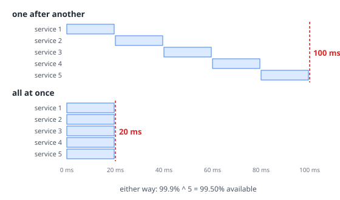

# Communication

Communication here means the ways the different services inside a system talk to each other over the network. Every time you open an app, one request from your phone may set off many requests between servers behind the scenes. This lesson compares the main ways of making those calls and when to wait for an answer or not.

## Before you start
<!-- bite: 0cfcab47-bbb7-4e67-9bdf-c8e81471b132 -->

You can already:

- Say what an HTTP request is made of (method, path, headers, body) and what a round trip is → [[networking/11-http-evolution/index|HTTP and its evolution]] (a skim is enough).
- Explain why a synchronous call couples the caller to the callee, and what a queue changes → [[architecture/02-building-blocks/04-messaging-and-async/index|messaging and async]].
- Write async TypeScript, and run a test file with Node 26 (`node --test`).

After this lesson you will be able to:

1. Count the requests, round trips and bytes a screen costs with REST and with a GraphQL query, and say when each wins.
2. Explain the N+1 problem in a GraphQL server, and how batching turns 41 queries into 3.
3. Encode a small message in Protocol Buffers by hand, and say why it's smaller than JSON.
4. Work out the availability and latency of a chain of synchronous calls, and choose between polling, server-sent events and WebSockets for live updates.
5. Write a `.proto` schema, serve it with gRPC, and call it with a deadline, handling its status codes and a server stream.

**Study route:** sections 1–3 set up the costs. Stop at the predictions in sections 3, 4 and 5 and try them before reading on. Section 10 is the worked example, section 11 the lab, and section 12 the hands-on gRPC lab. Sections 8 and 9 are shorter and can be read on their own.

## The kid version
<!-- bite: cb2d3b0a-bd86-4410-81de-16fc0175cd93 -->

You can get things from a shop three ways. You can walk the aisles yourself, picking up a whole box of cereal when you only wanted to know its price, and going back for each item you forgot: that's REST. You can hand the shopkeeper a list saying exactly what you want, and they fetch it all in one trip, though now they do the running around: that's GraphQL. Or, if you're a shopkeeper ordering from your regular supplier, you both use a printed order form with numbered boxes, so you write "3: 12" instead of "number of boxes of cereal: twelve": that's gRPC.

**Where the analogy stops working.** In a shop, the shopkeeper fetching ten items is one trip for you. In a server, a GraphQL query for ten orders can make the server go to the database 41 times unless it's careful (section 4). The trips didn't disappear; they moved to where you can't see them.

## 1. Why this exists
<!-- bite: da21c63d-2369-4634-b531-7faf3ff33e17 -->

The shop's mobile app has an order page: the order number, the total, the customer's name, and each item's name and quantity. Over the shop's REST API that's five requests: the order, then the customer, then three products. Each product comes back with its full description, the customer with their email and address, none of it shown. On a phone, each round trip to the server takes about 150 ms, so the page waits for that several times over. Meanwhile, inside the data centre, the checkout service calls payments, stock and pricing thousands of times a second, where every millisecond and every byte of JSON parsing adds up. And the order page should update when the parcel ships, without the user pulling to refresh. One API style doesn't suit all three, and this lesson is about choosing.

## Terms used in communication
<!-- bite: add8fca0-6d7c-4819-add5-c0c65c5a4fb6 -->

1. **API (application programming interface)**: The letters stand for those words. It's the set of requests one program accepts from another, and what it answers.
2. **REST (representational state transfer)**: The letters stand for those words. It's an API style where each thing is a **resource** at its own URL, read and changed with the HTTP methods `GET`, `POST`, `PUT` and `DELETE`, usually as JSON.
3. **Round trip**: This is one request going to a server and its answer coming back. Requests sent together share one round trip; a request that needs an earlier answer waits for another.
4. **Over-fetching**: This is receiving more data than the screen needs, because the endpoint always returns the whole resource.
5. **Under-fetching**: This is needing several requests to build one screen, because each endpoint returns only one resource.
6. **GraphQL**: This is a query language for APIs in which the client sends one request describing exactly which fields it wants, possibly across related objects, and gets back exactly those.
7. **Resolver**: In a GraphQL server, this is the function that fetches the value of one field, such as an order's customer.
8. **N+1 problem**: This is fetching a list with one query and then one more query for each item in it, so N items cost N + 1 queries.
9. **DataLoader**: This is a pattern, and a library of that name, that collects the keys requested during one step of work and fetches them in a single batch.
10. **RPC (remote procedure call)**: The letters stand for those words. It's an API style that looks like calling a function on another machine: `GetOrder(id)` rather than `GET /orders/id`.
11. **gRPC**: This is Google's RPC framework. It sends Protocol Buffers over HTTP/2 and generates client and server code from a schema.
12. **Protocol Buffers**: This is also called **protobuf**. It's a binary format for messages, defined by a schema that numbers each field.
13. **Varint**: This is a way of writing a whole number in as few bytes as it needs, 7 bits per byte, used throughout Protocol Buffers.
14. **Server-sent events**: This is a standard way for a server to keep an HTTP response open and send a stream of updates down it to the browser.
15. **WebSocket**: This is a connection that starts as an HTTP request and then becomes a two-way channel where either side can send messages at any time.

## 2. REST
<!-- bite: a39fb5ac-29ed-4973-86c7-548965175800 -->

Resources at URLs, verbs for what to do with them: `GET /orders/o1`, `POST /orders`, `DELETE /orders/o1`. It's the default for public and web APIs, and for good reasons:

- **Simple and universal.** Every language and tool speaks HTTP and JSON; `curl` is a client.
- **Cacheable.** A `GET` is safe to repeat, so browsers, CDNs and proxies can cache it with the `Cache-Control` rules from [[architecture/02-building-blocks/02-caching/index|caching]]. A product page can be served from the edge without reaching your servers.
- **Stateless.** Each request carries everything needed, which is what lets the [[architecture/02-building-blocks/01-load-balancing-and-proxies/index|load balancer]] send it to any server.

Its weaknesses are over-fetching and under-fetching, and no enforced contract unless you add one with OpenAPI ([[backend/frameworks/spring-boot/03-api-design-and-documentation|REST and OpenAPI design]]).

## 3. Counting the cost of one screen
<!-- bite: 946f3b1b-39f0-4978-8b8d-508db2f61b90 -->

The order page needs about 200 bytes of data: the order's ID and total, a name, and three item names with quantities. Over REST, the app asks for the order first, because only the order says which customer and products to ask for. It then asks for the customer and the three products together.

**Predict before reading on.** How many requests, how many round trips, and roughly how many bytes compared with the 200 the page shows?

<details>
<summary>After your prediction</summary>

**Five requests over two round trips**, sending **912 bytes** for a screen that uses **203**. More than three-quarters of what came down the wire was product descriptions, an email and an address, thrown away by the app. Sent one at a time instead of in two waves, the same five requests take five round trips: 750 ms on a 150 ms mobile connection, instead of 300 ms. The lab's REST test counts all of this.

</details>

REST has answers to both problems: endpoints shaped for a screen (`/order-pages/o1`), parameters that choose fields and embed related resources (`?fields=…&include=customer`), or a backend-for-frontend service that assembles each app's screens ([[architecture/03-architectural-patterns/04-microservices-patterns|microservices patterns]]). Each answer is more endpoints to build and keep in step with the screens. GraphQL is the general answer.

## 4. GraphQL, and the N+1 problem
<!-- bite: 0057a5ee-efa6-42ba-95ce-3ef273d412d0 -->

The client sends one query naming exactly the fields it wants:

```graphql
{ order(id: "o1") { id totalPence customer { name } items { quantity product { name } } } }
```

The server walks the query. For each field it either reads the value from the object it already has, or calls that field's **resolver** to fetch it. The answer has exactly the shape of the query. In the lab, it's the same 203-byte screen as before, in **one request and one round trip**, with nothing extra sent.

The cost moved to the server. Resolvers are written one field at a time: "an order's customer is `findCustomers([order.customerId])`". That's fine for one order. Now ask for a page of ten orders, each with its customer's name and its items' product names.

**Predict before reading on.** With resolvers that each fetch one row, how many database queries does that page take?

<details>
<summary>After your prediction</summary>

**41.** One query for the ten orders, then one per order for its customer (10), then one per item for its product (10 orders × 3 items = 30). That's the **N+1 problem**, and it's invisible from the client, which sent one request. With a **DataLoader**, each resolver still asks for one customer, but the loader waits until every resolver in the current step has asked, then fetches all the keys in one query: `WHERE id IN (…)`. The page then takes **3** queries: orders, customers and products. The lab's `DataLoader` waits with `setImmediate` and removes duplicate keys, since ten orders ask for the same three products thirty times.

</details>

Other costs to weigh before choosing GraphQL:

- **Caching is harder.** Queries usually go as `POST` requests to one URL, so HTTP caches and CDNs can't cache them without extra work (persisted queries sent as `GET` requests).
- **Clients can ask for a lot.** A deeply nested query can be expensive, so servers limit query depth and cost.
- **More moving parts** on the server: a schema, resolvers, loaders.

It's powerful when many clients need different shapes of the same data, such as a web app, two mobile apps and partners. It's overkill for a simple CRUD API with one client.

## Seeing REST and GraphQL side by side
<!-- bite: ae9adc84-674d-4121-ac6f-5fdd543c361a -->

Time runs down the page, and each orange band is one round trip. REST needs two, because the app can't ask for the customer and products until the order tells it which ones. GraphQL names every field up front, so one round trip brings back exactly the screen.


## 5. gRPC and Protocol Buffers
<!-- bite: 7462e48f-fab0-4140-9989-7e231b36cb1f -->

For service-to-service calls inside a system, gRPC is the usual choice. You write a schema:

```protobuf
message OrderSummary {
  uint32 id = 1;
  string customer = 2;
  uint32 total_pence = 3;
}
service Orders {
  rpc GetSummary(GetSummaryRequest) returns (OrderSummary);
}
```

and generate a typed client and server in each language from it. Calls go over HTTP/2, which carries many calls at once on one connection and supports streaming in both directions.

Messages are small because of how they're encoded. A field isn't sent by name, but as a **tag**: its number times 8, plus a **wire type** (0 for a varint, 2 for length-prefixed bytes such as a string). Whole numbers are **varints**: 7 bits per byte, lowest bits first, with each byte's top bit set if another byte follows. Encode `id = 150`:

1. The tag: field 1, wire type 0, is 1 × 8 + 0 = 8, which fits in one byte: `08`.
2. 150 in binary is `1001 0110`. The lowest 7 bits are `001 0110` (22). There's more to come, so set the top bit: 22 + 128 = 150 = `96`. (That this byte equals 150 again is a coincidence that holds for 128–255.)
3. What's left is 150 ÷ 128, rounded down: 1. Nothing follows, so the byte is `01`.

So `id = 150` is three bytes, `08 96 01`, exactly as in the Protocol Buffers documentation. A string is its tag, then its length, then its UTF-8 bytes: field 2 = "testing" is `12 07 74 65 73 74 69 6e 67`.

**Predict before reading on.** The order summary `{ id: 1, customer: "Gbenga Ali", totalPence: 8996 }` is 50 bytes as JSON. About how many as protobuf?

<details>
<summary>After your prediction</summary>

**17 bytes**: 2 for the ID (tag and value), 12 for the name (tag, length and 10 letters), and 3 for the total (8,996 needs two varint bytes). JSON spends its extra 33 bytes on field names, quotes and punctuation, and on writing numbers as text. Binary is also faster to parse. The costs: you can't read it without the schema, and browsers can't call gRPC directly, since they need a proxy such as gRPC-Web. That's why gRPC is rarely the choice for a public API.

</details>

## Seeing the varint bytes
<!-- bite: 96be99ad-6f9c-4dda-a7db-2d16b3af86b4 -->

Read from top to bottom. 150 needs eight bits, more than one 7-bit group, so it's split in two. The low group goes first with a top bit of 1 ("more follows"), and the high group goes last with a top bit of 0.


## 6. The quick chooser
<!-- bite: 524f9a5f-fa43-4d9f-8926-2c246d21831b -->

| Use case | Reach for |
|---|---|
| Public API, web, simplicity, HTTP caching | **REST** |
| Many clients needing different shapes of the same data, mobile | **GraphQL** |
| Internal service-to-service, high volume, typed contracts, streaming | **gRPC** |
| The caller doesn't need the answer now | a **message** ([[architecture/02-building-blocks/04-messaging-and-async/index\|messaging]]) |

Most systems use several: REST or GraphQL at the edge, gRPC inside, messages between services that don't need to wait.

## 7. Synchronous chains
<!-- bite: 97f05bd4-c591-45a1-946e-31b8830695dd -->

Separately from the style, a call is either synchronous (the caller waits) or asynchronous. Synchronous calls are simple and give an answer now, but they couple the caller to the callee: if the callee is slow or down, so is the caller.

In words: when a request has to pass through several services one after another, it succeeds only if all of them are up, so their availabilities multiply. It also waits for each in turn, so their latencies add up. Calls that don't depend on each other can go out together, and then the request waits only for the slowest.

With $A_i$ for each service's availability and $t_i$ for its latency:

$$A_{\text{chain}} = \prod_i A_i \qquad t_{\text{sequential}} = \sum_i t_i \qquad t_{\text{parallel}} = \max_i t_i$$

Five services at 99.9% each give 99.50%. That's five times the downtime of one service, about 3.6 hours a month instead of 43 minutes. Five 20 ms calls one after another take 100 ms. The fixes: make independent calls in parallel, cut services out of the path, cache what can be cached, and turn calls whose answer isn't needed now into messages. [[architecture/01-system-design-fundamentals/03-availability-and-reliability|Availability and reliability]] goes further.

## Seeing a chain one after another and all at once
<!-- bite: ee65e5f4-4501-4b3a-93ab-4d5ae7d67721 -->

Each bar is one 20 ms call. Called one after another, the waits add up to 100 ms. Sent together, the request waits only for the slowest, 20 ms. Neither changes the availability: all five still have to be up.



## 8. Pushing updates: polling, server-sent events, WebSockets
<!-- bite: 05d83747-f03e-4d9f-9d4e-ad39154e776a -->

HTTP is request and response: the client asks, the server answers. When the server has news, such as "your parcel shipped", there are four ways to get it to the client:

- **Polling.** The client asks every few seconds. It's simple and works everywhere, but most requests come back with nothing new, and an update waits up to one interval.
- **Long polling.** The client asks, and the server holds the request open until there's news or a timeout, then the client asks again. Updates arrive almost at once, at the cost of a held request per client.
- **Server-sent events.** One HTTP response stays open, and the server writes events into it as they happen. The browser reconnects automatically. It's one direction only, server to client, and it's plain HTTP, so proxies and load balancers handle it.
- **WebSockets.** The connection is upgraded to a two-way channel where either side can send at any time. It's needed when the client sends often too, as in chat, games and collaborative editing. The costs: each connection is held open on one server, so the load balancer must support it, scaling means tracking which server holds which user, and messages need your own protocol on top.

Use the simplest that meets the need: polling for "check every minute", server-sent events for a stream of server updates, WebSockets when both sides talk. Week 7's chat design goes deeper.

## Seeing the four ways to push updates
<!-- bite: 818553aa-6d85-41fc-ac11-eb6b80948e0e -->

Each column has the client on the left and the server on the right, with time running down. The orange dots are the moments the server has news. Notice how many polling requests come back empty, and how the other three get the news as soon as it happens.


## 9. The protocols underneath
<!-- bite: 2bc50bbf-2eeb-4df2-a89a-08fb803343e8 -->

These all ride on the same stack ([[devops/02-networking-and-web/01-networking-and-protocols|networking and protocols]]):

- **HTTP/1.1** sends one request at a time per connection.
- **HTTP/2** carries many at once on one connection; it's what gRPC uses.
- **HTTP/3** runs over QUIC on UDP, so a lost packet doesn't stall the other requests sharing the connection.
- **TCP** is reliable and ordered, and underneath most APIs. **UDP** is send-and-forget, used for video, voice, DNS and QUIC.
- **TLS** encrypts all of it ([[cybersecurity/04-web-security/03-https-and-tls|HTTPS and TLS]]).

## 10. Worked example: a style for each of the shop's connections
<!-- bite: e6863917-038a-4155-b9c9-9e3a27a1a86c -->

**The mobile app's screens:** GraphQL. Two apps and the website each need different shapes of orders, products and customers, and phones pay for every round trip: the order page goes from two round trips and 912 bytes to one round trip and 203 bytes, 150 ms instead of 300 on a 150 ms connection. The server uses DataLoaders from day one, and limits query depth.

**The product catalogue for the website:** REST. Product pages are the same for everyone, and `GET /products/p1` with `Cache-Control: max-age=60` lets the CDN serve most of them. This is the case GraphQL handles worst.

**Checkout to payments, stock and pricing:** gRPC. These are internal, called thousands of times a second, and benefit from a typed contract that fails at build time when a field changes. Pricing and stock don't depend on each other, so checkout calls them in parallel: max(30, 20) = 30 ms instead of 50.

**Invoices, analytics and the warehouse:** messages, as in [[architecture/02-building-blocks/04-messaging-and-async/index|messaging and async]]. Checkout doesn't wait for any of them, which also takes them out of the availability chain.

**"Your parcel shipped":** server-sent events on the order page while it's open, and nothing when it isn't. The client never sends anything back on that channel, so WebSockets would add cost for nothing.

## 11. Runnable example: the costs, counted
<!-- bite: b8c8c14f-77b4-4470-a660-21565dc76fd1 -->

`communication.ts` has a small shop database that counts queries, a REST API that counts requests and bytes, a GraphQL-style executor with resolvers and a DataLoader, a varint and protobuf encoder, and the chain arithmetic. `communication.test.ts` checks every number in this lesson, including the Protocol Buffers documentation's own example bytes. The shop data is in [`labs/shared/shop.json`](https://github.com/kingsleydaprime/knowledgebase/tree/main/architecture/02-building-blocks/05-communication/labs/shared), shared with the other languages' labs.

```ts
// communication.ts — what an API style costs, counted: requests, round trips and bytes for one screen fetched with
// REST and with a GraphQL-style query; the N+1 queries a naive resolver makes and the batching that fixes them;
// how Protocol Buffers encode a message in fewer bytes than JSON; and what calling services in a chain does.

export interface Customer { id: string; name: string; email: string; address: string }
export interface Product { id: string; name: string; pricePence: number; description: string }
export interface Order { id: string; customerId: string; items: { productId: string; quantity: number }[]; totalPence: number }

/** A tiny shop database that counts its queries. */
export class Db {
  queries = 0;
  customers = new Map<string, Customer>();
  products = new Map<string, Product>();
  orders = new Map<string, Order>();

  findOrders(ids: readonly string[]): Order[] {
    this.queries++;
    return ids.map((id) => this.orders.get(id)!);
  }

  /** One query for any number of customers: SELECT … WHERE id IN (…). */
  findCustomers(ids: readonly string[]): Customer[] {
    this.queries++;
    return ids.map((id) => this.customers.get(id)!);
  }

  findProducts(ids: readonly string[]): Product[] {
    this.queries++;
    return ids.map((id) => this.products.get(id)!);
  }
}

/** A REST API over the database: one resource per URL, always returned whole. It counts requests and bytes sent. */
export class RestApi {
  requests = 0;
  bytes = 0;
  #db: Db;

  constructor(db: Db) {
    this.#db = db;
  }

  get(path: string): unknown {
    const [, kind, id] = path.split("/"); // "/orders/o1" → "orders", "o1"
    const body =
      kind === "orders" ? this.#db.findOrders([id])[0]
      : kind === "customers" ? this.#db.findCustomers([id])[0]
      : kind === "products" ? this.#db.findProducts([id])[0]
      : undefined;
    if (body === undefined) throw new Error(`404 ${path}`);
    this.requests++;
    this.bytes += JSON.stringify(body).length;
    return body;
  }
}

/** What the order screen shows: the order, who placed it, and each item's name and quantity. */
export interface OrderScreen {
  id: string;
  totalPence: number;
  customer: { name: string };
  items: { quantity: number; product: { name: string } }[];
}

/**
 * The order screen over REST. The order must arrive before we know which customer and products to ask for, so
 * that's one round trip; the rest can then go out together, a second round trip. Done one at a time, it's five.
 */
export function orderScreenRest(api: RestApi, orderId: string): { screen: OrderScreen; roundTrips: number } {
  const order = api.get(`/orders/${orderId}`) as Order; // round trip 1
  const customer = api.get(`/customers/${order.customerId}`) as Customer; // round trip 2, sent together with...
  const products = order.items.map((i) => api.get(`/products/${i.productId}`) as Product); // ...these
  const screen = {
    id: order.id,
    totalPence: order.totalPence,
    customer: { name: customer.name },
    items: order.items.map((item, n) => ({ quantity: item.quantity, product: { name: products[n].name } })),
  };
  return { screen, roundTrips: 2 };
}

/** A selection of fields, GraphQL-style: `true` for a plain field, a nested selection for an object or a list. */
export type Selection = { [field: string]: true | Selection };

/** How to fetch a field that isn't stored on the object itself: a customer from an order's customerId, and so on. */
export type Resolvers = Record<string, (parent: any) => Promise<unknown>>;

/**
 * Runs a selection against a value, returning only the fields asked for. A field with a resolver is fetched;
 * otherwise it's read from the object. Lists are resolved element by element, all at once.
 */
export async function execute(value: any, selection: Selection, resolvers: Resolvers, type: string): Promise<any> {
  if (Array.isArray(value)) return Promise.all(value.map((v) => execute(v, selection, resolvers, type)));
  const out: Record<string, unknown> = {};
  await Promise.all(
    Object.entries(selection).map(async ([field, sub]) => {
      const resolver = resolvers[`${type}.${field}`];
      const child = resolver ? await resolver(value) : value[field];
      out[field] = sub === true ? child : await execute(child, sub, resolvers, FIELD_TYPES[`${type}.${field}`]);
    }),
  );
  return Object.fromEntries(Object.keys(selection).map((f) => [f, out[f]])); // fields in the order asked for
}

const FIELD_TYPES: Record<string, string> = { "Order.customer": "Customer", "Order.items": "Item", "Item.product": "Product" };

/**
 * Collects every key asked for while the current work is running, then fetches them all in one batch. This is
 * the DataLoader pattern: a resolver still asks for one customer, but the database sees one query for all of them.
 */
export class DataLoader<V> {
  #fetch: (keys: string[]) => V[];
  #waiting: { key: string; resolve: (v: V) => void }[] = [];

  constructor(fetch: (keys: string[]) => V[]) {
    this.#fetch = fetch;
  }

  load(key: string): Promise<V> {
    return new Promise((resolve) => {
      this.#waiting.push({ key, resolve });
      if (this.#waiting.length === 1) setImmediate(() => this.#dispatch()); // after everything already queued has run
    });
  }

  #dispatch(): void {
    const batch = this.#waiting;
    this.#waiting = [];
    const keys = [...new Set(batch.map((w) => w.key))]; // each key once, however many asked for it
    const fetched = this.#fetch(keys);
    const values = new Map(keys.map((k, i) => [k, fetched[i]]));
    for (const w of batch) w.resolve(values.get(w.key)!);
  }
}

/** Resolvers that fetch one row at a time (the N+1 problem), or through DataLoaders (one query per kind). */
export function resolvers(db: Db, batched: boolean): Resolvers {
  if (!batched) {
    return {
      "Order.customer": async (o: Order) => db.findCustomers([o.customerId])[0],
      "Item.product": async (i: { productId: string }) => db.findProducts([i.productId])[0],
    };
  }
  const customers = new DataLoader((ids) => db.findCustomers(ids));
  const products = new DataLoader((ids) => db.findProducts(ids));
  return {
    "Order.customer": (o: Order) => customers.load(o.customerId),
    "Item.product": (i: { productId: string }) => products.load(i.productId),
  };
}

/** A base-128 varint, as Protocol Buffers write integers: 7 bits a byte, low bits first, top bit set if more follow. */
export function varint(n: number): number[] {
  if (!Number.isInteger(n) || n < 0) throw new RangeError("varint takes a whole number from 0");
  const bytes: number[] = [];
  do {
    let byte = n % 128;
    n = Math.floor(n / 128); // not >>> 7, which would cut n to 32 bits
    if (n > 0) byte += 128;
    bytes.push(byte);
  } while (n > 0);
  return bytes;
}

/**
 * Encodes `message OrderSummary { uint32 id = 1; string customer = 2; uint32 total_pence = 3; }`. Each field is
 * a tag (field number × 8 + wire type: 0 for a varint, 2 for length-prefixed bytes) followed by its value.
 */
export function encodeOrderSummary(m: { id: number; customer: string; totalPence: number }): number[] {
  const text = [...new TextEncoder().encode(m.customer)];
  return [
    ...varint((1 << 3) | 0), ...varint(m.id),
    ...varint((2 << 3) | 2), ...varint(text.length), ...text,
    ...varint((3 << 3) | 0), ...varint(m.totalPence),
  ];
}

/** Calls one after another: all must be up (availabilities multiply) and their times add up. */
export function chain(services: readonly { availability: number; ms: number }[]) {
  return {
    availability: services.reduce((a, s) => a * s.availability, 1),
    sequentialMs: services.reduce((t, s) => t + s.ms, 0),
    parallelMs: Math.max(...services.map((s) => s.ms)), // only if the calls don't depend on each other
  };
}
```

```ts
import { test } from "node:test";
import assert from "node:assert/strict";
import { readFileSync } from "node:fs";
import { chain, Db, encodeOrderSummary, execute, orderScreenRest, resolvers, RestApi, type Selection, varint } from "./communication.ts";

const shop = JSON.parse(readFileSync(new URL("../shared/shop.json", import.meta.url), "utf8"));

function db(): Db {
  const d = new Db();
  for (const c of shop.customers) d.customers.set(c.id, c);
  for (const p of shop.products) d.products.set(p.id, p);
  for (const o of shop.orders) d.orders.set(o.id, o);
  return d;
}

const ORDER_SCREEN: Selection = { id: true, totalPence: true, customer: { name: true }, items: { quantity: true, product: { name: true } } };

test("REST: five requests over two round trips, and most of the bytes go unused", () => {
  const api = new RestApi(db());
  const { screen, roundTrips } = orderScreenRest(api, "o1");
  assert.equal(screen.customer.name, "Gbenga Ali");
  assert.deepEqual(screen.items.map((i) => `${i.quantity} × ${i.product.name}`), ["1 × Kettle", "1 × Toaster", "2 × Mug set"]);
  assert.deepEqual({ requests: api.requests, roundTrips, bytes: api.bytes }, { requests: 5, roundTrips: 2, bytes: 912 });
  // The screen itself needs under a quarter of that: the descriptions, email and address were sent and thrown away.
  assert.equal(JSON.stringify(screen).length, 203);
});

test("a GraphQL-style query: the same screen in one request, with only the fields asked for", async () => {
  for (const batched of [false, true]) {
    const d = db();
    const [order] = d.findOrders(["o1"]);
    const screen = await execute(order, ORDER_SCREEN, resolvers(d, batched), "Order");
    assert.deepEqual(screen, orderScreenRest(new RestApi(db()), "o1").screen); // the same answer as REST
    assert.equal(JSON.stringify(screen).length, 203); // and nothing more is sent
    // The work moved to the server: an order, a customer and three products, or three queries with batching.
    assert.equal(d.queries, batched ? 3 : 5);
  }
});

test("the N+1 problem: a list of ten orders makes 41 queries one at a time, 3 when batched", async () => {
  for (const batched of [false, true]) {
    const d = db();
    const orders = d.findOrders(shop.orders.map((o: { id: string }) => o.id)); // 1 query for the list
    const page = await execute(orders, { id: true, customer: { name: true }, items: { product: { name: true } } }, resolvers(d, batched), "Order");
    assert.equal(page.length, 10);
    assert.equal(page[0].customer.name, "Gbenga Ali");
    assert.equal(d.queries, batched ? 3 : 1 + 10 + 30); // naive: + one per customer + one per item
  }
});

test("varints and tags, byte for byte as in the Protocol Buffers documentation", () => {
  assert.deepEqual(varint(1), [0x01]);
  assert.deepEqual(varint(150), [0x96, 0x01]);
  assert.deepEqual(varint(300), [0xac, 0x02]);
  assert.deepEqual(varint(2 ** 35), [0x80, 0x80, 0x80, 0x80, 0x80, 0x01]); // past 32 bits still works
  assert.throws(() => varint(-1), RangeError);
  const bytes = encodeOrderSummary({ id: 150, customer: "testing", totalPence: 1 });
  const hex = bytes.map((b) => b.toString(16).padStart(2, "0")).join(" ");
  assert.equal(hex, "08 96 01 12 07 74 65 73 74 69 6e 67 18 01");
});

test("the same order summary: 17 bytes as protobuf, 50 as JSON", () => {
  const summary = { id: 1, customer: "Gbenga Ali", totalPence: 8996 };
  assert.equal(encodeOrderSummary(summary).length, 17);
  assert.equal(JSON.stringify(summary).length, 50); // field names are sent with every message, and numbers as text
});

test("a synchronous chain: availabilities multiply and latencies add up", () => {
  const five = Array(5).fill({ availability: 0.999, ms: 20 });
  const c = chain(five);
  assert.equal((c.availability * 100).toFixed(2), "99.50"); // five 99.9% services: about 3.6 hours down a month
  assert.equal(c.sequentialMs, 100);
  assert.equal(chain([{ availability: 1, ms: 30 }, { availability: 1, ms: 50 }, { availability: 1, ms: 20 }]).parallelMs, 50);
});
```

**Lab:** the code is in [`architecture/02-building-blocks/05-communication/labs/typescript/`](https://github.com/kingsleydaprime/knowledgebase/tree/main/architecture/02-building-blocks/05-communication/labs/typescript). From the vault root, `python3 labs/run.py communication/typescript` runs the tests and checks this page still shows the same code. Inside the folder, `node --test` runs the tests alone. Expect six passing tests in well under a second.

## 12. Hands-on gRPC: a real server and client
<!-- bite: 55efd438-fe7b-4384-a702-07e5e8e1fadd -->

Section 5 encoded protobuf by hand. Here the same `OrderSummary` goes through a real gRPC server and client, on a local port, with Node's `@grpc/grpc-js`. Everything starts from the contract:

```protobuf
// shop.proto — the contract. Client and server are both built from this file, so they can't disagree about it.
syntax = "proto3";

package shop.v1;

service Orders {
  // Unary: one request, one response.
  rpc GetSummary(GetSummaryRequest) returns (OrderSummary);
  // Server streaming: one request, then a stream of responses until the server is done.
  rpc WatchOrder(WatchOrderRequest) returns (stream OrderEvent);
}

message GetSummaryRequest {
  uint32 id = 1;
}

// The same message the communication lesson encodes by hand.
message OrderSummary {
  uint32 id = 1;
  string customer = 2;
  uint32 total_pence = 3;
}

message WatchOrderRequest {
  uint32 id = 1;
}

message OrderEvent {
  uint32 id = 1;
  string status = 2;
}
```

Three things in it are new compared with REST:

1. **The service is part of the schema.** `rpc GetSummary(GetSummaryRequest) returns (OrderSummary)` says exactly what goes in and what comes out. Both sides load this file, so a renamed or retyped field is caught when the code is built or loaded, not discovered in production.
2. **`stream` in a return type** makes it a server stream: one request, then any number of responses until the server ends the call. gRPC also has client streaming and bidirectional streaming, written with `stream` on the request side.
3. **`package shop.v1`** puts a version in the name, so a breaking change can live beside the old one as `shop.v2`.

The server and client:

```ts
// server.ts — a real gRPC server and client for shop.proto, on a local port. proto-loader reads the .proto at run
// time; the alternative is to generate typed code from it ahead of time (protobuf-es, ts-proto), which most
// production services do.
import * as grpc from "@grpc/grpc-js";
import * as protoLoader from "@grpc/proto-loader";

const definition = protoLoader.loadSync(new URL("./shop.proto", import.meta.url).pathname, {
  longs: Number, // uint32 fits in a JavaScript number; 64-bit fields would need care
  defaults: true, // a field the sender left out reads as its zero value, as proto3 specifies
});
const shop = grpc.loadPackageDefinition(definition).shop as any;

const ORDERS = new Map([[1, { id: 1, customer: "Gbenga Ali", totalPence: 8996 }]]);

/** Starts the Orders service on a free port. `delayMs` makes GetSummary slow, to test deadlines. */
export async function startServer(options: { delayMs?: number } = {}) {
  const server = new grpc.Server();
  const seen = { cancelled: 0 }; // calls the server noticed the client had given up on
  server.addService(shop.v1.Orders.service, {
    async GetSummary(call: grpc.ServerUnaryCall<{ id: number }, unknown>, reply: grpc.sendUnaryData<unknown>) {
      if (options.delayMs) await new Promise((r) => setTimeout(r, options.delayMs));
      if (call.cancelled) {
        seen.cancelled++; // the client's deadline passed: don't do work nobody will read
        return;
      }
      const order = ORDERS.get(call.request.id);
      if (!order) return reply({ code: grpc.status.NOT_FOUND, details: `no order ${call.request.id}` });
      reply(null, order);
    },
    WatchOrder(call: grpc.ServerWritableStream<{ id: number }, unknown>) {
      for (const status of ["created", "paid", "shipped"]) call.write({ id: call.request.id, status });
      call.end();
    },
  });
  const port = await new Promise<number>((resolve, reject) =>
    server.bindAsync("127.0.0.1:0", grpc.ServerCredentials.createInsecure(), (err, p) => (err ? reject(err) : resolve(p))),
  );
  return { port, seen, stop: () => new Promise<void>((resolve) => server.tryShutdown(() => resolve())) };
}

/** A client for the same service. Insecure (no TLS) because it only ever talks to 127.0.0.1 in this lab. */
export function connect(port: number) {
  const client = new shop.v1.Orders(`127.0.0.1:${port}`, grpc.credentials.createInsecure());
  return {
    /** A unary call with a deadline: the moment after which the client stops waiting, and tells the server so. */
    getSummary(id: number, deadlineMs = 1_000): Promise<{ id: number; customer: string; totalPence: number }> {
      return new Promise((resolve, reject) =>
        client.GetSummary({ id }, { deadline: Date.now() + deadlineMs }, (err: grpc.ServiceError | null, res: any) => (err ? reject(err) : resolve(res))),
      );
    },
    /** A server stream, collected into a list. */
    watchOrder(id: number): Promise<string[]> {
      return new Promise((resolve, reject) => {
        const statuses: string[] = [];
        client.WatchOrder({ id }).on("data", (e: { status: string }) => statuses.push(e.status)).on("end", () => resolve(statuses)).on("error", reject);
      });
    },
    close: () => client.close(),
  };
}
```

Two habits from that code matter in every gRPC service:

- **Every call gets a deadline.** A deadline isn't a timeout counted separately on each side. It's an absolute moment sent with the request, so every service the call passes through knows how long is left. When it passes, the client gets `DEADLINE_EXCEEDED`, and the server's `call.cancelled` turns true, so a well-behaved handler stops working on an answer nobody will read. Without a deadline, a slow dependency holds the call open indefinitely: the cascade from [[architecture/03-architectural-patterns/02-resilience-patterns/index|resilience patterns]].
- **Errors are status codes, not HTTP numbers.** gRPC has its own set: `NOT_FOUND`, `INVALID_ARGUMENT`, `DEADLINE_EXCEEDED`, `UNAVAILABLE` (safe to retry), `PERMISSION_DENIED`, and so on, each with a details string. Return the most specific one; clients decide whether to retry from the code.

**Predict before reading on.** The `OrderSummary` schema gains a fourth field, `string currency = 4`. An old client, still built from the three-field schema, receives a message from the new server. What happens? And what does a new client see in `currency` when it reads a message from an old server?

<details>
<summary>After your prediction</summary>

The old client **skips field 4** and reads the other three normally, with no error: an unknown field number is simply passed over, because every field carries its wire type and length. The new client reads `currency` as **`""`**, the zero value, because proto3 doesn't distinguish "absent" from "empty". That's why adding fields is safe and renumbering or reusing them isn't, and why a field whose absence matters needs `optional` in its definition. The lab's last test checks both directions. It also checks that a message whose fields are all zero values encodes to **0 bytes**, and that the real encoder produces exactly the 17 bytes section 5 worked out by hand.

</details>

```ts
import { test } from "node:test";
import assert from "node:assert/strict";
import * as grpc from "@grpc/grpc-js";
import protobuf from "protobufjs";
import { connect, startServer } from "./server.ts";
import { encodeOrderSummary } from "../typescript/communication.ts";

test("a unary call: one request, one typed response", async () => {
  const server = await startServer();
  const client = connect(server.port);
  assert.deepEqual(await client.getSummary(1), { id: 1, customer: "Gbenga Ali", totalPence: 8996 });
  client.close();
  await server.stop();
});

test("errors are status codes, not HTTP numbers: NOT_FOUND with details", async () => {
  const server = await startServer();
  const client = connect(server.port);
  await assert.rejects(client.getSummary(404), (err: grpc.ServiceError) => {
    assert.equal(err.code, grpc.status.NOT_FOUND);
    assert.equal(err.details, "no order 404");
    return true;
  });
  client.close();
  await server.stop();
});

test("a deadline: the client stops waiting, and the server learns the call was cancelled", async () => {
  const server = await startServer({ delayMs: 200 });
  const client = connect(server.port);
  await assert.rejects(client.getSummary(1, 50), (err: grpc.ServiceError) => err.code === grpc.status.DEADLINE_EXCEEDED);
  await new Promise((r) => setTimeout(r, 250)); // let the slow handler finish its wait
  assert.equal(server.seen.cancelled, 1); // it checked, and skipped the work
  client.close();
  await server.stop();
});

test("a server stream: one request, several responses in order", async () => {
  const server = await startServer();
  const client = connect(server.port);
  assert.deepEqual(await client.watchOrder(1), ["created", "paid", "shipped"]);
  client.close();
  await server.stop();
});

test("the bytes on the wire are exactly the ones the lesson encodes by hand", async () => {
  const root = await protobuf.load(new URL("./shop.proto", import.meta.url).pathname);
  const OrderSummary = root.lookupType("shop.v1.OrderSummary");
  const wire = OrderSummary.encode({ id: 1, customer: "Gbenga Ali", totalPence: 8996 }).finish();
  assert.deepEqual([...wire], encodeOrderSummary({ id: 1, customer: "Gbenga Ali", totalPence: 8996 }));
  assert.equal(wire.length, 17);
  // proto3 doesn't send fields at their zero value: an empty summary is zero bytes.
  assert.equal(OrderSummary.encode({ id: 0, customer: "", totalPence: 0 }).finish().length, 0);
});

test("adding a field: old readers skip it, new readers see a default for old messages", () => {
  const v1 = protobuf.parse(`syntax = "proto3"; message OrderSummary { uint32 id = 1; string customer = 2; uint32 total_pence = 3; }`).root.lookupType("OrderSummary");
  const v2 = protobuf.parse(`syntax = "proto3"; message OrderSummary { uint32 id = 1; string customer = 2; uint32 total_pence = 3; string currency = 4; }`).root.lookupType("OrderSummary");
  const fromNew = v2.encode({ id: 1, customer: "Gbenga Ali", totalPence: 8996, currency: "GBP" }).finish();
  const oldReads = v1.toObject(v1.decode(fromNew));
  assert.deepEqual(oldReads, { id: 1, customer: "Gbenga Ali", totalPence: 8996 }); // field 4 is skipped, no error
  const fromOld = v1.encode({ id: 1, customer: "Gbenga Ali", totalPence: 8996 }).finish();
  assert.equal(v2.toObject(v2.decode(fromOld), { defaults: true }).currency, ""); // missing: the zero value
});
```

**Lab:** the code is in [`architecture/02-building-blocks/05-communication/labs/grpc/`](https://github.com/kingsleydaprime/knowledgebase/tree/main/architecture/02-building-blocks/05-communication/labs/grpc). From the vault root, `python3 labs/run.py communication/grpc` installs the three packages on the first run (`npm ci`), starts a server on a free local port for each test, and checks this page still shows the same code. Expect six passing tests in under a second; the deadline test waits about a quarter of a second on purpose.

To go further on your own: add a client-streaming `rpc AddItems(stream AddItemRequest) returns (OrderSummary)`, and add an interceptor that reads a `x-request-id` from the call's metadata (gRPC's headers) and logs it. In production you'd also generate typed client and server code from the `.proto` with `buf` and protobuf-es or ts-proto, rather than loading it at run time.

## Common pitfalls
<!-- bite: 6618b32a-f483-4c33-a57b-77bac743355d -->

1. **Sequential requests that could go together.** A screen that waits for each REST call in turn pays a round trip per call. Send independent requests at once.
2. **GraphQL without batching.** Every list field becomes N+1 queries. Use DataLoaders from the start.
3. **GraphQL for cacheable public data.** It gives up HTTP caching, which REST gets for free.
4. **gRPC from the browser.** Browsers can't speak it directly. Put REST or GraphQL at the edge, or use gRPC-Web with a proxy.
5. **Long synchronous chains.** Availability multiplies down and latency adds up. Parallelise, cache, or make it a message.
6. **WebSockets where server-sent events would do.** Two-way connections cost more to run and scale. Use them when the client really sends too.
7. **Renumbering protobuf fields.** The number *is* the field on the wire. Never reuse or change one; add new numbers instead.
8. **gRPC calls without a deadline.** A slow dependency then holds every caller open. Set one on every call, and check for cancellation in long handlers.

## Check your understanding
<!-- bite: db84fd3c-34a2-4c02-950d-8661f23e6b67 -->

Try each one before you open the answer.

1. <!-- q: mcq id="0b09c03d" -->
   An order screen needs the order, its customer and its products from a REST API. The app sends the customer and product requests together. Why does it still need two round trips?

   - [ ] REST allows only one request per round trip
   - [x] The customer and product IDs are only known once the order's answer comes back
   - [ ] The server must answer requests in order
   - [ ] HTTP/2 can't send requests together

   <details><summary>Answer</summary>

   The later requests depend on data in the first answer, so the order is one round trip and everything else is a second. A round trip is one request going out and its answer coming back.

   </details>

2. <!-- q: gap id="46f950c3" answers="N+1|N + 1;DataLoader|data loader|dataloader" -->
   Fill in the gaps. A GraphQL server whose resolvers each fetch one row makes one query for a list and one more for each item in it. This is called the ___ problem. A ___ fixes it by collecting the keys asked for in one step and fetching them in a single batch.

   <details><summary>Answer</summary>

   The N+1 problem, fixed by a DataLoader, which turns many single-row lookups into one `WHERE id IN (…)` query.

   </details>

3. <!-- q: mcq id="361949d2" -->
   Protocol Buffers send each field by its number, not its name. What does that mean for changing a schema?

   - [ ] You can rename and renumber fields freely
   - [x] Never reuse or change a field number: an old client would read the new data as the old field, with no error
   - [ ] You must version every change as a new package
   - [ ] Adding a field breaks old clients

   <details><summary>Answer</summary>

   The number is the field on the wire. Names can change safely and new numbers can be added (old clients skip them), but a reused number silently gives wrong data.

   </details>

4. <!-- q: mcq id="ca0f3ac6" -->
   A live sports score page updates every few seconds, and the browser never sends anything back. Which push method fits best?

   - [ ] Polling every second
   - [x] Server-sent events
   - [ ] WebSockets
   - [ ] gRPC from the browser

   <details><summary>Answer</summary>

   Server-sent events give one-way updates over plain HTTP with automatic reconnection. Polling sends many empty requests, and WebSockets add a two-way channel nobody uses.

   </details>

5. <!-- q: mcq id="2bf3b388" -->
   Which style fits which connection? Choose all that apply.

   - [x] REST for a public product catalogue that a CDN should cache
   - [x] gRPC for internal service-to-service calls thousands of times a second
   - [ ] gRPC straight from a browser for a public API
   - [x] GraphQL when several apps need different shapes of the same data

   <details><summary>Answer</summary>

   REST keeps HTTP caching, gRPC gives small typed messages inside the system, and GraphQL lets each client ask for exactly what it needs. Browsers can't call gRPC directly without a proxy.

   </details>

6. <!-- q: open id="2dda0f1d" -->
   Why should every gRPC call carry a deadline?

   <details><summary>Answer</summary>

   Without one, a slow dependency holds the call, and every caller waiting on it, open indefinitely, which can cascade through the system. A deadline is an absolute moment sent with the request, so every service on the path knows how long is left and the server can stop working on an answer nobody will read.

   </details>

## Check your understanding: worked problems
<!-- bite: 8abc1c41-7740-4ab5-b8fb-122726fcb0d1 -->

Work each one out on paper first, then type your answer.

1. <!-- q: gap id="507d966c" answers="76;3" -->
   Fill in the gaps. A GraphQL page lists 15 orders, with each order's customer name and the product name of each of its 4 items. With resolvers that each fetch one row, it takes ___ database queries. With DataLoaders batching each step, it takes ___.

   <details><summary>Answer</summary>

   1 query for the orders + 15 for customers + 15 × 4 = 60 for products = 76. Batched, it's 3: one each for orders, customers and products.

   </details>

2. <!-- q: exact id="983d7d9d" answer="20 e8 07" accept="20e807|0x20 0xe8 0x07" -->
   Encode the protobuf field `count = 1000`, field number 4, as hex bytes. The tag is field number × 8 + wire type (0 for a whole number). A whole number is a varint: 7 bits per byte, lowest bits first, with 128 added to every byte that has another after it.

   <details><summary>Answer</summary>

   `20 e8 07`. The tag is 4 × 8 + 0 = 32 = `20`. 1000's low 7 bits are 104, plus 128 for "more follows" = 232 = `e8`. Then 1000 ÷ 128 rounded down = 7 = `07`.

   </details>

3. <!-- q: exact id="ec4ece0a" answer="15" -->
   How many bytes does this protobuf message take? Field 1 is the whole number 7. Field 2 is the string "Ada Obi" (7 characters). Field 3 is the whole number 25000. A whole-number field is a 1-byte tag plus a varint (7 bits per byte: 0–127 takes 1 byte, 128–16,383 takes 2, 16,384–2,097,151 takes 3). A string field is a 1-byte tag, a 1-byte length, then its characters.

   <details><summary>Answer</summary>

   15 bytes. Field 1: 2 bytes. Field 2: 1 + 1 + 7 = 9 bytes. Field 3: 25,000 needs a 3-byte varint, so 4 bytes. 2 + 9 + 4 = 15. The same data as compact JSON is 48 bytes.

   </details>

4. <!-- q: gap id="024971cb" answers="125;60" -->
   Fill in the gaps. Checkout calls three services that don't depend on each other, taking 40 ms, 25 ms and 60 ms. Called one after another, the calls take ___ ms. Called in parallel, they take ___ ms.

   <details><summary>Answer</summary>

   One after another, latencies add: 40 + 25 + 60 = 125 ms. In parallel, the request waits only for the slowest: 60 ms.

   </details>

5. <!-- q: sketch id="a508c61a" -->
   Draw two message sequence diagrams on paper, side by side, each with an "app" lifeline and a server lifeline, and group the messages into round trips. A profile page shows a user's name, their team's name and their 2 latest posts. The user record (`GET /users/u7`) says which team they're in (t2) and the ids of their 2 latest posts (p41 and p42); each team and post has its own URL, such as `GET /teams/t2` and `GET /posts/p41`. Draw it first over REST, sending any requests that don't depend on each other together, then over GraphQL. The connection has a 100 ms round trip. Write the total time under each.

   <details><summary>Answer</summary>

   

   What to check:
   - REST needs the user first, because only the user says which team and which posts to ask for.
   - The team and post requests go together in the second round trip, since none of them needs another.
   - GraphQL is one request whose query names every field, so it takes one round trip: 100 ms against 200 ms.

   </details>

## Practice — independent task
<!-- bite: 911208b9-3905-4f28-b607-4b9d8ab8d25b -->

**Fix REST's over-fetching without GraphQL.**

1. Copy `communication.ts` and `communication.test.ts` to a scratch folder.
2. Add support to `RestApi.get` for `/orders/o1?include=customer,items.product&fields=name`: the order with its customer and its items' products embedded, keeping only `name` from each embedded resource.
3. Write `orderScreenRestInclude` using it, and test that it returns the same screen as the other two methods in one request and one round trip.
4. Measure its bytes.

**A smaller step first:** predict how many database queries the naive resolvers make for a page of 20 orders, then change the N+1 test to check.

**Done when:** your tests pass, the screen arrives in one request, and you can say in two sentences what this cost you that GraphQL would have given you generally.

<details>
<summary>Hints — after your attempt</summary>

- Parse the query with `new URL(path, "http://shop")` and `searchParams.get("include")`.
- Expect a little over 203 bytes, because the order's own `customerId` and the items' `productId`s come too, unless you also filter the order's fields.
- What it cost: a new parameter scheme that every endpoint must support and every client must learn, and it's still the server that decides which combinations are allowed. JSON:API's "sparse fieldsets" and "include" standardise exactly this.

</details>

## Tradeoffs, limits and extensions
<!-- bite: a6c0adfb-16de-44ec-a542-98ae40400e92 -->

- **The lab counts bytes, not time.** Real latency depends on the network's round-trip time, compression (gzip shrinks repetitive JSON a lot) and parsing. Measure with your real payloads before deciding JSON is too big.
- **REST, GraphQL and gRPC can share one backend.** The styles are interfaces, and the same service code can sit behind more than one.
- **Versioning.** REST tends to version in the URL (`/v2/orders`), GraphQL deprecates fields and keeps one evolving schema, and gRPC adds field numbers. All three work if changes are only additions.
- **Streaming.** gRPC streams in both directions on one call; GraphQL has subscriptions, usually over WebSockets.

## Before moving on
<!-- bite: 9a00e33c-82c7-47cf-9375-94bbfd8ebf97 -->

You can count a screen's requests, round trips and bytes, explain and fix the N+1 problem, encode a protobuf message by hand and serve it over real gRPC with deadlines and status codes, work out what a synchronous chain does to availability and latency, and choose a way to push updates.

**Recap.** REST is simple, universal and cacheable, but screens over-fetch and under-fetch: the order page took five requests, two round trips and 912 bytes to show 203. GraphQL lets the client ask for exactly that in one round trip, but moves the work to the server, where naive resolvers make N+1 queries; DataLoaders batch them, here from 41 down to 3. gRPC sends numbered fields as varints over HTTP/2, so the summary is 17 bytes instead of 50, with both sides built from one `.proto` contract; every call carries a deadline, errors are status codes, and responses can stream. It suits internal calls, not browsers. Synchronous chains multiply availability and add latency, so parallelise or use messages. For live updates, use polling, then server-sent events, then WebSockets, in that order of cost.

**Next.** Week 4, [[architecture/03-architectural-patterns/01-monolith-microservices-serverless/index|monolith, microservices, serverless]]: once you know how services talk, whether to split them at all.

## Related
<!-- bite: 7f607fff-b800-43ea-8d73-4f0cfb5a55a1 -->

- [[backend/frameworks/spring-boot/03-api-design-and-documentation|API design and documentation (Java)]]: REST and OpenAPI in real code
- [[architecture/02-building-blocks/04-messaging-and-async/index|Messaging and async]]: the asynchronous alternative to request and response
- [[devops/02-networking-and-web/01-networking-and-protocols|Networking and protocols (DevOps)]]: the transport layer
- [[networking/11-http-evolution/index|HTTP and its evolution]]: HTTP/1.1, 2 and 3 in depth

## About this lesson
<!-- bite: c43a5710-606a-4611-a5b4-8903e776a886 -->

**Level:** Intermediate. **Covers:** From the roadmap.sh system-design roadmap. How the pieces of a system talk to each other and to their clients, and what each style costs. This lesson counts those costs for one screen: requests, round trips and bytes with REST and with GraphQL; the N+1 queries a naive GraphQL server makes and the batching that fixes them; how gRPC's Protocol Buffers fit a message in a third of JSON's bytes; what calling services in a chain does to availability and latency; and the options for pushing updates in real time. The worked example chooses a style for each of the shop's connections. The first lab checks every number; the second runs a real gRPC server and client, built from a `.proto` schema.
