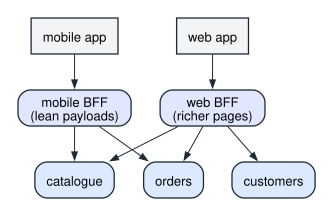
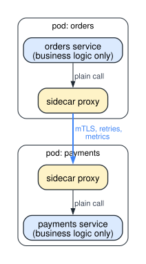

# Microservices Patterns

Microservices patterns are common solutions to the problems that come from splitting one app into many small services.

## What microservices patterns are
<!-- bite: 378ed540-75ae-4f89-a623-10d8a9d6f25b -->

Microservices patterns are the usual fixes for problems that come from splitting an app into services.

Those services have to find each other, share common jobs like logging in users, and keep working when one fails. This lesson covers the usual ways of handling each of these.

## The problem: coordination at a distance
<!-- bite: aa7628a4-a4bc-4984-a405-ca6118762c29 -->

Split one app into dozens of services and you create new problems the monolith never had: *how do services find each other? how do clients avoid knowing the internal topology? how do cross-cutting concerns get handled without duplicating them in every service?* These patterns answer those.

## Service Discovery
<!-- bite: d67a3417-5402-4ba7-8e6b-c96d89ece5a1 -->

Services scale up/down and move (new instances, failures, [[devops/10-orchestration/01-kubernetes|k8s]] reschedules), so their addresses aren't fixed. **Service discovery** lets a service find the current healthy instances of another by *name* rather than a hardcoded IP:

- **Server-side** — the caller hits a [[architecture/02-building-blocks/01-load-balancing-and-proxies/index|load balancer]] that knows the instances (k8s Services work this way).
- **Client-side** — the caller queries a **service registry** (Consul, etcd, Eureka) and picks an instance itself.

The registry is kept current by health checks. This is what makes "call the payment service" resolve to a live instance despite constant churn — and it relies on [[architecture/04-distributed-systems/index|distributed-systems]] machinery underneath.

## Seeing the two kinds of service discovery
<!-- bite: 8564245c-7e9e-4158-b826-695d0f2c66de -->

On the left, orders asks the registry and chooses an instance itself. On the right, orders calls one name and the load balancer chooses.

## API Gateway
<!-- bite: 2ef51a53-51ba-41b0-876f-0042d431baa1 -->

The single entry point for external clients (from [[architecture/02-building-blocks/01-load-balancing-and-proxies/index|load balancing]]): it routes to the right service and centralizes cross-cutting concerns — authentication, rate limiting, TLS, logging — so each service doesn't reimplement them. Two related patterns:

- **Gateway aggregation** — combine multiple service calls into one client response (so the client makes one request, not six).
- **Gateway offloading** — move shared functionality (auth, SSL) into the gateway.

Keep the gateway *thin* (routing + cross-cutting only) — business logic in the gateway recreates a monolith and a bottleneck.

## Backends for Frontends (BFF)
<!-- bite: 6ae7b245-710a-4f6a-b4a6-2fb082b5eddd -->

Instead of one API serving all clients, give each client type (web, mobile, third-party) its *own* gateway/backend tailored to its needs — the mobile BFF returns lean payloads, the web BFF returns richer ones. Avoids the compromise of a one-size-fits-all API (the over/under-fetching problem [[architecture/02-building-blocks/05-communication/index|GraphQL]] also addresses). Relevant to your [[architecture/03-architectural-patterns/01-monolith-microservices-serverless/index|full-stack]] work where one product has web + mobile clients (Arete).

## Seeing backends for frontends
<!-- bite: 12cb4d69-bb43-4fe8-92d8-91669e76b72e -->

Each app has its own backend, which calls the services it needs and shapes the answer for its own screens.

## Sidecar & Ambassador
<!-- bite: 63b96dec-6c99-4485-ac92-2cd2b23bdbfd -->

Deploy a helper *alongside* each service (in the same [[devops/10-orchestration/01-kubernetes|pod]]) to handle infrastructure concerns, so the service code stays focused on business logic:

- **Sidecar** — a companion container adding capabilities (logging, config, TLS, metrics) without changing the service. The basis of a [[devops/11-delivery-and-advanced/03-service-mesh|service mesh]] (an Envoy sidecar per service handling all networking — mTLS, retries, observability — transparently).
- **Ambassador** — a sidecar specifically for *outbound* calls (proxying/managing connections to external services).

## Seeing sidecars
<!-- bite: 6f050c35-816c-4616-b44d-bf300e74eccb -->

The two services only make plain calls to their own sidecar. The blue arrow between the sidecars is where encryption, retries and metrics happen.

## Leader Election
<!-- bite: fd6471fb-b194-431a-b2c4-cab9366a88d1 -->

When multiple instances of a service run for availability but only *one* should perform a task at a time (a scheduled job, a coordinator), they must agree on a **leader** — and re-elect if it dies. This is a [[architecture/04-distributed-systems/07-consensus-and-paxos|consensus]] problem, and you almost never implement it by hand: you lean on a coordination service (etcd, ZooKeeper, or the platform) that provides it. It's the bridge where microservices patterns meet distributed-systems theory.

## Cross-cutting: observability
<!-- bite: 4cc6dc30-7845-4057-ae7f-b3f11e39dfa3 -->

The pattern that makes microservices *operable*: because a request now spans many services, you *need* distributed [[devops/07-observability/index|tracing]] (a request/trace ID threaded through every hop), centralized logging, and per-service health endpoints — or debugging becomes impossible. This isn't optional the way it is in a monolith; it's the price of admission.

## The honest summary
<!-- bite: 5e17aa7a-486d-4a3a-99ff-e9b02a9642ce -->

These patterns are powerful, but note what they represent: **a whole platform of complexity that a monolith gets for free** (in-process calls need no discovery, one process needs no gateway, one app needs no distributed tracing). That's the real cost of microservices ([[architecture/03-architectural-patterns/01-monolith-microservices-serverless/index|when to adopt them]]) — you're signing up to build and run all of this. Managed platforms ([[devops/10-orchestration/index|Kubernetes]], [[devops/11-delivery-and-advanced/03-service-mesh|service meshes]]) provide much of it, which is exactly why they exist.

## Check your understanding
<!-- bite: e11c66ff-846f-4a81-bf58-32c008ce3b55 -->

Try each one before you open the answer.

1. <!-- q: mcq id="6b3dcd49" -->
   Services start, stop and move all the time, so their addresses aren't fixed. What lets one service find the current healthy instances of another by name?

   - [ ] A sidecar
   - [x] Service discovery
   - [ ] Leader election
   - [ ] A backend for frontend

   

Answer

   Service discovery resolves a name such as "payments" to live instances, kept current by health checks. It's done server-side through a load balancer, or client-side by querying a registry such as Consul or etcd.

   

2. <!-- q: gap id="687a9807" answers="server-side|server side|server;client-side|client side|client" -->
   Fill in the gaps. When the caller sends to a load balancer that knows the instances, as Kubernetes Services do, that's ___ discovery. When the caller asks a service registry and picks an instance itself, that's ___ discovery.

   

Answer

   Server-side and client-side. Either way, a registry kept current by health checks holds the list of healthy instances.

   

3. <!-- q: mcq id="11a3be0d" -->
   A product has a web app, a mobile app and a partner API, each needing differently shaped data. Each gets its own backend tailored to it. What is this pattern?

   - [ ] Ambassador
   - [ ] Gateway offloading
   - [x] Backends for frontends (BFF)
   - [ ] Strangler fig

   

Answer

   A BFF gives each client type its own gateway, so the mobile one can return lean payloads and the web one richer ones, avoiding a one-size-fits-all API.

   

4. <!-- q: mcq id="72ae4d50" -->
   Each service runs with an Envoy container beside it in the same pod, handling mTLS, retries and metrics without changes to the service's code. What is that helper container called?

   - [x] A sidecar
   - [ ] An API gateway
   - [ ] A service registry
   - [ ] A leader

   

Answer

   A sidecar adds infrastructure features alongside a service. A sidecar on every service is the basis of a service mesh. An ambassador is a sidecar just for outbound calls.

   

5. <!-- q: mcq id="3be618a3" -->
   Three instances of a service run for availability, but a nightly billing job must run on only one of them. What's the usual approach?

   - [ ] Write your own voting protocol between the instances
   - [x] Use a coordination service such as etcd or ZooKeeper to elect a leader, and re-elect if it dies
   - [ ] Run the job on all three and ignore duplicates
   - [ ] Put the job in the API gateway

   

Answer

   Leader election is a consensus problem, so you lean on a coordination service that already solves it rather than writing it by hand.

   

6. <!-- q: open id="7ce51c9c" -->
   Why is distributed tracing essential with microservices, when a monolith can manage without it?

   

Answer

   A single request now passes through many services, each with its own logs. Without a trace ID threaded through every hop, you can't follow one request or find which service made it slow or broke it. In a monolith, one stack trace shows the whole story.

   

## Related
<!-- bite: efade41d-9004-4462-9edc-103cd978497e -->
- [[architecture/03-architectural-patterns/01-monolith-microservices-serverless/index|Monolith / Microservices / Serverless]] — whether to take this on at all
- [[devops/10-orchestration/index|Orchestration (devops)]] — the platform that provides these
- [[architecture/04-distributed-systems/07-consensus-and-paxos|Consensus]] — the theory under service discovery & leader election

## About this lesson
<!-- bite: d34c7cc9-c8eb-46ce-acc7-272cd1f38604 -->

**Level:** reference. **Covers:** from the roadmap.sh system-design roadmap. The infrastructure patterns that make a [[architecture/03-architectural-patterns/01-monolith-microservices-serverless/index|microservices]] architecture actually workable — the machinery you inherit the moment you split a system across the network.
