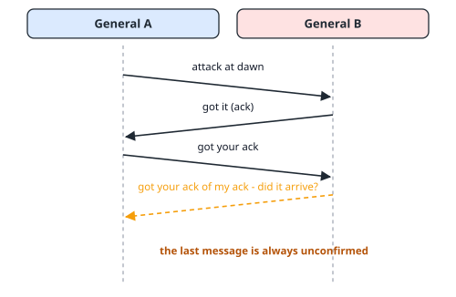

# Theoretical Limits

Theoretical limits are things that have been proven impossible for computers working over a network, no matter how clever the design. Knowing them saves you from trying to build something that cannot exist. This lesson covers the main ones and what real systems do instead.

## The kid version first
<!-- bite: 1f066b17-8a0c-4941-8f99-6147c7d1c5f3 -->

Some things aren't just *hard* — they're **impossible**, and no amount of cleverness fixes them. Knowing which is which saves you from trying forever. Three examples you'll meet below:
- **You and a friend want to jump in the pool at the *exact* same second, but you can only plan by passing notes** that might get lost. Can you *guarantee* you both jump together? No — the last note sent is never confirmed, so someone is always unsure. (That's "Two Generals.")
- **A group can't always agree on an answer if even one member might have secretly wandered off**, because "wandered off" looks the same as "just being slow." (That's "FLP.")
- **When your walkie-talkies stop reaching each other, you have to choose: keep answering (maybe with old info) or stay silent until you reconnect** — you can't do both. (That's "CAP.")

This note is the short list of walls the universe puts up. Every real design is a choice about *which wall you'll lean against.*

## Two Generals — agreement over a lossy channel is impossible
<!-- bite: c4d56d8f-e728-4738-8665-8fe67dea288d -->

The oldest result, and the cleanest intuition. Two generals must attack at the same time to win; they can only communicate by messengers who might be captured. General A sends "attack at dawn." Did it arrive? A needs an ack. B sends the ack — did *that* arrive? B now needs an ack of the ack. **No finite exchange of messages ever lets both sides be *certain* the other will attack** — every message needs confirmation, and the last message sent is always unconfirmed. 

Follow the messages down the page. Each one confirms the one before, so each needs its own confirmation, and the last one (dashed) is never confirmed, however long the chain gets.

The consequence you live with daily: **there is no such thing as guaranteed exactly-once delivery over an unreliable network.** TCP doesn't solve this — it gives you *reliable-ish* delivery with retries, but the fundamental uncertainty (did my last packet land?) remains. This is why distributed systems lean on **idempotency** ([[architecture/04-distributed-systems/10-distributed-transactions|transactions]]) instead: you can't guarantee a message arrives *exactly* once, so you make it *safe* to arrive more than once.

## FLP — consensus can't be guaranteed to terminate
<!-- bite: 1a45ee59-ed70-4706-96ca-d3ccea366342 -->

**The result (Fischer, Lynch, Paterson, 1985):** in a fully **asynchronous** system where **even one node may crash**, there is *no* deterministic algorithm that guarantees [[architecture/04-distributed-systems/07-consensus-and-paxos|consensus]] always **terminates**. Not "it's hard" — it's provably impossible to guarantee.

**The intuition:** in an asynchronous model you cannot distinguish a crashed node from an infinitely slow one ([[architecture/04-distributed-systems/01-what-makes-distributed-systems-hard|partial failure]]). The proof shows there's always some "bivalent" state — a state where the outcome isn't yet decided — and an adversarial scheduler can delay exactly the right message to keep the system in bivalent states forever. No crash actually has to happen; the mere *possibility* of one, plus arbitrary timing, is enough.

**Crucially, FLP is about *guaranteed termination*, not safety or usual-case behavior.** Consensus algorithms remain **always safe** (they never decide *wrong*), they just can't promise to always *finish* in bounded time. Real systems escape FLP not by breaking it but by **weakening the model**:
- **Timeouts / partial synchrony** — assume the network is *eventually* well-behaved; make progress during good periods (Raft, Paxos). This is the standard escape.
- **Randomization** — a coin flip breaks the adversary's ability to force the worst schedule; consensus terminates with probability 1 (some BFT protocols).

So FLP's practical lesson isn't "consensus is impossible" — it's "**consensus can stall during a bad network, and that's not a bug, it's a theorem.**" A cluster that stops accepting writes during a partition is FLP made visible.

## CAP — during a partition, pick C or A
<!-- bite: 6e0ac0b1-1409-4547-b536-3fe69302440d -->

**The result:** when a **network partition** (P) splits your nodes so they can't all communicate, you must choose between:
- **Consistency (C)** — every read sees the latest write (linearizable). To guarantee this during a partition, the minority side must **refuse** requests (it can't be sure it has the latest data) → you lose availability.
- **Availability (A)** — every request gets a (non-error) response. To stay available during a partition, both sides must answer from their own (possibly stale/divergent) state → you lose consistency.

You cannot have both *during a partition* — a direct consequence of unreliable networks. The famous "pick 2 of 3" framing is misleading: **partitions are not optional** (the network *will* partition), so P is a given, and the real choice is **C vs A when P happens.**

- **CP systems** (choose consistency): consensus stores (etcd, ZooKeeper, [[architecture/04-distributed-systems/09-coordination-services|Spanner]]), most SQL primaries. The minority side stops serving writes — correctness over uptime.
- **AP systems** (choose availability): [[architecture/04-distributed-systems/05-replication|Dynamo-style]] stores (Cassandra, Dynamo). Both sides keep serving, and you reconcile the divergence later ([[architecture/04-distributed-systems/06-crdts-and-conflict-resolution|CRDTs]], last-write-wins) — uptime over correctness.

CAP is also **not** a whole-system label — it's per-operation. One database can offer linearizable reads for some data and eventual for other data. See the fundamentals treatment in [[architecture/01-system-design-fundamentals/04-cap-and-consistency|CAP & Consistency]].

## Seeing a partition split a cluster
<!-- bite: e5199388-1ba3-4978-b397-a9be429f4e83 -->

Five nodes, cut into a group of three and a group of two. Three is a majority of five, so in a CP system the left side can still agree and keep taking writes. The right side can't reach a majority, so it refuses. An AP system lets both sides answer and sorts out the differences later.

## PACELC — the tradeoff that never sleeps
<!-- bite: 1bfc810a-fd43-4c2d-8e2e-cc5dd989e09b -->

CAP only describes the *partition* case, which is rare. **PACELC** (Abadi) completes it: **if Partition, choose Availability or Consistency; Else (normal operation), choose Latency or Consistency.**

The "else" clause is the one that bites every day: even with a perfectly healthy network, **strong consistency costs latency** — a linearizable write must reach a quorum ([[architecture/04-distributed-systems/07-consensus-and-paxos|consensus round-trip]]) before it can be acknowledged, while an eventually-consistent write can be acked by one node and propagated lazily. So:
- **PC/EC** — consistent always, paying latency in normal operation too (Spanner, most consensus systems).
- **PA/EL** — available and low-latency, giving up consistency in both cases (Dynamo, Cassandra by default).

PACELC is the more useful framework in practice, because you spend ~99.9% of your time in the **E** (no-partition) case, and that's where the consistency-vs-latency dial actually lives. "Strong consistency isn't free even when nothing is broken" is the whole point.

## The consistency/latency tradeoff is fundamental, not a limitation to engineer away
<!-- bite: 343908c1-2fd0-4f88-81be-96f353239b33 -->

A recurring beginner instinct is "surely with a fast enough network we get strong consistency *and* low latency." No: the two are in fundamental tension because **strong consistency requires coordination** (agreeing on an order), and coordination requires communication, and communication takes time and can be interrupted. The stronger the [[architecture/04-distributed-systems/04-consistency-models|consistency model]] you promise readers, the more coordination you must do, the more latency you pay, and the less available you are under partition. Weaker models (causal, eventual) need less coordination → faster, more available, but readers see anomalies. **Choosing a consistency model is choosing a point on this curve — there is no free corner.**

## CALM — when you can drop coordination entirely
<!-- bite: c537c7cf-4695-4279-aa84-c87ca3828753 -->

The optimistic counterweight (Hellerstein & Alvaro). **CALM: Consistency As Logical Monotonicity.** A computation can be made **consistent *without any coordination*** if and only if it is **monotonic** — roughly, once a fact becomes true it stays true, and adding more inputs only ever *adds* to the output, never retracts.

- **Monotonic** operations (set union, "has this ever happened?", grow-only counters, thresholds) can run coordination-free on every replica and always converge to the same answer — this is exactly why [[architecture/04-distributed-systems/06-crdts-and-conflict-resolution|CRDTs]] work.
- **Non-monotonic** operations (counting *distinct* values then deciding, "was this the *last* write?", anything that can be invalidated by later input) *require* coordination to be consistent.

CALM reframes the design question from "how do I coordinate?" to "**can I model this so it doesn't need coordination at all?**" The cheapest consensus is the one you proved you didn't need.

## How the limits map to the rest of the course
<!-- bite: 675217e6-7a1a-424a-8bdd-89ec0ab40969 -->

| Limit | Says you can't… | So the course does… |
|---|---|---|
| Two Generals | guarantee exactly-once delivery | idempotency + at-least-once ([[architecture/04-distributed-systems/10-distributed-transactions\|transactions]]) |
| FLP | guarantee consensus terminates (async) | partial synchrony + timeouts ([[architecture/04-distributed-systems/07-consensus-and-paxos\|Raft/Paxos]]) |
| CAP | have C and A during a partition | pick CP or AP per operation ([[architecture/04-distributed-systems/05-replication\|replication]]) |
| PACELC | have C without latency, ever | pick a [[architecture/04-distributed-systems/04-consistency-models\|consistency model]] on the curve |
| CALM | drop coordination for non-monotonic logic | model as monotonic → [[architecture/04-distributed-systems/06-crdts-and-conflict-resolution\|CRDTs]] where possible |

## Key insight
<!-- bite: b17f812b-efbc-4765-b9f6-3e67d6c986cd -->

**These aren't engineering limitations to optimize away — they're proofs of what's impossible, and every real design is a chosen point inside them.** You can't get exactly-once delivery (so you make things idempotent), you can't guarantee consensus terminates under asynchrony (so you assume eventual synchrony and accept stalls), and you can't have strong consistency without paying latency and sacrificing availability under partition (PACELC) — *unless* your logic is monotonic, in which case CALM lets you skip coordination entirely. Knowing the wall is there is what stops you running into it.

## Check your understanding
<!-- bite: 3a64eaf9-58cd-4939-8b6d-8dd8d86fe6dc -->

Try each one before you open the answer.

1. <!-- q: mcq id="70fea638" -->
   The Two Generals problem shows that no finite exchange of messages over a lossy channel makes both sides certain. What do real systems do because of this?

   - [ ] Use TCP, which guarantees exactly-once delivery
   - [x] Make operations idempotent, so a message arriving more than once is safe
   - [ ] Send every message exactly twice
   - [ ] Use synchronised clocks

   

Answer

   Exactly-once delivery is impossible, so systems retry (at-least-once) and make handling a repeat harmless. TCP does not remove the doubt about the last packet.

   

2. <!-- q: mcq id="9750edf6" -->
   What does the FLP result actually say?

   - [ ] Consensus algorithms can decide the wrong value
   - [x] In a fully asynchronous system where one node may crash, no deterministic algorithm can guarantee consensus always finishes
   - [ ] Consensus needs at least 5 nodes
   - [ ] Consensus is impossible in practice

   

Answer

   FLP is about guaranteed termination, not safety. Real systems escape it with timeouts (partial synchrony) or randomness, and accept that consensus can stall during a bad network.

   

3. <!-- q: gap id="536630b6" answers="consistency|C;availability|A" -->
   Fill in the gaps. CAP says that during a network partition you must choose between ___ (every read sees the latest write) and ___ (every request gets a non-error response).

   

Answer

   Consistency or availability. Partitions will happen, so P is not optional; the real choice is C or A when it happens.

   

4. <!-- q: mcq id="f48a1537" -->
   PACELC adds an "else" case to CAP. When there is no partition, what do you trade?

   - [ ] Availability against partition tolerance
   - [x] Latency against consistency
   - [ ] Throughput against storage
   - [ ] Nothing, a healthy network has no trade-off

   

Answer

   Latency against consistency. A strongly consistent write must reach a quorum before it is acknowledged, even when nothing is broken.

   

5. <!-- q: mcq id="71e5f5bf" -->
   CALM says an operation can stay consistent with no coordination if it is monotonic (new input only adds to the result). Which of these are monotonic? Choose all that apply.

   - [x] Adding items to a set (set union)
   - [x] "Has this user ever logged in?"
   - [ ] "Was this the last write?"
   - [x] A counter that only grows

   

Answer

   Set union, "has it ever happened" and grow-only counters never retract. "Was this the last write" can be overturned by a later write, so it needs coordination.

   

6. <!-- q: open id="5085702e" -->
   Why is "pick 2 of 3" a misleading way to describe CAP?

   

Answer

   Partitions are not something you can opt out of: real networks do partition. So P is a given, and the only real choice is consistency or availability while a partition is happening. CAP is also chosen per operation, not as a label for the whole system.

   

## Related
<!-- bite: ef1aaf0c-3c42-4c5d-bd30-c0cd0af60f2f -->
- [[architecture/04-distributed-systems/01-what-makes-distributed-systems-hard|What Makes It Hard]] — the models these results are proved against
- [[architecture/04-distributed-systems/04-consistency-models|Consistency Models]] — the spectrum PACELC makes you choose from
- [[architecture/04-distributed-systems/07-consensus-and-paxos|Consensus & Paxos]] — what FLP bounds and timeouts rescue
- [[architecture/01-system-design-fundamentals/04-cap-and-consistency|CAP & Consistency]] — the fundamentals-level view

## About this lesson
<!-- bite: d7958464-a808-4225-a1d9-9e05adab274b -->

**Level:** reference. **Covers:** from the canon (FLP 1985, Brewer's CAP + Gilbert & Lynch's proof, Abadi's PACELC, the CALM theorem). The [[architecture/04-distributed-systems/01-what-makes-distributed-systems-hard|models]] in the previous note produce hard *impossibility results* — things no algorithm can do, no matter how clever. Knowing these stops you chasing the impossible and tells you exactly which tradeoff you're forced to make. This is the theory that makes the rest of the course make sense.
