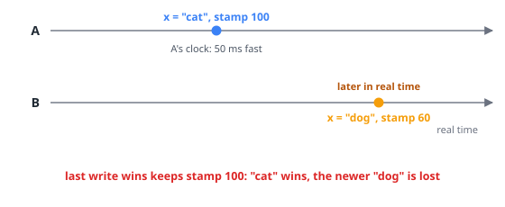
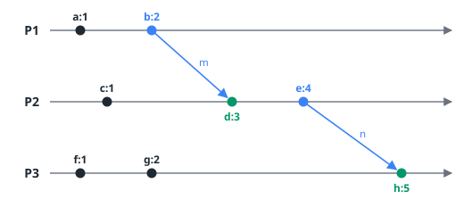
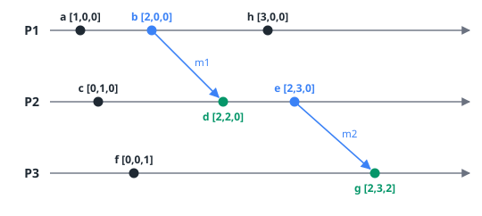

# Time & Ordering

Time and ordering is the problem of working out which event happened first when computers can't trust each other's clocks. Every computer's clock drifts a little, so two messages sent close together can't be ordered by their timestamps alone. This lesson shows how systems use cause and effect to put events in order.

## The kid version first
<!-- bite: bea296a8-d653-4e94-927f-f5ed7a87597e -->

You and a friend are in **different rooms**, and you both shout **"I got here first!"** How do you settle it? You *can't* use your watches — they disagree by a little, so your watch might say 3:00:01 while the "later" event shows 3:00:00 on the other watch. Clocks are liars here.

But there's one thing you *can* always trust: **cause and effect.** If your friend **shouted back an answer to your question**, then your question *must* have come first — because they couldn't answer something they hadn't heard yet. So instead of asking *"what time was it?"* (unanswerable), you ask *"did this cause that?"* (always answerable). This whole note is about ordering events by **who-could-have-heard-whom**, using **counters** passed along with messages instead of clocks on the wall.

## Why ordering is the whole game
<!-- bite: eb807391-3fe7-4dc2-b626-124e352ff3bf -->

Distributed systems constantly need to know the order of events: which write is newer, did this read happen before that write, which of two concurrent updates wins. On one machine, a lock or a single clock gives you order for free. Across machines — clocks disagree, messages arrive out of order — establishing order is genuinely hard, and getting it wrong *loses data* (a stale write silently overwrites a fresh one). Lamport's reframing is the key move: **stop asking "when did this happen?" and start asking "in what causal order?"**

## The trap: physical timestamps can't order cross-node events
<!-- bite: c202504c-13a7-41c5-bf5d-c50a74ed3245 -->

Recall from [[architecture/04-distributed-systems/01-what-makes-distributed-systems-hard|the models]]: wall-clock time can jump backward and drifts between nodes; monotonic clocks don't drift but are incomparable across nodes. So the tempting **"last write wins by timestamp"** silently corrupts data:

Time runs to the right in real time. A writes first, but its clock is fast; B writes later, but its clock is slow.

The write that actually happened later got the *lower* timestamp because B's clock lagged. Clock skew makes physical-timestamp ordering fundamentally unreliable — which is why we need **logical** order instead.

## Happens-before (→) — causal order without clocks
<!-- bite: 97420c66-f309-4f59-b2ba-b134a072f086 -->

Lamport's definition of the only ordering you can actually establish. Event **A happens-before B** (written `A → B`) if any of:
1. **Same node, A first** — A occurred before B in the same process.
2. **Message** — A is a `send` and B is the matching `receive`.
3. **Transitivity** — `A → C` and `C → B` imply `A → B`.

If **neither `A → B` nor `B → A`**, the events are **concurrent** (`A ∥ B`) — there is *genuinely no order* between them, and pretending there is one is the bug. Happens-before is a **partial order**: it captures causality (X *could have influenced* Y) and deliberately leaves unrelated events unordered. Everything below is machinery to *track* this relation with counters.

## Lamport clocks — a total order consistent with causality
<!-- bite: 89ffc467-3a6b-4957-9e93-a55198639ad4 -->

Each node keeps one integer counter `C`:
- **Local event:** `C = C + 1`.
- **Send:** `C = C + 1`, then attach `C` to the message.
- **Receive(msg):** `C = max(C, msg.C) + 1`.

**Worked trace** (P1, P2, P3; `e:C` = event with its Lamport value). Each line is one process, with time running right, and each blue arrow is a message:

The guarantee: **if `A → B` then `Lamport(A) < Lamport(B)`.** Break ties with node ID and you get a **total order** — every event gets a distinct, causality-respecting rank. That total order is exactly what **total-order broadcast** and Lamport's mutual-exclusion algorithm are built on, and it's a stepping stone to [[architecture/04-distributed-systems/07-consensus-and-paxos|consensus]].

**The one thing Lamport clocks can't do:** the converse fails. `Lamport(A) < Lamport(B)` does **not** imply `A → B` — they might be concurrent (in the trace, `g:2` on P3 and `d:3` on P2 are concurrent, yet `2 < 3`). Lamport clocks can *impose* an order but can't *detect* whether two events were truly causal or merely concurrent. When you need that distinction, go to vector clocks.

## Vector clocks — detecting concurrency exactly
<!-- bite: d45a757b-ab22-4bd5-9a90-e0458bd6cb74 -->

Each node keeps a **vector** `V` of counters, one entry per node. Node `i`:
- **Local event / send:** `V[i] = V[i] + 1`; attach the whole vector to sends.
- **Receive(msg):** `V[k] = max(V[k], msg.V[k])` for every `k`, then `V[i] = V[i] + 1`.

Compare two vectors elementwise:
- `Va ≤ Vb` on **every** entry (and `≠`) → **`A → B`** (A causally precedes B).
- `Vb ≤ Va` → **`B → A`**.
- **Neither dominates** (each is bigger in some entry) → **`A ∥ B`, concurrent** → a genuine conflict.

**Worked example** — two clients write the same key through a Dynamo-style store:

Start with `V = [0,0,0]` for nodes A, B and C. Each line below is one node or the client, with time running right:

This is precisely how [[architecture/04-distributed-systems/05-replication|leaderless (Dynamo) replication]] avoids silently losing a write: it *detects* the concurrent pair and either keeps both as **siblings** for the app to merge, or feeds them to a [[architecture/04-distributed-systems/06-crdts-and-conflict-resolution|CRDT]] that merges deterministically. The cost is size: the vector grows with the number of writers, so systems bound it (per-replica, not per-client; prune old entries) — **dotted version vectors** are a refinement that keeps them compact.

## Hybrid Logical Clocks (HLC) — the practical middle
<!-- bite: 6f2032db-13c4-4067-a163-bf6f99d1b564 -->

Logical clocks give correct causality but their numbers mean nothing to a human ("event 4,182" — when was that?). Physical clocks are human-meaningful but unsafe for ordering. **HLC** (used by CockroachDB, MongoDB) fuses them: each timestamp is `(physical_time, logical_counter)`. It tracks causality like a logical clock (bumping the counter on causally-later events) **while staying within a small bound of real wall-clock time** — so timestamps are both causally correct *and* roughly interpretable as "when," and they're monotonic even across NTP jumps. HLC is the pragmatic default when you want causal ordering *and* timestamps that mean something.

## TrueTime — buying certainty with hardware
<!-- bite: c6c2f3c1-ec08-4ead-9fd5-359073b2f473 -->

Google's Spanner takes the opposite bet: instead of avoiding physical clocks, **make them trustworthy enough to order by.** **TrueTime** equips every datacenter with **GPS receivers and atomic clocks**, and the API returns not a timestamp but an **interval** `[earliest, latest]` with a *guaranteed bound* on the uncertainty (typically a few milliseconds). To commit a transaction at time `T`, Spanner **waits out the uncertainty** — it deliberately pauses until `T` is definitely in the past everywhere (`now.earliest > T`), so no other transaction can be assigned an overlapping timestamp. This "commit wait" is how Spanner offers **externally-consistent (linearizable) global transactions** ([[architecture/04-distributed-systems/11-modern-distributed-transactions|modern transactions]]) — it trades a few ms of latency for a globally meaningful order. The lesson: you *can* order by physical time, but only if you pay to bound the uncertainty and then wait it out; almost everyone else uses logical/hybrid clocks because that's free.

## Why this feeds everything else
<!-- bite: ab8347a1-44f2-4908-a94e-43acd70ce07e -->

- **[[architecture/04-distributed-systems/04-consistency-models|Consistency models]]** are *defined* in terms of which orderings are guaranteed — **causal consistency** literally means "respects happens-before," no more, no less.
- **[[architecture/04-distributed-systems/06-crdts-and-conflict-resolution|Conflict resolution]]** uses version vectors to know *which* writes actually conflict (concurrent) vs which supersede.
- **[[architecture/04-distributed-systems/07-consensus-and-paxos|Consensus]]** is, in large part, machinery to impose a single agreed **total order** on operations despite all of the above — a replicated log is a totally-ordered sequence of commands.

## Key insight
<!-- bite: ef0b909c-1eff-4d38-a5b8-f15a05201c17 -->

**"When" is the wrong question across machines — "in what causal order" is the right one, and you answer it with counters and message-passing, not clocks.** Lamport clocks give a total order consistent with causality but can't detect concurrency; **vector clocks** detect it exactly (and power conflict detection in leaderless replication); **HLC** makes logical order human-readable; **TrueTime** is the expensive exception that makes physical time trustworthy by bounding and waiting out its error. Master happens-before and the rest of the course — consistency, conflict resolution, consensus — stops being mysterious.

## Check your understanding
<!-- bite: dfed26fd-350d-4e88-8ab2-a0bb5989d282 -->

Try each one before you open the answer.

1. <!-- q: mcq id="f3e10964" -->
   Node A's clock runs 50 ms ahead of node B's. A writes x = "cat" at timestamp 100. Later in real time, B writes x = "dog" at timestamp 60. A last-write-wins store keeps the higher timestamp. What happens?

   - [ ] "dog" is kept, because it was written later
   - [x] "cat" is kept, and B's newer write is silently lost
   - [ ] Both values are kept as siblings
   - [ ] The store reports an error

   

Answer

   "cat" wins because 100 > 60, even though "dog" came later. Clock skew makes physical timestamps unsafe for ordering events across nodes.

   

2. <!-- q: mcq id="aff8305b" -->
   Event A happens-before event B (A → B) when which of these is true? Choose all that apply.

   - [x] A and B are on the same node and A came first
   - [x] A is the sending of a message and B is its receipt
   - [x] A → C and C → B for some event C
   - [ ] A's wall-clock timestamp is smaller than B's

   

Answer

   The three rules are same node, message, and transitivity. Wall-clock timestamps say nothing about causality.

   

3. <!-- q: mcq id="53dd34e9" -->
   Event X has Lamport value 4 and event Y has Lamport value 9. What can you conclude?

   - [ ] X happened-before Y
   - [x] Y did not happen-before X, but X and Y might be concurrent
   - [ ] X and Y are concurrent
   - [ ] Nothing at all

   

Answer

   If Y → X then Lamport(Y) < Lamport(X), which is false here, so Y did not come first. But a smaller Lamport value does not prove X → Y: they might be concurrent.

   

4. <!-- q: gap id="a1f2c9bd" answers="vector;concurrent" -->
   Fill in the gaps. To detect whether two writes were truly concurrent, a Dynamo-style store uses ___ clocks. If neither clock is less than or equal to the other in every entry, the writes are ___.

   

Answer

   Vector clocks. When neither dominates, the writes are concurrent: a real conflict, kept as siblings or merged by a CRDT.

   

5. <!-- q: mcq id="75084fca" -->
   How does Google Spanner's TrueTime make physical time safe for ordering?

   - [ ] It uses NTP more often
   - [x] It returns an uncertainty interval and waits until the commit time is definitely in the past before committing
   - [ ] It uses a single global clock server
   - [ ] It switches to Lamport clocks during partitions

   

Answer

   GPS and atomic clocks keep the uncertainty to a few milliseconds, and "commit wait" pauses until that window has passed, trading a little latency for a global order.

   

6. <!-- q: open id="a059a930" -->
   What do Hybrid Logical Clocks give you that plain Lamport clocks do not?

   

Answer

   An HLC timestamp is a pair of physical time and a logical counter. It respects causality like a logical clock, but it also stays close to real wall-clock time, so a person can read it as roughly "when". It also stays monotonic across NTP jumps.

   

## Check your understanding: worked problems
<!-- bite: a493e69d-6bbb-4181-aea0-ee8b0ea9fd29 -->

Work each one out on paper first, then type your answer.

1. <!-- q: gap id="47526cf6" answers="2;3;5" -->
   Fill in the gaps. Lamport rules: a local event or a send adds 1 to the counter; a receive sets the counter to max(own, message) + 1. All counters start at 0.

   - P1: event a (local), then b (send m1 to P2), then c (local).
   - P2: event d (local), then e (receive m1), then f (send m2 to P3).
   - P3: events g, h, i (all local), then j (receive m2).

   The value of b is ___, the value of e is ___, and the value of j is ___.

   

Answer

   b = 2. At e, P2 has 1 and m1 carries 2, so e = max(1, 2) + 1 = 3. f = 4. At j, P3 has 3 and m2 carries 4, so j = max(3, 4) + 1 = 5.

   

2. <!-- q: exact id="4124cf8c" answer="8" -->
   A node's Lamport counter is 7. It receives a message stamped 3. What is its counter after the receive?

   

Answer

   max(7, 3) + 1 = 8. The receive always moves the counter past both values.

   

3. <!-- q: mcq id="f2150298" -->
   Compare the vector clocks of two writes, with entries for nodes A, B, C. Write 1 has [3, 0, 1]. Write 2 has [2, 4, 1]. How are they related?

   - [ ] Write 1 happened-before write 2
   - [ ] Write 2 happened-before write 1
   - [x] They are concurrent

   

Answer

   Write 1 is bigger in A's entry (3 > 2), and write 2 is bigger in B's entry (4 > 0). Neither dominates, so they are concurrent and conflict.

   

4. <!-- q: gap id="7bf5398d" answers="4;4;2" -->
   Fill in the gaps. Vector clock rule for a receive at node i: take the maximum of each entry, then add 1 to entry i. Node B (the second entry) holds [1, 3, 0] and receives a message carrying [4, 1, 2]. Its new vector is [___, ___, ___].

   

Answer

   Entry-wise max gives [4, 3, 2]. Then B adds 1 to its own entry: [4, 4, 2].

   

5. <!-- q: sketch id="7cda4720" -->
   Draw three horizontal process lines, P1, P2 and P3, with time running right, and write the vector clock [P1, P2, P3] at every event. All clocks start at [0,0,0]. Local events and sends add 1 to the process's own entry; a receive takes the entry-wise maximum and then adds 1 to its own entry.

   - P1: a (local), then b (send m1 to P2), then h (local).
   - P2: c (local), then d (receive m1), then e (send m2 to P3).
   - P3: f (local), then g (receive m2).

   Then name one pair of events that are concurrent.

   

Answer

   

   What to check:
   - Two message arrows, b to d and e to g, each sloping forward in time.
   - d = [2,2,0]: the maximum of [0,1,0] and [2,0,0] is [2,1,0], then P2 adds 1.
   - g = [2,3,2]: the maximum of [0,0,1] and [2,3,0] is [2,3,1], then P3 adds 1.
   - h [3,0,0] and e [2,3,0] are concurrent: each is bigger in one entry. So are f [0,0,1] and b [2,0,0].

   

## Related
<!-- bite: abcac2c6-6cf1-496d-92e8-e03f8b11d4ea -->
- [[architecture/04-distributed-systems/04-consistency-models|Consistency Models]] — orderings-as-guarantees; causal consistency = happens-before
- [[architecture/04-distributed-systems/06-crdts-and-conflict-resolution|CRDTs & Conflict Resolution]] — version vectors deciding what conflicts
- [[architecture/04-distributed-systems/07-consensus-and-paxos|Consensus & Paxos]] — imposing a single total order (the replicated log)
- [[languages/01-java/02-jvm-and-concurrency/02-concurrency|Concurrency (Java)]] — happens-before on a single machine (the JVM memory model)

## About this lesson
<!-- bite: 7c24342e-4219-4d9e-a357-01f70c00aa03 -->

**Level:** reference. **Covers:** from the canon (Lamport's "Time, Clocks, and the Ordering of Events in a Distributed System," 1978 — one of the most cited papers in CS; DDIA ch. 8–9). How to reason about "what happened before what" when there's [[architecture/04-distributed-systems/01-what-makes-distributed-systems-hard|no global clock]]. This is the conceptual bedrock under [[architecture/04-distributed-systems/04-consistency-models|consistency models]], [[architecture/04-distributed-systems/06-crdts-and-conflict-resolution|conflict resolution]], and [[architecture/04-distributed-systems/07-consensus-and-paxos|consensus]].
