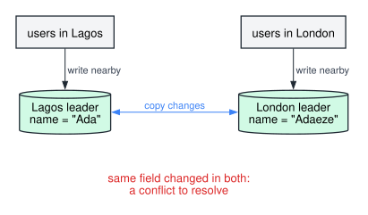
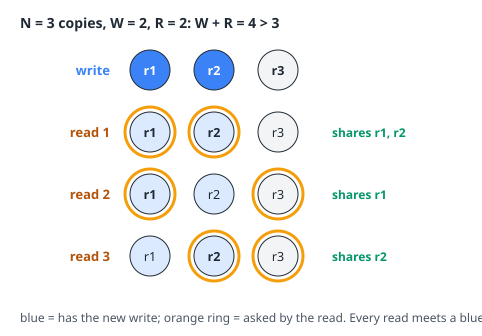
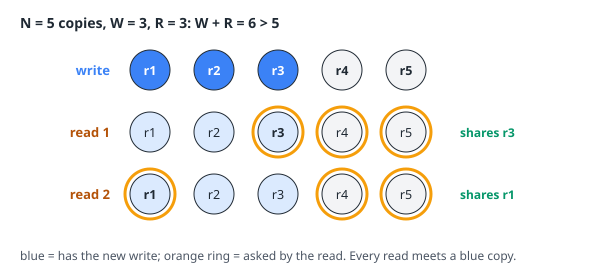

# Replication

Replication is keeping copies of the same data on more than one computer.

## What replication is
<!-- bite: d2a2fe13-8abb-4321-ba26-f00e2b5fcd32 -->

Replication is keeping copies of the same data on more than one computer.

If one copy is lost, the others survive, and people can read from whichever copy is closest to them. This lesson covers the main ways of keeping those copies in step.

## The kid version first
<!-- bite: 3c5f2592-6558-46cd-a253-d5d77a5260d5 -->

You have a favorite notebook. You make **three copies** and keep them in three different rooms. Why bother?
- **If one is lost** (juice spilled on it), you still have the others → **survives failure**.
- **A friend in another room** can read the nearby copy instead of walking to yours → **faster reads, closer to people**.
- **Lots of friends can read at once** from different copies → **handles more readers**.

The catch — and it's the *entire* difficulty of the topic: **when you change one copy, how do the other copies find out, and what happens if a room is locked (a machine or the network is down) right when you try to update it?** Everything below is a different answer to that one question.

## Architecture 1 — Single-leader (one boss notebook)
<!-- bite: 8e363bd7-32a0-4986-9ac2-76bea5a039eb -->

**Kid version:** one notebook is the **boss**. Anyone who wants to *change* something tells the boss; the boss writes it and then tells the copies "update to match." Anyone who just wants to *read* can look at any copy.

**Precise:** all **writes** go to one **leader**; the leader streams its changes (a replication log) to **followers**; **reads** can hit any replica. This is the most common setup — nearly every SQL database (Postgres, MySQL) works this way. It's popular because writes have a single place that decides the order, so there are **no write conflicts**.

## Architecture 1 — Single-leader: wait for the copies, or not
<!-- bite: de315148-3fb3-4929-9119-35332088892a -->

The first big decision is whether the leader waits for a copy before saying "done".

The interesting decisions:

- **Synchronous vs asynchronous replication** — *does the boss wait for a copy to say "got it" before telling you "done"?*
  - **Sync:** the leader waits for a follower to confirm before acknowledging your write. **Safe** (the write survives the leader dying) but **slow**, and it *stalls completely* if that follower is down.
  - **Async:** the leader says "done" immediately and copies in the background. **Fast**, but if the leader crashes before copying, that just-confirmed write is **lost** (the juice spilled on the boss's notebook before anyone copied the new line).
  - **Semi-sync** (the common compromise): wait for *one* follower, not all. Most systems accept a tiny durability risk for speed.

## Architecture 1 — Single-leader: replication lag and failover
<!-- bite: 40d6caa7-d253-4c5b-90fc-ea0f9081a338 -->

The other two decisions are about copies falling behind and replacing a dead leader.

- **Replication lag** — *the copies are a few seconds behind the boss*, like a live-TV broadcast delay. This causes the anomalies that the [[architecture/04-distributed-systems/04-consistency-models|session guarantees]] fix: you write a comment, your read hits a lagging copy, and your comment "vanishes" (needs **read-your-writes**); or you refresh and the score appears to go *backwards* (needs **monotonic reads**).

- **Failover** — *the boss is out sick; pick a new boss.* Promote a follower to leader. This is trickier than it sounds:
  - Which follower? It needs [[architecture/04-distributed-systems/07-consensus-and-paxos|consensus]] to agree, or you get **split-brain** — *two kids both think they're the boss*, each accepting different writes, corrupting the data. Split-brain is the nightmare; [[architecture/04-distributed-systems/09-coordination-services|fencing tokens]] and quorums are the guardrails.
  - With **async** replication, the old leader may have had writes the new leader never received → those writes are **lost** on failover.

## Seeing sync and async replication
<!-- bite: 3fd356bc-37cb-4e9c-8ee8-f5cd72adf734 -->

Time runs down each panel. On the left, the leader waits for the follower's "got it" before saying "done". On the right, it says "done" at once, then crashes before sending the copy, so a write the client was told is safe is gone.

## Architecture 2 — Multi-leader (several bosses)
<!-- bite: be726e88-bfae-45ea-bb3e-9cfa637d1c4b -->

**Kid version:** each *region* (say, one classroom per city) has its own boss notebook, so kids write to their *nearby* boss instead of a far-away one. The bosses then tell each other what changed.

**Precise:** multiple leaders each accept writes and replicate to one another. Great for **write latency** (write locally) and **write availability** (a region keeps working even if cut off from the others) — common for multi-datacenter and offline-capable apps. The price: **the same data can be changed in two places at once**, so you get **write conflicts** (two cities edit the same profile field differently). Now you *must* resolve conflicts — see [[architecture/04-distributed-systems/06-crdts-and-conflict-resolution|conflict resolution]].

## Seeing multi-leader replication
<!-- bite: bb53d472-8267-4b92-bfa2-9180432a1a8e -->

In the picture, each city writes to its own nearby leader, and the leaders copy to each other. When both change the same name at once, the copies collide.

## Architecture 3 — Leaderless (no boss — ask the crowd)
<!-- bite: 2c25f472-261f-4441-b2b6-c175718e960d -->

**Kid version:** there's *no* boss. To **change** something, you tell **several** friends directly. To **read** something, you *ask several friends* and take the most recent answer. As long as the group you tell and the group you ask **overlap**, at least one friend you ask will know the latest.

**Precise:** any replica accepts writes; the client (or a coordinator) writes to *several* replicas and reads from *several*, using **quorums** for consistency. This is the **Dynamo / Cassandra** model — extremely available (no leader to fail over, no single point of failure) at the cost of the client handling staleness and conflicts.

## Architecture 3 — Leaderless: quorums, consistency from counting
<!-- bite: a7ef40d8-c0d1-4972-87d9-9a20e9e5c3c4 -->

Leaderless stores stay correct by counting how many copies answer.

The neat trick that makes leaderless work. With **N** copies, require **W** copies to acknowledge each **write** and **R** copies to answer each **read**. If

$$W + R > N$$

then the write-set and any read-set **must share at least one copy** — so a read is guaranteed to touch a replica that has the latest write.

## Architecture 3 — Leaderless: quorums in kid terms, and tuning them
<!-- bite: ed823cab-8317-43f3-bcad-5082c022cc49 -->

Here is the same idea with a secret and three friends, and how changing the numbers shifts the tradeoff.

**Kid version:** 3 friends know the secret (N=3). You *tell* 2 of them the new secret (W=2) and later *ask* 2 of them (R=2). Since `2 + 2 > 3`, the two you ask can't *both* be the one friend you didn't tell — at least one of them has the new secret. 

Tuning W and R slides you along the tradeoff: `W=N, R=1` → fast reads, slow/fragile writes; `W=1, R=N` → fast writes, slow reads; `W=R=⌈(N+1)/2⌉` → balanced. Leaderless systems expose these knobs so you get **tunable consistency** per query. Two repair mechanisms keep lagging replicas honest: **read-repair** (on a read, push the latest value to any replica found stale) and **anti-entropy** (a background process that compares replicas — via [[architecture/04-distributed-systems/14-failure-detection-and-membership|Merkle trees]] — and fixes differences).

> **Quorums are weaker than they look.** `W+R>N` guarantees *overlap*, not linearizability — with concurrent writes, sloppy quorums, or a failed write that partially applied, you can still read stale or conflicting values. Leaderless ≠ strong consistency; it's *tunable, mostly-fresh* consistency.

## Seeing why the quorums overlap
<!-- bite: 02258c06-fe6b-4781-9d15-ddd4a30b5d16 -->

The top row is the write: it reached the blue copies, r1 and r2. Each row below is one possible read of two copies, ringed in orange. However you pick the two, at least one ring lands on a blue copy, which is what W + R > N promises.

## Choosing an architecture
<!-- bite: 3f1223a3-4a5e-4380-9c0c-0d92b46eecbf -->

| | Writes | Best for | Conflict risk |
|---|---|---|---|
| **Single-leader** | one place | most apps; anything needing simple strong-ish consistency | none (one writer) |
| **Multi-leader** | many places (per region) | multi-datacenter, offline-first | yes → need [[architecture/04-distributed-systems/06-crdts-and-conflict-resolution\|resolution]] |
| **Leaderless** | any replica | max availability, no failover (Cassandra/Dynamo) | yes → quorums + [[architecture/04-distributed-systems/06-crdts-and-conflict-resolution\|resolution]] |

The instinct: **single-leader for the data that must be correct** (money, accounts); **leaderless/eventual for the data that must be available** (feeds, carts, telemetry). And it pairs with [[architecture/04-distributed-systems/13-partitioning|partitioning]] — real systems *shard* data across many groups and *replicate* each shard, so the two techniques combine (each shard is a little single-leader or leaderless cluster).

## Key insight
<!-- bite: 77948a2e-0886-4134-976c-d32637cb4a77 -->

**Replication is "keep copies so you survive failure and serve readers nearby," and the whole art is how copies learn about changes when machines and networks fail.** One boss (single-leader) avoids conflicts but needs careful failover to dodge split-brain; many bosses (multi-leader) and no boss (leaderless) buy availability and low write-latency but *create* conflicts you must resolve. Leaderless leans on **quorums** (`W+R>N` guarantees the reader touches a copy that saw the latest write) for tunable, mostly-fresh consistency. What readers are actually *promised* is the [[architecture/04-distributed-systems/04-consistency-models|consistency model]]; what you do when copies clash is [[architecture/04-distributed-systems/06-crdts-and-conflict-resolution|conflict resolution]].

## Check your understanding
<!-- bite: 98f197fb-e6d0-4c43-b586-66ac653aeef7 -->

Try each one before you open the answer.

1. <!-- q: mcq id="4acb5224" -->
   In single-leader replication, the leader confirms a write to the client straight away and copies it to followers in the background. The leader then crashes before copying. What happens to that write?

   - [x] It is lost, even though the client was told it succeeded
   - [ ] It is safe, because a follower already has it
   - [ ] The client is told to retry
   - [ ] It becomes a conflict to resolve

   

Answer

   It is lost. That is the risk of asynchronous replication: fast, but a confirmed write can disappear if the leader dies first.

   

2. <!-- q: mcq id="b52f2a51" -->
   A user posts a comment, refreshes, and the read goes to a follower that is a few seconds behind. The comment seems to vanish. Which guarantee fixes this?

   - [x] Read-your-writes
   - [ ] Monotonic writes
   - [ ] Linearizability across all users
   - [ ] Anti-entropy

   

Answer

   Read-your-writes: after you write, you always see your own write, for example by reading your own recent data from the leader.

   

3. <!-- q: gap id="4988369c" answers="split-brain|split brain" -->
   Fill in the gap. During failover, if two nodes both believe they are the leader and both accept different writes, the problem is called ___.

   

Answer

   Split-brain. Consensus on who leads, plus fencing tokens and quorums, guard against it.

   

4. <!-- q: mcq id="f94f187c" -->
   Which replication setups allow the same data to be written in two places at once, so conflicts must be resolved? Choose all that apply.

   - [ ] Single-leader
   - [x] Multi-leader
   - [x] Leaderless

   

Answer

   Multi-leader and leaderless. Single-leader has one place that orders writes, so it has no write conflicts.

   

5. <!-- q: mcq id="8f35aa7f" -->
   A leaderless store has N = 3, W = 2 and R = 2. What does W + R > N guarantee?

   - [ ] Every read is linearizable
   - [x] Every read set shares at least one replica with the last write set
   - [ ] No writes ever conflict
   - [ ] The store survives any two failures

   

Answer

   It guarantees overlap, so a read touches at least one replica with the latest write. It does not give linearizability: concurrent writes, sloppy quorums and partly applied writes can still return stale values.

   

6. <!-- q: open id="f23375d5" -->
   Name the two repair mechanisms that keep stale replicas in a leaderless store up to date, and say when each one runs.

   

Answer

   Read-repair runs during a read: when the reader finds a replica with an old value, it pushes the newest value to it. Anti-entropy runs in the background: a process compares replicas (using Merkle trees) and fixes any differences, even for data nobody reads.

   

## Check your understanding: worked problems
<!-- bite: 72648fe0-f95b-46cf-936e-abb9b0d88c75 -->

Work each one out on paper first, then type your answer.

1. <!-- q: mcq id="e1f3ce04" -->
   A leaderless store has N = 7 copies. Which settings guarantee that every read overlaps the latest write? Choose all that apply.

   - [ ] W = 3, R = 4
   - [x] W = 4, R = 4
   - [x] W = 7, R = 1
   - [ ] W = 2, R = 5

   

Answer

   You need W + R > 7. 4 + 4 = 8 and 7 + 1 = 8 work. 3 + 4 = 7 and 2 + 5 = 7 are not greater than 7, so a read could miss every copy that has the write.

   

2. <!-- q: exact id="161f399f" answer="3" -->
   For a balanced quorum, set W = R = ⌈(N + 1) / 2⌉. What is W for N = 5?

   

Answer

   ⌈6 / 2⌉ = 3. Then W + R = 6 > 5, and both reads and writes can tolerate 2 slow or failed replicas.

   

3. <!-- q: gap id="a58ff07a" answers="2;0" -->
   Fill in the gaps. N = 5. A write needs W acknowledgements to succeed, so it can tolerate N − W replicas being down. With W = 3, writes survive ___ replicas down. With W = 5, writes survive ___ replicas down.

   

Answer

   5 − 3 = 2 and 5 − 5 = 0. W = N makes reads cheap (R = 1) but any single failure blocks writes.

   

4. <!-- q: exact id="cff56272" answer="600" -->
   A leader takes 1,500 writes per second and replicates asynchronously. Its follower is 0.4 seconds behind when the leader crashes and the follower is promoted. Roughly how many confirmed writes are lost?

   

Answer

   1,500 × 0.4 = 600 writes. Those were confirmed to clients but never reached the follower.

   

5. <!-- q: sketch id="42371831" -->
   Draw five replicas, r1 to r5, as circles in a row. A leaderless store uses N = 5, W = 3 and R = 3. A write reaches r1, r2 and r3: shade those. Below, draw two reads of three replicas each, ringing the replicas each read asks: one read that includes r3, r4 and r5, and one that includes r1, r4 and r5. For each read, write which replica it shares with the write, then say in one line why no read of three can miss the write.

   

Answer

   

   What to check:
   - The write row has exactly three shaded copies: r1, r2 and r3.
   - Read 1 shares r3 and read 2 shares r1 with the write.
   - A read of three can avoid at most the two unshaded copies, r4 and r5, so its third copy must be shaded: 3 + 3 − 5 = 1 shared copy at least.

   

## Related
<!-- bite: 31693ea1-64a5-4f65-96d0-4d4ccb6ceb35 -->
- [[architecture/04-distributed-systems/04-consistency-models|Consistency Models]] — what these architectures promise readers
- [[architecture/04-distributed-systems/06-crdts-and-conflict-resolution|CRDTs & Conflict Resolution]] — resolving multi-leader / leaderless conflicts
- [[architecture/04-distributed-systems/07-consensus-and-paxos|Consensus]] — what safe failover and strong consistency require
- [[architecture/04-distributed-systems/13-partitioning|Partitioning]] — the partner technique; shard, then replicate each shard
- [[architecture/02-building-blocks/03-databases-at-scale|Databases at Scale]] — replication as a scaling tool

## About this lesson
<!-- bite: 6822e184-248d-4f7f-a5e5-952d3cbe8196 -->

**Level:** reference. **Covers:** from the canon (DDIA ch. 5, the Dynamo paper). Keeping multiple copies of the same data on multiple machines — the *mechanism* underneath availability, read-scaling, and the [[architecture/04-distributed-systems/04-consistency-models|consistency]] promises. This note is *how you keep copies*; [[architecture/04-distributed-systems/04-consistency-models|consistency models]] is *what you promise readers*, and [[architecture/04-distributed-systems/06-crdts-and-conflict-resolution|conflict resolution]] is *what to do when copies disagree*.
