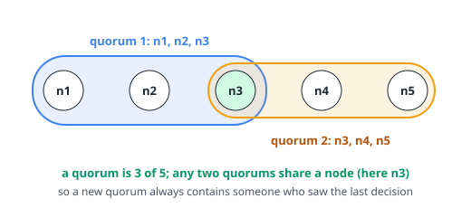

# Consensus & Paxos

Consensus is how a group of computers agrees on one value, even when some of them crash or their messages get lost.

## What consensus is
<!-- bite: 53f3ecee-7439-4b33-89ba-5cfa9ed1bbb3 -->

Consensus is how a group of computers agrees on one value, even when some of them fail.

It is like a group of friends picking one restaurant by majority vote over text. Paxos is a well-known method for doing this safely, and this lesson explains how it works.

## The kid version first
<!-- bite: 195421f0-7851-4162-bd9a-dd9e343893de -->

A group of friends has to pick **one** restaurant, and they'll all go to whatever gets picked. Trouble: some friends might **leave partway** (crash), some **texts get lost** (network), and you often **can't tell** who's still around. How do you get *everyone who's still there* to agree on the **same** choice, and never end up with half going to pizza and half going to tacos?

The trick that works is a **majority vote**. Here's the magic part: **any two groups that are each "more than half" must share at least one person.** So if "pizza" won a majority, there is *no* way "tacos" also won a majority — because the one friend in both groups can't have voted for both. That single fact — **majorities always overlap** — is the seed of every consensus algorithm. Everything below is machinery to run that vote correctly even while friends drop out and texts vanish.

## The problem, precisely
<!-- bite: 7a299efc-9d1d-4591-8fd3-7be835dcfc6d -->

**Consensus:** get a set of nodes to agree on a single value (or a single *order* of operations), satisfying four properties:
- **Agreement** — no two nodes decide *different* values. *(the critical one)*
- **Validity (integrity)** — the decided value was actually proposed by someone (not invented).
- **Termination** — every non-failed node eventually decides. *(the hard one)*

Agreement and validity are **[[architecture/04-distributed-systems/01-what-makes-distributed-systems-hard|safety]]** — they must hold *always*, even under total network chaos. Termination is **liveness** — and [[architecture/04-distributed-systems/02-theoretical-limits|FLP]] proves you *can't* guarantee it in a fully asynchronous network. So real algorithms are built to be **always safe** (never decide two different values) and to **terminate once the network behaves** (partial synchrony, via timeouts). *You never trade away agreement; you accept that progress can stall during a bad partition.*

## Quorums — why "more than half" is the whole trick
<!-- bite: b6a90b63-0c9e-4a84-9282-357f5004d536 -->

The overlap property, stated precisely: in a cluster of **N** nodes, a **quorum** is any set of **⌊N/2⌋ + 1** nodes (a strict majority). **Any two quorums intersect in at least one node.** That shared node is what makes agreement possible — it "remembers" the previous decision and prevents a second, conflicting one from forming.

Consequences you can feel:
- Clusters are **odd-sized** (3, 5, 7) — an even size wastes a node (4 tolerates the same 1 failure as 3, but needs 3 for a quorum).
- An **N-node cluster tolerates ⌊(N−1)/2⌋ failures** — 3 survives 1 down, 5 survives 2 down.
- If a partition leaves **no side with a majority**, *nobody* can make progress — the cluster stops accepting writes rather than risk two conflicting decisions ([[architecture/04-distributed-systems/02-theoretical-limits|CP under CAP]]).

## Seeing two majorities overlap
<!-- bite: ba91cada-6860-45a2-b390-f9e1683e1e83 -->

The blue group and the orange group are both majorities of five. They can't avoid each other: they share n3. That shared node is what carries an earlier decision into the next quorum.

## Why you need consensus constantly
<!-- bite: e25e4b01-1fbe-451b-a3eb-fc771b6a2816 -->

It hides under a surprising range of features — all of them "get everyone to agree on one thing":
- **Leader election** — agree on *which* node is the leader ([[architecture/04-distributed-systems/05-replication|replication failover]]) — and avoid two leaders (split-brain).
- **A replicated log / [[architecture/04-distributed-systems/12-the-log-and-state-machines|state machine]]** — agree on the *order* of operations, which is what gives [[architecture/04-distributed-systems/04-consistency-models|linearizable]] strong consistency.
- **Atomic commit** — agree to commit-or-abort a [[architecture/04-distributed-systems/10-distributed-transactions|transaction]] across shards.
- **Locks, configuration, membership** — one agreed source of truth.

This is why **etcd** and **ZooKeeper** ([[architecture/04-distributed-systems/09-coordination-services|coordination services]]) exist: they package consensus as a service so other systems ([[devops/10-orchestration/01-kubernetes|Kubernetes]] stores everything in etcd) don't reinvent it.

## Paxos — the original, correct, famously baffling
<!-- bite: b44ea6a2-2b78-42e4-a622-86c3a05508a4 -->

**Paxos** (Lamport, 1998) was the first *proven-correct* consensus algorithm, and everything since is a descendant. Three roles (a node can play several): **proposers** suggest values, **acceptors** vote, **learners** find out the result. Single-decree Paxos (agree on *one* value) runs two phases, both gated on a majority:

**Phase 1 — Prepare / Promise.** A proposer picks a **proposal number** `n` (globally unique, ever-increasing) and asks a majority of acceptors to *prepare* for `n`. An acceptor that hasn't already promised a *higher* number **promises** not to accept anything below `n`, and — crucially — **reports back any value it has already accepted**.

**Phase 2 — Accept / Accepted.** If the proposer got promises from a majority, it sends an *accept* request for value `v`. But **which `v`?** Here's the safety rule that makes Paxos correct: **if any acceptor reported an already-accepted value, the proposer MUST re-propose the one with the highest proposal number** (it cannot use its own preferred value). Only if *no* acceptor had accepted anything is the proposer free to choose. Acceptors accept unless they've since promised a higher number. Once a majority accepts `v`, `v` is **chosen** — permanently.

## Paxos: why it's correct, and Multi-Paxos
<!-- bite: f1fe03b1-360a-4e1a-a8b0-14de52186dbe -->

This part explains why Paxos never goes wrong, and how it grows into a log of values.

**Why it's correct (the intuition):** proposal numbers give a total order to attempts, the majority overlap guarantees any new proposer *sees* a previously-chosen value (via that shared acceptor), and the "re-propose the highest accepted value" rule forces it to *keep* that value. So once a value is chosen, every later proposal re-chooses the same one → **agreement holds** even with competing proposers, crashes, and lost messages.

**Multi-Paxos** extends single-decree to a *sequence* of values (a log): elect a stable leader, run Phase 1 *once*, then stream Phase-2-only accepts for each new log slot — amortizing the expensive part. This is what real systems (Google Chubby, Spanner) actually run.

## Paxos: why it has a bad reputation
<!-- bite: b020de2c-a257-41d4-b755-002fb43e48c9 -->

Paxos is correct, but people find it hard to use, and here is why.

**Why Paxos has a bad reputation:** single-decree Paxos is elegant, but turning it into a *practical, log-replicating, leader-based, membership-changing* system (Multi-Paxos) is underspecified in the paper and notoriously hard to implement correctly. Frustration with exactly this is what produced **Raft** — see [[architecture/04-distributed-systems/08-raft-in-depth|Raft in Depth]], which packages the same guarantees into something you can actually build.

## Seeing one round of Paxos
<!-- bite: f93f058c-b11f-4143-831a-35174be7f2ed -->

Time runs down. In phase 1, A2's promise (orange) reports that it already accepted "x" under proposal 3. That report forces the proposer's hand: in phase 2 it must ask for "x", not the value it wanted, so an earlier choice can't be overturned.

## The costs and limits (true of all consensus)
<!-- bite: 448970ca-ff3d-46ff-9e58-bd59977d6693 -->

- **Latency** — every committed operation needs a majority round-trip, so consensus is *slower* than a lone node. Use it for what *must* be consistent (metadata, leader election, config, the commit point), never the high-throughput data path.
- **Availability** — needs a majority alive; lose the majority and writes stop (CP).
- **It does not scale writes** — more nodes = more fault tolerance but a *bigger* quorum = *slower*. Consensus clusters stay small (3–7); for scale you run **many** small consensus groups and [[architecture/04-distributed-systems/13-partitioning|shard]] across them (each shard its own Raft/Paxos group — the Spanner model).
- **Crash-fault-tolerant only** — Paxos/Raft assume nodes fail by *stopping*, not *lying*. Malicious/arbitrary nodes need **[[architecture/04-distributed-systems/09-coordination-services|Byzantine]]** consensus (`3f+1` nodes), which is much costlier and reserved for trustless settings.

## Key insight
<!-- bite: ff792c58-7e8e-463c-823d-bd87cd6325db -->

**Consensus is "get everyone still here to agree on one value, forever," and it's possible only because majorities overlap** — any two majorities share a node that remembers the last decision, so a second, conflicting decision can't form. You hold **agreement always** and accept that **progress can stall** when no majority is reachable (FLP). **Paxos** achieves this with proposal-numbered prepare/accept rounds and the safety rule "re-propose the highest already-accepted value"; **Multi-Paxos** turns it into a log via a stable leader. It's correct but painful to build — which is why the next note is **Raft**, the same guarantees made understandable.

## Check your understanding
<!-- bite: deed893c-70fb-4f35-a380-d5a5281fd508 -->

Try each one before you open the answer.

1. <!-- q: mcq id="3b9843b4" -->
   Why can two different values never both win a majority vote in the same cluster?

   - [x] Any two majorities share at least one node, and that node cannot vote for both
   - [ ] The leader blocks the second vote
   - [ ] Clocks order the votes
   - [ ] Messages are never lost

   

Answer

   Majorities always overlap. The shared node remembers the first decision, which stops a conflicting second one from forming.

   

2. <!-- q: mcq id="da5b6ae0" -->
   Which consensus properties are safety properties that must hold even in total network chaos? Choose all that apply.

   - [x] Agreement: no two nodes decide different values
   - [x] Validity: the decided value was really proposed
   - [ ] Termination: every live node eventually decides

   

Answer

   Agreement and validity are safety. Termination is liveness, and FLP shows it cannot be guaranteed in a fully asynchronous network.

   

3. <!-- q: mcq id="40057578" -->
   Paxos, Phase 2: a proposer got promises from a majority. One acceptor reports it already accepted value "B" under proposal 3. What value must the proposer send?

   - [ ] Its own preferred value
   - [x] "B"
   - [ ] Any value, because it has a majority
   - [ ] Nothing; it must restart Phase 1

   

Answer

   If any acceptor reports an accepted value, the proposer must re-propose the one with the highest proposal number. Here that is "B". This rule keeps a chosen value chosen.

   

4. <!-- q: gap id="1aeafe4e" answers="Multi-Paxos|Multi Paxos|MultiPaxos" -->
   Fill in the gap. Running Phase 1 once under a stable leader and then streaming only Phase 2 accepts for each new log slot is called ___.

   

Answer

   Multi-Paxos. It spreads the expensive prepare phase over many log entries; Chubby and Spanner run it.

   

5. <!-- q: mcq id="fd7cafbe" -->
   Why do consensus clusters stay small (3 to 7 nodes)?

   - [ ] Paxos only supports 7 nodes
   - [x] More nodes means a bigger quorum per write, so writes get slower; scale comes from many small groups instead
   - [ ] Large clusters cannot elect a leader
   - [ ] More nodes reduce fault tolerance

   

Answer

   Every commit needs a majority round-trip. Systems shard data and run one small consensus group per shard.

   

6. <!-- q: open id="e9d563de" -->
   Why do consensus clusters use an odd number of nodes?

   

Answer

   An even size wastes a node. 4 nodes need a quorum of 3 and still tolerate only 1 failure, the same as 3 nodes. Adding the fourth node costs more without adding fault tolerance.

   

## Check your understanding: worked problems
<!-- bite: dede8f82-bfb8-4284-9183-b4283e280a5e -->

Work each one out on paper first, then type your answer.

1. <!-- q: gap id="aa07dd69" answers="4;3" -->
   Fill in the gaps. A quorum is ⌊N / 2⌋ + 1 nodes, and a cluster tolerates ⌊(N − 1) / 2⌋ failures. For N = 7, a quorum is ___ nodes and the cluster tolerates ___ failures.

   

Answer

   ⌊7 / 2⌋ + 1 = 4, and ⌊6 / 2⌋ = 3.

   

2. <!-- q: gap id="e7145974" answers="4;2" -->
   Fill in the gaps. A 6-node cluster needs a quorum of ___ nodes and tolerates ___ failures (the same as a 5-node cluster).

   

Answer

   ⌊6 / 2⌋ + 1 = 4 and ⌊5 / 2⌋ = 2. The sixth node adds cost but no extra fault tolerance.

   

3. <!-- q: mcq id="d2c2b46c" -->
   A 5-node cluster is cut by a network fault into groups of 2, 2 and 1 nodes. Which group can keep accepting writes?

   - [ ] Either group of 2
   - [ ] The group of 1
   - [x] None of them
   - [ ] All of them

   

Answer

   A 5-node cluster needs 3 for a quorum. No group has 3, so the whole cluster stops writing rather than risk two conflicting decisions.

   

4. <!-- q: exact id="b8752ec6" answer="Y" -->
   A Paxos proposer gets promises from a majority. The acceptors report: one accepted (proposal 2, value "X"), one accepted (proposal 5, value "Y"), and one accepted nothing. Which value must it propose?

   

Answer

   "Y", the value with the highest proposal number (5 > 2).

   

5. <!-- q: sketch id="9bf72054" -->
   Draw one round of single-decree Paxos as a message sequence diagram, with lifelines for a proposer and acceptors A1, A2 and A3. The proposer wants to propose "green" with proposal number 8. In phase 1, A1 has accepted nothing, A2 has already accepted value "red" under proposal 4, and A3 has already accepted "blue" under proposal 6. Draw both phases, with the reply each acceptor sends, and write which value the proposer sends in phase 2.

   

Answer

   

   What to check:
   - Phase 1 is prepare(8) out and a promise back from each acceptor; A2 and A3's promises carry what they had accepted.
   - The proposer sends "blue", the value with the highest accepted number (6 beats 4), not its own "green".
   - Phase 2 is accept(8, "blue") out and accepted back; a majority of accepts makes "blue" chosen.

   

## Related
<!-- bite: a12b2683-d1ba-4767-b55d-fad77bf93251 -->
- [[architecture/04-distributed-systems/08-raft-in-depth|Raft in Depth]] — the same problem solved in a buildable way (the recommended study path)
- [[architecture/04-distributed-systems/09-coordination-services|Coordination Services]] — consensus packaged as etcd/ZooKeeper; BFT
- [[architecture/04-distributed-systems/05-replication|Replication]] — what strong consistency and safe failover require
- [[architecture/04-distributed-systems/10-distributed-transactions|Distributed Transactions]] — atomic commit is a consensus problem
- [[architecture/05-case-studies/index|Case Studies]] — the build-your-own Raft KV-store

## About this lesson
<!-- bite: 9c8d0a9f-9531-4c1a-b251-827e694e1384 -->

**Level:** reference. **Covers:** from the canon (Lamport's *Paxos Made Simple*, DDIA ch. 9, MIT 6.824). The **crown jewel** of distributed systems: getting a group of unreliable machines to *agree* on one thing, despite crashes and a lying network. This note is the *problem*, why it's everywhere, the **quorum** idea that makes it possible, and **Paxos** (the original solution). **Raft** — the modern, understandable version — gets its own implementation-depth note ([[architecture/04-distributed-systems/08-raft-in-depth|Raft in Depth]]).
