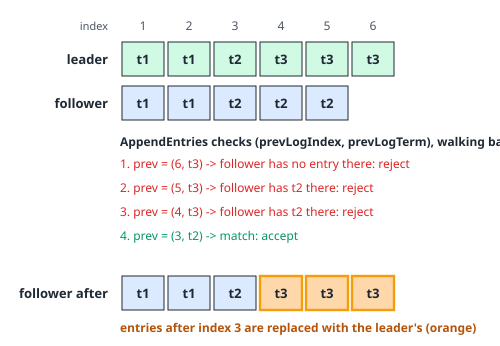

# Raft in Depth

Raft is a method for keeping a list identical across a group of computers, by picking one leader that writes to the list while the others copy it.

## What Raft is
<!-- bite: 09981bee-2367-4bb4-9968-bebab317ce17 -->

Raft is a way to keep one list identical across a group of computers.

It is used inside many real databases and tools to agree on data. This lesson goes through how the leader is chosen and how the copies stay in step.

## The kid version first
<!-- bite: 7a488a83-2a1f-477f-b749-c877ec1bdf33 -->

A group keeps a shared **to-do list** that must stay identical for everyone, even as kids come and go. Raft's plan:
1. **Pick one captain.** Only the captain writes on the list; everyone else **copies the captain's list**. One writer = no arguments about order.
2. **Copy before it counts.** The captain only calls a line "official" once **more than half** the group has copied it down. That way, even if the captain vanishes, a majority already has every official line.
3. **New captain if the old one goes quiet.** If nobody hears from the captain for a while, someone raises their hand and asks for votes; whoever a **majority** picks becomes the new captain — but *only if their list is at least as complete as everyone who votes*, so no official line is ever lost.
4. **Numbered rounds so ghosts are ignored.** Each "who's captain" round has a number (a **term**). If an old captain who fell asleep wakes up and starts giving orders with an *old* number, everyone says "that number's expired" and ignores them.

That's Raft. The rest is making each of those four rules airtight against the exact worst-case timing.

## The pieces: roles, terms, the log
<!-- bite: 5e05a200-90eb-4695-988f-507a0688d2b5 -->

- **Three roles:** every node is a **Follower** (passive, copies the leader), a **Candidate** (running to be leader), or the **Leader** (handles all client writes). Normal operation = one leader + followers.
- **Terms** = a logical clock ([[architecture/04-distributed-systems/03-time-and-ordering|logical time]]). Time is divided into numbered terms, each starting with an election and having **at most one leader**. *Every message carries the sender's term.* The rule that makes stale leaders harmless: **if you ever see a term higher than yours, adopt it and become a follower; if you receive a message with a term lower than yours, reject it.** Terms are how the group ignores ghosts from the past.
- **The log** = each node's copy of the ordered list of commands. Each entry stores `(term when it was created, command)`. Once an entry is **committed**, it's applied to the state machine ([[architecture/04-distributed-systems/12-the-log-and-state-machines|replicated state machine]]) — and committing a log of commands *is* consensus on their order.

## The two RPCs, field by field
<!-- bite: 6124292c-8241-4000-9897-92f5ef5be071 -->

Everything in Raft is these two remote calls. Knowing *why each field exists* is knowing Raft.

### `RequestVote` (candidates → everyone, during elections)
| Field | Why it's there |
|---|---|
| `term` | the candidate's term; a voter with a higher term rejects it |
| `candidateId` | who's asking |
| `lastLogIndex`, `lastLogTerm` | **the up-to-date check** — the voter grants its vote *only if the candidate's log is at least as up-to-date as its own* (see Safety). This is what stops a node missing committed entries from ever winning. |

A voter grants its vote if the candidate's term is current, it hasn't already voted this term, and the candidate's log is at least as up-to-date as its own.

## The two RPCs: `AppendEntries` (leader → followers; also the heartbeat)
<!-- bite: 0807d2ce-7c86-4499-b315-849f6c358ea1 -->

The second call is how the leader sends new entries, and it doubles as a heartbeat.

| Field | Why it's there |
|---|---|
| `term`, `leaderId` | which leader/term is speaking |
| `prevLogIndex`, `prevLogTerm` | **the consistency check** — the entry *immediately before* the new ones. The follower accepts the new entries **only if it has a matching entry at `prevLogIndex` with `prevLogTerm`.** This single check enforces the Log Matching Property. |
| `entries[]` | the new log entries (empty = a pure **heartbeat**) |
| `leaderCommit` | the leader's commit index, so followers learn what's now safe to apply |

If the consistency check **fails**, the follower rejects; the leader **decrements `prevLogIndex` and retries**, walking backward until it finds the last point where their logs agree, then overwrites everything after it with its own. The leader's log is the source of truth; divergent follower tails get rewritten.

## Leader election (rule 3, precisely)
<!-- bite: f2a66778-20f8-43b5-9dea-e258a5562871 -->

A follower that hears nothing from a leader within its **election timeout** becomes a candidate: it increments its term, votes for itself, and sends `RequestVote` to all. Outcomes: it wins a **majority** → becomes leader and starts sending heartbeats; or it hears from a legitimate leader (equal/higher term) → steps back to follower; or the vote **splits** (nobody wins) → a new election.

The trick that prevents endless split votes: **randomized election timeouts** (e.g. each node picks 150–300 ms randomly). One node almost always times out first, wins before others wake up, and starts heartbeating — split votes become rare and self-heal fast.

## Seeing the three roles
<!-- bite: ec070636-36ef-4ee5-9a8c-74906e98389a -->

Each arrow is one way a node changes role. Most of the time every node sits in FOLLOWER or LEADER; CANDIDATE only lasts as long as an election.

## Seeing one election, message by message
<!-- bite: 533f9b4d-74ec-480a-812b-87fe0d877c5a -->

Each node's random timeout is written under its name. N2's 170 ms is the shortest, so it moves to term 2, asks the other four for votes, and becomes leader once they grant them. Its heartbeats then reset everyone else's timers.

## Log replication & the Log Matching Property
<!-- bite: 91db7cb9-77e0-4e91-b862-c4bf9ec0cc85 -->

All client writes go to the leader, which appends to its log and sends `AppendEntries`. The **Log Matching Property** is Raft's backbone invariant:
> If two logs contain an entry with the **same index and term**, then (a) they store the same command, *and* (b) the logs are **identical in all entries up to that point.**

Why it holds: (a) a leader creates at most one entry per index per term; (b) the `prevLogIndex/prevLogTerm` check means a follower only appends if the *previous* entry already matched — inductively, a match at index `i` implies a match all the way back. So one matching `(index, term)` pair proves the entire prefix matches. This is what lets the leader repair a follower by walking backward to the first agreement point and overwriting forward.

## Seeing a follower's log repaired
<!-- bite: 407415b0-3915-4e98-a979-bcfbdb8f989c -->

Each box is one log entry, labelled with the term it was created in. The leader walks `prevLogIndex` back one step at a time until the follower has the same term at that index (index 3). Everything after that point is replaced with the leader's entries.

## The subtle part everyone gets wrong: the commitment rule (Figure 8)
<!-- bite: 7610d78d-8c71-4981-98a8-5c3a11f2223d -->

Naively you'd think: "an entry is committed once it's replicated on a majority." **This is wrong and it's the single most-missed detail in Raft.**

The danger: an entry from a *previous* term can be replicated on a majority and *still later be overwritten* by a new leader — because a different node with a longer log could win a subsequent election and force its own entries. If you committed (applied) that entry based only on majority replication, you'd have applied something that later disappears → a **safety violation**.

**Raft's rule:** a leader may only **commit an entry from its *own current term*** (once that entry is on a majority). Committing a current-term entry **drags all preceding entries with it** (by Log Matching, they're on that majority too), so old entries *do* get committed — but only *indirectly*, once something from the new term sits on top of them. A brand-new leader therefore often appends an empty **no-op** entry immediately, so it has a current-term entry to commit and can safely commit the inherited backlog. Miss this rule and your implementation loses committed data on a specific leader-crash-and-recover sequence; the paper's "Figure 8" is exactly that scenario.

## Safety: why a new leader has every committed entry
<!-- bite: af3caf4e-8587-46c1-a834-3a757ea9a551 -->

The **up-to-date restriction** in `RequestVote` guarantees it. "Up-to-date" is defined as: **higher `lastLogTerm` wins; if equal, longer log wins.** A candidate needs a majority to win; a committed entry is (by definition) on a majority; any two majorities overlap → at least one voter has the committed entry, and it will *refuse* to vote for a candidate whose log is less up-to-date. Therefore **no candidate missing a committed entry can ever assemble a majority.** Committed data survives every leader change — the property that makes Raft correct.

## Cluster membership changes
<!-- bite: 44829498-8292-4db9-9174-ec626a910b85 -->

Adding/removing nodes is dangerous: if nodes switch from the old to the new configuration at different times, you can briefly have **two disjoint majorities** (old-majority and new-majority) that each elect a leader → split brain. Raft's answers:
- **Joint consensus** (the paper's general method): a transitional configuration `C_old,new` in which decisions require majorities from **both** the old and new sets simultaneously, so no split is possible; then transition to `C_new`.
- **Single-server changes** (the common simplification): add or remove **one** node at a time — a one-node change can't create two disjoint majorities, so it's safe without joint consensus.

## Log compaction & snapshots
<!-- bite: 7e764259-6272-48e2-b354-0db7ffb4e2cf -->

The log can't grow forever. Each node periodically **snapshots** its state machine (the compacted state up to some index) and discards the log entries before it. A leader that needs to update a follower whose required entries were already discarded sends an **`InstallSnapshot`** RPC (the whole state) instead of `AppendEntries`. This bounds disk/memory and speeds up rejoining far-behind nodes.

## Linearizable client semantics (the details real systems need)
<!-- bite: e0b72e25-6a30-4d01-addb-f61e56e58d74 -->

Consensus on the log isn't enough for a correct *service*:
- **Duplicate commands:** a client retries a write after a timeout (it never saw the ack), so the same command reaches the log twice → applied twice (double-charge!). Fix: each client gets a **client id + monotonic sequence number**; the state machine remembers the last sequence applied per client and **ignores duplicates** — giving exactly-once *effect* despite at-least-once delivery ([[architecture/04-distributed-systems/02-theoretical-limits|Two Generals]]).
- **Linearizable reads without writing to the log:** naively, a read must go through the log (expensive) to be sure it's current. Optimizations: **ReadIndex** — the leader records its current commit index, confirms it's *still* leader via one heartbeat round-trip to a majority, then serves the read once it has applied up to that index (no log append). **Lease reads** — the leader holds a time-based lease (renewed by heartbeats) during which it *knows* no other leader exists, so it can serve reads locally with zero round-trips (relying on bounded clock drift — a weaker but faster guarantee).

## A worked failure trace (why the rules earn their keep)
<!-- bite: 9e1974c9-4588-49d3-8743-ffb149327cfa -->

1. Leader **L1** (term 4) appends entry `X` and replicates it to a **minority** before crashing. `X` is *not* committed.
2. Timeout → election. **L2** wins term 5. Whether `X` survives depends on whether a majority had it: if not, L2's log lacks `X`, and when L2 appends its own entries, the `prevLog` check makes followers that had `X` **overwrite** it. No harm — `X` was never committed, so no client was ever told it succeeded.
3. **L1 recovers** and, still thinking it's leader in term 4, sends `AppendEntries` with `term=4`. Every node now at term 5 sees `4 < 5` and **rejects** it; L1 sees the higher term in the replies and **steps down** to follower. The ghost is ignored.
4. L2 appends a term-5 entry, replicates to a majority, and **commits it — which retroactively commits any inherited entries beneath it** (the Figure-8 rule). The list is consistent and no committed line was ever lost.

Every rule above maps to one step of this trace — that's why they exist.

## Key insight
<!-- bite: d6fb3012-fcbe-4a85-a3b3-1b9ca7557459 -->

**Raft = one captain writes the shared list, everyone copies it, a line counts only once a majority has it, and a new captain must have every counted line — all tagged with numbered terms so ghosts from old rounds are ignored.** The buildable details that matter: the two RPCs and *why each field exists* (`prevLog*` enforces Log Matching; `lastLog*` enforces the up-to-date restriction), randomized timeouts to avoid split votes, the **Figure-8 commitment rule** (commit only a *current-term* entry, which drags the rest), snapshots for compaction, and client-id dedup + ReadIndex/lease for a correct, fast *service*. Read it, then **build it** — the edge cases only become real in code.

## Check your understanding
<!-- bite: f231fd51-e627-47e0-bcd3-781f18f9d33c -->

Try each one before you open the answer.

1. <!-- q: mcq id="49b06c32" -->
   An old Raft leader wakes up after a pause and sends AppendEntries with term 4. The other nodes are now on term 6. What happens?

   - [ ] The followers accept, since it was the leader
   - [x] The followers reject it, and the old leader sees term 6 in the replies and steps down
   - [ ] Two leaders run side by side
   - [ ] The cluster starts a new election at term 4

   

Answer

   Any message with a lower term is rejected, and any node that sees a higher term adopts it and becomes a follower. Terms make old leaders harmless.

   

2. <!-- q: mcq id="9b78144f" -->
   What stops Raft elections from splitting the vote over and over?

   - [ ] A fixed election order by node id
   - [x] Randomised election timeouts, so one node usually times out first and wins
   - [ ] Clocks synced with NTP
   - [ ] Lowering the quorum size

   

Answer

   Each node picks a random timeout (for example 150–300 ms). One node usually wakes first, wins, and starts heartbeats before others become candidates.

   

3. <!-- q: gap id="607beb2f" answers="prevLogIndex;prevLogTerm" -->
   Fill in the gaps. A follower only appends new entries if it already has a matching entry at index ___ with term ___. This check enforces the Log Matching Property.

   

Answer

   prevLogIndex and prevLogTerm. If the check fails, the leader steps back one index and retries until the logs agree.

   

4. <!-- q: mcq id="b392c6f3" -->
   When may a Raft leader mark an entry as committed?

   - [ ] As soon as any entry is on a majority, whatever its term
   - [x] When an entry from its own current term is on a majority; that also commits all earlier entries
   - [ ] As soon as it writes the entry to its own log
   - [ ] Only when every node has the entry

   

Answer

   This is the Figure 8 rule. An old-term entry on a majority can still be overwritten, so it is only committed indirectly. That is why a new leader often appends a no-op entry first.

   

5. <!-- q: mcq id="12ac8adf" -->
   A client retries a write after a timeout, and the command lands in the log twice. How does a Raft service avoid applying it twice?

   - [ ] It cannot; duplicates are always applied
   - [x] Each client sends an id and a sequence number, and the state machine ignores sequence numbers it has already applied
   - [ ] The leader drops every retry
   - [ ] It uses a lease read

   

Answer

   Client id plus sequence number gives exactly-once effect on top of at-least-once delivery.

   

6. <!-- q: open id="bd9e6c4f" -->
   Why can a candidate that is missing a committed entry never become leader?

   

Answer

   A committed entry sits on a majority, and the candidate needs votes from a majority. Two majorities share at least one node, and that node has the entry. It refuses to vote for any candidate whose log is less up to date (lower last term, or same term and shorter), so the candidate cannot reach a majority.

   

## Check your understanding: worked problems
<!-- bite: a608c86a-6aa3-4713-b889-634e63e4cf0a -->

Work each one out on paper first, then type your answer.

1. <!-- q: mcq id="5642d73f" -->
   Raft's up-to-date rule: a higher last log term wins; if the last terms are equal, the longer log wins. A voter grants its vote only if the candidate is at least as up to date. Which candidates get this voter's vote? The voter's log ends with term 4 at index 8. Choose all that apply.

   - [ ] Candidate ending with term 3 at index 12
   - [x] Candidate ending with term 5 at index 4
   - [ ] Candidate ending with term 4 at index 6
   - [x] Candidate ending with term 4 at index 8

   

Answer

   Term 5 beats term 4 whatever the length. Term 4 at index 8 ties, which counts as at least as up to date. Term 3 loses even with a longer log, and term 4 at index 6 is shorter.

   

2. <!-- q: exact id="c091aea7" answer="4" -->
   A 5-node cluster. A candidate's log ends with (term 4, index 6), and it votes for itself. The other four voters' logs end with:

   | Voter | Last term | Last index |
   |---|---|---|
   | V1 | 4 | 6 |
   | V2 | 3 | 9 |
   | V3 | 4 | 7 |
   | V4 | 2 | 3 |

   Using the up-to-date rule (higher last term wins; equal terms, longer log wins), how many votes does the candidate get in total?

   

Answer

   4: itself, V1 (tie), V2 (term 3 is lower) and V4 (term 2 is lower). V3 refuses because it has the same term and a longer log. 4 is a majority of 5, so it wins.

   

3. <!-- q: exact id="68dbb7c5" answer="8" -->
   A 5-node Raft leader tracks the highest log index each node has (including itself): 10, 10, 8, 6, 4. All of these entries are from the current term. What is the highest index it can commit?

   

Answer

   8. Index 8 is held by 3 nodes (10, 10, 8), a majority of 5. Index 10 is only on 2 nodes.

   

4. <!-- q: sketch id="6919b401" -->
   Draw two Raft logs as rows of boxes, one box per entry, with the entry's term written in it. The leader's log is terms 1, 2, 2, 4, 4 (indexes 1 to 5). A follower's log is terms 1, 2, 3, 3, 3, 3 (indexes 1 to 6). List each AppendEntries consistency check the leader makes, starting from prevLogIndex 5, and whether the follower accepts it. Then draw the follower's log after the repair.

   

Answer

   

   What to check:
   - Four checks: index 5, 4 and 3 are rejected, index 2 with term 2 is accepted.
   - The follower keeps only indexes 1 and 2 of its own log.
   - The repaired follower log equals the leader's, 1, 2, 2, 4, 4: the extra sixth entry is deleted, not kept.

   

## Related
<!-- bite: 46875c0d-bb72-4e0a-af37-e6f184c6cf79 -->
- [[architecture/04-distributed-systems/07-consensus-and-paxos|Consensus & Paxos]] — the problem Raft solves and the original algorithm
- [[architecture/04-distributed-systems/09-coordination-services|Coordination Services]] — etcd/ZooKeeper run this under the hood; fencing, leases
- [[architecture/04-distributed-systems/12-the-log-and-state-machines|The Log & State Machines]] — what the committed log feeds
- [[architecture/04-distributed-systems/03-time-and-ordering|Time & Ordering]] — terms as a logical clock
- [[architecture/05-case-studies/index|Case Studies]] — build the Raft KV-store (do this)

## About this lesson
<!-- bite: 400dd0bc-bda8-4516-8146-8c58b9ebca15 -->

**Level:** reference. **Covers:** from the Raft paper (Ongaro & Ousterhout, *In Search of an Understandable Consensus Algorithm*, 2014) and MIT 6.824. [[architecture/04-distributed-systems/07-consensus-and-paxos|Consensus & Paxos]] covered *why* agreement is hard and the original solution. This note is **Raft at the level where you can actually build one** — the field's most-implemented consensus algorithm, and the topic that most rewards writing the code ([[architecture/05-case-studies/index|build-your-own Raft KV-store]]). The details below feel obvious in prose and bite you in the implementation; that gap is the whole point.
