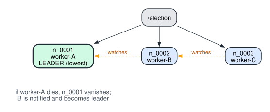
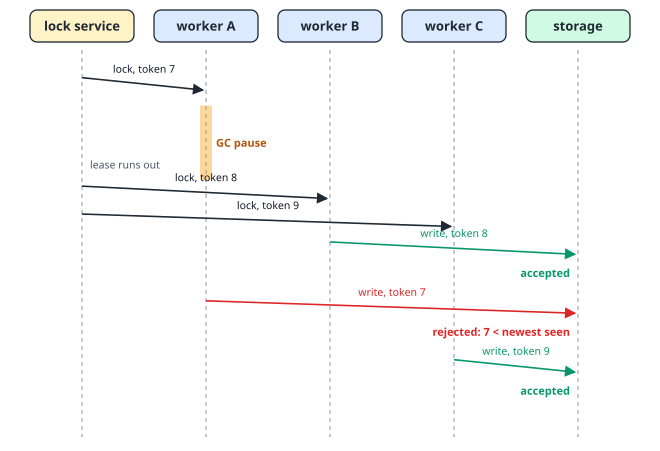

# Coordination Services

A coordination service is a small, very reliable shared system that other programs ask for agreements, such as who the leader is or who holds a lock.

## What a coordination service is
<!-- bite: 9e7c985f-a0af-45ee-8233-932c90c38e73 -->

A coordination service is a small, very reliable system other programs ask to settle agreements.

Instead of every team building its own voting system, they use one that already gets it right. This lesson shows what these services offer and how to use them safely.

## The kid version first
<!-- bite: fc9346d9-695e-4c1f-8b0a-4019f523c8d6 -->

Running a fair vote is hard to get right ([[architecture/04-distributed-systems/08-raft-in-depth|Raft]] proves it). So instead of *every* group of kids inventing their own voting rules, the school provides **one trusted hall monitor** who already knows how to run fair votes and remember decisions. Any group can just walk up and ask:
- *"Who's our team captain?"* → the monitor runs the election and tells everyone the same answer.
- *"Can I hold the ball? Nobody else should take it while I have it."* → the monitor hands out a **turn** and makes sure only one kid holds it.
- *"Tell me the moment Sam leaves the playground."* → the monitor **watches** and pings you.

That hall monitor is **ZooKeeper** or **etcd**. The clever part is *how* it knows a kid left (so it can free their turn) and how it stops a **daydreaming kid who thinks they still have the ball** from messing things up (fencing). Both are below.

## ZooKeeper & etcd — the workhorses
<!-- bite: dfff9178-620d-4a5a-b1af-3909c4cba21c -->

Both are small, consensus-backed ([[architecture/04-distributed-systems/07-consensus-and-paxos|ZAB / Raft]]) key-value stores whose *whole job* is coordination, not bulk data. [[devops/10-orchestration/01-kubernetes|Kubernetes]] stores **all** its cluster state in etcd; Kafka, HBase, and many others use ZooKeeper. The primitives that make them useful:

- **The data model** — a tiny filesystem-like tree of **znodes** (ZooKeeper) or a flat key-space (etcd). You store small values (config, who's-the-leader, membership lists) — kilobytes, not gigabytes.
- **Ephemeral nodes** — a znode **tied to the client's session** that **automatically disappears when that client disconnects** (its heartbeats stop). *Kid version: the moment Sam leaves, his name-tag vanishes on its own.* This is the magic ingredient — it turns "is this client alive?" into "does its ephemeral node still exist?", giving you [[architecture/04-distributed-systems/14-failure-detection-and-membership|failure detection]], locks, and leader election almost for free.
- **Sequential nodes** — the service appends a monotonically increasing number to a node's name, so clients get a fair, ordered queue (used for locks and elections).
- **Watches** — a client registers to be **notified** when a znode changes/disappears, instead of polling. Event-driven coordination.

## ZooKeeper & etcd: leader election, the standard recipe
<!-- bite: a0d95c31-bd3f-4b6e-829d-7cae99c43bbd -->

The building blocks above combine into a simple way to elect a leader.

Every candidate creates an **ephemeral + sequential** node under `/election/`. The one with the **lowest sequence number is the leader.** Each other node **watches** the node just below it. If the leader's client dies, its ephemeral node vanishes → the next-lowest gets notified → it becomes leader. Automatic, fair, and self-healing — all from ephemeral + sequential + watches.

## Seeing the election recipe
<!-- bite: e9bab2a5-c384-46d1-b4ff-52e569e6cb1b -->

Each worker's node hangs under `/election`, numbered in the order it was created. The lowest number leads, and each other node watches the one just below it (orange), so when a node vanishes exactly one worker is told.



## Distributed locks — and why "get a lock" is not enough
<!-- bite: 98ac2bb0-1c89-467b-9b78-f3ea34c94a47 -->

The obvious use: *"only one worker should process this job."* Ask the service for a lock, do the work, release it. **But a naive lock is unsafe**, and this is one of the most important gotchas in the field:

```text
1. Worker A acquires the lock, starts writing to storage.
2. Worker A hits a stop-the-world GC pause (or VM suspend) for 15 seconds
   — from the outside, indistinguishable from dead.
3. The lock's lease expires; the service gives the lock to Worker B.
4. Worker B starts writing.
5. Worker A WAKES UP, still believing it holds the lock, and writes too.
   → TWO writers → corruption. The lock did NOT protect anything.
```

## Distributed locks: why the lock failed, and fencing
<!-- bite: fc4892ad-7da2-4d9c-92d3-b59b13c74ab3 -->

The lock service did its job, so the fix has to come from somewhere else.

The lock service did nothing wrong — [[architecture/04-distributed-systems/01-what-makes-distributed-systems-hard|a paused process can't know time passed]]. The fix is **fencing tokens**: every time the lock is granted, the service also returns a **monotonically increasing number** (a fence). Worker A got token `33`; Worker B got token `34`. The **storage system itself checks the token** and **rejects any write with a token lower than the highest it has seen.** So when zombie A wakes and writes with token `33`, storage says "I've already accepted `34` — rejected." *Kid version: each turn comes with a numbered ticket, and the ball-keeper refuses any ticket older than the newest one it's seen.*

The deep lesson: **a lock alone can't provide mutual exclusion in an asynchronous system** — you need the *protected resource* to participate via fencing. Any "distributed lock" tutorial that omits fencing is teaching a data-corruption bug.

## Seeing fencing tokens stop the zombie
<!-- bite: f16b6e75-1b40-48a7-9aff-a5368fc6d4f5 -->

Time runs down. Worker A's orange bar is its pause; while it sleeps, the lease runs out and B gets the lock with a higher token. When A wakes and writes with the old token, storage turns it away.


## The other consensus lineages (beyond Raft/Paxos)
<!-- bite: 53a110f8-d264-4db6-8a40-06649b0a6dbf -->

Raft and Multi-Paxos aren't the only crash-fault-tolerant consensus protocols — and they're more alike than different (all are *leader + replicated log + numbered view/term changes*):

- **Viewstamped Replication (VR)** — actually *predates* Paxos; a leader-based replication protocol with "views" (Raft's terms by another name). Independently arrived at nearly the same design — strong evidence the leader-log-view shape is the *natural* solution.
- **ZAB (ZooKeeper Atomic Broadcast)** — ZooKeeper's protocol; a leader broadcasts a totally-ordered stream of state changes, with a recovery phase on leader change. Optimized for the high-read, low-write coordination workload.

If you understand Raft, you understand all three — they differ in details, not in essence.

## Byzantine fault tolerance — when nodes can *lie*
<!-- bite: 2538859c-dd54-40aa-9641-8feb4e2b1685 -->

Everything so far assumes **crash faults**: nodes fail by *stopping*, never by sending false or conflicting messages. **Byzantine Fault Tolerance (BFT)** handles nodes that are *malicious or arbitrarily broken* — sending different messages to different peers, forging data. It's fundamentally harder:
- **You need `3f + 1` nodes to tolerate `f` liars** (vs `2f + 1` for crashes), because you must out-vote not just the silent but the actively-deceptive, and confirm a supermajority independently agrees.
- **PBFT** (Practical Byzantine Fault Tolerance) was the first efficient BFT protocol; modern **blockchains** use BFT-style consensus (or proof-of-work/stake as a Sybil-resistant twist) because participants are *untrusted strangers*.
- **When you need it:** trustless/adversarial settings (public blockchains, cross-organization systems). **When you don't:** normal internal infrastructure, where you control the machines and crash-fault-tolerant Raft/Paxos is the right, far cheaper choice.

## The rule of thumb: control plane, not data plane
<!-- bite: d3c6f770-65a0-44be-983d-b650d7aff964 -->

Every coordination primitive is a [[architecture/04-distributed-systems/07-consensus-and-paxos|consensus]] round-trip — correct but slow, and it doesn't scale writes. So use a coordination service for the **control plane** (who's the leader, what's the config, which nodes are members, hand out the lock) — small, infrequent, must-be-correct decisions — and **never** route your high-throughput **data plane** (every user request) through it. etcd holds "which pod is the leader," not "every row of user data."

## Key insight
<!-- bite: 39b99509-c9bd-4778-a152-b110d6f8c436 -->

**Don't build consensus — rent it.** A coordination service (ZooKeeper/etcd) is a small consensus-backed store that hands you locks, leader election, config, and membership, mostly powered by **ephemeral nodes** (auto-vanish when a client dies) + **watches**. But a "distributed lock" is *not enough on its own*: a [[architecture/04-distributed-systems/01-what-makes-distributed-systems-hard|paused process]] can hold a lock it's lost, so the protected resource must enforce **fencing tokens** (reject any writer with a stale number). Raft/VR/ZAB are the same leader-log-view idea; **BFT** (`3f+1`) is the pricier version for when nodes might *lie*. And always: coordination is for the **control plane**, never the data plane.

## Check your understanding
<!-- bite: 662fea0d-34e8-495a-8294-b2d105ac61fc -->

Try each one before you open the answer.

1. <!-- q: mcq id="6f318c71" -->
   In ZooKeeper, what is an ephemeral node?

   - [x] A node tied to a client's session that disappears by itself when the client's heartbeats stop
   - [ ] A node that is deleted after one read
   - [ ] A node stored only in memory on the leader
   - [ ] A node whose name gets an increasing number added

   <details><summary>Answer</summary>

   It vanishes when its client disconnects, which turns "is this client alive?" into "does its node still exist?". The increasing number describes a sequential node.

   </details>

2. <!-- q: mcq id="566384fc" -->
   Worker A holds a lock, then freezes in a 15-second GC pause. The lock expires and goes to worker B. A wakes up and writes. What prevents corruption?

   - [ ] A longer lock lease
   - [ ] Asking the lock service again before every write
   - [x] Fencing tokens: the storage rejects any write whose token is lower than the highest it has seen
   - [ ] Nothing, two writers is unavoidable

   <details><summary>Answer</summary>

   A lock alone cannot give mutual exclusion, because a paused process cannot know time has passed. The protected storage must check fencing tokens.

   </details>

3. <!-- q: gap id="8fe75b3c" answers="watch|watches" -->
   Fill in the gap. Instead of polling, a ZooKeeper client registers a ___ to be notified when a znode changes or disappears.

   <details><summary>Answer</summary>

   A watch. Watches make coordination event-driven.

   </details>

4. <!-- q: mcq id="7b5bca3d" -->
   Which of these belong in a coordination service like etcd? Choose all that apply.

   - [x] Which pod is the current leader
   - [x] A small piece of shared configuration
   - [ ] Every row of user data
   - [ ] Every incoming user request

   <details><summary>Answer</summary>

   Coordination services are for the control plane: small, infrequent decisions that must be correct. Each write is a consensus round-trip, so the high-volume data plane does not belong there.

   </details>

5. <!-- q: mcq id="b0897b3c" -->
   When does a system need Byzantine fault tolerance instead of Raft or Paxos?

   - [ ] Whenever there are more than 7 nodes
   - [x] When nodes may lie or act maliciously, such as untrusted parties in a public blockchain
   - [ ] When the network is slow
   - [ ] For all internal infrastructure

   <details><summary>Answer</summary>

   Raft and Paxos assume nodes fail by stopping. BFT handles lying nodes but costs much more (3f + 1 nodes).

   </details>

6. <!-- q: open id="9b709a25" -->
   Describe the standard leader-election recipe built from ephemeral nodes, sequential nodes and watches.

   <details><summary>Answer</summary>

   Each candidate creates an ephemeral, sequential node under /election/. The lowest number is the leader. Each other candidate watches the node just below its own. When the leader dies, its ephemeral node disappears, the next one is notified and becomes leader.

   </details>

## Check your understanding: worked problems
<!-- bite: a7489048-2b5b-4cb9-8205-7daf816e2818 -->

Work each one out on paper first, then type your answer.

1. <!-- q: gap id="663dc79a" answers="10;4" -->
   Fill in the gaps. BFT needs 3f + 1 nodes to tolerate f lying nodes. To tolerate 3 liars you need ___ nodes. A 13-node BFT cluster tolerates at most ___ liars.

   <details><summary>Answer</summary>

   3 × 3 + 1 = 10. For 13 nodes, f = (13 − 1) / 3 = 4.

   </details>

2. <!-- q: gap id="01bae5a8" answers="accept|accepted;reject|rejected;accept|accepted;reject|rejected" -->
   Fill in the gaps with accept or reject. A storage system has seen no tokens yet and rejects any write whose fencing token is lower than the highest it has accepted. Writes arrive in this order:

   | Order | Writer | Token |
   |---|---|---|
   | 1 | A | 33 |
   | 2 | B | 34 |
   | 3 | A | 33 |
   | 4 | C | 35 |
   | 5 | B | 34 |

   Write 2 is ___, write 3 is ___, write 4 is ___, write 5 is ___.

   <details><summary>Answer</summary>

   Write 2 (34 ≥ 33) is accepted. Write 3 (33 < 34) is rejected. Write 4 (35) is accepted. Write 5 (34 < 35) is rejected.

   </details>

3. <!-- q: gap id="710fa4c0" answers="B;D" -->
   Fill in the gaps. Four candidates create ephemeral sequential nodes under /election/: A gets n-0007, B gets n-0003, C gets n-0012 and D gets n-0005. The lowest number leads. The leader is ___. If the leader's session dies, the new leader is ___.

   <details><summary>Answer</summary>

   Sorted: B (3), D (5), A (7), C (12). B leads; when B's node vanishes, D, which was watching it, takes over.

   </details>

4. <!-- q: sketch id="9efab4d2" -->
   Draw a message sequence diagram with lifelines for a lock service, workers A, B and C, and storage. Storage rejects any write whose token is lower than the highest token it has accepted. In this order: A gets the lock with token 7 and then pauses; the lease runs out; B gets the lock with token 8; C gets the lock with token 9; B writes with token 8; A wakes and writes with token 7; C writes with token 9. Mark each write accepted or rejected.

   <details><summary>Answer</summary>

   

   What to check:
   - Tokens are handed out in increasing order: 7, 8, 9.
   - B's write (8) is accepted, and storage now remembers 8.
   - A's write (7) is rejected, even though A still thinks it holds the lock.
   - C's write (9) is accepted, because 9 is higher than 8.

   </details>

## Related
<!-- bite: 75ac0f13-f612-41c5-a67c-7fc435995d19 -->
- [[architecture/04-distributed-systems/07-consensus-and-paxos|Consensus & Paxos]] — what these services run inside
- [[architecture/04-distributed-systems/08-raft-in-depth|Raft in Depth]] — the algorithm powering etcd/Consul
- [[architecture/04-distributed-systems/01-what-makes-distributed-systems-hard|What Makes It Hard]] — process pauses, the reason fencing exists
- [[architecture/04-distributed-systems/14-failure-detection-and-membership|Failure Detection & Membership]] — ephemeral nodes as a liveness signal
- [[devops/10-orchestration/01-kubernetes|Kubernetes]] — the biggest etcd user

## About this lesson
<!-- bite: 1b063166-0bf7-4419-bfc2-ba4297bd7290 -->

**Level:** reference. **Covers:** from the canon (the ZooKeeper and Chubby papers, DDIA ch. 8–9, the PBFT paper). Most applications should **not** implement [[architecture/04-distributed-systems/07-consensus-and-paxos|consensus]] themselves — it's too easy to get wrong. Instead they lean on a **coordination service** that has consensus built in and exposes it as simple, reliable primitives: locks, leader election, configuration, membership. This note is those services, how to use them *safely* (fencing!), and the other consensus lineages beyond Raft.
