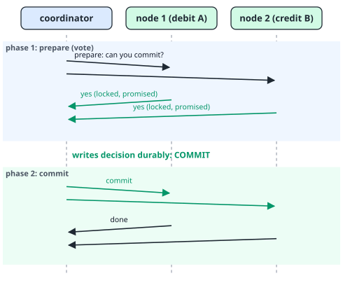
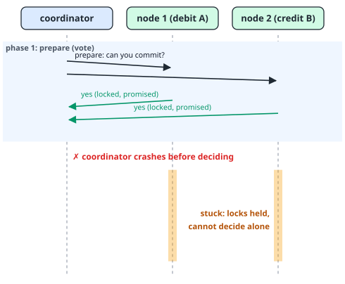
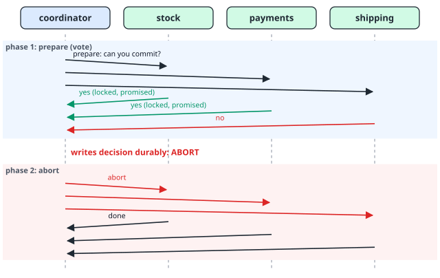

# Distributed Transactions

A distributed transaction is a change that has to happen on several computers together, where either every part happens or none of it does.

## What a distributed transaction is
<!-- bite: 74251819-6308-4b9f-9a3c-9a50dc0de633 -->

A distributed transaction is a change on several computers that must happen everywhere or nowhere.

Moving money from your account in one bank to an account in another bank is a good example. This lesson covers the two main ways of doing this and where each one can go wrong.

## The kid version first
<!-- bite: c328c13b-e35d-4fe5-b5c2-47d34b39ae4e -->

You want to move **$50 from your piggy bank to your sister's piggy bank** — but the two banks are in **different rooms**. The rule you need is **"both change, or neither does"**: it must never happen that $50 leaves yours and *doesn't* arrive in hers (money vanished) or arrives *without* leaving yours (money duplicated). Easy when both banks are on your desk. Hard when a room can get **locked** (a machine or network fails) *right in the middle*. Two ways people handle it:
1. **A referee counts everyone in.** *"Everyone ready to do their part? … Yes? … Okay — GO!"* If anyone says "not ready," nobody goes. (That's **Two-Phase Commit**.) The danger: if the **referee faints** right after "ready?" but before "GO!", everyone's frozen holding their breath. 
2. **Just do each step for real, and undo if needed.** Take $50 out of yours; put $50 in hers; if putting-in fails, **put the $50 back** in yours. No freezing, but for a moment an onlooker *can* see the money mid-flight. (That's a **Saga**.)

Everything below is those two ideas, made precise — plus the *other* transaction question: when **lots of kids** read and write the shared banks at once, what confusing things are they allowed to see? (That's **isolation**.)

## Atomicity across nodes — Two-Phase Commit (2PC)
<!-- bite: 5c5670f4-c1b3-477f-af06-7330cfa5194a -->

A single-database ACID transaction gives atomicity for free. Spread the data across nodes ([[architecture/04-distributed-systems/13-partitioning|sharding]], or [[architecture/03-architectural-patterns/01-monolith-microservices-serverless/index|microservices]] each with their own DB) and "debit A on node 1, credit B on node 2, atomically" gets hard — either node can fail mid-way. **2PC** is the classic protocol, run by a **coordinator**:

1. **Prepare phase** — coordinator asks every participant *"can you commit?"* Each does the work tentatively, **locks the data**, writes it to durable storage, and votes **yes** ("I *promise* I can commit if told to") or **no**. A yes-vote is a binding promise it cannot take back.
2. **Commit phase** — if *all* voted yes, the coordinator writes its decision durably and tells everyone *"commit"*; if *any* voted no (or timed out), *"abort."* Participants that promised must obey.

## Two-Phase Commit: the price it pays
<!-- bite: 093a9a4e-765b-4138-8213-bc0319f9a9dc -->

Two-phase commit gives all-or-nothing, but it costs a lot, and here is what.

Atomicity — at a steep price:
- **It's a *blocking* protocol (the fatal flaw).** If the coordinator crashes *after* participants promised but *before* announcing the decision, participants are **stuck**: they've locked resources and promised, but can't unilaterally decide (committing or aborting alone might contradict the coordinator's decision, which some other participant may already have heard). They must wait for the coordinator to recover. **3PC** adds a phase to reduce blocking but assumes bounded network delay, so it's rarely used.
- **Latency & lock contention** — multiple round-trips, and data stays locked across the *whole* protocol, crushing throughput.
- **Availability multiplies down** — one slow/down participant blocks the entire transaction ([[architecture/01-system-design-fundamentals/03-availability-and-reliability|availability multiplies]]).

## Two-Phase Commit: making it less fragile
<!-- bite: a8515260-16f7-456d-9347-b2e017f86121 -->

Production systems remove the weakest point of two-phase commit, and this is how.

**Making 2PC less fragile:** the blocking flaw is the coordinator being a single point of failure — so production systems make the **coordinator itself a [[architecture/04-distributed-systems/07-consensus-and-paxos|consensus]] group** (its decision log replicated via Raft/Paxos), so a coordinator crash doesn't freeze everyone. In fact **atomic commit is itself a consensus problem** — "get all participants to agree commit-or-abort." 2PC is used *within* databases and via XA transaction managers, but across microservices it's usually avoided.

## Seeing two-phase commit
<!-- bite: d495f095-6607-4d89-b50e-757bef7ad385 -->

Time runs down. In phase 1 both nodes lock their data and promise "yes". Only after every vote is in does the coordinator write its decision and send it out in phase 2.

## Seeing where two-phase commit blocks
<!-- bite: 43eb9839-b64c-4bf7-8e96-d7995a9a91f2 -->

This is the same start, but the coordinator crashes after both "yes" votes. The orange bars are the time each node sits holding its locks: it has promised, so it can't abort, and it hasn't been told to commit.

## Isolation — what concurrent transactions may see
<!-- bite: 2c6eb80c-33e9-48ff-aba8-8caab96576ff -->

Atomicity is "all-or-nothing per transaction." **Isolation** is the *other* half: when many transactions run at once, which interleavings are allowed? Weaker isolation = faster + more concurrency, but more anomalies. The ladder (weak → strong), each level *forbidding* one more anomaly:

| Level | Forbids | Anomaly it still allows |
|---|---|---|
| **Read Uncommitted** | (almost nothing) | **dirty reads** — seeing another txn's uncommitted change that may be rolled back |
| **Read Committed** | dirty reads/writes | **non-repeatable reads** — re-reading a row gives a different value (someone committed in between) |
| **Snapshot Isolation (Repeatable Read)** | non-repeatable reads | **write skew** & **phantoms** — two txns read an overlapping set, each makes a decision valid alone but not together |
| **Serializable** | *everything* — as if txns ran one-at-a-time | (none) — the gold standard |

## Isolation: the anomalies in kid terms, and MVCC
<!-- bite: 464c2cac-66e1-4cfd-a7c2-729b4365353c -->

Here are the anomalies from the table in plain pictures, and how databases avoid blocking.

*Kid version of the anomalies:* a **dirty read** is peeking at a change someone might still erase; a **non-repeatable read** is the price changing while you're still shopping; **write skew** is two doctors each going off-call because they each saw *the other* was still on — individually fine, together nobody's covering.

**MVCC (Multi-Version Concurrency Control)** is how modern databases give strong isolation without everyone blocking on locks: keep **multiple versions** of each row, and give each transaction a consistent **snapshot** (as of its start). Readers never block writers and vice-versa — they just read the version their snapshot points to. MVCC powers snapshot isolation and serializable-snapshot isolation in Postgres, Oracle, and the [[architecture/04-distributed-systems/11-modern-distributed-transactions|distributed databases]] in the next note. **Serializability** (isolation's strongest) and **linearizability** ([[architecture/04-distributed-systems/04-consistency-models|consistency's strongest]]) together are **strict serializability** — what Spanner offers.

## Sagas — the pragmatic alternative
<!-- bite: c5de4cdc-1066-46c5-9932-77f1521c6e34 -->

Because 2PC is so costly, most cross-service systems use the **saga** pattern ([[architecture/03-architectural-patterns/03-data-and-integration-patterns|data & integration patterns]]): a sequence of *local* transactions, each committing independently, with **compensating transactions** to undo earlier steps if a later one fails (refund, cancel, release).

The key difference: a saga gives **eventual consistency, not atomic isolation.** Nothing is globally locked; each step commits and is *immediately visible*, and failure triggers *semantic* rollbacks. So an observer *can* briefly see intermediate state (money debited, not yet credited) — the app must tolerate that. In exchange: no blocking, no distributed locks, independent service availability. For most business workflows, that trade is right. Sagas come in two shapes — **orchestration** (a central coordinator drives the steps) and **choreography** (services react to each other's events).

## Idempotency — the load-bearing requirement
<!-- bite: 184589f3-28aa-46f9-8011-7bbd5d2b1f51 -->

Because messages get [[architecture/04-distributed-systems/01-what-makes-distributed-systems-hard|lost, duplicated, and retried]], **every step** (saga *or* 2PC) must be **idempotent** — safe to apply more than once with the same effect. "Debit $50" applied twice on a retry is a bug; "apply debit with idempotency-key K, skip if K already seen" is safe. This is the [[languages/01-java/06-applied-systems/02-id-generation-and-idempotency|idempotency-key pattern]] from the real pipeline — **mandatory, not optional.**

## Exactly-once — the honest truth
<!-- bite: 5687bf5b-87d8-4258-9530-88a43203d8b3 -->

Everyone wants "exactly-once" processing; at the messaging layer it's [[architecture/04-distributed-systems/02-theoretical-limits|impossible to guarantee]] (you can't tell a lost message from a lost ack — Two Generals). What you actually build is **at-least-once delivery + idempotent processing = effectively-once *outcome*.** "Exactly-once is idempotency, not magic" is a mark of real understanding.

## Key insight
<!-- bite: 3abcd0ef-6607-4601-9584-159b704d3c1f -->

**Distributed transactions are two problems: atomicity ("both piggy banks change or neither") and isolation ("what can concurrent transactions see").** For atomicity, **2PC** gives all-or-nothing but *blocks* if the coordinator dies (fix: make the coordinator a consensus group — atomic commit *is* consensus); **sagas** trade atomic isolation for availability via local commits + compensations. For isolation, weaker levels allow more anomalies (dirty/non-repeatable reads, write skew); **MVCC** delivers strong isolation without lock contention via snapshots; serializable + linearizable = strict serializability. And underneath it all, everything must be **idempotent**, because "exactly-once" is just at-least-once + idempotency.

## Check your understanding
<!-- bite: 9c2eeadb-2786-4e9e-91be-8723637fe037 -->

Try each one before you open the answer.

1. <!-- q: mcq id="88a0b350" -->
   In Two-Phase Commit, the coordinator crashes after every participant voted yes but before it sent the decision. What happens to the participants?

   - [ ] They all commit on their own
   - [ ] They all abort on their own
   - [x] They are stuck holding locks until the coordinator recovers
   - [ ] They elect a new coordinator automatically

   

Answer

   A yes vote is a binding promise, and deciding alone might contradict a decision someone else already heard. This blocking is 2PC's fatal flaw; production systems fix it by making the coordinator a consensus group.

   

2. <!-- q: gap id="6bd85476" answers="compensating|compensation" -->
   Fill in the gap. A saga runs a sequence of local transactions. If a later step fails, it runs ___ transactions to undo the earlier steps, such as a refund.

   

Answer

   Compensating transactions. Each step commits and is visible straight away, so a saga gives eventual consistency rather than isolation.

   

3. <!-- q: mcq id="8bfb256c" -->
   Two doctors are on call. Each checks that the other is still on call, then each goes off call. Both transactions were valid alone but together leave nobody covering. Which anomaly is this, and which isolation level still allows it?

   - [ ] Dirty read, allowed by Read Committed
   - [ ] Non-repeatable read, allowed by Serializable
   - [x] Write skew, allowed by Snapshot Isolation
   - [ ] Phantom, allowed by nothing

   

Answer

   Write skew. Snapshot Isolation lets both read the same snapshot and decide independently. Only Serializable forbids it.

   

4. <!-- q: mcq id="a00b24ed" -->
   How does MVCC let readers and writers avoid blocking each other?

   - [ ] It locks every row for reading
   - [x] It keeps several versions of each row, and each transaction reads from a snapshot taken at its start
   - [ ] It runs transactions one at a time
   - [ ] It retries reads until no writer is active

   

Answer

   Readers read the version their snapshot points to, so writers can create new versions without blocking them.

   

5. <!-- q: mcq id="648c100b" -->
   How do real systems get an "exactly-once" outcome when messages can be lost or duplicated?

   - [ ] Guaranteed exactly-once network delivery
   - [x] At-least-once delivery plus idempotent processing
   - [ ] At-most-once delivery
   - [ ] Two-Phase Commit on every message

   

Answer

   Exactly-once delivery is impossible. Retrying until acknowledged and making repeats harmless (for example with an idempotency key) gives an effectively-once outcome.

   

6. <!-- q: open id="b9c341e4" -->
   When would you choose a saga over 2PC across microservices, and what do you give up?

   

Answer

   Across services with their own databases, 2PC blocks, holds locks across the whole protocol and makes everyone depend on the slowest participant. A saga commits each step locally, so services stay independent and available. You give up isolation: others can briefly see in-between states, such as money debited but not yet credited.

   

## Check your understanding: worked problems
<!-- bite: c94921f6-231b-436a-b063-58b1277309ec -->

Work each one out on paper first, then type your answer.

1. <!-- q: exact id="2093d8bf" answer="0.996005996001" sigfigs="3" -->
   A 2PC transaction needs all 4 participants to be up, and each is up 99.9% of the time, independently. What fraction of the time can the transaction run? Give a decimal.

   

Answer

   0.999⁴ ≈ 0.996. Availability multiplies down: every extra participant makes the whole transaction less available.

   

2. <!-- q: exact id="2491434e" answer="0.9509900499" sigfigs="3" -->
   A 2PC transaction spans 5 participants, each up 99% of the time, independently. What is the chance all 5 are up together? Give a decimal.

   

Answer

   0.99⁵ ≈ 0.951, so about 1 in 20 attempts finds a participant down.

   

3. <!-- q: mcq id="9a0bc0b8" -->
   A checkout saga runs three steps in order: (1) reserve stock, (2) charge payment, (3) book delivery. Step 3 fails. Which compensations run, and in what order?

   - [x] Refund the payment, then release the stock
   - [ ] Release the stock, then refund the payment
   - [ ] Cancel the delivery, then refund the payment, then release the stock
   - [ ] Only refund the payment

   

Answer

   Refund the payment (undo step 2), then release the stock (undo step 1). Compensations run in reverse order of the steps that committed. Step 3 never committed, so it needs no undo.

   

4. <!-- q: sketch id="2efddf3a" -->
   Draw a two-phase commit as a message sequence diagram, with lifelines for a coordinator and three participants: stock, payments and shipping. When asked to prepare, stock and payments vote yes, and shipping votes no. Draw both phases, every message, and the decision the coordinator writes down.

   

Answer

   

   What to check:
   - Phase 1 sends prepare to all three before any decision is made.
   - One "no" is enough: the decision is abort, written down before phase 2.
   - Abort goes to every participant, including stock and payments, which voted yes and must release their locks.

   

## Related
<!-- bite: 30abd29d-bdf1-4310-bcb4-eedd6c8bf55d -->
- [[architecture/04-distributed-systems/11-modern-distributed-transactions|Modern Distributed Transactions]] — Spanner/Calvin: serializable, cross-shard, at scale
- [[architecture/04-distributed-systems/04-consistency-models|Consistency Models]] — isolation's single-object cousin; strict serializability
- [[architecture/04-distributed-systems/07-consensus-and-paxos|Consensus]] — atomic commit as a consensus problem
- [[architecture/03-architectural-patterns/03-data-and-integration-patterns|Data & Integration Patterns]] — sagas, orchestration vs choreography
- [[languages/01-java/06-applied-systems/02-id-generation-and-idempotency|Idempotency (Java)]] — the pattern in real code

## About this lesson
<!-- bite: 8487a179-86db-4401-afca-75100f5f4bf5 -->

**Level:** reference. **Covers:** from the canon (DDIA ch. 7 & 9). How to make an **all-or-nothing** operation span multiple nodes or services — the *atomicity* problem — and the **isolation** problem (how concurrent transactions interfere). This is the transaction cousin of [[architecture/04-distributed-systems/04-consistency-models|consistency models]]: consistency is about single-object recency; isolation is about multi-object interleaving.
