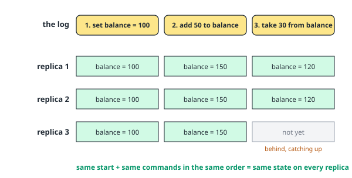
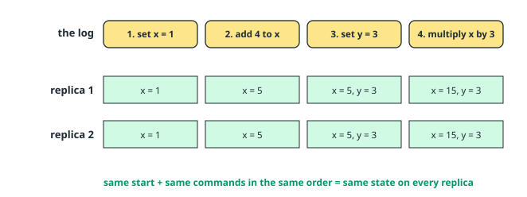

# The Log & State Machines

A log is a list of steps that you only ever add to at the end, and a replicated state machine is a set of computers that each follow the same log to reach the same result.

## What the log and replicated state machines are
<!-- bite: fef9eb96-beb8-4f80-afc2-f7bda2395ade -->

A log is a list you only add to at the end, and many computers can follow the same log.

It is like giving five friends the same numbered recipe so they all cook the same meal. Much of distributed systems comes back to this one idea.

## The kid version first
<!-- bite: fbc818c0-4fbb-4799-9906-1736d5e2d7a8 -->

Imagine a **recipe written as a numbered list of steps** that you only ever *add to the end* of — never erase, never insert in the middle. Now give the exact same numbered recipe to five friends in five kitchens. If every friend **starts from the same empty bowl and follows the same steps in the same order**, they all bake the **identical cake** — even though they never talked to each other while baking. No need to compare cakes; sameness is *guaranteed* by "same start + same steps + same order."

That numbered, add-only list is **the log**, and "same start + same ordered steps → same result" is the **replicated state machine**. Almost everything else in distributed systems is either *how to agree on that list* ([[architecture/04-distributed-systems/07-consensus-and-paxos|consensus]]) or *what to do with it* (databases, streams, event apps). Once you see the log everywhere, the field gets a lot smaller.

## The Replicated State Machine (RSM) — the core model
<!-- bite: 6fecbd4e-312f-4cec-b8ff-3a61dfd395b4 -->

A **state machine** is anything that takes commands and updates state (a key-value store, a bank ledger, a counter). The RSM insight:

> If every replica **starts in the same state** and **applies the same commands in the same order**, they end in the **same state** — forever.

So keeping N machines identical reduces to **one problem: agree on the ordered log of commands.** That's *exactly* what [[architecture/04-distributed-systems/07-consensus-and-paxos|consensus]] provides — Raft/Paxos don't agree on a single value, they agree on a **log**, precisely so it can drive an RSM. There's one hidden requirement people miss: **the commands must be deterministic.** A command like "set `x = current_time()` " or "shuffle randomly" breaks the RSM — replicas diverge because "the same step" produces different results. Determinism is the price of the whole trick (and why [[architecture/04-distributed-systems/11-modern-distributed-transactions|Calvin]] insists on it).

## Seeing a replicated state machine
<!-- bite: e9f2dc4d-b5e4-43b9-b0d8-63d40035be5d -->

Each column is one log entry, and each row is a replica's state after applying it. Replicas 1 and 2 agree at every step. Replica 3 is one entry behind, but it will land on the same 120, because it's following the same log.

## The log as *the* integration abstraction
<!-- bite: c8266413-5523-43eb-8d35-efc26c037854 -->

Jay Kreps' argument ("The Log"): an ordered, replayable log is the right primitive for connecting *systems*, not just replicating one. Producers append; any number of consumers read at their own pace, each tracking its own position (**offset**). This **decouples** everyone — a new consumer can join later and replay from the beginning; a slow consumer doesn't block a fast one; the log is the single source of truth everyone derives their view from. "Turn your data pipeline into a log everyone subscribes to" reorganizes a messy web of point-to-point integrations into a clean hub.

## Where the log shows up (same idea, different costume)
<!-- bite: 9d9b0ced-ad8c-44e5-93a3-882e5c2807ef -->

- **Apache Kafka** — the log *as infrastructure*: a distributed, [[architecture/04-distributed-systems/13-partitioning|partitioned]], [[architecture/04-distributed-systems/05-replication|replicated]] commit log. **Ordering is guaranteed within a partition** (via offsets), consumers track offsets, and retention/compaction control how long history lives. It's the RSM log, productized for streaming.
- **LSM-trees** (Log-Structured Merge trees — RocksDB, Cassandra, LevelDB) — how storage engines make writes fast: append every write to a **write-ahead log** + an in-memory table, then merge to disk in the background. The database you query is *built on a log underneath*.

## Where the log shows up: change data capture and event sourcing
<!-- bite: 85751178-2408-4153-b6a8-795bf377a24e -->

The log also hides inside databases and app designs, in these two forms.

- **Change Data Capture (CDC)** — treat a database's own replication log as an event stream (Debezium tailing the WAL). This is the bridge that turns "a database" into "a stream of every change," so downstream systems (search indexes, caches, analytics) stay in sync by *consuming the log*.
- **Event sourcing** — the app-architecture face: store the **log of events as the source of truth** (not the current state), and derive current state by replaying. Gives a perfect audit trail and time-travel, at the cost of replay complexity. ([[architecture/03-architectural-patterns/03-data-and-integration-patterns|data & integration patterns]] covers this and CQRS.)

Every one of these is "an ordered, append-only log + something that replays it." Recognizing that is the payoff of the note.

## Exactly-once, honestly (again, via the log)
<!-- bite: b0891901-47ea-48ee-b5b6-81d3704df0e0 -->

The log makes the [[architecture/04-distributed-systems/02-theoretical-limits|"exactly-once is impossible"]] reality manageable. You get **exactly-once *effect*** (not delivery) by combining:
- **ordered offsets** — a consumer knows exactly where it is,
- **idempotent consumers** — reprocessing the same offset is harmless,
- **atomic "process + advance offset"** — commit the work and the new offset together, so a crash-retry can't double-count.

Kafka's "exactly-once semantics" is this pattern, not magic — the same [[architecture/04-distributed-systems/10-distributed-transactions|at-least-once + idempotency]] truth wearing a log.

## Key insight
<!-- bite: f00bc488-c3a0-41a5-9009-91a549177fa2 -->

**The append-only, totally-ordered log is the hidden backbone of distributed systems: agree on an ordered list of commands, and every replica that replays it from the same start ends up identical (a replicated state machine — the one requirement being that commands are deterministic).** [[architecture/04-distributed-systems/07-consensus-and-paxos|Consensus]] exists to agree on that log; **Kafka** is the log as streaming infrastructure; **LSM-trees** are a log under your database; **CDC** turns a DB into its log; **event sourcing** stores the log *as* the truth. And "exactly-once" is just an ordered log + idempotent consumers + atomic offset commit. Once you see the log everywhere, the field unifies.

## Check your understanding
<!-- bite: 4357e580-fb80-4518-b1a7-73d9dba6d72e -->

Try each one before you open the answer.

1. <!-- q: mcq id="6d220377" -->
   Five replicas start in the same state and apply the same log. Which command would make them end up different?

   - [ ] set x = 5
   - [ ] add 3 to x
   - [x] set x = current_time()
   - [ ] delete key y

   

Answer

   Commands must be deterministic. Each replica reads a different current time, so "the same step" gives different results.

   

2. <!-- q: gap id="5c30aa1c" answers="same|identical;same|identical" -->
   Fill in the gaps. The replicated state machine idea: if every replica starts in the ___ state and applies the same commands in the ___ order, they all end in the same state.

   

Answer

   Same start, same order. So keeping N machines identical reduces to agreeing on one ordered log, which is what consensus gives.

   

3. <!-- q: mcq id="69bbfbe6" -->
   Where does Kafka guarantee ordering?

   - [ ] Across the whole topic
   - [x] Within a single partition, by offset
   - [ ] Across all topics in the cluster
   - [ ] Nowhere

   

Answer

   Kafka orders messages within a partition. Consumers track their own offset in each partition.

   

4. <!-- q: mcq id="99c6e20e" -->
   Match the idea to its description: storing the log of events as the source of truth and rebuilding current state by replaying it.

   - [ ] Change Data Capture
   - [x] Event sourcing
   - [ ] LSM-tree
   - [ ] Snapshot isolation

   

Answer

   Event sourcing. CDC turns a database's own replication log into a stream; an LSM-tree is a storage engine built on a write-ahead log.

   

5. <!-- q: mcq id="ad9a6b89" -->
   Which three things together give a log consumer an exactly-once effect? Choose all that apply.

   - [x] Ordered offsets, so the consumer knows where it is
   - [x] Idempotent processing, so repeating an offset is harmless
   - [x] Committing the work and the new offset atomically
   - [ ] Guaranteed exactly-once delivery by the network

   

Answer

   The first three. Exactly-once delivery does not exist; the effect comes from at-least-once delivery plus these safeguards.

   

6. <!-- q: open id="977c896e" -->
   Why is a shared log a good way to connect many systems, compared with point-to-point integrations?

   

Answer

   Producers append once and any number of consumers read at their own pace, each tracking its own offset. A new consumer can join later and replay from the start, and a slow consumer does not hold up a fast one. The log becomes the single source of truth instead of a tangle of direct connections.

   

## Check your understanding: worked problems
<!-- bite: 3406dd7e-aaca-4ab6-81b2-4489487f0361 -->

Work each one out on paper first, then type your answer.

1. <!-- q: gap id="9bd21d29" answers="16;18" -->
   Fill in the gaps. A replica starts empty and applies this log in order:

   1. set x = 5
   2. add 3 to x
   3. set y = 2
   4. multiply x by 2
   5. add x to y

   At the end x = ___ and y = ___.

   

Answer

   x: 5, then 8, then 16. y: 2, then 2 + 16 = 18. Every replica applying the same log ends with the same values.

   

2. <!-- q: exact id="9df1e0c3" answer="6" -->
   A consumer's committed offset says the next message to read is 42. It processes messages 42 to 47, then crashes before committing a new offset. When it restarts, how many messages does it process a second time?

   

Answer

   It restarts from 42, so 42 to 47 run again: 6 messages. That is why processing must be idempotent, or committed atomically with the offset.

   

3. <!-- q: mcq id="ca939d47" -->
   Two replicas apply the same three commands but in a different order. Replica 1: set x = 2, add 3 to x, multiply x by 4. Replica 2: set x = 2, multiply x by 4, add 3 to x. Do they agree?

   - [ ] Yes, both end with x = 20
   - [x] No: replica 1 ends with 20 and replica 2 with 11
   - [ ] No: replica 1 ends with 11 and replica 2 with 20

   

Answer

   (2 + 3) × 4 = 20, but 2 × 4 + 3 = 11. Same commands in a different order give different states, which is why the order must be agreed.

   

4. <!-- q: sketch id="bda76a76" -->
   Draw a replicated state machine as a grid. Across the top, draw this log as four boxes: 1. set x = 1, 2. add 4 to x, 3. set y = 3, 4. multiply x by 3. Below it, draw two rows, replica 1 and replica 2, both starting empty, and in each cell write the replica's whole state after applying that entry.

   

Answer

   

   What to check:
   - Each cell shows the whole state, so y = 3 stays in the last column.
   - The final state is x = 15 and y = 3 on both replicas.
   - The two rows are identical cell by cell: same start, same commands, same order.

   

## Related
<!-- bite: 01597fa3-654e-4afc-a079-e56f7c5d5d02 -->
- [[architecture/04-distributed-systems/07-consensus-and-paxos|Consensus]] — agrees on the log that drives the RSM
- [[architecture/04-distributed-systems/08-raft-in-depth|Raft in Depth]] — a replicated log, concretely
- [[architecture/04-distributed-systems/03-time-and-ordering|Time & Ordering]] — the log *is* a total order of operations
- [[architecture/03-architectural-patterns/03-data-and-integration-patterns|Data & Integration Patterns]] — event sourcing, CQRS, streaming
- [[architecture/02-building-blocks/03-databases-at-scale|Databases at Scale]] — LSM storage engines

## About this lesson
<!-- bite: 1f73ec7c-7f4c-4753-ad88-fa6ffc22e276 -->

**Level:** reference. **Covers:** from the canon (Jay Kreps' *The Log*, the Raft/VR papers, DDIA ch. 3 & 11). One idea quietly unifies half of distributed systems: the **append-only, totally-ordered log.** Replication, consensus, streaming, databases, and event-driven architecture turn out to be the *same trick* in different costumes — agree on an ordered sequence of events, and anything that replays it deterministically ends up in the same state.
