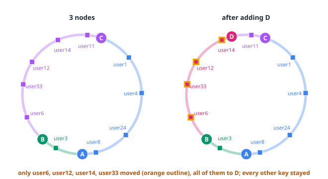
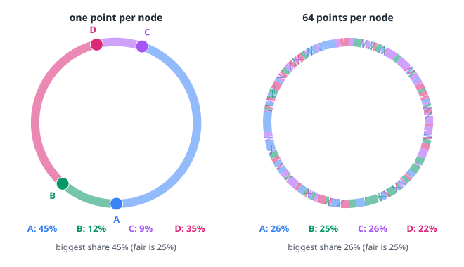
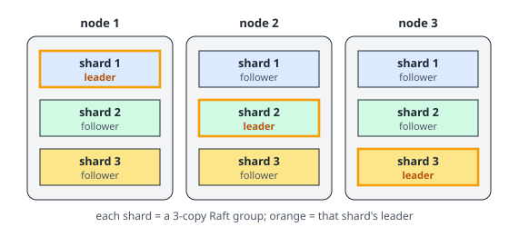
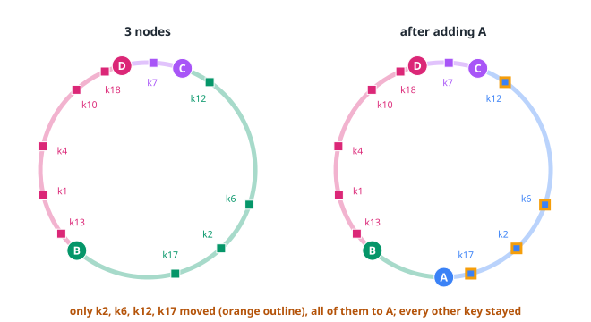

# Partitioning

Partitioning is splitting data across several machines because there is too much for one machine to hold. The hard part is deciding which piece of data goes on which machine. This lesson compares the main ways of splitting data and what goes wrong with each.

## The kid version first
<!-- bite: 15524cd0-cdc3-4f71-a370-0243717f9bbc -->

You have **way too many toys for one toy box** — so you get several boxes and split the toys across them. Simple idea, but the *hard* question is **which toy goes in which box**, and you have two instincts:
- **By name (A–F in box 1, G–M in box 2…).** Nice when you want "all the toys starting with S" — they're together. But if a new craze means *everyone* wants the newest toys (all starting with "Z"), **one box gets mobbed** while others sit idle (a **hotspot**).
- **By a scramble rule (a "hash"): compute a number from the toy's name and use it to pick a box.** Spreads toys evenly so no box gets mobbed — but now "all the S toys" are scattered across every box.

And there's a nasty trap: if you pick the box with **"box = number mod (how many boxes)"** and then *add one more box*, the math changes for *almost every toy* → you have to **re-sort nearly everything**. The clever fix (**consistent hashing**) makes adding a box move only *a few* toys. That's this whole note.

## Partitioning (sharding) strategies
<!-- bite: fb92c0eb-7e14-425f-b777-e6b3145d6988 -->

**Partitioning** (a.k.a. sharding) splits the dataset so each node holds a subset ([[architecture/02-building-blocks/03-databases-at-scale|databases at scale]]). Two base strategies, with opposite tradeoffs:

- **Range partitioning** — assign contiguous key ranges to nodes (`A–F` → node 1, `G–M` → node 2…). **Great for range scans** (a "last 24 hours" query hits few nodes) — but **hotspot-prone**: time-ordered keys send *all* recent writes to one node.
- **Hash partitioning** — hash the key, assign by hash. **Distributes evenly** (kills key-skew hotspots), but **destroys range queries** (adjacent keys scatter everywhere). Compound keys (hash the first part, range the second) recover *some* locality.

**The partition key is the single most important decision in a sharded system.** A poor choice bakes in hotspots or forces expensive cross-partition operations, and changing it later means a painful migration. Choose it to (a) spread load evenly and (b) keep your common queries on as few partitions as possible.

### The hot-key problem
Even perfect hashing can't save you from **one key that's individually enormous** — a celebrity's account, a viral post. All its traffic lands on one partition. Mitigations: **split the hot key** by appending a random suffix (spreading it across N partitions, at the cost of reads having to gather all N), or **cache it** separately in front of the store. There's no automatic fix; the application has to know which keys are hot.

## Consistent hashing — partitioning that survives change
<!-- bite: 9e92840a-025c-4386-9451-e0356583b88e -->

Naive `node = hash(key) % N` has a fatal operational flaw: **change `N` (add or remove a node) and almost every key remaps**, triggering a cluster-wide reshuffle (and cache-miss storm). **Consistent hashing** fixes it:

- Map **both nodes and keys onto a ring** (a hash space wrapped into a circle). A key belongs to the **next node clockwise** from its position.
- Add or remove a node and **only the keys in that one arc move** — roughly **`1/N` of keys**, not all of them. The rest stay put.
- **Virtual nodes** — place each physical node at *many* points on the ring (not one). This smooths the distribution (no node accidentally owning a huge arc) and makes rebalancing spread evenly when a node joins/leaves. Without virtual nodes, consistent hashing distributes lumpily.

This is the backbone of Dynamo, Cassandra, Riak, and many caches/load balancers — and one of the best things to implement yourself to make distributed systems concrete (the ⭐ consistent-hash sharded cache in [[architecture/05-case-studies/index|case studies]]).

> **Aside — fixed-partition rebalancing.** Many systems (e.g. Kafka, Elasticsearch) instead create a *large fixed number* of partitions up front (say 1000) and just **assign partitions to nodes**, moving whole partitions when nodes change. Simpler than a ring, and "how many partitions" becomes the capacity ceiling. Both approaches solve the same "don't reshuffle everything" goal.

## Seeing a node join the ring
<!-- bite: a583ce98-2123-4558-8837-28a5cf022afd -->

Each key belongs to the first node clockwise from it, so each node owns the coloured arc just before it. When D lands between B and C, only the keys in that slice change owner (orange outline), and they all go to D. Every other key stays where it was.

## Seeing virtual nodes even out the ring
<!-- bite: f4df8c99-2dcf-464c-9e4e-2e5a73b16c97 -->

On the left, each node sits at one point, and by bad luck A owns 45% of the ring while C owns 9%. On the right, each node sits at 64 points, so each owns many small arcs, and every share lands close to the fair 25%.

## Secondary indexes — the cross-partition headache
<!-- bite: 5e65e639-0886-4ead-bd1c-ff8ec907b01b -->

Partitioning by primary key is easy; **querying by something else** is where it bites. Two schemes:
- **Local (document-partitioned) index** — each partition indexes only its own data. Writes are cheap (one partition), but a query on the secondary field must **scatter-gather across *all* partitions** (each might have matches). Common default.
- **Global (term-partitioned) index** — the index itself is partitioned by the indexed term, so a read hits one partition — but a **write** must update a *different* partition than the data, making writes cross-partition (often async). You trade read cost for write cost.

There's no free lunch; which you pick depends on read-heavy vs write-heavy.

## Request routing — finding the right partition
<!-- bite: 2ab119d6-4026-48f7-9584-c3fb82445837 -->

When a client wants key `K`, *who knows which node holds it?* Three approaches: the client asks any node (which forwards), a **routing tier / load balancer** knows the mapping, or the client is **partition-aware** and computes it directly. The partition→node mapping is itself cluster state that must stay consistent as things rebalance — usually kept in a **[[architecture/04-distributed-systems/09-coordination-services|coordination service]]** (ZooKeeper/etcd) so everyone reads the same up-to-date map.

## Partitioning + replication together (the real architecture)
<!-- bite: 2a949e8d-9200-4cac-941f-52d8c7c7007b -->

Real systems do **both**: **partition for scale, replicate each partition for fault tolerance.** A dataset is split into shards, and *each shard* has (say) 3 [[architecture/04-distributed-systems/05-replication|replicas]] across different nodes/racks/zones. Frequently **each shard's replicas form a small [[architecture/04-distributed-systems/07-consensus-and-paxos|consensus]] group** (Raft) for strong consistency *within* the shard, and the system scales by running **many** such groups. This **"shard + replicate + consensus-per-shard"** pattern is the architecture of every modern distributed database — [[architecture/04-distributed-systems/11-modern-distributed-transactions|Spanner, CockroachDB, TiDB]] — and the synthesis of this whole course.

## Seeing shards and replicas together
<!-- bite: d9460740-a99c-47e2-92bd-78f481c33fb1 -->

Each node holds a copy of every shard, and each shard's three copies form a small Raft group. The orange outline marks each shard's leader: a different node leads each shard, so the write load is spread out and any one node can fail.

## Key insight
<!-- bite: b30b8fc7-d747-4979-b308-a6d410315874 -->

**Partitioning is "too much for one node, so split it across many," and the whole art is choosing *how* to split.** Range keys give cheap scans but risk hotspots; hash keys spread evenly but scatter ranges — and the **partition key is your most consequential, hardest-to-change decision.** Never use `hash % N` (adding a node reshuffles everything); use **consistent hashing with virtual nodes** (or a large fixed partition count) so growth moves only `~1/N` of the data. Secondary indexes force a read-cost-vs-write-cost choice (local vs global). And real systems **combine partitioning with [[architecture/04-distributed-systems/05-replication|replication]] and per-shard [[architecture/04-distributed-systems/07-consensus-and-paxos|consensus]]** — shard for scale, replicate for safety, agree within each shard.

## Check your understanding
<!-- bite: ab785d83-8e19-4832-8adf-7ff240791d6e -->

Try each one before you open the answer.

1. <!-- q: mcq id="a08bbdf6" -->
   A table of sensor readings is range-partitioned by timestamp. What problem will it most likely hit?

   - [ ] Range queries become slow
   - [x] All new writes land on one partition, making it a hotspot
   - [ ] Keys scatter evenly, so nothing is wrong
   - [ ] Secondary indexes stop working

   

Answer

   Time-ordered keys send every recent write to the partition holding the newest range. Range partitioning is great for scans but prone to hotspots.

   

2. <!-- q: mcq id="ca9e02c3" -->
   What does hash partitioning give up in exchange for spreading keys evenly?

   - [ ] Fault tolerance
   - [x] Efficient range queries, because neighbouring keys scatter across partitions
   - [ ] Fast single-key lookups
   - [ ] Replication

   

Answer

   Adjacent keys hash to unrelated places, so a range query has to hit many partitions. Compound keys can win back some locality.

   

3. <!-- q: gap id="0df309fa" answers="virtual" -->
   Fill in the gap. In consistent hashing, placing each physical node at many points on the ring, so that no node owns a huge arc by chance, is called using ___ nodes.

   

Answer

   Virtual nodes. They smooth the distribution and spread rebalancing evenly when a node joins or leaves.

   

4. <!-- q: mcq id="1957fc65" -->
   A celebrity's post gets so much traffic that its one partition is overloaded. Which of these fixes actually help? Choose all that apply.

   - [x] Split the hot key by adding a random suffix, spreading it over several partitions
   - [x] Put a cache in front of that key
   - [ ] Switch from hash to range partitioning
   - [ ] Add more nodes and rely on rebalancing

   

Answer

   One key is one key: no partitioning scheme spreads it automatically. Splitting it (reads must gather all pieces) or caching it are the options.

   

5. <!-- q: mcq id="d9084a35" -->
   With a local (document-partitioned) secondary index, what does a query on the secondary field cost?

   - [ ] One partition read
   - [x] A scatter-gather across all partitions
   - [ ] A cross-partition write
   - [ ] Nothing extra

   

Answer

   Each partition only indexes its own data, so any partition might have matches. Writes stay cheap. A global index flips this: cheap reads, cross-partition writes.

   

6. <!-- q: open id="07cdb7b5" -->
   Why is choosing the partition key called the most important decision in a sharded system?

   

Answer

   It decides whether load spreads evenly and whether common queries hit one partition or many. A poor key bakes in hotspots or expensive cross-partition work, and changing it later means migrating all the data.

   

## Check your understanding: worked problems
<!-- bite: 86a1490f-bbef-4f51-b2a5-9556e5c64d9b -->

Work each one out on paper first, then type your answer.

1. <!-- q: exact id="e8830b66" answer="0.8" accept="80%|80" -->
   Keys 0 to 99,999 are placed with node = key mod N. The cluster grows from N = 4 to N = 5. What fraction of keys move to a different node? Give a decimal.

   

Answer

   0.8: 80% of keys move. A key stays only when key mod 4 equals key mod 5. This is why hash mod N is a bad idea when nodes change.

   

2. <!-- q: gap id="3185aa90" answers="A;C;A" -->
   Fill in the gaps. A consistent-hash ring runs from 0 to 99 and wraps around. Nodes sit at positions A = 10, B = 40 and C = 75. A key belongs to the first node at or clockwise after its position. Key 5 goes to ___, key 41 goes to ___, and key 80 goes to ___.

   

Answer

   5 → A (10). 41 → C (75), the next node after 40. 80 → past 75 it wraps around to A (10).

   

3. <!-- q: mcq id="b04a25fe" -->
   Same ring, 0 to 99, nodes A = 10, B = 40 and C = 75; a key goes to the first node at or clockwise after it. A new node D joins at position 60. Which keys change owner?

   - [ ] Every key
   - [ ] Keys from 10 to 40
   - [x] Keys from 41 to 60, which move from C to D
   - [ ] Keys from 76 to 99

   

Answer

   Only the arc between B (40) and D (60) changes hands, from C to D. Every other key stays put.

   

4. <!-- q: exact id="9ef3ece8" answer="0.2" accept="1/5|20%" -->
   With consistent hashing on an evenly balanced 5-node ring, roughly what fraction of keys move when one node is removed? Give a decimal.

   

Answer

   About 1/N = 1/5 = 0.2. Only the leaving node's keys move to its neighbour; the rest stay.

   

5. <!-- q: sketch id="611e8086" -->
   Draw a hash ring as a circle with 0 at the top and positions in degrees running clockwise. Nodes sit at B = 221, C = 19 and D = 346, and node A will join at 180. Ten keys sit at: k1 = 256, k2 = 137, k4 = 283, k6 = 109, k7 = 3, k10 = 318, k12 = 35, k13 = 234, k17 = 165, k18 = 336. Each key belongs to the first node clockwise from it. Draw the ring before and after A joins, and mark the keys that change owner.

   

Answer

   

   What to check:
   - Before A joins, everything from C (19) round to B (221) belongs to B: k12, k6, k2 and k17.
   - A at 180 takes exactly the keys between C (19) and A (180): k12, k6, k2 and k17, all moving from B to A.
   - k13, k4, k1, k10 and k18 stay on D, and k7 stays on C.

   

## Related
<!-- bite: 0ea484d0-aa04-48c2-b46d-5723e5116b71 -->
- [[architecture/04-distributed-systems/05-replication|Replication]] — the redundancy half; shard, then replicate each shard
- [[architecture/04-distributed-systems/14-failure-detection-and-membership|Failure Detection & Membership]] — knowing which nodes are alive to route/rebalance
- [[architecture/04-distributed-systems/07-consensus-and-paxos|Consensus]] — per-shard agreement
- [[architecture/02-building-blocks/03-databases-at-scale|Databases at Scale]] — sharding from the system-design view

## About this lesson
<!-- bite: 81a1fba4-1638-4a82-8906-03324bf3b7b5 -->

**Level:** reference. **Covers:** from the canon (DDIA ch. 6). How data is **split across many nodes** so you can store more and serve more than one machine can hold — and how to split it *well*, so load stays even and queries stay cheap. (Knowing *who's alive* to route around failures is the sibling topic: [[architecture/04-distributed-systems/14-failure-detection-and-membership|failure detection & membership]].)
