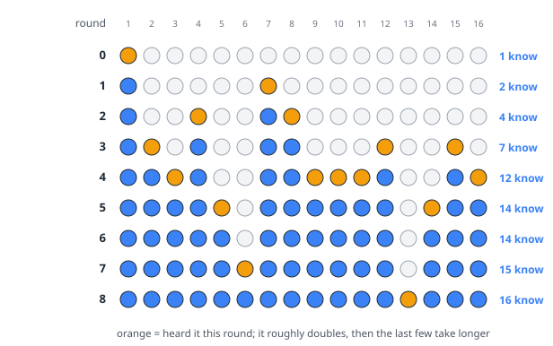
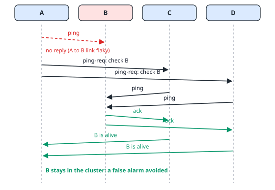
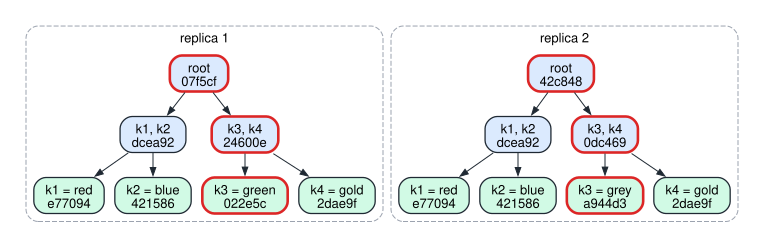
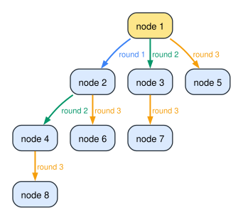

# Failure Detection & Membership

Failure detection is working out whether a computer in a group has stopped working or is just slow to reply, and membership is keeping track of which computers are in the group.

## What failure detection and membership are
<!-- bite: f4bc8e8d-22f9-4592-8577-dfddda307e8e -->

Failure detection is telling a dead computer from a slow one, and membership is knowing who is in the group.

Over a network, a slow computer and a dead one can look exactly the same. This lesson shows the tricks real systems use to tell them apart.

## The kid version first
<!-- bite: 6a25962f-e53f-4dc3-bd58-ba5a5d4f66f5 -->

You're playing a game on a big playground and need to know: **has Sam left, or is Sam just being slow to answer?** You can't see the whole playground, so you rely on Sam periodically shouting **"here!"** (a heartbeat). If you stop hearing it… did Sam leave? Or is Sam just far away and quiet for a moment? **You genuinely can't be sure** — and if you *wrongly* declare Sam gone, you might give away Sam's turn while Sam's still playing (bad!).

So real playgrounds (clusters) use three tricks:
1. **Don't rely on just yourself — ask around** ("hey, anyone heard Sam?"). News spreads kid-to-kid until everyone knows. (That's **gossip**.)
2. **Use a *worry meter*, not a yes/no.** The longer since "here!", the *more worried* you get — and you only act when worry crosses a line *you* choose. (That's **phi-accrual**.)
3. **Everyone agree on the official roster** so two kids don't disagree about whether Sam's in the game. (That's **membership**, and it leans on [[architecture/04-distributed-systems/07-consensus-and-paxos|consensus]].)

## Heartbeats and the timeout tradeoff
<!-- bite: 4bd1d487-92d6-4eee-bf22-139cafb4b862 -->

The baseline: each node periodically sends "I'm alive" (a **heartbeat**); miss enough in a row and you *suspect* failure. But every fixed **timeout** is a lose-lose tradeoff (straight from [[architecture/04-distributed-systems/01-what-makes-distributed-systems-hard|the impossibility of perfect failure detection]]):
- **Too short** → you declare *live-but-slow* nodes dead → needless failovers, data reshuffles, and **split-brain** risk.
- **Too long** → you're slow to react to real deaths → requests keep going to a corpse, hurting availability.

There is no "correct" timeout — only a tradeoff you tune to your network. The better detectors below stop pretending it's binary.

## Phi-accrual failure detection — a suspicion level, not a boolean
<!-- bite: 0a9e8ed8-0a85-48ec-a860-ec1669de4f77 -->

Instead of "dead/alive," a **phi-accrual detector** outputs a continuous number **φ** — *how suspicious we are right now* — computed from the **statistical distribution of recent heartbeat arrival times.** If heartbeats usually arrive every 1s ± 0.1s and it's been 1.05s, φ is low (relax); if it's been 5s, φ is high (worry a lot). The caller picks its **own threshold** ("act when φ > 8"), and different callers can choose differently for the same node.

The elegance: it **adapts automatically** to network conditions — on a jittery network the "normal" distribution is wider, so the detector is naturally more patient; on a snappy network it reacts faster. Used in **Cassandra** and **Akka**. It turns the timeout tradeoff from a hardcoded guess into a tunable, self-adjusting knob.

## Gossip protocols — decentralized awareness
<!-- bite: f8508c35-81d1-4217-aead-8fe454275260 -->

A central monitor watching everyone is a bottleneck and a single point of failure. **Gossip** (epidemic protocols) spreads information the way a rumor spreads on the playground: **each node periodically picks a few random peers and exchanges state** ("here's who I think is alive, and their versions"). Any piece of news reaches the whole cluster in **`O(log n)` rounds** — exponentially fast, with no central authority, and robust to individual failures (there's no one to knock out).

Gossip carries **membership** (who's in the cluster), **failure suspicions**, and version metadata. It's how **Cassandra, Consul, Riak, and Dynamo** track membership and failures at scale. The tradeoff: it's **eventually consistent** — for a brief window, different nodes may have slightly different views of who's alive. That's fine for routing hints; it's *not* fine for decisions that must be atomic (which is why authoritative membership uses consensus — below).

## Seeing gossip spread
<!-- bite: 0a03db12-7641-4107-8ba3-19b90983d964 -->

Each row is one round, and each circle is one of 16 nodes. Blue nodes know the news; orange ones heard it this round. Every node that knows tells one random peer, so the count roughly doubles at first, then the last few stragglers take a few lucky picks.

## SWIM — gossip done efficiently
<!-- bite: 9ed35a09-3508-4baf-a34c-c062379a60d4 -->

**SWIM** (Scalable Weakly-consistent Infection-style process Membership — the basis of HashiCorp **Serf/Consul**) is a refined gossip design that separates two concerns and fixes gossip's false-positive problem:
- **Failure detection by indirect pings:** node A pings B; if no reply, instead of immediately declaring B dead, A asks **`k` other nodes to *each* ping B on A's behalf.** Only if *all* the indirect pings also fail does A suspect B. This filters out "A↔B link is flaky but B is fine" false positives cheaply.
- **Dissemination piggybacked on the pings** (membership updates ride along on the ping traffic, no separate broadcast).

The result is failure detection whose cost-per-node stays roughly **constant** as the cluster grows, with far fewer false alarms than naive heartbeat-timeout.

## Seeing an indirect ping
<!-- bite: 85d56754-d5de-45e9-9831-1a470323f724 -->

Time runs down. A's own ping to B is lost (dashed red), but A doesn't give up on B. It asks C and D to try, and their pings get through, so B stays in the cluster.

## Anti-entropy — repairing divergence
<!-- bite: 25100382-ae12-419e-8afe-d5230f0b168f -->

Detecting failure is half of "keeping copies honest"; the other half is fixing the divergence that failures cause. **Anti-entropy** is a background process where [[architecture/04-distributed-systems/05-replication|replicas]] periodically **compare their data and reconcile differences.** Comparing everything byte-by-byte is too expensive, so replicas exchange **Merkle trees** (a tree of hashes): if two roots match, the data is identical — done; if not, you descend only into the *differing* branches, pinpointing exactly which keys diverged with minimal data transfer. This is the partner to **read-repair** (fix-on-read) in leaderless replication — read-repair fixes what you happen to read, anti-entropy sweeps the rest.

## Seeing two Merkle trees compared
<!-- bite: d0cd2c2d-d3ac-4882-8b95-aaadaadeef79 -->

Each box holds a hash; the red outlines are the hashes that differ between the two replicas. The roots differ, so the replicas look one level down. The k1, k2 branch matches and is skipped whole; only the k3, k4 branch is followed, down to the one key that differs.

## Membership and split-brain
<!-- bite: 22fdaed7-7804-4e75-848d-f4d209da3b02 -->

**Membership** = the agreed answer to "which nodes are currently in the cluster?" Gossip gives a *fast, eventually-consistent* view — great for routing. But some decisions need an **authoritative, atomic** membership (who's allowed to vote, which nodes own which [[architecture/04-distributed-systems/13-partitioning|shards]]), and for those, gossip's brief disagreements are dangerous. The nightmare is **split-brain**: a network partition where **both sides think the other is dead** and each elects its own leader / accepts its own writes → divergent, conflicting data.

The guardrails, all from earlier notes:
- **[[architecture/04-distributed-systems/07-consensus-and-paxos|Quorums]]** — a side without a majority refuses to act, so *at most one* side can make progress (the minority "loses" rather than forming a second brain).
- **Authoritative membership via consensus** — the official roster changes go through a [[architecture/04-distributed-systems/09-coordination-services|coordination service]] (etcd/ZooKeeper), so everyone agrees who's in.
- **[[architecture/04-distributed-systems/09-coordination-services|Fencing tokens]]** — even if a stale node *thinks* it's still a member/leader, the resource rejects its out-of-date token.

So the two views coexist by design: **gossip for fast, approximate awareness; consensus for the rare, must-be-correct membership decision.**

## Key insight
<!-- bite: e63b8dcb-4349-405b-8ba1-057dcaca1a03 -->

**You can't observe failure, only decide it — so decide well.** Fixed heartbeat timeouts are a lose-lose guess; **phi-accrual** replaces them with an adaptive *suspicion level* you threshold yourself. **Gossip** spreads membership and failure news cluster-wide in `O(log n)` rounds with no central point; **SWIM** makes it cheap and false-positive-resistant via indirect pings; **anti-entropy** (Merkle-tree diffs) repairs the divergence failures cause. And because gossip is only *eventually* consistent, the must-be-atomic decisions — official membership, leader — go through **[[architecture/04-distributed-systems/07-consensus-and-paxos|quorums/consensus]] and [[architecture/04-distributed-systems/09-coordination-services|fencing]]** to prevent **split-brain**.

## Check your understanding
<!-- bite: 4c4b67ba-ebc2-4aed-ba82-3d824799c398 -->

Try each one before you open the answer.

1. <!-- q: mcq id="d4dd1db4" -->
   What does a phi-accrual failure detector output?

   - [ ] Dead or alive
   - [x] A suspicion level based on how recent heartbeats have usually arrived
   - [ ] The number of missed heartbeats
   - [ ] The node's clock time

   

Answer

   A number φ that grows the longer a heartbeat is overdue compared with the usual spread. Each caller picks its own threshold, and it adapts to jittery networks by itself.

   

2. <!-- q: mcq id="8cc96c76" -->
   In SWIM, node A pings B and gets no reply. What does A do next?

   - [ ] Declares B dead
   - [x] Asks k other nodes to ping B on its behalf, and only suspects B if those fail too
   - [ ] Waits for B's next heartbeat
   - [ ] Asks the leader whether B is alive

   

Answer

   Indirect pings filter out the case where only the A–B link is flaky. This cuts false alarms cheaply.

   

3. <!-- q: gap id="1687481a" answers="Merkle" -->
   Fill in the gap. During anti-entropy, replicas compare ___ trees of hashes. If the roots match the data is identical; if not, they descend only into the branches that differ.

   

Answer

   Merkle trees. They pinpoint the keys that diverged while sending very little data.

   

4. <!-- q: mcq id="e3bd3de7" -->
   Gossip spreads membership news quickly with no central node. Why is it not used alone for decisions like who may vote or who owns a shard?

   - [ ] It is too slow
   - [x] It is only eventually consistent, so nodes can briefly disagree about who is in
   - [ ] It needs a leader
   - [ ] It cannot carry failure suspicions

   

Answer

   Brief disagreement is fine for routing hints but dangerous for atomic decisions. Those go through consensus, such as etcd or ZooKeeper.

   

5. <!-- q: mcq id="e6299703" -->
   Which guardrails stop split-brain, where both sides of a partition elect their own leader? Choose all that apply.

   - [x] Quorums, so only a side with a majority can act
   - [x] Membership decided through a consensus-backed coordination service
   - [x] Fencing tokens, so a stale leader's writes are rejected
   - [ ] Shorter heartbeat timeouts

   

Answer

   The first three. Shorter timeouts make wrong "dead" verdicts more likely, which increases split-brain risk.

   

6. <!-- q: open id="f2dac897" -->
   What goes wrong if a heartbeat timeout is too short, and what goes wrong if it is too long?

   

Answer

   Too short: live but slow nodes are declared dead, causing needless failovers, data reshuffles and split-brain risk. Too long: real failures are noticed late, and requests keep going to a dead node, hurting availability.

   

## Check your understanding: worked problems
<!-- bite: 2b9ca12d-3adf-41de-ae02-0c2dc5d87268 -->

Work each one out on paper first, then type your answer.

1. <!-- q: exact id="47a5b1da" answer="10" -->
   In gossip, assume the number of nodes that know a piece of news doubles every round, starting from one node. How many rounds until all 1,000 nodes know? (Round up log₂ of the cluster size.)

   

Answer

   log₂ 1000 ≈ 9.97, so 10 rounds. Spread is O(log n).

   

2. <!-- q: exact id="1d67f691" answer="20" -->
   With the same doubling assumption, how many rounds does gossip need to reach 1,000,000 nodes? (Round up log₂ of the cluster size.)

   

Answer

   log₂ 1,000,000 ≈ 19.9, so 20 rounds. A thousand times more nodes costs only about 10 more rounds.

   

3. <!-- q: mcq id="373d0302" -->
   A 7-node cluster is split by a partition into a group of 3 and a group of 4. Each side thinks the other is dead. With quorums of ⌊N / 2⌋ + 1, which side can elect a leader?

   - [ ] The group of 3
   - [x] The group of 4
   - [ ] Both
   - [ ] Neither

   

Answer

   A quorum of 7 is 4. Only the group of 4 has it, so only one leader can exist and split-brain is avoided.

   

4. <!-- q: sketch id="9f3be375" -->
   Draw how news spreads through an 8-node cluster under ideal gossip, as a tree of arrows labelled with the round number. Node 1 knows the news at the start. In each round, every node that already knows tells exactly one node that doesn't: in round r, node i tells node i + 2^(r−1). How many rounds until all 8 know?

   

Answer

   

   What to check:
   - Round 1 has one arrow, round 2 two arrows, and round 3 four arrows: the number who know doubles, 1, 2, 4, 8.
   - Every node gets exactly one incoming arrow, except node 1.
   - It takes 3 rounds, which is log₂ 8.

   

## Related
<!-- bite: 6fe2bde2-30c7-4f7d-9645-9b4168aa3ae8 -->
- [[architecture/04-distributed-systems/01-what-makes-distributed-systems-hard|What Makes It Hard]] — why perfect failure detection is impossible
- [[architecture/04-distributed-systems/13-partitioning|Partitioning]] — the sibling operational topic (rebalancing on membership change)
- [[architecture/04-distributed-systems/05-replication|Replication]] — read-repair + anti-entropy keep replicas honest
- [[architecture/04-distributed-systems/09-coordination-services|Coordination Services]] — ephemeral nodes as a liveness signal; authoritative membership
- [[architecture/04-distributed-systems/07-consensus-and-paxos|Consensus]] — quorums as the split-brain guardrail

## About this lesson
<!-- bite: eabe23b4-cc52-4930-add4-33ebc51b426d -->

**Level:** reference. **Covers:** from the canon (the phi-accrual paper, the SWIM paper, DDIA ch. 8, the Dynamo paper). [[architecture/04-distributed-systems/01-what-makes-distributed-systems-hard|What Makes It Hard]] established the uncomfortable truth: **failure is a decision, not an observation** — you can't perfectly tell a dead node from a slow one. This note is how real systems make that decision *well*, and how a cluster keeps an agreed, current view of **who is alive** (membership).
