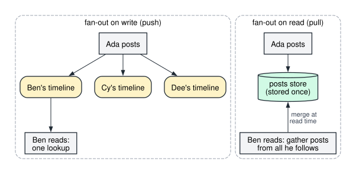
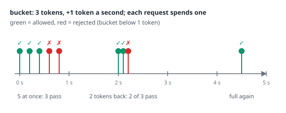

# Designing Real Systems

This lesson is a set of practice problems where you design real systems, such as a URL shortener like bit.ly, step by step. For each one you clarify what it must do, estimate how much traffic it gets, sketch the design, dig into the hardest part and name the trade-offs. Do each one on paper first before reading the worked answer.

## How to use these
<!-- bite: d6fdbba9-1af5-4968-9361-c442c71f50a5 -->

For each problem, run the framework: **clarify requirements → estimate → high-level design → deep-dive the hard part → name the tradeoffs.** Do it on paper/whiteboard before reading any solution. The classic problems each stress a different building block:

## URL shortener (e.g. bit.ly)
<!-- bite: 2e1778a6-43b2-4b9c-a830-7679ff66db8e -->

- **The core** — generate a short unique key for a long URL; redirect on lookup.
- **What it teaches** — key generation ([[languages/01-java/06-applied-systems/02-id-generation-and-idempotency|ID strategies]]: hash vs counter vs random, collision handling), read-heavy [[architecture/02-building-blocks/02-caching/index|caching]] (redirects vastly outnumber creates), and simple [[architecture/02-building-blocks/03-databases-at-scale|key-value storage]] at scale. The gentle starter.

Here is one common shape for it. A create takes the next number from an ID generator and writes it in base 62 (125 becomes "21"). A redirect checks the cache first and only goes to the store on a miss.

## A social feed / Twitter timeline
<!-- bite: 62c125e2-8ebc-4667-bcdc-6794a994d474 -->

- **The core** — users post; followers see a timeline.
- **What it teaches** — the **fan-out** decision: *fan-out-on-write* (push each post to all followers' precomputed timelines — fast reads, expensive for celebrities with millions of followers) vs *fan-out-on-read* (assemble the timeline at read time — cheap writes, slow reads). The real answer is *hybrid* (push for most, pull for celebrities) — a perfect example of "it depends on the [[architecture/01-system-design-fundamentals/01-how-to-approach-system-design/index|requirements]]." Also [[architecture/02-building-blocks/02-caching/index|caching]], [[architecture/02-building-blocks/03-databases-at-scale|sharding]] by user, and [[architecture/01-system-design-fundamentals/04-cap-and-consistency|eventual consistency]] (a slightly stale feed is fine).

On the left, one post becomes a write into every follower's timeline, so a read is one lookup. On the right, the post is stored once and each read gathers posts from everyone the reader follows.

## A rate limiter
<!-- bite: 2901910b-3028-45bd-b294-1c9c2432941e -->

- **The core** — allow N requests per user per window; reject the rest.
- **What it teaches** — algorithms (token bucket, sliding window), where the counter lives ([[architecture/02-building-blocks/02-caching/index|Redis]] for shared state across servers), and the [[languages/01-java/02-jvm-and-concurrency/exercises/index|concurrency]] of atomic increments. You've already got a [[languages/01-java/02-jvm-and-concurrency/exercises/index|single-machine version to build]] — the distributed version adds shared state.

A token bucket in action: each dot is one request, green if a token was there to spend and red if not. The bucket holds 3 and refills 1 a second, so a burst gets 3 through and the rest wait for tokens to come back.

## A chat system (e.g. WhatsApp)
<!-- bite: 02df8786-56b9-4b3e-a28a-8ee5c7f3ff30 -->

- **The core** — real-time messaging, delivery, presence.
- **What it teaches** — [[architecture/02-building-blocks/05-communication/index|WebSockets]] for real-time push, message [[architecture/02-building-blocks/04-messaging-and-async/index|queues]], delivery guarantees + [[languages/01-java/06-applied-systems/02-id-generation-and-idempotency|idempotency]] (exactly-once display), and connection state at scale.

Follow Ada's message: her server saves it, asks presence which server holds Ben's connection, and hands it to that server through the queue, which pushes it down Ben's WebSocket.

## Others worth working
<!-- bite: afd7fd0a-d709-49ea-9199-64487f04f8c8 -->

A **news feed / notification system** (fan-out again), a **web crawler** (queues, dedup, politeness), a **typeahead/autocomplete** (tries, caching), a **distributed cache** (consistent hashing), a **payment system** (strong consistency, idempotency, sagas — the [[languages/01-java/06-applied-systems/index|domain you've built in Java]]).

## The evaluation criteria (what "good" looks like)
<!-- bite: 37ea8ac3-eda4-431b-984f-9c42ec150f92 -->

Whether interviewing or designing for real, a strong design shows:

1. **Requirements first** — you asked what you're optimizing for before designing.
2. **Justified choices** — every component has a *why* tied to a requirement, not "because it's what people use."
3. **Named tradeoffs** — you said what you're giving up (consistency for availability, storage for read speed) *deliberately*.
4. **Bottleneck awareness** — you found the single points of failure and hot paths and addressed them.
5. **Knowing when to stop** — you didn't add Kafka and microservices to a problem a monolith and a database solve.

## Then: build one
<!-- bite: 81982cd0-cf00-4e3d-80ec-9b5df55a0cb1 -->

Reading and whiteboarding get you far, but the deepest understanding comes from **building** — which is why the flagship [[project-ideas|projects]] are systems you implement yourself. Design a system on paper, then go build a piece of it for real.

## Check your understanding
<!-- bite: f629dc81-9efa-4fdf-894d-001c4ce9387b -->

Try each one before you open the answer.

1. <!-- q: mcq id="9c7fb73a" -->
   What order does the design framework follow?

   - [ ] High-level design, estimate, clarify requirements, trade-offs, deep-dive
   - [x] Clarify requirements, estimate, high-level design, deep-dive the hard part, name the trade-offs
   - [ ] Pick technologies, draw boxes, estimate
   - [ ] Deep-dive first, then requirements

   

Answer

   Requirements first, so every later choice can be tied to what you are optimising for.

   

2. <!-- q: mcq id="8e9cbcfe" -->
   A social network has ordinary users and a few celebrities with millions of followers. Which timeline fan-out approach fits best?

   - [ ] Fan-out-on-write for everyone
   - [ ] Fan-out-on-read for everyone
   - [x] Hybrid: push posts for most users, pull celebrity posts at read time

   

Answer

   Pushing a celebrity's post into millions of timelines is too expensive, while pulling everything at read time makes every read slow. The hybrid uses each where it is cheap.

   

3. <!-- q: mcq id="3089305c" -->
   A rate limiter runs on many servers. Where should the per-user counter live?

   - [ ] In each server's memory
   - [x] In a shared store such as Redis, with atomic increments
   - [ ] In the user's browser
   - [ ] In a log file

   

Answer

   Every server must see the same count, so the state is shared, and increments must be atomic so concurrent requests are not miscounted.

   

4. <!-- q: gap id="11abd163" answers="WebSockets|WebSocket|websockets" -->
   Fill in the gap. A chat system pushes new messages to clients in real time over ___.

   

Answer

   WebSockets keep a connection open so the server can push messages. Queues and idempotency handle delivery so a message is shown once.

   

5. <!-- q: mcq id="34956202" -->
   Which of these show a strong design? Choose all that apply.

   - [x] Every component has a reason tied to a requirement
   - [x] It names what it gives up, such as consistency for availability
   - [x] It finds single points of failure and hot paths
   - [ ] It uses Kafka and microservices to look scalable

   

Answer

   Knowing when to stop is also a criterion: do not add Kafka and microservices to a problem a monolith and a database already solve.

   

6. <!-- q: open id="641b12fe" -->
   Why is a URL shortener a read-heavy system, and what does that suggest for its design?

   

Answer

   A link is created once but clicked (redirected) many times, so lookups far outnumber creates. That points to caching the short-key-to-URL mapping and using simple key-value storage that serves lookups fast.

   

## Check your understanding: worked problems
<!-- bite: f07c7457-d7b2-44ac-8228-e99c48db6b18 -->

Work each one out on paper first, then type your answer.

1. <!-- q: exact id="4c8a48b1" answer="38.5802469136" sigfigs="2" -->
   A URL shortener creates 100 million new short links per month. Taking a month as 30 days, how many links are created per second on average?

   

Answer

   100,000,000 / (30 × 24 × 3,600) = 100,000,000 / 2,592,000 ≈ 38.6 writes per second.

   

2. <!-- q: exact id="df63267b" answer="3858.02469136" sigfigs="2" -->
   A URL shortener creates about 38.58 links per second, and each link is read 100 times as often as it is created. About how many redirects per second does it serve?

   

Answer

   38.58 × 100 ≈ 3,858 reads per second. A cache in front of the store absorbs most of these.

   

3. <!-- q: exact id="a9e2c600" answer="3" -->
   A URL shortener stores 100 million new links per month for 5 years, at 500 bytes per record. How many terabytes is that? (1 TB = 10¹² bytes.)

   

Answer

   100,000,000 × 12 × 5 = 6 billion records. 6 × 10⁹ × 500 = 3 × 10¹² bytes = 3 TB.

   

4. <!-- q: exact id="59fcaae3" answer="6000000" -->
   With fan-out-on-write, every post is copied into each follower's timeline. A celebrity with 2,000,000 followers posts 3 times. How many timeline writes does that cause?

   

Answer

   2,000,000 × 3 = 6,000,000 writes. That is why celebrities are handled with fan-out-on-read instead.

   

5. <!-- q: sketch id="5d8b031b" -->
   Draw the high-level design of a paste-sharing service on paper. Users paste text (up to 1 MB) and get a short code back; anyone with the code can read it. Reads outnumber creates 100 to 1, a few pastes go viral, and each paste has an owner and an expiry date. Draw the boxes and arrows for both the create path and the read path, and label where the paste text and the paste details are kept.

   

Answer

   

   What to check:
   - Short codes come from an ID generator (or a counter in base 62), not from hashing alone, so they can't collide.
   - The text itself is in object storage; the small details (code, owner, expiry) are in a database.
   - Reads, being 100 times more common, go through a CDN and a cache before reaching the stores.
   - The app servers are stateless behind a load balancer.

   

## Related
<!-- bite: 18c4d56e-9ac8-4146-8f81-4f6e2bb6268b -->
- [[architecture/01-system-design-fundamentals/01-how-to-approach-system-design/index|How to Approach System Design]] — the framework these apply
- [[architecture/system-design-reference|System Design Reference]] — the dense cheat-sheet for quick lookup
- [[project-ideas|Project Ideas]] — build-your-own Redis / DB / git / Raft

## About this lesson
<!-- bite: 681bb825-6430-46b1-85d6-4ceb09e60d67 -->

**Level:** reference / practice. **Covers:** applying the [[architecture/01-system-design-fundamentals/01-how-to-approach-system-design/index|framework]] to the classic design problems. The point isn't to memorize "the answer" (there isn't one) — it's to practice the *reasoning*, since that's what the skill and the interview reward.
