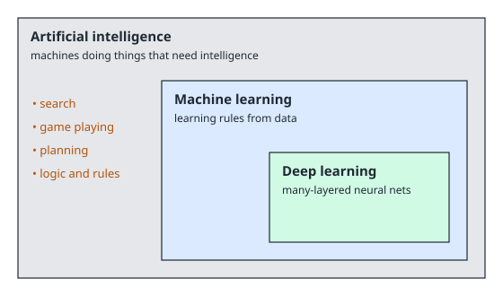

# What Artificial Intelligence Is

Artificial intelligence is the field of building computer systems that do things we would call intelligent if a person did them.

## Before you start
<!-- bite: b3a99c6d-77ce-42c1-92d8-77794a0c7724 -->

You don't need any maths for this lesson. It helps to have used a map app, played a computer game against the computer, or chatted with an AI assistant, because those are the systems this subject explains.

After this lesson you will be able to:

1. give a working definition of AI and say what each of the two words in its name means;
2. explain the difference between symbolic AI and sub-symbolic AI, and say where machine learning fits;
3. name the main areas of AI and which of them this subject covers.

## What AI is
<!-- bite: 6f328e52-1bcc-4afb-bb5e-b48f37098aca -->

Open the map app on your phone and ask for a route from Lagos to Abuja. In under a second it gives you a route, a distance and a time. Nobody at the company sat down and wrote the Lagos-to-Abuja route into the app. The app worked it out, by trying roads and comparing them, the way you would with a paper map, only much faster.

That is the kind of thing artificial intelligence is about. If a person planned that route, we'd say they used their head. When a computer does it, we call it AI.

This lesson gives you the definition, the two big families of AI, and a map of the whole field, so every later lesson has a place to sit.

## The kid version
<!-- bite: c5dacd55-3397-4ec4-aa78-fd3b18e166ac -->

Imagine you want a toy robot that can find its way out of a maze. You could give it a very long list of instructions for one maze: "go left, go left, go right…". But move it to a new maze and it walks into a wall. Or you could teach it *how to think about* mazes: "try a path; if it's a dead end, go back and try another." Now it can get out of any maze, even one you've never seen. AI is building the second kind of robot: one that works out what to do, instead of being told every step.

**Where the analogy stops working.** A maze has walls you can see and one exit. Many real AI problems have hidden information, other players working against you, or no single "exit", so the robot also has to guess, weigh options and sometimes settle for "good enough".

## The two words in the name
<!-- bite: 49d1bde6-95ee-4645-9b99-7f8f45ca9d3f -->

Let's take the name apart, because each word is doing a job.

**Artificial** means made by human art or effort, rather than happening naturally. Artificial flowers are made in a factory; the ones in your garden grew.

**Intelligence** is the ability to acquire knowledge and use it. Notice it has two halves: *getting* knowledge (learning, perceiving) and *using* it (reasoning, deciding, acting). A library has plenty of knowledge but no intelligence, because it can't use any of it.

Put them together and you get the definition from the Concise Oxford Dictionary that the course uses:

A one-sentence version for an exam: AI is the part of computer science concerned with the design of computer systems that exhibit intelligence, that is, the ability to acquire knowledge and use it.

## Many definitions, one idea
<!-- bite: 71613da4-0db0-4e40-b0ef-aae2bead0244 -->

Different books define AI differently. Here are some you'll meet in the course slides:

1. "The art of creating machines that perform functions that require intelligence when performed by people."
2. "The study of how to make computers do things at which, at the moment, people are better."
3. "The automation of activities we associate with human thinking, like decision making, problem solving and learning."
4. "The study of the computations that make it possible to perceive, reason and act."
5. "A branch of computer science that is concerned with the automation of intelligent behaviour."

They sound different, but they all point at the same thing: getting a machine to do the kind of work that needs a mind.

## The joke definition
<!-- bite: dcf7ec4a-d8ff-41a2-8e1e-a0d1d8518a90 -->

There's a joke definition too: "AI is anything in computing that we don't yet know how to do properly." It's funny because it's partly true. Once route finding became normal, people stopped calling the map app "AI". It's still AI. We just got used to it.

In the next lesson you'll see that these definitions fall into four groups, and that the group they fall into changes how you build the system.

## The two roles and the two goals of AI
<!-- bite: d67f5b5e-d8f3-460e-9864-7cfde6d06d88 -->

From those definitions, AI has two roles:

1. **Study the intelligent part.** Work out what it is that people do when they think, decide and act sensibly.
2. **Represent it on a computer.** Turn that into data and programs a machine can run.

And it has two goals:

1. **Make computers more useful**, by letting them take over tasks that are dangerous or boring for humans: sorting millions of emails, landing a rover on Mars, watching a power plant all night.
2. **Understand the principles of human intelligence.** Building a machine that does something is a strong test of whether you really understand how it's done.

## Two ways to build intelligence
<!-- bite: 70393764-7e86-46d8-aa0a-b38bed6365c2 -->

There are two big families of AI, and they answer one question differently: *where does the knowledge come from?*

**Symbolic AI** writes the knowledge down as explicit symbols. A symbol is something like `Lagos`, `road(Lagos, Ibadan, 130)` or `IF fever AND rash THEN measles`. Each symbol stands for a real thing in the world, so you can look inside the system and read what it knows. The map app's road network is symbolic: every city and road is a named piece of data, and the app *searches* through them.

**Sub-symbolic AI** doesn't write the knowledge down as readable symbols. A neural network is the usual example. You give it inputs and correct outputs, and it adjusts thousands of numbers until it gives the right response. It works, but you can't point to one number and say "this one means Lagos."

Machine learning sits mostly on the sub-symbolic side: the system *learns* its rules from data instead of having them written in. This subject is about the symbolic side, sometimes called **classical AI**: search, game playing, reasoning and planning. The learning side has its own subject, [[machine-learning/index|Machine Learning]].

## AI, machine learning and deep learning
<!-- bite: a8101a66-6e52-406f-9ea9-71aae8cc8226 -->

You'll often hear "AI" and "machine learning" used as if they mean the same thing. They don't. AI is the big box. Machine learning is one way of filling it, and deep learning is one way of doing machine learning.

A chess program that looks ahead at every possible move and picks the best one, with no learning at all, is AI. It's in the big box but outside the machine-learning box. That kind of program is exactly what this subject teaches you to build. [[machine-learning/00-foundations/01-what-is-ai|What is AI, actually]] tells the same story from the machine-learning side.

## The areas of AI
<!-- bite: d99cf8ce-4e5e-423d-a25d-95b17627b952 -->

AI is a big field, and the course slides split it into these areas:

1. **Search**, including game playing. This is the fundamental technique of AI: lay out the possible answers or actions as a space, then look through it.
2. **Knowledge representation and reasoning.** Describing what you know about the world so a program can draw new conclusions from it.
3. **Planning.** Given goals, build a sequence of actions that reaches them.
4. **Learning.** Changing behaviour in the light of experience.
5. **Natural language processing.** Understanding and producing human language.
6. **Expert systems.** Capturing a human expert's knowledge, such as a doctor's, in rules a program can apply.
7. **Interacting with the environment.** Vision, speech recognition and robotics.

They depend on each other. Planning needs search and knowledge representation. Expert systems need knowledge representation and reasoning. So search comes first, and that's why it fills most of this subject.

## Terms used in this lesson
<!-- bite: c88ef813-e1f7-4a8a-869e-6e64fb2217ac -->

1. **Artificial intelligence (AI)**: This is the field of building computer systems that do things which would need intelligence if a person did them.
2. **Intelligence**: This is the ability to acquire knowledge and use it.
3. **Symbol**: This is a name or piece of data that stands for one real thing, such as `Lagos` standing for the city.
4. **Symbolic AI**: This is also known as **classical AI**. This is AI where the knowledge is written down as explicit symbols and rules that a person can read.
5. **Sub-symbolic AI**: This is AI where the knowledge is spread across many numbers, as in a neural network, with no single number standing for one real thing.
6. **Machine learning**: This is the part of AI where a system learns its rules from examples instead of having them written in.

## Common pitfalls and traps
<!-- bite: 7b14e255-3e2c-4ebb-967e-0695f4033d2f -->

- **Thinking AI means machine learning.** Machine learning is one way of doing AI. A route planner or a chess engine that never learns anything is still AI.
- **Thinking AI must copy the human brain.** Most AI doesn't. The map app doesn't think about roads the way you do; it just gets the right answer. The next lesson makes this precise.
- **Calling something "not AI" because it has become ordinary.** Spell-checkers, route planners and game opponents are all AI, even though we've stopped being impressed by them.

## Check your understanding
<!-- bite: 425f4b6d-ea3b-4f74-b3fb-19a0ef8bbdd9 -->

Try each one before you open the answer.

1. <!-- q: gap id="e177e44c" answers="acquire|get|gain;use|apply" -->
   Intelligence is the ability to ___ knowledge and ___ it.

   

Answer

   Acquire it and use it. A library holds a lot of knowledge but isn't intelligent, because it can't use any of it.

   

2. <!-- q: mcq id="2f337b12" -->
   A program plays draughts by looking ahead at every possible move for six turns and picking the move that leads to the best position. It never changes its behaviour from one game to the next. Which statement is true?

   - [x] It is AI, but not machine learning.
   - [ ] It is machine learning, because it plays a game well.
   - [ ] It is not AI, because it never learns.
   - [ ] It is deep learning, because it looks six moves deep.

   

Answer

   It's AI, because it does something that needs intelligence when a person does it. It isn't machine learning, because it learns nothing from data or experience. It's classical, symbolic AI: search.

   

3. <!-- q: mcq id="2198a536" -->
   Which of these are examples of symbolic AI? (choose all that apply)

   - [x] A medical program built from rules like "if fever and stiff neck, then suspect meningitis"
   - [x] A route planner that searches a list of named cities and roads
   - [ ] A neural network trained on thousands of photos to recognise cats
   - [x] A chess program that looks ahead through the possible moves

   

Answer

   The rules, the route planner and the chess program all work on explicit symbols you can read. The cat-photo network keeps its knowledge spread across many numbers, so it's sub-symbolic.

   

4. <!-- q: exact id="a8494121" answer="search" accept="searching" -->
   The course slides call one technique "the fundamental technique of AI", and it includes game playing. Which one?

   

Answer

   Search. Lay out the possible answers or actions as a space, then look through it. Planning and game playing are both built on it.

   

5. <!-- q: open id="67fd9c55" -->
   A friend says "my phone's map app isn't AI, it's just a normal app." Explain in two or three sentences why it is AI, and why people stop calling things like it AI.

   

Answer

   Finding the best route between two cities is something we'd say needs intelligence if a person did it: they'd have to weigh roads and compare options. The app does it by searching through a symbolic map, which is classical AI. People stop calling it AI once it's common and works well, which is why the joke definition says AI is "whatever we don't yet know how to do properly".

   

## Before moving on
<!-- bite: 016015af-1d90-4c13-b3d7-9dd3c36374ea -->

You're done with this lesson when you can define AI in one sentence without looking, say what "artificial" and "intelligence" each mean, and sort a system into symbolic or sub-symbolic.

Recap: AI is building systems that do what would need intelligence in a person; intelligence is acquiring knowledge and using it. Symbolic (classical) AI writes knowledge as readable symbols and searches or reasons over them. Sub-symbolic AI, including most machine learning, keeps knowledge in learned numbers. Search is the fundamental technique, and this subject is about the symbolic side.

Next, [[artificial-intelligence/01-foundations/02-the-four-approaches-to-ai|The Four Approaches to AI]] sorts all those different definitions into four groups and shows which one we'll use: building systems that act rationally.

## Related
<!-- bite: 7a96003d-5b0e-4937-8f48-4562422fc082 -->

- [[machine-learning/00-foundations/01-what-is-ai|What is AI, actually]]: the same nesting of AI, machine learning and deep learning, from the machine-learning side.
- [[machine-learning/index|Machine Learning]]: the sub-symbolic, learning side of AI.

## About this lesson
<!-- bite: 1000b421-d8c7-4ee7-a3ac-b53ab693a11e -->

**Level:** introductory, no maths. Lesson 1 of section 01 (foundations). It covers the definition of AI, the meaning of the two words, the roles and goals of AI, symbolic versus sub-symbolic AI, and the areas of AI.

**Source:** University of Lagos SSG 518 (Artificial Intelligence II) Module 1 slides, *Introduction/History*, which follow Ben Coppin's *Artificial Intelligence Illuminated*, the recommended text.
