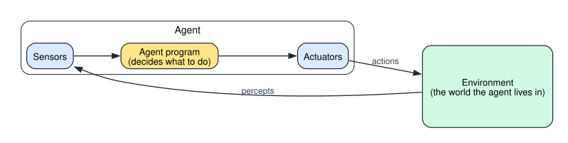

# Agents and Environments

An agent is anything that perceives its environment through sensors and acts on that environment through actuators.

## Before you start
<!-- bite: a1af5ba3-3590-4b5b-a6bc-04ea1308ed1e -->

Read [[artificial-intelligence/01-foundations/03-the-four-approaches-to-ai|The Four Approaches to AI]] first. This lesson takes its idea of a rational agent and makes it precise.

After this lesson you will be able to:

1. draw the agent–environment loop and name its parts: percepts, sensors, agent program, actuators, actions;
2. describe a task with PEAS (performance measure, environment, actuators, sensors);
3. classify an environment along six dimensions, such as fully or partially observable;
4. explain why a goal-based agent needs search, which is the subject of the rest of this course.

## What an agent is
<!-- bite: ddcb03bd-0d9c-42fb-a544-2bd751cf4bff -->

In lesson 3 we said this subject builds rational agents. Now let's say exactly what an agent is.

An agent is anything that takes in information about its surroundings and does something in response. You are an agent: your eyes and ears take things in, and your hands, legs and voice act. A thermostat is an agent: its thermometer takes in the temperature, and its switch acts on the heater. And the map app is an agent: it takes in your location and destination, and it acts by showing a route.

The course slides put it in one line: **an agent is an entity that perceives and acts.** The rest of this lesson builds that line out into something you can design with.

## The kid version
<!-- bite: 4c596c6a-7e1c-4f57-b6a6-bfe789509b89 -->

A robot vacuum is an agent. Its bump sensor and dirt sensor tell it what's going on: "I hit a wall", "this spot is dirty". Its little brain decides: "turn left", "suck harder here". Its wheels and brush carry that out. Then it senses again, decides again, acts again, all day long. Every AI system in this subject works the same way: sense, decide, act, repeat.

**Where the analogy stops working.** The vacuum only reacts to what's in front of it. The agents we care about most also *plan ahead*: before moving at all, they think through sequences of actions, which the vacuum never does.

## The agent–environment loop
<!-- bite: 46a3644d-ab14-4533-8b59-5bca10a5f07d -->

Here's the loop every agent runs.

Follow it round. The **environment** is the part of the world the agent lives in. What the agent takes in at one moment is a **percept**, and it comes in through **sensors**. The **agent program** decides what to do. The decision goes out through **actuators** as an **action**, which changes the environment. Then the next percept comes in, and the loop goes round again.

## The agent function
<!-- bite: 7c25cf27-deee-49e3-bc4a-1bc447361f0e -->

An agent decides using everything it has perceived so far, not just the latest percept. That whole history is the **percept sequence**.

So abstractly, an agent is a function from percept sequences to actions. The course writes it like this, where $P^*$ means "any sequence of percepts" and $A$ means "the set of actions":

$$f: P^* \rightarrow A$$

Read it as: give me everything you've seen so far, and I'll give you one action.

The **agent function** is that mathematical mapping. The **agent program** is the actual code, running on a real machine, that computes it. The difference matters because the function might be easy to describe ("always take the cheapest route") but expensive to compute.

## What makes an agent rational
<!-- bite: b634ef59-57a4-43ad-8b4a-a87c38967f3e -->

In lesson 3, a rational agent did "whatever is expected to achieve the goal best, given the information available". To check that, you need to know four things:

1. **The performance measure**: how success is scored.
2. **The agent's prior knowledge** of the environment.
3. **The actions** the agent can perform.
4. **The percept sequence** so far.

A rational agent picks the action that's expected to maximise the performance measure, given its prior knowledge and percept sequence. A perfectly rational agent is usually out of reach, because computing the perfect action takes too long. So, as the course says, we aim for the best program for the given machine resources.

## Describing a task with PEAS
<!-- bite: f070cc30-67c5-4763-b2e4-f5ce3215e0e2 -->

Before you design an agent, write down its task with **PEAS**: Performance measure, Environment, Actuators, Sensors. Here it is for a self-driving taxi going from Lagos to Abuja:

1. **Performance measure**: arrive safely, quickly and cheaply, obey the law, keep the passenger comfortable.
2. **Environment**: roads, other vehicles, pedestrians, potholes, checkpoints, weather.
3. **Actuators**: steering, accelerator, brake, indicators, horn.
4. **Sensors**: cameras, GPS, speedometer, distance sensors, fuel gauge.

Notice that the performance measure has several parts that pull against each other. Fastest isn't always safest. That's normal, and a real design has to weigh them.

## Kinds of environment, part 1
<!-- bite: a0ceba35-5d40-4da5-b405-71f20cc197df -->

Environments differ, and the kind of environment decides how hard the agent's job is. Here are the six ways to classify one, starting with the first three:

1. **Fully observable or partially observable.** If the sensors show everything that matters, it's fully observable. A chessboard is: you can see every piece. Driving is partially observable: you can't see round the next bend.
2. **Deterministic or stochastic.** If the next state is completely fixed by the current state and the action, it's deterministic. In chess, moving a piece always does exactly that. Driving is stochastic: you press the brake, but a wet road might make you skid.
3. **Episodic or sequential.** In an episodic environment, each decision stands alone, like a machine sorting good oranges from bad ones one at a time. In a sequential one, today's choice changes tomorrow's options. Chess and driving are sequential.

## Kinds of environment, part 2
<!-- bite: 1026a674-d0af-4357-a0c6-6f55c240c68b -->

4. **Static or dynamic.** A static environment waits while the agent thinks. A crossword is static. A dynamic one keeps changing: traffic doesn't stop while the taxi decides.
5. **Discrete or continuous.** Discrete means a countable number of distinct states and actions, like the squares and moves in chess. Continuous means smooth values, like the exact speed and steering angle of a car.
6. **Single-agent or multi-agent.** A crossword has one agent. Chess has two, working against each other. Driving has many, mostly cooperating but sometimes competing for the same lane.

The easiest environment is fully observable, deterministic, episodic, static, discrete and single-agent. The real world is the hardest on every count. Much of this subject works on the easy end first, then relaxes one assumption at a time. Adversarial search, for example, drops "single-agent" to handle games.

## Kinds of agent
<!-- bite: bc7f3056-5e9f-4e15-9205-4e36990fb34f -->

Agents can also be built in different ways. Here are the two that matter most for this subject:

1. **A simple reflex agent** acts only on the current percept, using condition–action rules: "if the car in front brakes, then brake." It's fast, but it can't plan, and it fails if it needs to remember something it can't currently see.
2. **A goal-based agent** knows what it's trying to achieve. It asks: "if I do this, then this, then this, will I reach the goal?" To answer, it has to look ahead through sequences of actions before acting.

Looking ahead through sequences of actions to find one that reaches a goal is **search**. That's why search is the fundamental technique of AI, and why it fills most of this subject. There are also **utility-based** agents, which ask not just "does this reach the goal?" but "how good is it?", and **learning** agents, which improve with experience.

## Terms used in this lesson
<!-- bite: 7ad3d28c-5ec9-4086-be22-a8d23038761c -->

1. **Percept**: This is what the agent takes in from the environment at one moment, such as one camera frame.
2. **Percept sequence**: This is the complete history of everything the agent has perceived so far.
3. **Sensor**: This is the part of an agent that takes in percepts, such as a camera or a thermometer.
4. **Actuator**: This is the part of an agent that carries out actions, such as a wheel, a brake or a screen.
5. **Agent function**: This is the mathematical mapping from percept sequences to actions, written $f: P^* \rightarrow A$.
6. **Agent program**: This is the code, running on a real machine, that computes the agent function.
7. **PEAS**: The letters stand for performance measure, environment, actuators and sensors. It's the four-part description of an agent's task.
8. **Goal-based agent**: This is an agent that chooses actions by looking ahead to see which sequence of actions reaches its goal.

## Common pitfalls and traps
<!-- bite: 5b9d4abf-5008-4e97-8775-6038dc372fc2 -->

- **Thinking only robots are agents.** Software is an agent too. The map app's sensors are its inputs (your location, the map data) and its actuator is the screen.
- **Confusing the agent function with the agent program.** The function is *what* the agent should do. The program is *how* a real machine works it out. One function can be computed by a fast program or a hopelessly slow one.
- **Classifying driving as fully observable because the car has many sensors.** No sensor sees round a corner or into another driver's mind. If anything that matters is hidden, it's partially observable.

## Check your understanding
<!-- bite: 753035bb-265a-4794-8ebd-9d237620056f -->

Try each one before you open the answer.

1. <!-- q: gap id="6ed672df" answers="sensors;actuators" -->
   An agent perceives its environment through ___ and acts on it through ___.

   

Answer

   Sensors and actuators. For a robot vacuum, the bump and dirt sensors are sensors, and the wheels and brush are actuators.

   

2. <!-- q: mcq id="734352f4" -->
   A spam filter looks at each email on its own and labels it spam or not spam. Its label for one email has no effect on the next. How would you classify this environment?

   - [x] Episodic
   - [ ] Sequential
   - [ ] Multi-agent and continuous
   - [ ] Dynamic and stochastic

   

Answer

   Episodic: each decision stands alone and doesn't change the options for the next one.

   

3. <!-- q: mcq id="07f17d3c" -->
   A program plays Ludo, which involves rolling a die, against three other players. Which of these describe its environment? (choose all that apply)

   - [x] Stochastic
   - [x] Multi-agent
   - [x] Sequential
   - [ ] Continuous

   

Answer

   Stochastic, because the die roll makes the next state uncertain. Multi-agent, because there are other players. Sequential, because every move changes later options. It's discrete, not continuous: there's a countable number of squares and moves.

   

4. <!-- q: open id="be589b52" -->
   Write a PEAS description for an automatic gate that opens for residents' cars at an estate entrance.

   

Answer

   One good answer. Performance measure: let residents in quickly, keep non-residents out, never close on a car or person. Environment: the driveway, approaching cars, people, weather. Actuators: the gate motor, a light or buzzer. Sensors: a number-plate camera or card reader, a car-presence sensor, a safety beam across the gate. Any answer that names all four parts sensibly is fine.

   

5. <!-- q: open id="1887c339" -->
   Why does a goal-based agent need search, when a simple reflex agent doesn't?

   

Answer

   A simple reflex agent just maps the current percept to an action with a rule, so it never looks ahead. A goal-based agent has to find a *sequence* of actions that reaches the goal, and to do that it must try out possible sequences in its head and compare them before acting. Looking through possible action sequences is search.

   

## Before moving on
<!-- bite: 5ef15b36-eb78-422a-a2ec-56682dc210a3 -->

You're done when you can draw the agent–environment loop, write a PEAS description for a new task, classify an environment on all six dimensions, and say why goal-based agents need search.

Recap: an agent perceives through sensors and acts through actuators, computing an action from its percept sequence, $f: P^* \rightarrow A$. A rational agent maximises its performance measure given what it knows. PEAS describes the task. Environments vary on six dimensions, from easy (fully observable, deterministic, episodic, static, discrete, single-agent) to hard. A goal-based agent looks ahead through action sequences, which is search.

Next, [[artificial-intelligence/01-foundations/06-problem-solving-in-ai|Problem Solving in AI]] shows how a goal-based agent turns a real-world task into a problem it can search: the steps it follows, and the five parts every problem needs.

## Related
<!-- bite: 977cec46-6938-4e62-b78c-33e7a3269aa0 -->

- [[machine-learning/08-other-architectures/03-reinforcement-learning|Reinforcement Learning]]: agents that learn what to do from rewards, instead of searching a known map.
- [[control-theory/index|Control Theory]]: the feedback loop behind the agent–environment loop.

## About this lesson
<!-- bite: 38f92f83-ccf6-45bd-a66c-fa909d35ecb4 -->

**Level:** introductory. Lesson 5 of section 01 (foundations). It covers agents, the agent function, rationality, PEAS, the six environment properties, and simple reflex versus goal-based agents.

**Source:** University of Lagos SSG 518 Module 1 slides (*Rational agents*: "an agent is an entity that perceives and acts", $f: P^* \rightarrow A$, and the caveat about computational limits). PEAS, the environment properties and the agent types follow Russell and Norvig's *Artificial Intelligence: A Modern Approach*, chapter 2, which the course grid comes from.
