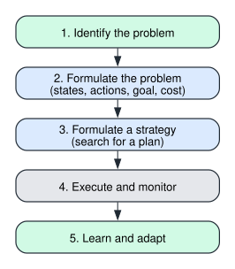
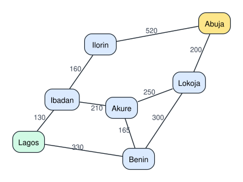
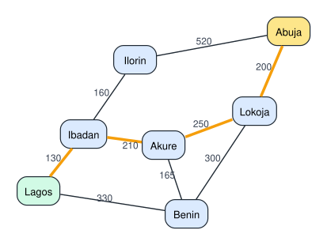

# Problem Solving in AI

Problem solving in AI is a systematic process in which an agent identifies a challenge, describes it precisely, works out a plan and carries it out to reach a goal.

## Before you start
<!-- bite: 55d46801-a0fd-4cc0-8e2b-307b4394bd3e -->

Read [[artificial-intelligence/01-foundations/05-agents-and-environments|Agents and Environments]] first. You need the idea of a goal-based agent, which looks ahead before acting.

After this lesson you will be able to:

1. list the five steps of problem solving in AI;
2. formulate a problem with its five parts: initial state, actions, transition model, goal test and path cost;
3. work out the cost of a path on a map, and say why the path with fewest steps isn't always the cheapest.

## What problem solving in AI is
<!-- bite: 54a6a4df-ed1f-475d-b2ec-021419f79ce8 -->

At the end of the last lesson, a goal-based agent had to look ahead through sequences of actions. But a computer can't look ahead through "drive to Abuja". It needs the task written down exactly: where am I, what can I do, what happens when I do it, how do I know I've arrived, and what does it cost?

Problem solving in AI is the process of getting from a messy real-world task to that exact description, then finding and carrying out a plan. It involves designing agents that analyse their environment, define their goals, and use algorithms to get from an initial state to the outcome they want.

This lesson does it for the example we'll carry through the whole subject: driving from Lagos to Abuja.

## The kid version
<!-- bite: 84b40194-84e2-43cc-829d-39184aa1d485 -->

Say you want to get from your house to your friend's house across town. First you notice the problem: "I need to get there." Then you describe it: "I'm at home. I can walk down any street. I'm done when I'm at their gate. Shorter is better." Then you plan a way, walk it while watching for blocked streets, and next time you remember the shortcut. Problem solving in AI is exactly those steps, written so a computer can follow them.

**Where the analogy stops working.** You plan in your head without noticing. A computer has nothing in its head except what you wrote down, so every part of the description, especially "what can I do from here?", must be spelled out with nothing left to common sense.

## The five steps of problem solving
<!-- bite: 3246c00a-c510-4fb3-8052-0a3622f9a301 -->

## The five steps, one by one
<!-- bite: 0fbf7d90-80d7-4fab-b83e-198e1ee0c6fc -->

Here's what each step means for the road trip:

1. **Problem identification.** Recognise the problem and define it within the environment. "Get the passenger from Lagos to Abuja."
2. **Problem formulation.** Structure the problem so the agent can understand and solve it, usually as a state space. This is the step the rest of this lesson is about.
3. **Strategy formulation.** Work out a plan to get from the initial state to a goal state. For a route, that means searching the map, which is what sections 02 and 03 teach.
4. **Execution and monitoring.** Carry out the plan while checking that it's working. If a road turns out to be closed, notice and re-plan.
5. **Learning and adaptation.** Learn from experience to solve future problems better. This often uses reinforcement learning or other machine learning.

## The five parts of a problem
<!-- bite: 25293cb3-61f2-439a-b6c0-9d5f35c31b61 -->

Step 2, formulation, means writing down five parts. Here's the map we'll use for the road trip, and for the rest of the subject. Lagos (green) is where we start, and Abuja (yellow) is where we want to be. The numbers are road distances in km.

## The five parts, for the road trip
<!-- bite: 395b2201-38ef-4271-bcce-7a35fe335df0 -->

Using that map, here are the five parts:

1. **Initial state**: where the agent starts. *In Lagos.*
2. **Actions**: what the agent can do in a given state. *In Lagos, drive to Ibadan or drive to Benin.* The available actions depend on the state: from Ibadan, the actions are drive to Lagos, Ilorin or Akure.
3. **Transition model**: what state each action leads to. *Driving to Ibadan from Lagos puts you in Ibadan.* The state an action leads to is called its **successor**.
4. **Goal test**: how to tell whether a state is a goal. *Am I in Abuja?*
5. **Path cost**: a number that adds up the cost of the actions along a path. *The total distance in km.*

Your class notes call the third part the "translation model". The standard name is **transition model**, because it describes how an action makes the state *transition* (change) to a new one.

## The state space
<!-- bite: 70aab2a3-010c-4353-bdcd-d6ecd0696281 -->

Put the initial state, the actions and the transition model together, and you have every state you could reach and every way to move between them. That's the **state space**. On our map, the state space is the seven cities and the nine roads.

A **path** is a sequence of states joined by actions, such as Lagos → Ibadan → Ilorin → Abuja. A **solution** is a path from the initial state to a goal state. An **optimal solution** is a solution with the lowest path cost of all.

Notice what we left out: potholes, fuel stops, traffic, the colour of the car. Deciding which details matter and throwing away the rest is called **abstraction**. A good abstraction keeps enough detail that a solution in the model still works in the real world, and drops everything else so the search stays small.

## Costing a path
<!-- bite: 05701aab-ae9b-410b-b70f-c1de7c192e97 -->

Let's cost a solution. Take Lagos → Ibadan → Ilorin → Abuja. Add up the road lengths:

$$130 + 160 + 520 = 810 \text{ km}$$

That's a solution: it starts in the initial state and passes the goal test. It's only three roads long. But is it optimal?

Before reading on, look at the map and try to find a cheaper solution.

## Fewest steps is not cheapest
<!-- bite: ebd58f6f-5050-45f9-93a9-547b32542a60 -->

Here's another solution: Lagos → Benin → Lokoja → Abuja.

$$330 + 300 + 200 = 830 \text{ km}$$

Also three roads, but 20 km longer. Now try a four-road route: Lagos → Ibadan → Akure → Lokoja → Abuja.

$$130 + 210 + 250 + 200 = 790 \text{ km}$$

It has *more* roads than either of the others, but it's the cheapest of all. That's the optimal solution.

## Seeing the cheapest route
<!-- bite: d02e2483-7d75-4dd9-99ec-7e1a97527615 -->

Here's the 790 km route on the map.

Keep this in your head, because it comes back in section 02. Some search methods find the path with the **fewest steps** (810 or 830 km here). Others find the path with the **lowest cost** (790 km). They're different questions, and choosing the wrong method gives you the wrong answer.

## A second example: the 8-puzzle
<!-- bite: 27995f5d-d161-4be8-9ef1-ef06e3db94cf -->

The same five parts describe problems that aren't about maps at all. The 8-puzzle is a 3 × 3 tray with tiles numbered 1 to 8 and one empty square. You slide a tile into the empty square until the tiles are in order.

1. **Initial state**: any arrangement of the tiles.
2. **Actions**: move the blank left, right, up or down (whichever stay inside the tray).
3. **Transition model**: the new arrangement after the blank swaps with the tile next to it.
4. **Goal test**: are the tiles in order, 1 to 8, with the blank in the corner?
5. **Path cost**: each move costs 1, so the path cost is the number of moves.

Its state space is huge: 9!/2 = 181,440 reachable arrangements. You couldn't draw it, but you don't need to. The five parts let a program generate states as it needs them.

## Terms used in this lesson
<!-- bite: 077ba89c-4877-4c7c-8cd6-620cc55778be -->

1. **Initial state**: This is the state the agent starts in.
2. **Action**: This is something the agent can do in a state, such as drive to a neighbouring city.
3. **Transition model**: This is the description of which state each action leads to. Your class notes call it the "translation model".
4. **Successor**: This is a state you can reach from a given state with one action.
5. **Goal test**: This is the check that tells whether a state is a goal.
6. **Path cost**: This is the total cost of the actions along a path, such as total distance.
7. **State space**: This is the set of all states reachable from the initial state, together with the actions joining them.
8. **Solution**: This is a path from the initial state to a goal state. An **optimal solution** is a solution with the lowest path cost.
9. **Abstraction**: This is leaving out details that don't matter for the problem, so the model stays small but solutions still work in the real world.

## Common pitfalls and traps
<!-- bite: ed4cbcd8-5346-4a60-8155-d3d64f8d965e -->

- **Writing actions that don't depend on the state.** "Drive to Ibadan" is only an action when you're next to Ibadan. Actions are always "what can I do *from here*".
- **Assuming the shortest-looking path is optimal.** On our map the two three-road routes cost 810 and 830 km, but the four-road route costs 790 km. Count cost, not steps.
- **Mixing up the goal test with the goal.** The goal is Abuja. The goal test is the *check* "am I in Abuja?". Some problems have many goal states, like "any city with an airport", so the test matters more than a single goal.

## Check your understanding
<!-- bite: ca3af055-0885-4e73-b87d-e949f8ba41bf -->

Try each one before you open the answer.

1. <!-- q: mcq id="775eb0c0" -->
   Which of these are among the five parts of a problem formulation? (choose all that apply)

   - [x] Initial state
   - [x] Transition model
   - [ ] Heuristic function
   - [x] Path cost
   - [x] Goal test

   

Answer

   The five parts are initial state, actions, transition model, goal test and path cost. A heuristic function is extra knowledge used by some search methods later; it isn't part of the problem itself.

   

2. <!-- q: exact id="c641ca7c" answer="600" -->
   Use this map of roads, with distances in km:

   | Road | Distance |
   |---|---|
   | Enugu – Onitsha | 110 |
   | Onitsha – Benin | 140 |
   | Benin – Ore | 150 |
   | Ore – Lagos | 200 |

   What is the path cost, in km, of Enugu → Onitsha → Benin → Ore → Lagos?

   

Answer

   110 + 140 + 150 + 200 = 600 km. The path cost is the sum of the costs of the actions along the path.

   

3. <!-- q: mcq id="1520a789" -->
   Use this map, with distances in km. Two routes go from A to D:

   | Road | Distance |
   |---|---|
   | A – B | 100 |
   | B – D | 300 |
   | A – C | 80 |
   | C – E | 90 |
   | E – D | 110 |

   Which statement is true?

   - [ ] A → B → D is optimal, because it uses fewer roads.
   - [x] A → C → E → D is optimal, at 280 km against 400 km.
   - [ ] Both routes cost the same.
   - [ ] Neither is a solution, because they use different numbers of roads.

   

Answer

   A → B → D costs 100 + 300 = 400 km. A → C → E → D costs 80 + 90 + 110 = 280 km. The route with more roads is cheaper, so it's the optimal solution.

   

4. <!-- q: gap id="70e4d915" answers="formulation|problem formulation;strategy|strategy formulation" -->
   In the five steps of problem solving, describing the problem as states, actions, a goal and a cost is called problem ___. Working out a plan to get from the initial state to the goal is called ___ formulation.

   

Answer

   Problem formulation, then strategy formulation. Formulation describes the problem; strategy formulation (usually search) finds the plan.

   

5. <!-- q: open id="e0d50c13" -->
   Formulate this problem with all five parts: a robot in a building must get from room G01 on the ground floor to room 304 on the third floor. It can walk along corridors, take the stairs, or take the lift.

   

Answer

   One good answer. Initial state: the robot is in room G01. Actions: from its current location, walk to a neighbouring room or corridor point, take the stairs up or down one floor, or take the lift to any floor (if it's at the lift). Transition model: each action moves the robot to the location it leads to. Goal test: is the robot in room 304? Path cost: total time taken (or distance walked), adding up each action's cost.

   

## Before moving on
<!-- bite: 27dcb0fa-e11c-4ce7-813e-6200a6bd1b2c -->

You're done when you can list the five steps, formulate a new problem with all five parts, and cost two paths on a map to find which is optimal.

Recap: problem solving runs identify → formulate → plan a strategy → execute and monitor → learn. A problem is formulated with an initial state, actions, a transition model, a goal test and a path cost. Together these define the state space. A solution is a path to a goal, and an optimal solution has the lowest path cost. On our map, Lagos to Abuja costs 790 km at best, by a route with four roads, not three.

Next, [[artificial-intelligence/01-foundations/07-types-of-problems-and-techniques|Types of Problems and Techniques]] shows that problems aren't all alike: in some you can undo a mistake and in some you can't, and that decides which technique you reach for.

## Related
<!-- bite: e3e99475-1b75-48a8-bc76-7c157cb30cee -->

- [[dsa/02-data-structures/09-graphs/index|Graphs]]: the state space is a graph, and this is the data structure behind it.
- [[operations-research/index|Operations Research]]: the same "find the cheapest route" problem, solved with optimisation instead of search.

## About this lesson
<!-- bite: b675d8ad-d562-449c-9bb9-96cb23e2f5f1 -->

**Level:** introductory. Lesson 6 of section 01 (foundations). It covers the five steps of problem solving, the five parts of a problem formulation, the state space, solutions and optimal solutions, abstraction, and the 8-puzzle.

**Source:** University of Lagos SSG 518 class notes, *Problem Solving in AI* (09/03/26: the definition, steps and components), and the SSG 518 *Introduction to Search* slides (the route-finding example and the five parts). The Nigeria map's distances are rounded road distances chosen for hand tracing, not survey figures; `scripts/diagrams/artificial_intelligence.py` computes and asserts every path cost here.
