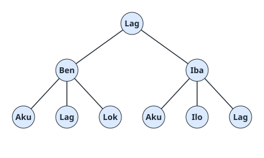

# What Search Is

Search is a method computers use to examine a problem space, state by state, to find a path from the start state to a goal state.

## Before you start
<!-- bite: 8f2b2a34-de68-401f-bfe1-f4fe770b2f6c -->

Read [[artificial-intelligence/01-foundations/05-problem-solving-in-ai|Problem Solving in AI]] first. You need the five parts of a problem (initial state, actions, transition model, goal test, path cost) and the Lagos-to-Abuja map.

After this lesson you will be able to:

1. say what search is, and why the problem space and the search space are the same thing;
2. draw a search tree from a map, and explain why the same city can appear in it more than once;
3. describe the general search loop: take a node off the frontier, test it, expand it;
4. tell data-driven search from goal-driven search, and say when each one fits.

## What search is
<!-- bite: 75c1aa6e-b545-4d89-aace-585282224dfe -->

In the last section you formulated the road trip: start in Lagos, drive along roads, stop when you're in Abuja, add up the kilometres. That told the computer *what* the problem is. It didn't tell it *how* to find the answer.

That's what search does. Your class notes define it like this:

A one-sentence version for an exam: search is a method that can be used by computers to examine a problem space to find a goal. It is the systematic examination of states to find a path from the start (root) state to the goal state.

"Systematic" is the key word. The computer doesn't guess. It works through the states in a fixed order, keeping track of where it has been, until it reaches a goal. The order it uses is what makes one search method different from another, and the next nine lessons are about those orders.

## The kid version
<!-- bite: a4d3b381-af1f-4dc5-860e-178c1f6473d1 -->

You've lost your keys somewhere in the house. You could run around checking random places, but you'd check the kitchen three times and never look under the bed. So you search properly: start at the front door, check every room on the ground floor, then go upstairs and check every room there, ticking each one off as you go. Search in AI is exactly this: a careful, ordered way of checking places until you find what you want, remembering where you've already looked.

**Where the analogy stops working.** Your house has a few rooms. A computer's problem can have millions or billions of states, far too many to check them all, so the *order* you check them in decides whether you find the answer in a second or never.

## Problem space and search space
<!-- bite: c5dfd9bd-2114-471b-a1c2-12865125190a -->

Your notes write **problem space ⟺ search space**. The two names mean the same thing.

The **problem space** is the state space you built in the last lesson: every state you can reach and the actions joining them. For the road trip, it's the seven cities and nine roads. When we start searching through it, we call it the **search space**. Same space, different name, depending on whether you're describing the problem or solving it.

Your notes add one more line worth keeping: search forms the core component of many intelligent processes. Route planning, game playing, puzzle solving, timetabling and planning all come down to searching a space.

## The search tree
<!-- bite: 61f153f1-c552-4a25-a353-55226f3e52e3 -->

A computer doesn't search the map directly. It builds a **search tree** as it goes.

The root of the tree is the initial state, Lagos. Its children are the states one action away: Benin and Ibadan. Their children are the states one more action away, and so on. Here are the first two levels:



Look closely. Lagos appears three times, and Akure twice. That's because the map has loops: you can drive Lagos → Benin → Lagos. The map has only 7 cities, but the tree can keep growing forever.

## State space versus search tree
<!-- bite: e6ccf86e-66b1-46a9-b6ea-2bb491d2c53f -->

So the state space and the search tree are not the same:

1. **The state space** has each state once. Our map has 7.
2. **The search tree** has one node for every *path* the search has tried. The same state can appear in many nodes, one for each way of getting there.

To stop wasting time on states it has already seen, a search can keep a list of them, called the **explored set** (or **reached set**). A search that keeps this list is called **graph search**. A search that doesn't, and happily explores Lagos again, is called **tree search**. On a map with loops, graph search is the safe choice.

## The general search loop
<!-- bite: 4be4262c-e008-4d89-9e7e-ac296dfbeee2 -->

Every search method in this section runs the same loop. The nodes waiting to be looked at are kept in a list called the **frontier** (sometimes the **open list** or **fringe**).

```
frontier ← [the initial state]
loop:
    if the frontier is empty: return failure
    take a node off the frontier
    if the node passes the goal test: return the path to it
    expand the node: add its children to the frontier
```

**Expanding** a node means applying every action to it to generate its children. That's the only difference between the methods: **which node comes off the frontier next.** Take the oldest node, and you get breadth-first search. Take the newest, and you get depth-first search. Take the cheapest, and you get uniform-cost search.

## Data-driven search
<!-- bite: e6489fdc-7e5d-496a-8d13-9e9685d0fd54 -->

There's one more choice before we pick an order: which end do you start from? Your notes give two types of search.

**Data-driven search**, also known as **forward-driven** search or **forward chaining**, starts from an initial state and uses the allowed actions to move forward until a goal is reached.

It's most useful when the initial data are given and it isn't clear what the goal is. Your notes' example is a system that analyses astronomical data and makes deductions about stars and planets. It gets a great deal of data but no direct goal. It's expected to work forward from the data and draw its own conclusions, and there's a huge number of possible conclusions it might reach.

Our road trip is forward search too: start in Lagos and drive toward Abuja.

## Goal-driven search
<!-- bite: 34daacbf-f546-49be-849f-b1254ce746b6 -->

**Goal-driven search**, also known as **backward chaining**, starts at the goal and works backwards toward a start state, by asking which moves could lead to the goal.

It's useful when the goal is clearly specified. Your notes' example is medical diagnosis: the condition to check is known ("does this patient have malaria?"), but the rest of the data, such as the causes and symptoms that would confirm it, must be found. So you start from "malaria", ask "what would cause this?", and work back to the tests you need.

A simple way to tell them apart: if you know where you're starting and have many possible destinations, go forward. If you know exactly where you want to end up and many places you might have started, go backward.

## The two main techniques
<!-- bite: ee2e81e9-3e6b-481a-abc1-0799fe897eee -->

Search methods split into two main families, and your notes name both:

1. **Uninformed search**, also called **blind search**, has no information about how far the current state is from the goal. It only knows how to traverse the tree, visiting every node in a specific order. It's also called **exhaustive** or **brute-force** search. Because it uses nothing about the problem to guide it, it may not be very efficient.
2. **Informed search**, also called **heuristic search**, uses information about the problem to guess which states are closer to the goal, and looks there first.

## The six uninformed methods
<!-- bite: 5cba77b7-ed29-4c33-b0d5-3aa8f8b29dfd -->

This section covers the six uninformed methods in your notes:

1. Breadth-first search
2. Depth-first search
3. Depth-limited search
4. Iterative deepening depth-first search
5. Uniform-cost search
6. Bidirectional search

Section 03 covers informed search.

## Terms used in this lesson
<!-- bite: edd8c9bc-51f6-45b1-b8be-5fffcdf4c6b8 -->

1. **Search**: This is the systematic examination of states to find a path from the start state to a goal state.
2. **Search space**: This is also known as the **problem space**. It's the set of states and actions being searched.
3. **Search tree**: This is the tree a search builds as it runs. The root is the initial state, and each node's children are the states one action away.
4. **Node**: This is one entry in the search tree. It holds a state and the path that reached it. Two nodes can hold the same state.
5. **Expanding a node**: This means applying every action to a node's state to generate its children.

## More terms used in this lesson
<!-- bite: 46c3dded-312e-4959-969d-3049f022ed21 -->

6. **Frontier**: This is also known as the **open list** or **fringe**. It's the list of nodes generated but not yet expanded.
7. **Explored set**: This is also known as the **reached set** or **closed list**. It's the record of states already seen, so they aren't searched again.
8. **Data-driven search**: This is also known as **forward chaining**. It searches forward from the initial state.
9. **Goal-driven search**: This is also known as **backward chaining**. It searches backward from the goal.
10. **Uninformed search**: This is also known as **blind search**. It's search that uses no knowledge of where the goal is.

## Common pitfalls and traps
<!-- bite: 46a79b13-f410-44c2-add4-d99f2a31b92e -->

- **Thinking the search tree is the map.** The map has 7 cities. The search tree from it can be infinite, because loops let the same city appear again and again.
- **Thinking blind search is random.** Blind search is perfectly orderly. It's "blind" only because it can't tell which states are closer to the goal.
- **Mixing up which way is "driven".** Data-driven starts from the data (the initial state) and goes forward. Goal-driven starts from the goal and goes backward.

## Check your understanding
<!-- bite: abace274-1c61-4ca3-826e-6515046854b5 -->

Try each one before you open the answer.

1. <!-- q: gap id="33a65681" answers="problem space|state space;search space" -->
   Your notes write ___ ⟺ ___: the space of states is called one name when describing the problem and another when solving it.

   <details><summary>Answer</summary>

   Problem space ⟺ search space. They're the same set of states and actions.

   </details>

2. <!-- q: mcq id="3999bd5c" -->
   A map has three towns, P, Q and R, each joined by a road to both of the others. You build the search tree from P, two levels deep, without an explored set. How many times does P appear in the tree?

   - [ ] Once
   - [x] Three times
   - [ ] Twice
   - [ ] Five times

   <details><summary>Answer</summary>

   Three times. P is the root. Its children are Q and R. Q's children are P and R, and R's children are P and Q. So P appears at the root and once under each of Q and R.

   </details>

3. <!-- q: mcq id="4efba63d" -->
   A doctor's program must decide whether a patient has typhoid. It knows exactly which condition it's checking, and must find the tests and symptoms that would confirm it. Which kind of search fits?

   - [ ] Data-driven (forward chaining)
   - [x] Goal-driven (backward chaining)

   <details><summary>Answer</summary>

   Goal-driven. The goal is clearly specified (typhoid), so the program works backward from it to the evidence it needs.

   </details>

4. <!-- q: exact id="ac954e0d" answer="frontier" accept="open list|fringe|the frontier" -->
   What is the name of the list of nodes that have been generated but not yet expanded?

   <details><summary>Answer</summary>

   The frontier, also called the open list or fringe. Which node a method takes off the frontier next is what makes it different from the others.

   </details>

5. <!-- q: open id="c3ab1768" -->
   Explain the difference between tree search and graph search, and say which you'd use on a road map with loops.

   <details><summary>Answer</summary>

   Graph search keeps an explored set of states it has already seen and doesn't search them again. Tree search keeps no such list, so it can revisit states and even loop forever. On a road map with loops you'd use graph search, so the search doesn't keep driving back to cities it has already checked.

   </details>

## Before moving on
<!-- bite: 52c4559f-0afc-450d-a3b7-75f1b6369e1d -->

You're done when you can define search in your notes' words, draw two levels of a search tree from any map, write the general search loop, and pick data-driven or goal-driven search for a given problem.

Recap: search systematically examines states to find a path from the start to a goal. It builds a search tree, where one state can appear many times; graph search keeps an explored set to avoid that. Every method runs the same loop and differs only in which frontier node it takes next. Data-driven search goes forward from the data; goal-driven search goes backward from the goal.

Next, [[artificial-intelligence/02-uninformed-search/02-measuring-a-search-method|Measuring a Search Method]] gives you the four questions for judging any search method, and shows why the size of the search tree is the thing to watch.

## Related
<!-- bite: baf74940-c8b2-4c02-abaa-34ce5b29384e -->

- [[dsa/02-data-structures/09-graphs/index|Graphs]]: the state space is a graph, and graph traversal is search.
- [[artificial-intelligence/01-foundations/04-agents-and-environments|Agents and Environments]]: why a goal-based agent needs search.

## About this lesson
<!-- bite: 62159f49-dd01-4b07-8290-c17ff10eebad -->

**Level:** introductory. Lesson 1 of section 02 (uninformed search). It covers what search is, problem space and search space, search trees, the frontier and the explored set, data-driven and goal-driven search, and uninformed versus informed search.

**Source:** University of Lagos SSG 518 class notes, *Introduction to Search Method in AI Problem* (23/11/25), and the classmate's copy of the same lecture (the astronomy example). The search-tree and frontier terms follow the SSG 518 *Introduction to Search* slides and Russell and Norvig. The search tree is drawn by `scripts/diagrams/ai_search.py`.
