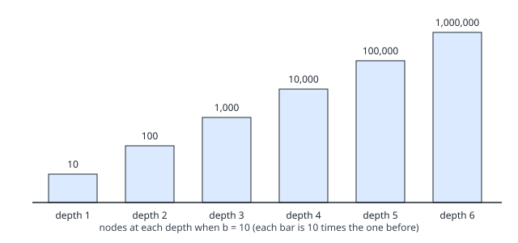

# Measuring a Search Method

A search method is judged on four questions: does it always find a solution, does it find the best one, how long does it take, and how much memory does it need?

## Before you start
<!-- bite: 5632fba5-9af3-49c9-a9b0-020f43f5b675 -->

Read [[artificial-intelligence/02-uninformed-search/01-what-search-is|What Search Is]] first. You need the search tree, nodes and the frontier.

After this lesson you will be able to:

1. state the four criteria: completeness, optimality, time complexity and space complexity;
2. say what $b$, $d$ and $m$ mean, and find them for a small tree;
3. count the nodes in a search tree up to depth $d$, and explain why the count explodes.

## What measuring a search method means
<!-- bite: c7a3eaae-0479-4357-8138-94f09f4e639d -->

The next eight lessons give you six search methods. You'll want to know which one to use, and "it depends" isn't an answer you can write in an exam. So before meeting any of them, let's fix the questions we'll ask of every one.

There are four, and they come straight from the course slides. Two are about the answer you get. Two are about what it costs you to get it.

## The kid version
<!-- bite: 7b254f95-9f20-426f-92b4-adedfd5334af -->

Say you're choosing how to look for your lost keys. You'd ask four things. Will this way definitely find them, if they're in the house? Will it find them by the shortest walk? How long will it take? And how much do I have to remember as I go: just "I'm in the bedroom", or a whole list of every drawer I still have to open? Those four questions are exactly how search methods are compared.

**Where the analogy stops working.** In a house the answers are "a few minutes" and "a short list". In a big search problem the time and the list can grow so fast that a method which works for depth 5 is hopeless at depth 15, so the answers are given as formulas, not numbers.

## The four criteria
<!-- bite: bfe65a7b-6b56-4de5-978a-bb5a7981d6f9 -->

1. **Completeness.** Will it always find a solution when one exists? A complete method never misses a solution that's there.
2. **Optimality.** Does it find the lowest-cost solution? On our map, the optimal route is the 790 km one. A method that returns the 830 km route has found *a* solution but not the optimal one.
3. **Time complexity.** How long does it take? We measure this by the number of nodes it generates or expands, not seconds, because seconds depend on the computer.
4. **Space complexity.** How much memory does it need at one time? We measure this by the largest number of nodes it has to keep stored at once.

Space often matters more than time. You can wait longer for an answer, but if the search runs out of memory, you get no answer at all.

## The three numbers b, d and m
<!-- bite: 7a0a6271-86c4-4b4f-8f27-57fed5674a04 -->

Time and space depend on the shape of the search tree, and three numbers describe that shape. The course slides use these letters, and so does every table you'll see:

1. **$b$, the branching factor**: the maximum number of children (successors) a node has. On our map, Ibadan has three neighbours, more than any other city, so $b = 3$.
2. **$d$, the depth of the shallowest goal**: how many actions the closest goal is from the root. Abuja is 3 roads from Lagos at the fewest, so $d = 3$.
3. **$m$, the maximum depth of the search tree**: the length of the longest path. It can be infinite. On our map, without an explored set, you can drive in circles forever, so $m = \infty$.

Remember these three, because every method's time and space is written with them.

## Counting the nodes
<!-- bite: 9d0a361e-89db-40ff-9b9e-dce6b30110b5 -->

How many nodes does a search tree have down to depth $d$? Let's count level by level for a tree where every node has $b$ children.

The root is 1 node. Level 1 has $b$ nodes. Each of those has $b$ children, so level 2 has $b \times b = b^2$. Level 3 has $b^3$. So the levels below the root add up to:

$$b + b^2 + b^3 + \dots + b^d$$

Try it with the small tree from your class notes, where $b = 2$ and $d = 2$: $2 + 4 = 6$ nodes below the root. Count them in the picture of that tree in the next lesson and you'll get 6.

The last term, $b^d$, is bigger than all the others put together (almost), so we write the total as $O(b^d)$. The $O$ means "grows like": we only care about the term that dominates as the tree gets big.

## The exponential wall
<!-- bite: e7d727e3-25fa-48f0-b416-7da1bdc3b2ba -->

$O(b^d)$ looks harmless until you put numbers in. Take $b = 10$, which is small for a real problem. Predict before reading on: how many nodes are there down to depth 6?

$$10 + 100 + 1{,}000 + 10{,}000 + 100{,}000 + 1{,}000{,}000 = 1{,}111{,}110$$

Over a million. Every extra level multiplies the work by 10. At depth 12, it's over a trillion. This is called **exponential growth**, and it's the enemy of every search method. It's why your notes say uninformed search "may not be very efficient", and why section 03 is about cutting the tree down with heuristics.

## Reading a complexity
<!-- bite: 2642fd79-8963-48ab-8b2d-6175597a299d -->

When you see the time and space of a method written with these letters, read them like this:

1. **$O(b^d)$**: grows exponentially with the depth of the goal. Fine for shallow goals, hopeless for deep ones.
2. **$O(b^m)$**: grows with the *maximum* depth. If $m$ is much bigger than $d$, or infinite, this is far worse.
3. **$O(bm)$ or $O(bd)$**: grows only in a straight line with depth. That's tiny. A method with this space can search very deep without running out of memory.

You'll meet all three in the next few lessons. Breadth-first search needs $O(b^d)$ space; depth-first search needs only $O(bm)$. That difference is the whole story of the next two lessons.

## Terms used in this lesson
<!-- bite: 11675bd8-9eee-4775-aab7-f2075d0bc7ab -->

1. **Complete**: A search method is complete if it always finds a solution when one exists.
2. **Optimal**: A search method is optimal if the solution it finds has the lowest path cost.
3. **Time complexity**: This is how the number of nodes generated grows with the size of the problem.
4. **Space complexity**: This is how the largest number of nodes stored at one time grows with the size of the problem.
5. **Branching factor ($b$)**: This is the maximum number of children a node has.
6. **Depth ($d$)**: This is the number of actions from the root to the shallowest goal.
7. **Maximum depth ($m$)**: This is the length of the longest path in the search tree. It can be infinite.
8. **Exponential growth**: This is growth where each step multiplies the size by the same factor, as $b^d$ does with each extra level.

## Common pitfalls and traps
<!-- bite: 8f348eb7-4b79-4b8c-9833-f55810e147b0 -->

- **Mixing up complete and optimal.** Complete means *a* solution is always found. Optimal means the *best* one is found. A method can be complete but not optimal.
- **Mixing up $d$ and $m$.** $d$ is the depth of the shallowest goal, where a good search can stop. $m$ is the deepest the tree goes, which a bad search might wander down. $m$ can be infinite; $d$ is finite if a solution exists.
- **Measuring time in seconds.** Seconds depend on the computer. Node counts let you compare methods fairly.

## Check your understanding
<!-- bite: 89ce7758-e14a-40fd-b2fe-6387cf7af5f1 -->

Try each one before you open the answer.

1. <!-- q: mcq id="8407630e" -->
   A search method always finds a solution if one exists, but sometimes returns a longer route than necessary. Which statement describes it?

   - [x] Complete but not optimal
   - [ ] Optimal but not complete
   - [ ] Both complete and optimal
   - [ ] Neither complete nor optimal

   

Answer

   Complete, because it always finds a solution. Not optimal, because the solution isn't always the cheapest.

   

2. <!-- q: exact id="35c1c75a" answer="1110" accept="1,110" -->
   A search tree has branching factor $b = 10$. How many nodes are there below the root, down to and including depth 3?

   

Answer

   10 + 100 + 1,000 = 1,110.

   

3. <!-- q: exact id="6e870bb3" answer="14" -->
   A search tree has branching factor $b = 2$. How many nodes are there below the root, down to and including depth 3?

   

Answer

   2 + 4 + 8 = 14.

   

4. <!-- q: gap id="840cc528" answers="branching factor;depth" -->
   In complexity formulas, $b$ is the ___ and $d$ is the ___ of the shallowest goal.

   

Answer

   Branching factor and depth. $m$ is the maximum depth of the tree.

   

5. <!-- q: open id="81376a64" -->
   Why does space complexity often matter more than time complexity in search?

   

Answer

   If a search takes a long time, you can still wait for the answer. If it needs more memory than the computer has, it crashes and gives no answer at all. Methods that need $O(b^d)$ memory run out of memory long before they run out of time.

   

## Before moving on
<!-- bite: 61137b13-1d77-4b57-b912-e2c1ea01b9c9 -->

You're done when you can state the four criteria, find $b$, $d$ and $m$ for a small tree or map, and count the nodes to depth $d$.

Recap: a search method is judged on completeness, optimality, time and space. Time and space are written with $b$ (branching factor), $d$ (depth of the shallowest goal) and $m$ (maximum depth). The tree has $b + b^2 + \dots + b^d$ nodes to depth $d$, which is $O(b^d)$, and that exponential growth is why search is hard.

Next, [[artificial-intelligence/02-uninformed-search/03-breadth-first-search|Breadth-First Search]] is the first method: it searches level by level, always finds the solution with the fewest steps, and pays for it with $O(b^d)$ memory.

## Related
<!-- bite: cd1b65e1-08dd-4169-861b-185fc36fa67e -->

- [[dsa/01-loops-and-what-they-cost|Loops and What They Cost]]: Big-O notation, starting from counting loop steps.

## About this lesson
<!-- bite: b84f638b-b7bd-486d-9811-33e39837fdd7 -->

**Level:** introductory, with simple sums. Lesson 2 of section 02 (uninformed search). It covers the four criteria for judging search, the notation $b$, $d$ and $m$, counting nodes, and exponential growth.

**Source:** University of Lagos SSG 518 *Introduction to Search* slides (*Measuring a Search Algorithm*: the four criteria and the notation). The node counts are computed and asserted by `scripts/diagrams/ai_search.py`.
