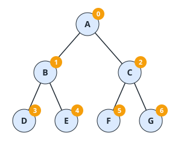
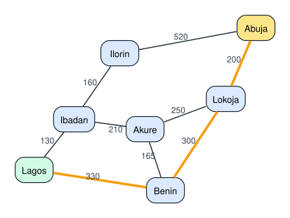

# Breadth-First Search

Breadth-first search starts from the root node, explores all the neighbouring nodes first, then moves on to the next level of neighbours.

## Before you start
<!-- bite: 72928e4a-9866-454e-bade-19ac6ffcebcb -->

Read [[artificial-intelligence/02-uninformed-search/02-measuring-a-search-method|Measuring a Search Method]] first. You need $b$, $d$ and the four criteria. You should know what a queue is (first in, first out); [[dsa/02-data-structures/05-stacks-and-queues|Stacks and Queues]] explains it if not.

After this lesson you will be able to:

1. trace breadth-first search (BFS) by hand on a tree and on a map, writing the queue after each step;
2. explain why BFS always finds the solution with the fewest steps, and why that isn't always the cheapest;
3. give BFS's advantages and disadvantages, and its $O(b^d)$ space;
4. write BFS in Python.

## What breadth-first search is
<!-- bite: 09a8d8f7-4093-45cb-88c8-ba5340997169 -->

Back in the general search loop, the only question was "which node comes off the frontier next?" Breadth-first search gives the simplest answer: **the oldest one.** The node that has been waiting longest goes next.

That one rule makes the search spread out level by level. It checks everything one step from the start, then everything two steps away, then three, like ripples spreading out from a stone dropped in water.

Your notes put it this way: it starts from the root node, explores the neighbouring nodes first, then moves towards the next-level neighbours. You explore all the nodes at the same distance before moving to the next distance. And your notes' tip for remembering the name: the *breadth* of a rectangle is how wide it is, so breadth-first means going across, horizontally, before going down.

## The kid version
<!-- bite: 7f201270-060f-4485-9d61-017b9bf4a44e -->

You're looking for your friend in a big compound. First you knock on every door on the ground floor. Only when you've tried every one do you go up to the first floor and knock on every door there. Then the second floor. If your friend is on the first floor, you're guaranteed to find them before you waste time on the second.

**Where the analogy stops working.** In the compound you just walk past the ground floor once you're done with it. BFS has to *remember* every door on the next floor it's planning to knock on, and when each floor has ten times as many doors as the one below, that list gets enormous.

## The FIFO queue
<!-- bite: 54570405-94a7-4020-b865-3a869ba1295e -->

BFS keeps its frontier in a **FIFO queue**: first in, first out. New nodes join at the back; the next node to expand comes off the front. It's the queue at a bank: whoever arrived first is served first.

Here's the tree from your class notes, with the order BFS visits each node:



Follow the queue. Start with `[A]`. Take A off the front and add its children: `[B, C]`. Take B off and add D and E at the back: `[C, D, E]`. Take C off and add F and G: `[D, E, F, G]`. Now everything left is on level 2, and they come off in order. Visit order: A, B, C, D, E, F, G, numbered 0 to 6.

## Do the nodes on a level have to be connected?
<!-- bite: df9d0c77-ca48-4a24-b5b1-2307d1075731 -->

Your notes ask, about the dashed line drawn across the bottom level: "do these have to be connected?" No. There's no edge between E and F. The dashed line in the notes only shows the *order* BFS visits them, sweeping across the level. BFS moves from E to F because F is next in the queue, not because they're joined.

## BFS on the map
<!-- bite: 510e0296-ca73-4287-b2de-11d14041adcd -->

Now let's run BFS on the Lagos-to-Abuja map, using graph search (so no city goes into the queue twice). Two conventions, used for every trace in this section: a city's neighbours are added in alphabetical order, and BFS checks for the goal as soon as a city is generated, rather than waiting until it comes off the queue.

Predict before reading the table: which route will BFS return?

| Step | Expand | Queue afterwards (front first) |
|---|---|---|
| 1 | Lagos | Benin, Ibadan |
| 2 | Benin | Ibadan, Akure, Lokoja |
| 3 | Ibadan | Akure, Lokoja, Ilorin |
| 4 | Akure | Lokoja, Ilorin |
| 5 | Lokoja | generates Abuja: goal found |

At step 4, Akure adds nothing: its neighbours Benin, Ibadan and Lokoja have all been seen already.

## The route BFS returns
<!-- bite: 4111b047-0c2c-494c-87eb-e28235e8f962 -->

Follow the parents back from Abuja: Abuja came from Lokoja, Lokoja from Benin, Benin from Lagos. So the route is Lagos → Benin → Lokoja → Abuja.



That's 3 roads, the fewest possible. But it's 330 + 300 + 200 = **830 km**, and the cheapest route is 790 km. BFS found the route with the fewest *steps*, not the fewest *kilometres*.

This is the key fact about BFS. It's optimal only when every step costs the same. On a map where roads have different lengths, it isn't.

## BFS in Python
<!-- bite: 78368c20-99bf-4152-9387-d7afe8d4a8c1 -->

Here's BFS on the map. Save it as `bfs.py` and run `python3 bfs.py` from the same folder. It needs nothing but Python 3.

```python
from collections import deque

ROADS = {("Lagos", "Ibadan"): 130, ("Lagos", "Benin"): 330, ("Ibadan", "Ilorin"): 160,
         ("Ibadan", "Akure"): 210, ("Benin", "Akure"): 165, ("Benin", "Lokoja"): 300,
         ("Ilorin", "Abuja"): 520, ("Akure", "Lokoja"): 250, ("Lokoja", "Abuja"): 200}

def neighbours(city):
    out = [b for (a, b) in ROADS if a == city] + [a for (a, b) in ROADS if b == city]
    return sorted(out)                       # alphabetical, as in the lesson

def bfs(start, goal):
    parent = {start: None}                   # every city seen, and where it came from
    queue = deque([start])                   # the FIFO frontier
    while queue:
        city = queue.popleft()               # oldest first
        for nxt in neighbours(city):
            if nxt not in parent:
                parent[nxt] = city
                if nxt == goal:              # goal test when generated
                    path = [nxt]
                    while parent[path[-1]]:
                        path.append(parent[path[-1]])
                    return path[::-1]
                queue.append(nxt)
    return None                              # queue empty: no route exists

route = bfs("Lagos", "Abuja")
km = sum(ROADS.get((a, b)) or ROADS[(b, a)] for a, b in zip(route, route[1:]))
print(" -> ".join(route))
print(f"{len(route) - 1} roads, {km} km")
```

## BFS in Python: what it prints
<!-- bite: 83417f2c-588d-4ee5-a160-3a691dc9e2f1 -->

Run it, and it prints:

```
Lagos -> Benin -> Lokoja -> Abuja
3 roads, 830 km
```

The `parent` dictionary does two jobs: it's the explored set, and it lets us walk back from the goal to rebuild the route.

## How good is BFS?
<!-- bite: 28194735-ccf8-46cc-802a-b74abbce3ce8 -->

Let's ask the four questions from the last lesson.

1. **Complete?** Yes, as long as $b$ is finite. It checks every level in turn, so it reaches the goal's level eventually.
2. **Optimal?** Only if every step costs the same. It finds the fewest steps, as you just saw.
3. **Time:** $O(b^d)$. In the worst case it generates every node down to the goal's depth.
4. **Space:** $O(b^d)$. It keeps the whole next level in the queue, and that level has about $b^d$ nodes.

The space is the killer. With $b = 10$ and a goal at depth 6, the queue can hold a million nodes at once.

## Advantages and disadvantages
<!-- bite: a2e29dd1-a0d6-4334-963f-cc1ba1de590c -->

Your notes list these, and they're asked for directly.

**Advantages:**

1. It will provide a solution if any solution exists.
2. If there's more than one solution, it gives the minimal solution, the one with the fewest steps.

**Disadvantages:**

1. Each level of nodes is saved to create the next, so it consumes a lot of memory. The space to store the nodes is exponential.
2. Its complexity depends on the number of nodes.
3. It needs a lot of time if the solution is far from the root, because it looks at all the nodes above it first.

## Terms used in this lesson
<!-- bite: 40da8599-e923-4643-ba18-53969334801e -->

1. **Breadth-first search (BFS)**: This is the search that always expands the oldest node on the frontier, so it explores level by level.
2. **FIFO queue**: The letters stand for first in, first out. It's a list where items are added at the back and removed from the front.
3. **Level**: This is the set of nodes at the same depth, the same number of steps from the root.
4. **Parent**: This is the node a node was generated from. Following parents back from the goal rebuilds the route.

## Common pitfalls and traps
<!-- bite: 45a60219-90c0-4983-b1ba-4a6eaee47c6b -->

- **Thinking BFS finds the shortest route on a map.** It finds the route with the fewest *roads*. On our map that's 830 km, while the shortest is 790 km.
- **Adding the same city to the queue twice.** On a map with loops, keep an explored set (the `parent` dictionary here), or BFS wastes time and memory on repeats.
- **Forgetting the order convention in a trace.** If the question doesn't fix one, state yours ("neighbours in alphabetical order"). A different order can give a different, equally valid trace.

## Check your understanding
<!-- bite: 285fb9ef-1b28-4e3b-a516-bdcbf8f43d8e -->

Try each one before you open the answer.

1. <!-- q: mcq id="27c7af8e" -->
   Which data structure does breadth-first search use for its frontier?

   - [x] A FIFO queue
   - [ ] A LIFO stack
   - [ ] A priority queue ordered by path cost
   - [ ] A hash set only

   <details><summary>Answer</summary>

   A FIFO queue: the oldest node comes off first, so the search goes level by level.

   </details>

2. <!-- q: exact id="effc2e43" answer="ABCDEFGH" accept="A B C D E F G H|A,B,C,D,E,F,G,H" -->
   A tree has root A with children B, C and D (in that order). B has children E and F. D has children G and H. In what order does BFS visit the nodes? Write the letters with no spaces.

   <details><summary>Answer</summary>

   ABCDEFGH. Level 0 is A; level 1 is B, C, D; level 2 is E, F (from B), then G, H (from D). C has no children.

   </details>

3. <!-- q: mcq id="69d5d55c" -->
   A map has these roads, with lengths in km: S–A 1, A–G 1, S–B 5, B–G 1 and S–G 10. BFS starts at S with goal G, testing for the goal when a node is generated. Which route does it return?

   - [x] S → G, 10 km
   - [ ] S → A → G, 2 km
   - [ ] S → B → G, 6 km

   <details><summary>Answer</summary>

   S → G. G is a direct neighbour of S, so BFS generates it in the first expansion and stops. It's one road, the fewest steps, but at 10 km it's the most expensive route. BFS ignores road lengths.

   </details>

4. <!-- q: gap id="2d73151c" answers="b^d|O(b^d)" -->
   Breadth-first search needs space that grows like $O($___$)$, because it stores a whole level of the tree.

   <details><summary>Answer</summary>

   $b^d$. The queue holds the next level, which has about $b^d$ nodes.

   </details>

5. <!-- q: open id="aebd3f1a" -->
   Give the two advantages and three disadvantages of BFS from your notes.

   <details><summary>Answer</summary>

   Advantages: it provides a solution if one exists, and if there are several solutions it gives the minimal one (fewest steps). Disadvantages: it uses a lot of memory, since each level is stored to build the next (exponential space); its complexity depends on the number of nodes; and it's slow when the solution is deep, because it checks every node above it first.

   </details>

## Practice: trace it yourself
<!-- bite: 36ef670d-25ba-4163-851a-d02a2fd4a4ec -->

Use this map. Roads (km): Kano–Kaduna 230, Kano–Bauchi 300, Kaduna–Abuja 180, Kaduna–Jos 260, Bauchi–Jos 120, Jos–Abuja 300.

1. Trace BFS from Kano to Abuja, adding neighbours in alphabetical order and testing for the goal when a city is generated. Write the queue after each expansion.
2. Give the route, its number of roads and its length.
3. Is there a cheaper route? Change the program above to this map and check your trace.

**Done when** your hand trace matches the program, and you can say why BFS returned the route it did.

<details><summary>Check your answer</summary>

Expand Kano: queue Bauchi, Kaduna. Expand Bauchi: add Jos; queue Kaduna, Jos. Expand Kaduna: it generates Abuja, so the goal is found. Route Kano → Kaduna → Abuja, 2 roads, 410 km. Here BFS happens to find the cheapest route too: the other routes, Kano → Bauchi → Jos → Abuja (720 km) and Kano → Kaduna → Jos → Abuja (790 km), are both longer. That's luck, not a guarantee.

</details>

## Before moving on
<!-- bite: 0d8f96d6-1efe-44a2-aea3-8d234f876f8c -->

You're done when you can trace BFS on a tree and a map with the queue written out, explain why it returns the fewest steps, and recite its properties and its pros and cons.

Recap: BFS expands the oldest node, using a FIFO queue, so it goes level by level. It's complete, and optimal only when every step costs the same. Time and space are both $O(b^d)$, and the memory is its weakness. On our map it returns Lagos → Benin → Lokoja → Abuja: 3 roads, but 830 km.

Next, [[artificial-intelligence/02-uninformed-search/04-depth-first-search|Depth-First Search]] makes the opposite choice, taking the newest node first. It needs very little memory, but you'll see what it costs.

## Related
<!-- bite: 1e97bc6f-8d21-4329-8703-eb7dc2349070 -->

- [[dsa/02-data-structures/09-graphs/index|Graphs]]: BFS as a graph traversal, with its use for shortest paths in unweighted graphs.
- [[dsa/02-data-structures/05-stacks-and-queues|Stacks and Queues]]: the FIFO queue BFS runs on.

## About this lesson
<!-- bite: 6b2affca-b239-4920-9bbd-dd6b4688c86c -->

**Level:** introductory. Lesson 3 of section 02 (uninformed search). It covers BFS's rule, the FIFO queue, tracing BFS on a tree and on the map, its code, its properties, and its advantages and disadvantages.

**Source:** University of Lagos SSG 518 class notes, *Breadth First Search* (23/11/25, with the 7-node tree and the advantages and disadvantages), and the SSG 518 *Introduction to Search* slides (properties table). The trace and the route are computed and asserted by `scripts/diagrams/ai_search.py`.
