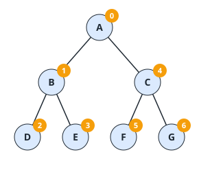
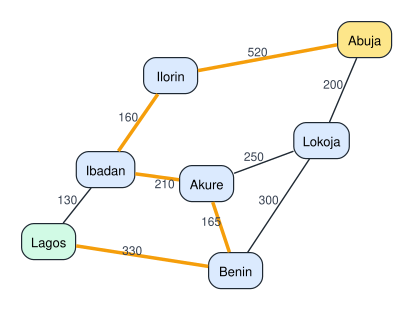

# Depth-First Search

Depth-first search picks one path and follows it as deep as it can go; when it hits a dead end, it goes back to the last crossroads and tries the other path.

## Before you start
<!-- bite: 512ca7bc-1044-4583-81da-74e9a44e1eb6 -->

Read [[artificial-intelligence/02-uninformed-search/03-breadth-first-search|Breadth-First Search]] first. This lesson compares the two all the way through. You should know what a stack is (last in, first out); [[dsa/02-data-structures/05-stacks-and-queues|Stacks and Queues]] explains it if not.

After this lesson you will be able to:

1. trace depth-first search (DFS) by hand on a tree and on a map;
2. explain why DFS needs only $O(bm)$ memory, and why it can still fail to find a solution;
3. give DFS's advantages, disadvantages and typical uses;
4. write DFS in Python with recursion.

## What depth-first search is
<!-- bite: 961cd8f7-31d5-403b-9753-ae9ca1dea70b -->

BFS took the *oldest* node off the frontier. Depth-first search takes the *newest*. That one change flips the whole search around.

The node just generated is the deepest one, so DFS always goes one level deeper if it can. It runs straight down one branch until it reaches the bottom. Only then does it come back up to the last node that still has an untried child, and go down that one.

Your notes say it best: basically, you pick one path and follow it as far as you can. When you hit a dead end, you go back to the crossroads and try the other path.

## The kid version
<!-- bite: fa199110-0a0b-4cd7-b5d7-6e08680a78ac -->

You're in a maze. At every junction you take the first turning on your left and keep walking. When you hit a wall, you walk back to the last junction and take the next turning there. You never stand at the entrance making a list of every corridor; you just remember the way back. That's depth-first search.

**Where the analogy stops working.** A real maze has an end to every corridor. A search space can have a branch that goes on forever, and DFS will walk down it forever without ever coming back, which is why plain DFS can fail even when the exit is close by.

## The LIFO stack
<!-- bite: 843730b3-e77b-419a-b4d1-577bb4f3c4dc -->

DFS keeps its frontier in a **LIFO stack**: last in, first out. The newest node is on top, and it comes off first, like a pile of plates. Your notes add that it's usually implemented with **recursion**: the function calls itself for each child, and the computer's own call stack does the remembering.

Here's the same tree as in the BFS lesson, with the order DFS visits each node:



Compare it with BFS. BFS went A, B, C, D, E, F, G: across first. DFS goes A, B, D, then back up to B for E, then back up to A for C, F, G: down first. Your notes say DFS creates the same set of nodes as BFS, only in a different order.

## Why the memory is so small
<!-- bite: 9a302d2c-71a5-4aba-b4fe-6ee27974ca14 -->

Your notes give the key reason DFS is cheap on memory: the nodes it stores are on a single path from the root to a leaf (a **leaf** is a node at the bottom with no children). Plus, at each level, the siblings it hasn't tried yet.

So at depth $m$, it holds about $m$ nodes on the path, and up to $b$ waiting siblings at each of those levels. That's $b \times m$ nodes at most. The space is **linear**:

$$O(bm)$$

Compare BFS's $O(b^d)$. With $b = 10$ and depth 6, BFS may hold a million nodes; DFS holds about 60. That's the whole reason DFS exists.

## DFS on the map
<!-- bite: 1fa3528e-9630-421d-ab74-2775efc30be4 -->

Now DFS on the Lagos-to-Abuja map. Same conventions as before: neighbours tried in alphabetical order, and a city already visited is never visited again. Predict first: will DFS find the 790 km route?

1. Start at **Lagos**. Neighbours: Benin, Ibadan. Go to **Benin** first.
2. At Benin. Neighbours: Akure, Lagos (visited), Lokoja. Go to **Akure**.
3. At Akure. Neighbours: Benin (visited), Ibadan, Lokoja. Go to **Ibadan**.
4. At Ibadan. Neighbours: Akure (visited), Ilorin, Lagos (visited). Go to **Ilorin**.
5. At Ilorin. Neighbours: Abuja, Ibadan (visited). Go to **Abuja**. Goal!

DFS never had to backtrack here: the first branch happened to reach Abuja.

## The route DFS returns
<!-- bite: 6cb269cf-a39e-411e-899a-a53629dd210d -->

The route is Lagos → Benin → Akure → Ibadan → Ilorin → Abuja.



That's 330 + 165 + 210 + 160 + 520 = **1,385 km**, over 5 roads. It drove from Lagos to Benin and then back west to Ibadan, almost to where it started. DFS found *a* route, but nearly the worst one. It just took the first branch it came to and kept going.

## DFS in Python
<!-- bite: 1648ce1d-8600-4040-bbd4-413cd33f1047 -->

Here's DFS on the map, written recursively. Save it as `dfs.py` and run `python3 dfs.py`.

```python
ROADS = {("Lagos", "Ibadan"): 130, ("Lagos", "Benin"): 330, ("Ibadan", "Ilorin"): 160,
         ("Ibadan", "Akure"): 210, ("Benin", "Akure"): 165, ("Benin", "Lokoja"): 300,
         ("Ilorin", "Abuja"): 520, ("Akure", "Lokoja"): 250, ("Lokoja", "Abuja"): 200}

def neighbours(city):
    out = [b for (a, b) in ROADS if a == city] + [a for (a, b) in ROADS if b == city]
    return sorted(out)

def dfs(city, goal, path, visited):
    visited.add(city)
    if city == goal:
        return path
    for nxt in neighbours(city):
        if nxt not in visited:
            found = dfs(nxt, goal, path + [nxt], visited)   # go deeper first
            if found:
                return found
    return None                                             # dead end: back up

route = dfs("Lagos", "Abuja", ["Lagos"], set())
km = sum(ROADS.get((a, b)) or ROADS[(b, a)] for a, b in zip(route, route[1:]))
print(" -> ".join(route))
print(f"{len(route) - 1} roads, {km} km")
```

## DFS in Python: what it prints
<!-- bite: bbf4f6f2-af7e-4f5d-a557-c4cb9cc0a614 -->

Run it, and it prints:

```
Lagos -> Benin -> Akure -> Ibadan -> Ilorin -> Abuja
5 roads, 1385 km
```

There's no stack in the code, because recursion is the stack. Each call waits for its child's call to finish; `return None` is the "go back to the crossroads" step.

## How good is DFS?
<!-- bite: 81d9b181-2d0b-4c38-8349-b94ce00ba19f -->

1. **Complete?** No. On an infinite branch, or a map with loops and no explored set, it can go down forever and never come back. With an explored set on a finite map like ours, it does always find a solution.
2. **Optimal?** No. It returns the first solution it stumbles on, as the 1,385 km route shows.
3. **Time:** $O(b^m)$. In the worst case it explores the whole tree down to the maximum depth $m$, which can be far deeper than the goal.
4. **Space:** $O(bm)$. Linear, its big strength.

## Advantages, disadvantages and uses
<!-- bite: 93b043dd-c620-4bcc-adac-08aff0dd5b8e -->

Your notes list these.

**Advantages:**

1. It needs less memory, as it only stores a stack of nodes from the root to the current node.
2. It can reach the goal node in less time than BFS, if it happens to pick the right branch first.

**Disadvantages:**

1. It may not terminate, and can go on infinitely down one path.
2. Its complexity depends on the depth.

## Where DFS is used
<!-- bite: 1ac9f28b-a374-4367-8f1e-851756b3b73d -->

Your notes give three uses:

1. **Maze navigation**: follow a corridor until it ends, then back up.
2. **Working with a DAG (directed acyclic graph)**: a graph with one-way edges and no loops, such as the order courses must be taken in. DFS can't loop forever there, because there are no loops.
3. **Finding a file in nested folders**: open a folder, then its subfolder, then its subfolder, before trying the next folder.

## Terms used in this lesson
<!-- bite: 5ac780cc-7c46-4ec2-8608-50b7b8ea0664 -->

1. **Depth-first search (DFS)**: This is the search that always expands the newest node on the frontier, so it goes as deep as possible before backing up.
2. **LIFO stack**: The letters stand for last in, first out. It's a list where the most recently added item is removed first.
3. **Recursion**: This is a function calling itself. In DFS, each call handles one node and calls itself for that node's children.
4. **Leaf**: This is a node at the bottom of a tree, with no children.
5. **Backtracking**: This is going back to the last node with an untried child when a path hits a dead end.
6. **DAG (directed acyclic graph)**: The letters stand for those three words. It's a graph whose edges go one way and which has no loops.

## Common pitfalls and traps
<!-- bite: cb125f97-5200-41ed-ae32-9a3e397ac1bd -->

- **Thinking DFS is faster than BFS.** It *can* be, if it picks the right branch first. It can also explore a huge useless branch first. Neither is faster in general.
- **Running DFS without an explored set on a graph with loops.** It will go Lagos → Benin → Lagos → Benin… forever.
- **Mixing up $O(bm)$ and $O(b^m)$.** DFS's *space* is $O(bm)$, small and linear. Its *time* is $O(b^m)$, exponential in the maximum depth.

## Check your understanding
<!-- bite: d7e1c3e9-78dd-4dac-9df6-b95a65032f5c -->

Try each one before you open the answer.

1. <!-- q: mcq id="94a58b10" -->
   Which data structure does depth-first search use for its frontier?

   - [ ] A FIFO queue
   - [x] A LIFO stack (or recursion)
   - [ ] A priority queue ordered by path cost

   <details><summary>Answer</summary>

   A LIFO stack, which is usually provided by recursion. The newest node comes off first, so the search goes deeper first.

   </details>

2. <!-- q: exact id="5edae5ef" answer="ABEFCDGH" accept="A B E F C D G H|A,B,E,F,C,D,G,H" -->
   A tree has root A with children B, C and D (in that order). B has children E and F. D has children G and H. In what order does DFS visit the nodes, taking children left to right? Write the letters with no spaces.

   <details><summary>Answer</summary>

   ABEFCDGH. Down from A to B, then B's children E and F, back up to A for C (no children), then D and its children G and H.

   </details>

3. <!-- q: exact id="4783c76d" answer="40" -->
   A search tree has branching factor $b = 4$ and maximum depth $m = 10$. Roughly how many nodes does DFS need to store at most, using $b \times m$?

   <details><summary>Answer</summary>

   4 × 10 = 40. That's the linear $O(bm)$ space. BFS on a tree this size could need around $4^{10}$, over a million.

   </details>

4. <!-- q: mcq id="1a402f53" -->
   Why is DFS not complete in general?

   - [ ] It uses too much memory and crashes.
   - [x] It can go down an infinite branch and never come back.
   - [ ] It always returns the longest route.
   - [ ] It can only search trees, not graphs.

   <details><summary>Answer</summary>

   It can follow an infinite (or looping) branch forever, never backing up to try the branch where the goal is.

   </details>

5. <!-- q: open id="d3b09880" -->
   A map has roads S–A 4, S–B 1, A–G 1, B–G 2. DFS starts at S, tries neighbours alphabetically, and stops at the first goal it reaches. Which route does it return, and is it the cheapest? Explain.

   <details><summary>Answer</summary>

   From S it tries A first (alphabetical), then from A it reaches G. Route S → A → G, cost 4 + 1 = 5. It isn't the cheapest: S → B → G costs 1 + 2 = 3. DFS took the first branch alphabetically and stopped at the first solution, without comparing costs.

   </details>

## Before moving on
<!-- bite: 160d9a27-e853-4278-ac4a-f7401d737476 -->

You're done when you can trace DFS on a tree and a map, explain why its space is $O(bm)$, say why it's neither complete nor optimal in general, and list its pros, cons and uses.

Recap: DFS expands the newest node, using a LIFO stack or recursion, so it dives down one branch and backtracks at dead ends. It needs only $O(bm)$ memory, but takes $O(b^m)$ time, isn't optimal, and isn't complete when branches can go on forever. On our map it returns a 1,385 km route.

Next, [[artificial-intelligence/02-uninformed-search/05-depth-limited-search|Depth-Limited Search]] fixes DFS's worst habit, going down forever, by giving it a maximum depth.

## Related
<!-- bite: aae5d433-b5a9-4271-93f9-a99e234e8b5c -->

- [[dsa/02-data-structures/09-graphs/index|Graphs]]: DFS as a graph traversal, including cycle detection and topological sort on a DAG.
- [[dsa/02-data-structures/05-stacks-and-queues|Stacks and Queues]]: the stack DFS runs on.

## About this lesson
<!-- bite: fc4d4597-cf06-4176-9d57-72b2e8124093 -->

**Level:** introductory. Lesson 4 of section 02 (uninformed search). It covers DFS's rule, the LIFO stack and recursion, its linear space, tracing it on a tree and on the map, its code, its properties, and its advantages, disadvantages and uses.

**Source:** University of Lagos SSG 518 class notes, *Depth First Search* (23/11/25, with the tree, the $O(bm)$ space, the advantages and disadvantages, and the uses), and the SSG 518 *Introduction to Search* slides (properties). The trace and route are computed and asserted by `scripts/diagrams/ai_search.py`.
