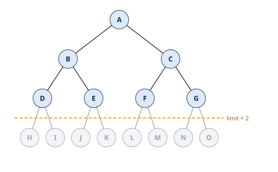

# Depth-Limited Search

Depth-limited search is depth-first search with a predetermined limit: it never goes deeper than a fixed depth, which stops it from running down an infinite path.

## Before you start
<!-- bite: 571db131-54cf-4a37-8bcc-475165a6117d -->

Read [[artificial-intelligence/02-uninformed-search/04-depth-first-search|Depth-First Search]] first. Depth-limited search is DFS with one extra rule.

After this lesson you will be able to:

1. explain how depth-limited search (DLS) fixes DFS's infinite-path problem;
2. read the depth-limit diagram and say which nodes DLS visits;
3. tell the two failure values apart: standard failure and cutoff failure;
4. trace DLS on the map, and choose a sensible depth limit.

## What depth-limited search is
<!-- bite: fde06be5-e4c3-4d90-bc08-f77f0a208a85 -->

The last lesson ended with DFS's worst habit: on an infinite branch, it goes down forever and never comes back. Depth-limited search fixes that with a simple rule.

Pick a number $\ell$, the **depth limit**. DLS runs exactly like DFS, except that a node at depth $\ell$ is treated as if it has no children. The search never goes below that line. Your notes put it in one sentence:

A one-sentence version for an exam: DLS is just DFS with a maximum depth. It sets a boundary to prevent an infinite path.

## The kid version
<!-- bite: 318f7e6e-4e72-4ca3-ae12-91a0d4387158 -->

You're exploring a cave with a rope tied to the entrance, and the rope is only 50 metres long. You still explore depth-first, following one tunnel as far as you can, but when the rope runs out you have to turn back, even if the tunnel keeps going. You can't get lost forever. But if the treasure is 60 metres in, you'll never reach it.

**Where the analogy stops working.** In the cave you'd know the treasure might be just past the rope's end. DLS can't tell "nothing down there" from "something down there, past my limit" unless it keeps track, which is why it has two different ways of failing.

## Reading the depth-limit diagram
<!-- bite: 336f5c9e-3940-4c6b-b44d-9a8ca8ca8b93 -->

Your notes ask "explain depth limit search diagram??", so let's read one carefully. Here's the 15-node tree from your notes, with a depth limit of 2:

## Which nodes DLS visits
<!-- bite: e3cd0e60-c5b4-43a3-bd2c-b4b9ee845b57 -->

Count the depths in that picture. A is depth 0. B and C are depth 1. D, E, F and G are depth 2. The orange line sits just below depth 2.

DLS runs depth-first, but when it reaches a node at depth 2 it treats it as a leaf. So it visits A, B, D (stop, depth 2), E (stop), back up to C, F (stop), G (stop). The order is **A, B, D, E, C, F, G**. Everything below the line, H to O, is greyed out because DLS never generates it.

So if the goal were, say, M, DLS with limit 2 would never find it, even though it's there. That's the price of the boundary.

## Two ways to fail
<!-- bite: 875e7e0b-78b6-435d-9257-d3319c03c361 -->

When DLS doesn't find the goal, there are two very different reasons, and your notes give each its own name:

1. **Standard failure value**: the problem has no solution at all. DLS explored everything and never hit the limit, so there's nothing out there.
2. **Cutoff failure value**: the problem has no solution *within the given depth limit*. DLS hit the limit somewhere, so a solution might exist deeper down.

The difference matters for what you do next. A standard failure means stop: there's no answer. A cutoff means try again with a bigger limit. The next lesson turns that "try again" into a method.

## DLS on the map, limit 2
<!-- bite: 62178494-3ff6-4987-b343-2a43ac403d70 -->

Let's run DLS from Lagos to Abuja with $\ell = 2$. Neighbours are tried alphabetically, and a city already on the current path is skipped, so the search can't drive in a circle.

1. **Lagos** (depth 0). Try **Benin** (depth 1).
2. From Benin, try **Akure** (depth 2). That's the limit, so stop and back up. Skip Lagos (on the path). Try **Lokoja** (depth 2). Limit again; back up.
3. Back at Lagos, try **Ibadan** (depth 1).
4. From Ibadan, try **Akure** (depth 2), limit. Try **Ilorin** (depth 2), limit. Skip Lagos.
5. Nothing left. The limit was hit, so the result is **cutoff**.

Abuja is 3 roads from Lagos, so with $\ell = 2$, DLS can't reach it. The cutoff tells you so.

## DLS on the map, limit 3
<!-- bite: f09a2346-a167-4071-89fa-18c37a795769 -->

Now raise the limit to $\ell = 3$.

1. **Lagos** → **Benin** → **Akure** (depth 2). From Akure, try **Ibadan** (depth 3): not the goal, and at the limit. Try **Lokoja** (depth 3): not the goal, at the limit. Back up.
2. From Benin, skip Lagos (on the path), try **Lokoja** (depth 2).
3. From Lokoja, try **Abuja** (depth 3). Goal!

The route is Lagos → Benin → Lokoja → Abuja, 830 km, the same as BFS found. Notice Lokoja was visited twice: once at depth 3 under Akure, and again at depth 2 under Benin. DLS checks only the current path, not everywhere it has been. A city reached first by a long path might be worth revisiting by a shorter one, because from there the limit leaves more room to go further.

## Choosing the limit
<!-- bite: c5f54c12-d412-4969-b4d6-066d50d1cf3b -->

DLS is only as good as its limit. Too small, and you miss the goal (as $\ell = 2$ did). Too big, and you waste time exploring deep branches you didn't need. Your slides say it: if $\ell$ is too small the goal is missed; if too large, the search is wasteful.

Sometimes you know a good limit from the problem itself. On our map, every city can reach every other city in at most 3 roads. That number, the most roads you need between any two places, is called the **diameter** of the map. Any limit of at least 3 is guaranteed to find a route to anywhere. On a map of Nigeria's 36 state capitals you'd know roughly how many roads any trip needs, and set the limit from that.

But often you have no idea how deep the goal is. Then you need the method in the next lesson.

## How good is DLS?
<!-- bite: fcda9741-65fe-48e9-b04a-8e29c47c931c -->

Here $\ell$ is the depth limit:

1. **Complete?** No, if $\ell < d$: the goal is below the limit and never found. Yes if $\ell \ge d$ and the space is finite.
2. **Optimal?** No. It's still DFS inside the limit, so it returns the first solution it finds.
3. **Time:** $O(b^\ell)$. It explores the tree down to depth $\ell$.
4. **Space:** $O(b\ell)$. Linear, like DFS, but now with a guaranteed bound.

## Advantages and disadvantages
<!-- bite: 52d60cd9-873b-4fc7-8720-3cc362f89cc0 -->

From your notes:

**Advantages:**

1. It is memory efficient.
2. It can't go down an infinite path.

**Disadvantages:**

1. Incompleteness: if the limit is too small, it misses the solution.
2. It may not be optimal if the problem has more than one solution.

## Terms used in this lesson
<!-- bite: d50373d5-2902-4e90-8b0e-7600aefdcd4f -->

1. **Depth-limited search (DLS)**: This is depth-first search that treats nodes at a fixed depth as having no children, so it never goes deeper.
2. **Depth limit ($\ell$)**: This is the maximum depth DLS is allowed to reach.
3. **Standard failure**: This is DLS's result when the problem has no solution at all.
4. **Cutoff failure**: This is DLS's result when no solution was found within the depth limit, though one might exist deeper.
5. **Diameter**: This is the largest number of steps needed to get between any two states by their shortest route. On our map, it's 3.

## Common pitfalls and traps
<!-- bite: ac1a2abc-a26a-48a0-a990-c75d4af81805 -->

- **Treating cutoff and standard failure as the same.** Cutoff says "maybe deeper"; standard failure says "nowhere". Reporting just "not found" throws that away.
- **Counting depth from 1.** The root is at depth 0. With limit 2, the nodes at depth 2 are visited but not expanded.
- **Setting the limit to the number of nodes.** The limit is about depth (number of actions), not how many states there are.

## Check your understanding
<!-- bite: 3e05aea3-b3fa-4b1a-9bbd-622f904277ed -->

Try each one before you open the answer.

1. <!-- q: exact id="286e9f6c" answer="A,B,D,E,C,F,G" accept="A B D E C F G|A, B, D, E, C, F, G" -->
   A complete binary tree has A at the top, B and C below it, D, E under B, F, G under C, and H to O on the next level down. DLS runs with limit 2, taking children left to right. In what order does it visit the nodes? Write the letters separated by commas.

   

Answer

   A, B, D, E, C, F, G. Nodes at depth 2 (D, E, F, G) are visited but treated as leaves, so H to O are never generated.

   

2. <!-- q: mcq id="73b9d784" -->
   DLS returns "cutoff". What does that tell you?

   - [ ] The problem has no solution at all.
   - [x] No solution was found within the limit, but one may exist deeper.
   - [ ] A solution was found exactly at the limit.
   - [ ] The search ran out of memory.

   

Answer

   Cutoff means the limit was reached somewhere, so a deeper solution might exist. "No solution at all" is the standard failure value.

   

3. <!-- q: mcq id="c2b9e7f6" -->
   A goal is 5 actions from the start. Which depth limits let DLS find it? (choose all that apply)

   - [ ] 3
   - [ ] 4
   - [x] 5
   - [x] 7

   

Answer

   5 and 7. The limit must be at least the goal's depth. With 3 or 4, the goal is below the limit and DLS reports a cutoff.

   

4. <!-- q: gap id="3c3246d9" answers="bl|b l|bℓ|O(bl)|O(bℓ)" -->
   With branching factor $b$ and depth limit $\ell$, the space DLS needs grows like $O($___$)$.

   

Answer

   $b\ell$. It's linear, like DFS, and now has a firm upper bound because it can't go deeper than $\ell$.

   

5. <!-- q: open id="e8c68417" -->
   Your notes say DLS "can solve the drawback of the infinite path of DFS". Explain how, and what new drawback it brings.

   

Answer

   DLS treats any node at the depth limit as having no children, so it can never go deeper than the limit: no path can run on forever. The new drawback is incompleteness: if the goal is deeper than the limit, DLS never finds it, so you have to choose the limit well, and often you don't know how deep the goal is.

   

## Before moving on
<!-- bite: 4bf9903b-e618-455e-8208-eb4d9edd9801 -->

You're done when you can read a depth-limit diagram, trace DLS on the map with any limit, tell cutoff from standard failure, and say why choosing the limit is the hard part.

Recap: DLS is DFS with a maximum depth $\ell$. Nodes at depth $\ell$ are treated as leaves, so it can't go down forever. It returns cutoff when the limit was reached (maybe deeper) and standard failure when there's no solution at all. Its space is $O(b\ell)$, but it's incomplete if $\ell < d$ and not optimal. On our map, limit 2 gives cutoff and limit 3 finds the 830 km route.

Next, [[artificial-intelligence/02-uninformed-search/06-iterative-deepening-search|Iterative Deepening Search]] removes the guesswork: it tries limit 0, then 1, then 2, and keeps going until the goal turns up.

## Related
<!-- bite: 3c3137a4-2f55-44a5-aef5-75c27a0b38fc -->

- [[artificial-intelligence/02-uninformed-search/04-depth-first-search|Depth-First Search]]: the method DLS limits.

## About this lesson
<!-- bite: 5ebda600-13d6-46ca-a6aa-18c0d6c59eb1 -->

**Level:** introductory. Lesson 5 of section 02 (uninformed search). It covers DLS's rule, the depth-limit diagram, the two failure values, tracing on the map with limits 2 and 3, choosing a limit, and DLS's properties, advantages and disadvantages.

**Source:** University of Lagos SSG 518 class notes, *Depth Limit Search* (24/11/25: the definition, the two failure values, advantages and disadvantages, and the question "explain depth limit search diagram"), and the SSG 518 *Introduction to Search* slides (properties and the "too small, too large" warning). The traces and the map's diameter are computed and asserted by `scripts/diagrams/ai_search.py`.
