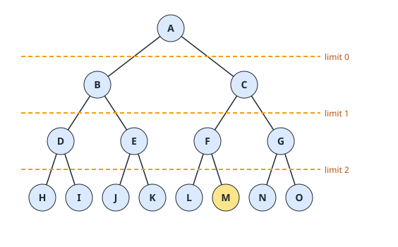

# Iterative Deepening Search

Iterative deepening search runs depth-limited search with a limit of 0, then 1, then 2, and so on, increasing the limit by one each time until it finds a solution.

## Before you start
<!-- bite: 8ef31ebc-d74a-477a-97fe-c0a4f68745a1 -->

Read [[artificial-intelligence/02-uninformed-search/05-depth-limited-search|Depth-Limited Search]] first. Iterative deepening is DLS run over and over.

After this lesson you will be able to:

1. explain how iterative deepening search (IDS) combines the best of BFS and DFS;
2. trace IDS round by round on a tree and on the map;
3. show with numbers why repeating the shallow levels costs very little;
4. give IDS's properties, and say why it's the usual choice for blind search.

## What iterative deepening search is
<!-- bite: 4d6d8507-bb2a-408a-a018-8090fe3785bf -->

DLS left us with one problem: you have to guess the limit, and you usually can't. Iterative deepening removes the guess. It just tries every limit in turn, starting from 0.

Your notes call it a depth-limited search that "evolves". It runs DLS with a limit; if the solution isn't found, it increases the limit by 1 and runs again; and so on. The full name is **iterative deepening depth-first search**, because each round is a depth-first search, and the depth grows with each round (each **iteration**).

Your notes also give the reason it matters, in red ink: it **combines the best parts of BFS and DFS.** It finds the shallowest goal like BFS, and uses tiny memory like DFS.

## The kid version
<!-- bite: fd251b56-794b-48c1-9773-317df935b5c6 -->

You're looking for a lost goat in the bush around your village. First you check just the compound. Not there. Then you walk out to 1 km and look around everywhere within that distance, coming back home each time you finish a path. Not there. Then you go out to 2 km and check everywhere within that. You re-walk the first kilometre each time, which feels wasteful, but you're guaranteed to find the goat at the closest distance it could be, and you never have to remember more than the path you're on.

**Where the analogy stops working.** Re-walking the first kilometre costs you real time on foot. In search, the repeated shallow levels are tiny compared with the new deepest level, so the waste is much smaller than it feels. The numbers below show how small.

## IDS on the tree, round by round
<!-- bite: 9db61b4c-b468-4161-ae38-7d7411f4192d -->

Here's the 15-node tree from your notes. Say the goal is M, on the bottom level. The dashed lines show where each round's limit cuts the tree.



## The four rounds
<!-- bite: dc9b8705-12bb-451d-8920-4babcfa5fe2d -->

Each round is a fresh DLS from the root:

1. **Limit 0:** visits A. No goal. Cutoff.
2. **Limit 1:** visits A, B, C. No goal. Cutoff.
3. **Limit 2:** visits A, B, D, E, C, F, G. No goal. Cutoff.
4. **Limit 3:** visits A, B, D, H, I, E, J, K, C, F, L, M. Goal found!

Your notes draw this tree with an "initial limit" line and a "new limit" line. That's exactly this: each new round moves the line one level down.

## IDS on the map
<!-- bite: c584d34c-53a1-4e2c-b6a4-d3dc9515e6a2 -->

On the Lagos-to-Abuja map, with the same conventions as the DLS lesson:

| Round | Limit | Cities visited | Result |
|---|---|---|---|
| 1 | 0 | 1 (Lagos) | cutoff |
| 2 | 1 | 3 (Lagos, Benin, Ibadan) | cutoff |
| 3 | 2 | 7 | cutoff |
| 4 | 3 | 7 | found |

The route is Lagos → Benin → Lokoja → Abuja, 830 km: the same as BFS returned, because both find the shallowest goal first. In total IDS made 1 + 3 + 7 + 7 = 18 visits. Rounds 1 to 3 were "wasted", but they were small.

## Why the repeated work is cheap
<!-- bite: 1710d52e-805d-4bf9-8fe0-c5da44af9ea4 -->

IDS re-does the top of the tree in every round. That sounds expensive, so let's count. With branching factor $b$ and the goal at depth $d$:

1. The nodes at depth $d$ are generated once (only in the last round).
2. The nodes at depth $d - 1$ are generated twice.
3. The nodes at depth 1 are generated $d$ times.

Now put numbers in. Take $b = 10$ and $d = 5$.

$$\text{IDS: } 5(10) + 4(100) + 3(1{,}000) + 2(10{,}000) + 1(100{,}000) = 123{,}450$$

$$\text{BFS: } 10 + 100 + 1{,}000 + 10{,}000 + 100{,}000 = 111{,}110$$

IDS does only about 11% more work than BFS. The reason is that most of the nodes in a tree are on the bottom level. The bottom level here has 100,000 nodes, more than all the levels above it put together. Repeating the small upper levels hardly adds anything. Your slides say it in one line: the repeated work is small because the last level dominates.

## How good is IDS?
<!-- bite: 1b00193e-ecd8-4150-8a30-fae8fe9c761e -->

1. **Complete?** Yes, if $b$ is finite. It tries every depth in turn, so it reaches the goal's depth eventually, like BFS.
2. **Optimal?** Yes, if every step costs the same. It finds the shallowest goal first, like BFS. On our map, with roads of different lengths, it returns 830 km, not 790 km.
3. **Time:** $O(b^d)$, the same order as BFS.
4. **Space:** $O(bd)$. Each round is just a DFS, so memory is linear, like DFS.

That's the payoff: BFS's completeness and shallowest-goal guarantee, with DFS's tiny memory.

## The rule of thumb
<!-- bite: 5ff47265-3085-42f5-a653-58c71562456b -->

Your slides give a rule worth memorising:

A one-sentence version for an exam: when the search space is large and the depth of the solution is unknown, iterative deepening is the preferred uninformed search method.

It's not always the fastest. If you know the depth, plain DLS with the right limit skips the extra rounds. And if memory is plentiful, BFS avoids the repeats. But when you know neither, IDS is the safe choice.

## IDS in Python
<!-- bite: 3765af25-c47e-4e36-af4f-0ac243745858 -->

IDS is a short loop around a DLS function. Save it as `ids.py` and run `python3 ids.py`.

```python
ROADS = {("Lagos", "Ibadan"): 130, ("Lagos", "Benin"): 330, ("Ibadan", "Ilorin"): 160,
         ("Ibadan", "Akure"): 210, ("Benin", "Akure"): 165, ("Benin", "Lokoja"): 300,
         ("Ilorin", "Abuja"): 520, ("Akure", "Lokoja"): 250, ("Lokoja", "Abuja"): 200}

def neighbours(city):
    out = [b for (a, b) in ROADS if a == city] + [a for (a, b) in ROADS if b == city]
    return sorted(out)

def dls(path, goal, limit):
    city = path[-1]
    if city == goal:
        return path
    if limit == 0:
        return "cutoff"
    cut = False
    for nxt in neighbours(city):
        if nxt in path:                      # don't drive in a circle
            continue
        result = dls(path + [nxt], goal, limit - 1)
        if result == "cutoff":
            cut = True
        elif result:
            return result
    return "cutoff" if cut else None         # None is the standard failure

def ids(start, goal):
    limit = 0
    while True:
        result = dls([start], goal, limit)
        print(f"limit {limit}: {result}")
        if result != "cutoff":
            return result                    # a route, or None if there is none
        limit += 1

route = ids("Lagos", "Abuja")
```

## IDS in Python: what it prints
<!-- bite: 33fe3c95-b7f2-4e0f-ba07-7bd54b3052b5 -->

Run it, and it prints:

```
limit 0: cutoff
limit 1: cutoff
limit 2: cutoff
limit 3: ['Lagos', 'Benin', 'Lokoja', 'Abuja']
```

## Terms used in this lesson
<!-- bite: e5e35abe-19eb-4d5a-aeae-9af06c695e58 -->

1. **Iterative deepening search (IDS)**: This is also known as **iterative deepening depth-first search**. It runs depth-limited search with limits 0, 1, 2, … until it finds a solution.
2. **Iteration**: This is one repetition of a loop. In IDS, each iteration is one complete depth-limited search with a fixed limit.

## Common pitfalls and traps
<!-- bite: e43e967c-c15a-42bf-affb-f59e00ebcd43 -->

- **Thinking IDS is much slower than BFS.** It repeats the upper levels, but they're small. With $b = 10$, $d = 5$, it does about 11% more work.
- **Thinking IDS finds the cheapest route.** Like BFS, it finds the shallowest goal. With unequal step costs, that's not the cheapest.
- **Forgetting that each round starts from the root.** IDS doesn't continue from where the last round stopped; it starts again with a deeper limit.

## Check your understanding
<!-- bite: 5acd73a2-f279-43d3-bed0-b7f1f24ed693 -->

Try each one before you open the answer.

1. <!-- q: mcq id="7bbe822f" -->
   Which two methods' strengths does IDS combine?

   - [x] BFS's completeness and shallowest-goal guarantee, with DFS's small memory
   - [ ] DFS's speed with UCS's cost-optimality
   - [ ] BFS's small memory with DFS's completeness
   - [ ] A\*'s heuristic with BFS's queue

   <details><summary>Answer</summary>

   BFS's completeness and shallowest-goal guarantee, with DFS's linear memory. BFS has large memory and DFS is incomplete, so the other options have them backwards.

   </details>

2. <!-- q: exact id="e8e4debd" answer="A,B,D,E,C,F,G" accept="A B D E C F G|A, B, D, E, C, F, G" -->
   A tree has root A with children B and C. B has children D and E. C has children F and G. The goal is G. IDS takes children left to right. Write the nodes visited in the round that finds G, separated by commas.

   <details><summary>Answer</summary>

   A, B, D, E, C, F, G. G is at depth 2, so it's found in the limit-2 round. That round is a depth-first search to depth 2, so it goes down to D and E under B before trying C, then F, then G.

   </details>

3. <!-- q: exact id="a1494fc1" answer="1230" accept="1,230" -->
   With branching factor $b = 10$ and the goal at depth $d = 3$, IDS generates the depth-1 nodes 3 times, the depth-2 nodes twice and the depth-3 nodes once. How many nodes is that in total?

   <details><summary>Answer</summary>

   3(10) + 2(100) + 1(1,000) = 30 + 200 + 1,000 = 1,230. BFS would generate 1,110, so the extra cost is small.

   </details>

4. <!-- q: gap id="60cb5799" answers="bd|O(bd)|b d" -->
   IDS needs memory that grows like $O($___$)$, where $d$ is the depth of the shallowest goal.

   <details><summary>Answer</summary>

   $bd$. Each round is a depth-first search, so memory is linear.

   </details>

5. <!-- q: open id="5e21ad87" -->
   IDS repeats the top levels of the tree in every round. Explain why this doesn't make it much slower than BFS.

   <details><summary>Answer</summary>

   In a tree with branching factor $b$, each level has $b$ times as many nodes as the one above, so the bottom level holds more nodes than all the levels above it combined. The upper levels are repeated, but they're small; the big bottom level is generated only once, in the last round. So the total is only a little more than BFS, around 11% more for $b = 10$.

   </details>

## Before moving on
<!-- bite: 4c416bc5-4c1c-4e00-b860-3dc9fcfce0ef -->

You're done when you can trace IDS round by round, explain with numbers why the repeats are cheap, and state when IDS is the method to choose.

Recap: IDS runs DLS with limits 0, 1, 2, … until it finds the goal. It's complete and finds the shallowest goal like BFS, but uses only $O(bd)$ memory like DFS, with $O(b^d)$ time. Repeating the upper levels costs little because the bottom level dominates. When the space is big and the depth is unknown, IDS is the usual blind search. On our map it returns the 830 km route after 4 rounds.

Next, [[artificial-intelligence/02-uninformed-search/07-uniform-cost-search-1|Uniform-Cost Search 1]] finally pays attention to road lengths: it always expands the cheapest path so far, so it finds the 790 km route.

## Related
<!-- bite: e4667ffe-c34e-4d10-ae48-cbc24c8aec6e -->

- [[artificial-intelligence/02-uninformed-search/03-breadth-first-search|Breadth-First Search]]: same answer, different memory.

## About this lesson
<!-- bite: 31bc2bd1-b77e-4508-ba0e-d2cbfe99e690 -->

**Level:** introductory, with simple sums. Lesson 6 of section 02 (uninformed search). It covers IDS's rule, tracing it on the 15-node tree and on the map, the cost of repeated work, its properties, the rule of thumb for choosing it, and its code.

**Source:** University of Lagos SSG 518 class notes, *Iterative Deepening Search* (24/11/25, with the 15-node tree and its "initial limit" and "new limit" lines), and the SSG 518 *Introduction to Search* slides (properties and the rule of thumb). The rounds, visit counts and node totals are computed and asserted by `scripts/diagrams/ai_search.py`.
