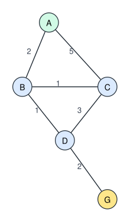
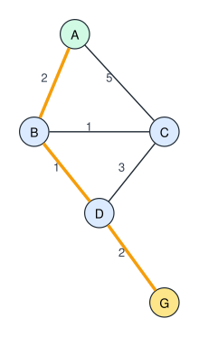

# Uniform-Cost Search 1: The Cheapest Path First

Uniform-cost search finds the cheapest path to a goal by always expanding the node with the lowest total cost so far.

## Before you start
<!-- bite: 7b60aa9d-3b94-43a2-bde4-43dbc4b059dd -->

Read [[artificial-intelligence/02-uninformed-search/03-breadth-first-search|Breadth-First Search]] first. Uniform-cost search is BFS with "oldest" replaced by "cheapest". You need path cost from [[artificial-intelligence/01-foundations/05-problem-solving-in-ai|Problem Solving in AI]].

After this lesson you will be able to:

1. say how uniform-cost search (UCS) chooses the next node, and what a priority queue is;
2. trace UCS by hand on the graph from your class notes, writing the frontier after each step;
3. explain what happens when UCS finds a cheaper way to a node already on the frontier.

## What uniform-cost search is
<!-- bite: 0926106e-0eca-418b-afed-3c8c353ff3d2 -->

Every method so far has ignored road lengths. BFS found the fewest roads; DFS found whatever came first. On our map both returned routes longer than the 790 km best.

Uniform-cost search is the first method that cares about cost. Your notes put its rule in four short lines:

1. It cares about total cost, not number of steps.
2. It expands the node with the lowest total cost so far.
3. It uses a priority queue, not FIFO or LIFO.
4. It goes cheapest first, rather than deepest or closest.

The total cost so far for a node $n$ is written $g(n)$: the sum of the step costs on the path from the start to $n$. UCS always expands the node with the smallest $g(n)$.

## The kid version
<!-- bite: d15f0c96-73aa-47dc-b6fe-00bd84266fdb -->

You're sending a parcel and you want the cheapest courier route. You write down every route you know with its price so far: "to Ibadan, ₦1,300; to Benin, ₦3,300". You always extend the *cheapest* one on your list next, because a cheap route might stay cheap. You never bother extending an expensive route while a cheaper one is still waiting. When the cheapest thing on your list is a route that already reaches the destination, you're done: nothing else on the list can beat it.

**Where the analogy stops working.** Prices on a courier list can be negative (a discount) or change while you plan. UCS needs every step to cost something positive and fixed. A step with negative cost could make an expensive-looking route suddenly cheap, and UCS's "cheapest first" logic would break.

## The priority queue
<!-- bite: 5df0a982-584a-4625-9bec-77dda3267198 -->

UCS keeps its frontier in a **priority queue**: a list where each item has a priority, and the item with the best priority always comes out first, no matter when it went in. Here the priority is $g(n)$, and the smallest comes out first.

Compare the three frontiers you've seen:

1. **FIFO queue** (BFS): the oldest comes out first.
2. **LIFO stack** (DFS): the newest comes out first.
3. **Priority queue** (UCS): the cheapest comes out first.

That's the only change from BFS. The rest of the search loop is the same.

## The graph from your notes
<!-- bite: ea393781-8d11-4a9a-853b-aca4746f835f -->

Your notes draw this graph and write "Explain this!" beside it. Let's do exactly that. Start at A; the goal is G. The numbers on the edges are step costs.

## The routes through the graph
<!-- bite: ea8ea0ef-ba75-407a-aa94-8dd517ee314c -->

Your notes compare two routes through that graph:

1. A → B → D → G costs 2 + 1 + 2 = **5**.
2. A → C → D → G costs 5 + 3 + 2 = **10**.

There are others too: A → B → C → D → G costs 2 + 1 + 3 + 2 = 8, and A → C → B → D → G costs 5 + 1 + 1 + 2 = 9. The cheapest is 5. Now let's watch UCS find it without trying every route.

## Tracing UCS, steps 1 and 2
<!-- bite: 4e4ad6ed-227e-457a-b810-8f7575a929bd -->

The frontier is written as node and $g$, cheapest first. When two nodes tie, take them alphabetically. UCS tests for the goal when a node comes *off* the frontier, not when it's added. The next lesson shows why.

**Step 1.** The frontier holds A with $g = 0$. Take A off. It isn't the goal. Expand it: B costs 0 + 2 = 2; C costs 0 + 5 = 5.

Frontier: **B 2, C 5**.

## Tracing UCS, step 2: a cheaper way to C
<!-- bite: eca4c591-4629-4b6b-a78f-e6e0b9075c58 -->

**Step 2.** Take B off (2 is cheapest). It isn't the goal. Expand it:

1. C via B costs 2 + 1 = 3. C is already on the frontier at 5, but 3 is cheaper, so C's cost drops to 3 and its parent becomes B.
2. D via B costs 2 + 1 = 3. D is new.

Frontier: **C 3, D 3**.

That update in step 2 is the heart of UCS. The direct road from A to C looked like the way to C, but going round through B is cheaper. UCS keeps only the cheapest known way to each node.

## Tracing UCS, steps 3 to 5
<!-- bite: 74b95621-ed5f-4f8d-860e-748b7e3986b4 -->

**Step 3.** C and D tie at 3; alphabetically, take C off. It isn't the goal. Expand it: D via C costs 3 + 3 = 6, but D is already on the frontier at 3, so no change. A and B are already done.

Frontier: **D 3**.

**Step 4.** Take D off. It isn't the goal. Expand it: G costs 3 + 2 = 5.

Frontier: **G 5**.

**Step 5.** Take G off. It *is* the goal. Stop.

## The route UCS returns
<!-- bite: a0983f45-d367-4a5e-bac1-df2ef391e0db -->

Follow the parents back: G came from D, D from B, B from A. The route is **A → B → D → G**, cost **5**, exactly the answer your notes ticked.

Notice what UCS never did: it never expanded anything costing more than 5. The routes costing 8, 9 and 10 were never followed to the end. That's the point of cheapest first.

## Why the answer is guaranteed cheapest
<!-- bite: 514e8f09-0f43-4461-a886-3ef89a5fc6ce -->

Here's the argument in words. UCS takes nodes off in order of cost: first everything costing 0, then the cheapest next, and so on, always rising. When G comes off at cost 5, every node on the frontier costs at least 5. Since every step costs something positive, any other path to G would have to pass through one of those frontier nodes and then add more cost, so it would cost *more* than 5. So 5 is the best there is.

This needs every step cost to be positive. Your slides write the condition as "cost > 0". With a zero-cost step, UCS could loop round it forever; with a negative one, the argument above breaks.

## Terms used in this lesson
<!-- bite: 9fa58d92-14a1-4cd0-9b7b-050065d9d448 -->

1. **Uniform-cost search (UCS)**: This is the search that always expands the frontier node with the lowest total path cost so far.
2. **$g(n)$**: This is the cost of the path from the start to node $n$, the sum of its step costs.
3. **Priority queue**: This is a list where each item has a priority, and the item with the best priority (here, the lowest cost) always comes out first.
4. **Step cost**: This is the cost of one action, such as the length of one road.

## Common pitfalls and traps
<!-- bite: c4945b9d-d0fb-429e-aea3-7b5d16a132b5 -->

- **Stopping when the goal is first added to the frontier.** UCS stops when the goal comes *off* the frontier. A goal added at cost 10 might later be reached for 5.
- **Forgetting to update a node's cost.** When you find a cheaper way to a node already on the frontier, replace its cost and parent. In step 2, C went from 5 to 3.
- **Thinking "uniform" means all costs are equal.** It's the opposite: UCS is for when costs differ. "Uniform" refers to how the search spreads out evenly by cost, like a ripple in cost rather than in steps.

## Check your understanding
<!-- bite: c9e19d40-46b8-40da-a803-a475240150a1 -->

Try each one before you open the answer.

1. <!-- q: mcq id="0177f93c" -->
   Which node does uniform-cost search expand next?

   - [ ] The node added to the frontier first
   - [ ] The node added to the frontier last
   - [x] The node with the lowest path cost from the start, $g(n)$
   - [ ] The node with the fewest steps from the start

   

Answer

   The node with the lowest $g(n)$, using a priority queue. The first two are BFS and DFS; fewest steps is what BFS finds.

   

2. <!-- q: exact id="aa8fccc3" answer="4" -->
   A graph has edges with costs S–A 1, S–B 4, A–B 2, A–G 6, B–G 1. Uniform-cost search runs from S to goal G. What is the cost of the path it returns?

   

Answer

   4. Pop S: A 1, B 4. Pop A (1): B via A = 3, cheaper than 4, so B becomes 3; G via A = 7. Pop B (3): G via B = 4, cheaper than 7, so G becomes 4. Pop G (4): goal. The route is S → A → B → G, cost 1 + 2 + 1 = 4.

   

3. <!-- q: mcq id="3f219f96" -->
   During UCS, node C is on the frontier with cost 9. The search then finds another path to C costing 6. What should happen?

   - [ ] Keep cost 9, because C was found first that way
   - [x] Change C's cost to 6 and its parent to the new route
   - [ ] Add a second copy of C and keep both forever
   - [ ] Stop the search, because C has been found twice

   

Answer

   Change C's cost to 6 and its parent to the new route. UCS keeps the cheapest known way to each node. (Some implementations add a second copy and skip the dearer one when it comes off; the effect is the same.)

   

4. <!-- q: gap id="0e5704f6" answers="priority queue|priority-queue" -->
   UCS keeps its frontier in a ___, ordered so the cheapest path comes out first.

   

Answer

   A priority queue. BFS uses a FIFO queue and DFS uses a LIFO stack.

   

5. <!-- q: open id="5d2611a4" -->
   In the class-notes graph (A–B 2, A–C 5, B–C 1, B–D 1, C–D 3, D–G 2), explain why UCS never expands a path costing more than 5 before it finishes.

   

Answer

   UCS always takes the cheapest frontier node next, so the costs it expands rise steadily: 0, 2, 3, 3, then G at 5. The goal comes off at cost 5, and the search stops there. Any path costing more than 5 is still waiting on the frontier, or was never generated, when G is taken off, so it's never expanded.

   

## Before moving on
<!-- bite: 0f4209a9-50a4-4b02-9557-04058f40d0f5 -->

You're done when you can trace UCS on a small graph with the frontier written out, including updating a node's cost when a cheaper way appears, and explain why the first goal taken off is the cheapest.

Recap: UCS expands the frontier node with the lowest $g(n)$, using a priority queue. When it finds a cheaper way to a node already waiting, it updates the cost. It tests for the goal when a node comes off the frontier, and as long as every step costs something positive, the first goal it takes off is the cheapest. On your notes' graph it returns A → B → D → G, cost 5.

Next, [[artificial-intelligence/02-uninformed-search/08-uniform-cost-search-2|Uniform-Cost Search 2]] runs UCS on the Lagos-to-Abuja map, where it finally finds the 790 km route, and shows what goes wrong if you test for the goal too early.

## Related
<!-- bite: 5f8f6ad1-403a-4750-9fd4-c314ef23b400 -->

- [[dsa/02-data-structures/07-heaps|Heaps]]: the data structure that makes a priority queue fast.
- [[dsa/02-data-structures/09-graphs/index|Graphs]]: Dijkstra's algorithm, which is UCS run to every node.

## About this lesson
<!-- bite: 2b2ba780-f5fd-4d79-ad53-528868f3abe8 -->

**Level:** introductory. Lesson 7 of section 02 (uninformed search), part 1 of 2 on uniform-cost search. It covers UCS's rule, $g(n)$, the priority queue, a full trace on the class-notes graph with a cost update, and why the result is the cheapest.

**Source:** University of Lagos SSG 518 class notes, *Uniform Cost Search* (24/11/25: the four-line rule, the A–B–C–D–G graph and its two route sums, with "Explain this!"), and the SSG 518 *Introduction to Search* slides ("cost > 0"). The trace is computed and asserted by `scripts/diagrams/ai_search.py`.
