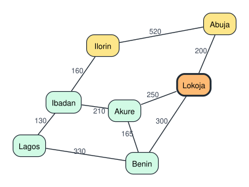

# Bidirectional Search

Bidirectional search runs two searches at once, one forward from the start and one backward from the goal, and stops when they meet in the middle.

## Before you start
<!-- bite: 773953aa-8a94-433f-8627-cb665e740673 -->

Read [[artificial-intelligence/02-uninformed-search/03-breadth-first-search|Breadth-First Search]] first. Each half of a bidirectional search is usually a BFS. It also helps to remember goal-driven search from [[artificial-intelligence/02-uninformed-search/01-what-search-is|What Search Is]].

After this lesson you will be able to:

1. explain how bidirectional search works and how it knows when to stop;
2. show with numbers why two half-depth searches are far cheaper than one full-depth search;
3. trace bidirectional search on the map;
4. state the two conditions a problem must meet for bidirectional search to work.

## What bidirectional search is
<!-- bite: 6db47ebd-76c9-4791-902c-0f2da992380d -->

Your notes describe it like this: instead of searching from the start all the way to the goal, one search starts at the start node and moves forward, while another starts at the goal node and moves backward, and they meet in the middle. Then your notes say "Explain more!", so that's what this lesson does.

It joins the two directions from lesson 1. The forward half is data-driven search, from the start. The backward half is goal-driven search, from the goal. Run them together, and each only has to cover half the distance.

## The kid version
<!-- bite: 91583f2d-5bbc-4af9-866d-fa22ac7686f0 -->

You and your friend are digging a tunnel through a hill. You could dig all the way from one side alone. Or you dig from your side while your friend digs from theirs, and you meet in the middle. Each of you only digs half, so the tunnel is done in about half the time. Bidirectional search is digging from both ends.

**Where the analogy stops working.** In a tunnel, halving the distance halves the work. In search, halving the *depth* does far better than halve the work, because the tree grows exponentially with depth. The numbers below show it.

## Why meeting in the middle is so fast
<!-- bite: cf5d774a-a909-4bbb-bbad-89a663534e17 -->

Remember from [[artificial-intelligence/02-uninformed-search/02-measuring-a-search-method|Measuring a Search Method]] that a search to depth $d$ generates about $b^d$ nodes. Bidirectional search runs two searches, each only to depth $d/2$. So it generates about:

$$b^{d/2} + b^{d/2}$$

instead of $b^d$. Put numbers in: $b = 10$, goal at depth $d = 6$.

1. **One search to depth 6:** $10 + 100 + \dots + 1{,}000{,}000 = 1{,}111{,}110$ nodes.
2. **Two searches to depth 3:** $2 \times (10 + 100 + 1{,}000) = 2{,}220$ nodes.

About 500 times less work. That's because $b^{d/2}$ isn't half of $b^d$; it's its *square root*. Halving the exponent is enormous.

## How the two searches know they've met
<!-- bite: 85a40cb6-31c6-486f-af70-09ff2894126a -->

Each search keeps its own set of states it has reached. The searches take turns, one level at a time. After each step, check: **has either search just reached a state the other search has already reached?**

If yes, that state is where they meet. The route is the forward search's path from the start to the meeting state, joined to the backward search's path from the meeting state to the goal.

## Bidirectional search on the map
<!-- bite: d44f5ce2-dde4-4932-917d-4bde09257d40 -->

Let's run it from Lagos to Abuja, with each half a BFS that adds one level per turn (neighbours alphabetical).

1. **Forward, level 1:** from Lagos, reach **Benin** and **Ibadan**. Has the backward search reached either? It has only Abuja so far. No meeting.
2. **Backward, level 1:** from Abuja, reach **Ilorin** and **Lokoja**. Has the forward search reached either? It has Lagos, Benin and Ibadan. No meeting.
3. **Forward, level 2:** from Benin, reach **Akure**, then **Lokoja**. The backward search has already reached Lokoja. **They meet at Lokoja.**

## Where the two searches meet
<!-- bite: e98bcc57-3223-41e7-8f30-6a5d586210a5 -->

Here's the map at the moment they meet.

Join the halves. Forward: Lagos → Benin → Lokoja. Backward: Lokoja → Abuja. The route is **Lagos → Benin → Lokoja → Abuja**, 830 km, 3 roads. It's the same route BFS found, because each half is a BFS, so it finds the fewest roads but not the fewest kilometres.

## When bidirectional search works
<!-- bite: 412f616d-ac34-4d5d-8f86-c538cfc22bc6 -->

The speed-up is huge, but it comes with two conditions. Your slides name them both:

1. **There must be a clear goal state.** The backward search has to start somewhere. "Get to Abuja" works. "Get to any city with an airport" or "checkmate the opponent" doesn't give you one state to start from, so bidirectional search doesn't fit.
2. **Actions must be reversible**, or at least you must be able to work out predecessors. The backward search asks "which states lead *to* this one?". On a road map with two-way roads, that's easy: the cities that lead to Lokoja are its neighbours. In a problem with one-way actions, working backwards can be hard or impossible.

And there's a cost in memory. To check whether the searches have met, at least one of them has to keep all the states it has reached, so the space is also $O(b^{d/2})$.

## How good is bidirectional search?
<!-- bite: d67cc0bd-5dd6-45e1-9371-def3d563269a -->

With BFS in both directions:

1. **Complete?** Yes, if $b$ is finite.
2. **Optimal?** Yes, if every step costs the same, like BFS. On our map, with unequal roads, it returns 830 km, not 790 km. (Using uniform-cost search in both directions can make it cost-optimal, but the stopping rule then needs more care than "first meeting".)
3. **Time:** $O(b^{d/2})$.
4. **Space:** $O(b^{d/2})$.

## Terms used in this lesson
<!-- bite: 2b5bc5bb-6774-4859-931d-b08c1d2907b4 -->

1. **Bidirectional search**: This is a search that runs forward from the start and backward from the goal at the same time, stopping when the two meet.
2. **Forward search**: This is the half that starts at the initial state and follows actions forward.
3. **Backward search**: This is the half that starts at the goal and works out which states lead to it.
4. **Meeting state**: This is the state reached by both searches. The solution passes through it.
5. **Predecessor**: This is a state from which one action leads to a given state. The backward search needs to find predecessors.

## Common pitfalls and traps
<!-- bite: 015a561f-3c4a-48c8-93bd-e2c40454754f -->

- **Thinking it halves the work.** It does much better: $b^{d/2}$ is the square root of $b^d$. With $b = 10$, $d = 6$, it's 2,220 nodes against 1,111,110.
- **Using it when the goal is a description, not a state.** "Any winning position" has no single state to search back from.
- **Forgetting to check for the meeting after every step.** If you only check at the end, the two searches pass through each other and keep going, wasting the whole advantage.

## Check your understanding
<!-- bite: 36f36c15-cc45-4a68-a2ed-3b5db305129a -->

Try each one before you open the answer.

1. <!-- q: exact id="9c31ceb6" answer="220" -->
   A problem has branching factor $b = 10$ and the goal at depth $d = 4$. Bidirectional search runs a BFS to depth 2 from each end. Using $2 \times (b + b^2)$, how many nodes does it generate?

   

Answer

   2 × (10 + 100) = 220. A single BFS to depth 4 would generate 10 + 100 + 1,000 + 10,000 = 11,110.

   

2. <!-- q: mcq id="8d2a032a" -->
   For which of these problems does bidirectional search fit well?

   - [x] Finding a route from Enugu to Kano on a map of two-way roads
   - [ ] Finding any winning position in a game of chess
   - [ ] Finding a state from which no further moves are possible, with no single target
   - [ ] Following one-way actions whose predecessors can't be worked out

   

Answer

   The Enugu-to-Kano route. It has one clear goal state, and two-way roads make predecessors easy. The others either have no single goal state or can't be searched backwards.

   

3. <!-- q: gap id="5b0fe827" answers="b^{d/2}|b^(d/2)|O(b^(d/2))|O(b^{d/2})" -->
   With BFS in both directions, bidirectional search takes time that grows like $O($___$)$.

   

Answer

   $b^{d/2}$: each half only goes to half the depth.

   

4. <!-- q: open id="6d224053" -->
   Explain how bidirectional search knows when to stop, and how it builds the final route.

   

Answer

   Each search keeps the set of states it has reached. After each step, it checks whether the state it just reached is already in the other search's set. When one is, that's the meeting state. The route is the forward path from the start to the meeting state, followed by the backward path from the meeting state to the goal.

   

5. <!-- q: mcq id="38b64c47" -->
   On a map where roads have different lengths, bidirectional search with BFS in both halves returns a route. Which statement is true?

   - [ ] It is always the cheapest route.
   - [x] It has the fewest roads, but may not be the cheapest.
   - [ ] It is always the longest route.
   - [ ] It has the most roads.

   

Answer

   Each half is a BFS, so it finds the fewest steps, not the lowest cost. On our map it returns the 3-road 830 km route, while the cheapest is 790 km.

   

## Before moving on
<!-- bite: bb6bf720-722e-489b-ae44-f3c2e7087a9d -->

You're done when you can explain bidirectional search and its stopping rule, compute its saving for given $b$ and $d$, trace it on the map, and name the two conditions it needs.

Recap: bidirectional search runs a forward search from the start and a backward search from the goal, checking after each step whether they've met. Two searches to depth $d/2$ cost $O(b^{d/2})$, far less than $O(b^d)$. It needs a clear goal state and reversible actions, and with BFS halves it finds the fewest steps. On our map, the searches meet at Lokoja.

Next, [[artificial-intelligence/02-uninformed-search/10-comparing-uninformed-search|Comparing Uninformed Search Methods]] puts all six methods side by side and gives you the rules for choosing one.

## Related
<!-- bite: ec0ace30-9623-48a8-914f-4e09019f94ad -->

- [[artificial-intelligence/02-uninformed-search/01-what-search-is|What Search Is]]: data-driven and goal-driven search, the two halves joined here.

## About this lesson
<!-- bite: 0cba8a02-402b-41eb-8a54-8efd85664b6f -->

**Level:** introductory, with simple sums. Lesson 9 of section 02 (uninformed search). It covers bidirectional search's idea, its $O(b^{d/2})$ saving, the meeting check, a trace on the map, its two conditions and its properties.

**Source:** University of Lagos SSG 518 class notes, *Bi-Directional Search* (24/11/25: the definition, and "Explain more!"), and the SSG 518 *Introduction to Search* slides ("cuts time from $O(b^d)$ to $O(b^{d/2})$, but needs a clear goal state and reversible actions"). The trace and the node counts are computed and asserted by `scripts/diagrams/ai_search.py`.
