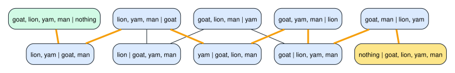

# River-Crossing Puzzles: Formulating and Solving with Search

River-crossing puzzles are small problems you solve by writing them as a state space and searching it with breadth-first search.

## Before you start
<!-- bite: 6ddd6285-c76e-4250-aba5-8d505bea48ee -->

Read [[artificial-intelligence/01-foundations/06-problem-solving-in-ai|Problem Solving in AI]] for the five parts of a problem, and [[artificial-intelligence/02-uninformed-search/03-breadth-first-search|Breadth-First Search]] for the method.

After this lesson you will be able to:

1. formulate a river-crossing puzzle as a state space: state, initial state, actions, constraints, goal test and path cost;
2. count and draw the legal states;
3. find the shortest solution with breadth-first search and write it as a table of crossings;
4. solve the goat, yam and lion puzzle and the missionaries and cannibals puzzle, both of which appear in past exams.

## What a river-crossing puzzle is
<!-- bite: 4dee3d03-a44c-4351-96b9-d22c8b65664b -->

A river-crossing puzzle has some people or things on one bank, a boat or bridge that can carry only a few at a time, and a rule about who can't be left together. You have to get everyone across without breaking the rule.

The 2025/26 SSG 518 exam asked one with a goat, a yam and a lion; the 2019/20 SSG 503 exam asked missionaries and cannibals. They look like brain-teasers, but they're really exam questions about **problem formulation**. Once you write down the states and actions correctly, breadth-first search does the rest, and gives you the shortest answer too.

## The kid version
<!-- bite: 578e9dab-af8e-4306-85fc-a9ce4a2c9d86 -->

Think of carrying your little brother, your dog and your birthday cake across a busy road, one at a time. You can't leave your dog alone with the cake, and you can't leave your brother alone with the dog. So you plan: take the dog across first, come back, take the cake, bring the dog back... Each "situation" (who is where) is a state, each trip is an action, and you're searching for a safe sequence of trips.

**Where the analogy stops working.** You'd work it out by trial and error in your head. A computer lists every safe situation and searches them systematically, so it's sure to find the shortest plan, and to report if there's none.

## The goat, the yam and the lion: the puzzle
<!-- bite: 5b1c115f-479f-47d2-9439-1a89838da657 -->

From the 2025/26 SSG 518 exam:

> A man is travelling with three possessions: a goat, a yam and a lion. He arrives at a narrow bridge and can cross with only one item at a time. If left alone together, the lion will eat the goat, and the goat will eat the yam. The man must always be present to prevent one item from destroying another.

The exam asks you to formulate it as a state space search problem and find the sequence of actions.

## Formulating it
<!-- bite: af3cebbd-0602-411e-bb62-ada669413a11 -->

1. **State**: where each of the man, goat, yam and lion is: start side or far side. Write a state as *start side | far side*, for example "goat, yam, lion, man | nothing".
2. **Initial state**: "goat, yam, lion, man | nothing".
3. **Actions**: the man crosses alone, or crosses carrying one item that is on his side.
4. **Transition model**: the man, and the item if he carries one, move to the other side.
5. **Constraint**: a state is illegal if, on the side *without* the man, the lion is with the goat, or the goat is with the yam.
6. **Goal test**: "nothing | goat, yam, lion, man".
7. **Path cost**: 1 per crossing. Fewest crossings is best.

Each of the four can be on either side, so there are $2^4 = 16$ possible states. The constraint rules out 6 of them, leaving **10 legal states**.

## The state space
<!-- bite: 5a28e128-b712-40a3-8b28-ed5d2cafa59b -->

Here are all 10 legal states, joined wherever one crossing takes you from one to the other.

Breadth-first search from the start explores this graph level by level, and the first time it reaches the goal it has the fewest crossings. The orange path is what it finds.

## The goat, the yam and the lion: the solution
<!-- bite: 44e3bc84-a82b-4915-b620-4dc64fef5b33 -->

**7 crossings:**

| Crossing | Action | Start side afterwards | Far side afterwards |
|---|---|---|---|
| 1 | Take the goat across | yam, lion | man, goat |
| 2 | Come back alone | man, yam, lion | goat |
| 3 | Take the lion across | yam | man, goat, lion |
| 4 | Bring the goat back | man, goat, yam | lion |
| 5 | Take the yam across | goat | man, yam, lion |
| 6 | Come back alone | man, goat | yam, lion |
| 7 | Take the goat across | nothing | man, goat, yam, lion |

The trick is crossing 4: taking something *back*. The goat is in both dangerous pairs, so it can never be left with either of the others. The man takes it first, and brings it back once to swap. (Taking the yam at crossing 3 and the lion at crossing 5 works too.)

## Missionaries and cannibals: the puzzle
<!-- bite: a1611245-717b-4c8a-91e4-845a21382150 -->

From the 2019/20 SSG 503 exam:

> On one bank of a river are three missionaries and three cannibals. There is one boat that can hold up to two people. If the cannibals ever outnumber the missionaries on either bank, the missionaries will get eaten. How can the boat be used to safely carry everyone across?

## Formulating it
<!-- bite: ee1696b2-8b50-4819-aee2-fb0de2d6911f -->

1. **State**: (missionaries on the start bank, cannibals on the start bank, which bank the boat is on). You don't need to name people: any missionary is as good as any other.
2. **Initial state**: (3, 3, start). **Goal**: (0, 0, far).
3. **Actions**: the boat carries 1 or 2 people across: two missionaries, two cannibals, one of each, or one person alone.
4. **Constraint**: on each bank, if there are any missionaries, there must be at least as many missionaries as cannibals.
5. **Path cost**: 1 per crossing.

With 0 to 3 of each on the start bank and the boat on either side, there are $4 \times 4 \times 2 = 32$ possible states, and **20 are legal**. Some of the legal ones can't actually be reached from the start, which breadth-first search finds out automatically.

## Missionaries and cannibals: the solution
<!-- bite: 85a170dd-8cdc-49df-83f8-ee10efcffecd -->

**11 crossings**, the fewest possible. The numbers show who is left on the start bank.

| Crossing | Boat carries | Start bank (M, C) | Far bank (M, C) |
|---|---|---|---|
| 1 | 2 cannibals across | 3, 1 | 0, 2 |
| 2 | 1 cannibal back | 3, 2 | 0, 1 |
| 3 | 2 cannibals across | 3, 0 | 0, 3 |
| 4 | 1 cannibal back | 3, 1 | 0, 2 |
| 5 | 2 missionaries across | 1, 1 | 2, 2 |
| 6 | 1 missionary and 1 cannibal back | 2, 2 | 1, 1 |
| 7 | 2 missionaries across | 0, 2 | 3, 1 |
| 8 | 1 cannibal back | 0, 3 | 3, 0 |
| 9 | 2 cannibals across | 0, 1 | 3, 2 |
| 10 | 1 cannibal back | 0, 2 | 3, 1 |
| 11 | 2 cannibals across | 0, 0 | 3, 3 |

## Checking the missionaries solution
<!-- bite: 7cbc7769-cbda-467a-83b0-4d64a98d1e27 -->

Check each row of that table: wherever there are missionaries, there are at least as many of them as cannibals. Crossing 6 is the key move: sending one of each *back* keeps both banks balanced at (2, 2) and (1, 1).

## Why breadth-first search
<!-- bite: 98a1a2ce-fea7-4bbf-aaee-e4a4c8c4e485 -->

Both puzzles have equal step costs (every crossing counts 1) and small state spaces (10 and 20 legal states), so breadth-first search is the natural choice. It's complete, it finds the fewest crossings, and its memory problem doesn't matter at this size. Use an explored set, because you can always cross back the way you came and loop forever otherwise.

## Terms used in this lesson
<!-- bite: 4ce847af-2a20-4f00-8c23-38bdc93cd691 -->

1. **Constraint**: This is a rule a state must satisfy to be legal, such as "the goat is never alone with the lion".
2. **Legal state**: This is a state that satisfies every constraint.
3. **Reachable state**: This is a legal state that can actually be reached from the initial state by some sequence of actions. Not every legal state is reachable.

## Common pitfalls and traps
<!-- bite: 14561928-d510-48c2-8330-b9ff7786afe3 -->

- **Leaving the man (or boat) out of the state.** Where he is decides which actions are possible and which bank is unguarded.
- **Checking the constraint on the wrong bank.** In the goat puzzle, the danger is on the side *without* the man. In missionaries and cannibals, check *both* banks after every crossing.
- **Forgetting that items can come back.** Both solutions need a return trip carrying something.

## Check your understanding
<!-- bite: b847cdab-a12a-4bcb-85fb-eed691218826 -->

Try each one before you open the answer.

1. <!-- q: exact id="49f25d27" answer="7" -->
   How many crossings does the shortest solution to the goat, yam and lion puzzle take?

   

Answer

   7: goat across, back alone, lion across, goat back, yam across, back alone, goat across.

   

2. <!-- q: mcq id="bd710aac" -->
   In the goat, yam and lion puzzle, which item must the man take first?

   - [x] The goat
   - [ ] The yam
   - [ ] The lion
   - [ ] Nothing: he crosses alone first

   

Answer

   The goat. If he takes the yam, the lion eats the goat; if he takes the lion, the goat eats the yam; if he goes alone, both happen. Only taking the goat leaves a safe pair behind.

   

3. <!-- q: mcq id="b9a71668" -->
   In missionaries and cannibals, which of these start-bank states is illegal? (M, C) means missionaries and cannibals left on the start bank.

   - [ ] (3, 1)
   - [x] (1, 2)
   - [ ] (0, 3)
   - [ ] (2, 2)

   

Answer

   (1, 2): on the start bank, 1 missionary is outnumbered by 2 cannibals. (0, 3) is fine because there are no missionaries there to eat, and the far bank has (3, 0).

   

4. <!-- q: exact id="f6cef64c" answer="11" -->
   How many crossings does the shortest missionaries and cannibals solution take?

   

Answer

   11, found by breadth-first search.

   

5. <!-- q: open id="89ee158e" -->
   A farmer must cross with a fox, a chicken and a bag of corn. The fox eats the chicken and the chicken eats the corn if left alone. Formulate the problem: give the state, initial state, actions, constraint and goal test.

   

Answer

   State: which side the farmer, fox, chicken and corn are each on. Initial state: all four on the start side. Actions: the farmer crosses alone or with one item from his side. Constraint: on the side without the farmer, the fox must not be with the chicken, and the chicken must not be with the corn. Goal test: all four on the far side. (It's the same puzzle as the goat, yam and lion, so the answer is also 7 crossings, starting with the chicken.)

   

## Before moving on
<!-- bite: d955c895-96b7-46e1-9d9c-79c212975370 -->

You're done when you can formulate a crossing puzzle with all its parts, count its legal states, and write out the shortest solution as a table, checking the constraint at every row.

Recap: a crossing puzzle is a state-space problem. The state records who is on which side (and where the man or boat is), actions are crossings, and constraints rule out unsafe states. Breadth-first search finds the fewest crossings: 7 for the goat, yam and lion, and 11 for missionaries and cannibals. The trick in both is a return trip that carries something back.

Next, [[artificial-intelligence/02-uninformed-search/12-water-jugs-and-tower-of-hanoi|Puzzles as Search: Water Jugs and the Tower of Hanoi]] uses the same method on two puzzles with no one to get eaten.

## Related
<!-- bite: 1accf2f9-2f85-4b2b-a96f-e5a23cb35928 -->

- [[artificial-intelligence/05-constraint-satisfaction/01-constraint-satisfaction-problems|Constraint Satisfaction Problems]]: problems defined entirely by constraints.

## About this lesson
<!-- bite: 5c3c6f50-ec68-4a59-9f11-0829a3bb6156 -->

**Level:** introductory. Lesson 11 of section 02 (uninformed search). It covers formulating and solving two river-crossing puzzles with breadth-first search.

**Source:** the University of Lagos SSG 518 2025/26 exam (question 4b, the goat, yam and lion) and the SSG 503 2019/20 exam (question 4iii, missionaries and cannibals), plus the SSG 518 classmate's notes, which work missionaries and cannibals as an assignment. Every state count and solution is computed by breadth-first search and asserted by `scripts/diagrams/ai_gaps.py` and `scripts/diagrams/ai_question_bank.py`.
