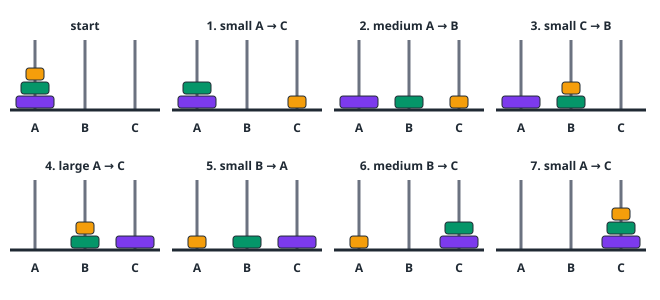

# Puzzles as Search: Water Jugs and the Tower of Hanoi

The water-jug puzzle and the Tower of Hanoi are two more puzzles you solve by writing them as a state space and searching it.

## Before you start
<!-- bite: 84e5cff2-60a8-4fa3-a076-28ff31960a2a -->

Read [[artificial-intelligence/02-uninformed-search/11-river-crossing-puzzles|River-Crossing Puzzles]] first: this lesson uses the same method on two new puzzles. You'll also need [[artificial-intelligence/02-uninformed-search/03-breadth-first-search|Breadth-First Search]].

After this lesson you will be able to:

1. formulate the water-jug puzzle: state, actions, the pouring rule, goal test and path cost;
2. solve it with breadth-first search, and tell when it has no solution;
3. formulate the Tower of Hanoi and solve it for any number of discs;
4. explain why the Tower of Hanoi always takes $2^n - 1$ moves and has $3^n$ states.

## What these two puzzles are
<!-- bite: ba54fcfc-fc2c-4250-9b7d-a5cb59b53e26 -->

The **water-jug puzzle** gives you two jugs with no markings, say a 7-litre jug and a 4-litre jug, and a tap. You have to measure out an exact amount, such as 6 litres, using only three kinds of action: fill a jug, empty a jug, or pour one jug into the other.

The **Tower of Hanoi** has three pegs and a stack of discs of different sizes on the first peg, biggest at the bottom. You have to move the whole stack to the third peg, one disc at a time, never putting a bigger disc on a smaller one.

Neither puzzle has a person who can get eaten, but they're the same kind of exam question as the river crossings: **write the problem as a state space, then search it**. The checkpoint and mock exams in this subject ask both.

## The kid version
<!-- bite: d1a8c15a-7f41-41c5-8a4d-346f36de2fe7 -->

You're making zobo, and the recipe says 6 cups of water. But all you have is a big bottle that holds exactly 7 cups and a small one that holds exactly 4, with no lines on either. You can't guess "a bit less than full". So you fill, pour and empty, and each time you can say exactly how much is in each bottle. After a few tries, 6 cups are sitting in the big bottle.

**Where the analogy stops working.** In the kitchen you'd find the trick by fiddling. A computer can't fiddle: it lists every situation the two bottles can be in, and searches them in order, so it finds the *shortest* way, and it can prove when there's no way at all.

## The water jugs: the state
<!-- bite: 473cc656-da23-4827-a27d-5a82ab6f0c5e -->

The **state** is a pair $(a, b)$: the litres in the 7-litre jug and the litres in the 4-litre jug. Whole litres are enough, because every action either fills a jug, empties it, or pours until something is empty or full.

1. **Initial state**: $(0, 0)$, both jugs empty.
2. **Goal test**: $a = 6$, exactly 6 litres in the 7-litre jug. (The 4-litre jug can hold anything.)
3. **Path cost**: 1 per action, so the best solution is the one with the fewest actions.

The state ignores everything that doesn't matter: the tap, the colour of the jugs, how fast you pour. That's abstraction, as in [[artificial-intelligence/01-foundations/06-problem-solving-in-ai|Problem Solving in AI]].

## The water jugs: the six actions
<!-- bite: a87f2791-4a31-4a77-be29-4476d8969357 -->

From any state $(a, b)$ there are six actions:

1. **Fill the 7-litre jug**: $(7, b)$.
2. **Fill the 4-litre jug**: $(a, 4)$.
3. **Empty the 7-litre jug**: $(0, b)$.
4. **Empty the 4-litre jug**: $(a, 0)$.
5. **Pour the 7-litre into the 4-litre**, until the 7-litre is empty or the 4-litre is full.
6. **Pour the 4-litre into the 7-litre**, until the 4-litre is empty or the 7-litre is full.

The pours are the only tricky part, so the next section gives their rule.

## The pouring rule
<!-- bite: 9dd9a7de-2b0e-41da-9336-679b12b4a073 -->

When you pour the 7-litre jug into the 4-litre jug, the amount that moves is whichever runs out first: the water in the 7-litre jug, or the space left in the 4-litre jug.

$$\text{amount poured} = \min(a,\; 4 - b), \qquad (a, b) \to (a - \text{amount},\; b + \text{amount})$$

For example, from $(5, 1)$ the 7-litre jug has 5 litres, but the 4-litre jug only has room for 3. So 3 litres move, and the state becomes $(2, 4)$. Pouring the other way works the same, with $\min(b,\; 7 - a)$.

## Solving it with breadth-first search
<!-- bite: 1c2c9fb4-4fc3-4ac1-bb56-18c5ab0f7749 -->

Every action costs 1, so breadth-first search finds the fewest actions. Here's the answer it returns, **6 actions**, with the jugs drawn after each one:

The trick is in the last two actions. With 3 litres already in the 4-litre jug, it only has room for 1 more. So pouring a full 7-litre jug into it moves exactly 1 litre, and leaves exactly 6.

## Seeing the whole state space
<!-- bite: 754f1eb4-9ad5-40b8-b471-d540ddb7832b -->

Now draw every possible state as a grid: $a$ from 0 to 7 across, $b$ from 0 to 4 up. That's 40 grid points, but breadth-first search only ever reaches **22** of them (the big blue dots):

They're exactly the points on the **edge** of the grid. That's because every action ends with at least one jug either empty or full: filling and emptying obviously do, and a pour stops when one jug is empty or the other is full. A state like $(3, 2)$, with both jugs partly full, can never happen. The orange arrows are the 6-action solution, bouncing between the edges.

## When there's no answer
<!-- bite: d6c6cfe0-d6f2-4862-9d08-278b20d38baa -->

Try a 6-litre jug and a 4-litre jug, and ask for 3 litres. Breadth-first search explores every reachable state and never finds one with 3 litres. Its frontier runs empty, so it reports failure: the **standard failure** from [[artificial-intelligence/02-uninformed-search/05-depth-limited-search|Depth-Limited Search]], meaning there's no solution at all.

Here's why. Both jugs hold an even number of litres, and filling, emptying and pouring only ever add or take away whole jugfuls or what fits. So every amount you can ever have is a multiple of 2, the **greatest common divisor** of 6 and 4. You can measure 2 or 4 litres, but never 3. The general rule: with jugs of $A$ and $B$ litres, you can measure $c$ litres in a jug only if $c$ is a multiple of $\gcd(A, B)$ and fits in it. Breadth-first search finds this out by itself, but knowing the rule saves you the search.

## The Tower of Hanoi: the state
<!-- bite: a222b77a-29f7-4f33-a62b-1b9c341f719d -->

Three pegs, A, B and C, and $n$ discs, all on peg A, biggest at the bottom. Move them all to peg C.

1. **State**: which peg each disc is on, written smallest disc first. For 3 discs, (A, A, A) is the start. You don't need to record the order of discs on a peg, because the rule forces it: on any peg, the discs are always biggest at the bottom.
2. **Initial state**: every disc on A. **Goal test**: every disc on C.
3. **Path cost**: 1 per move.

Each disc can be on any of 3 pegs, so with $n$ discs there are $3^n$ states: 27 for 3 discs, 81 for 4. Every one of them can be reached.

## The Tower of Hanoi: the actions
<!-- bite: 7230458c-b06e-4a27-8aae-58e5f334b196 -->

An action moves **the top disc of one peg to another peg**, and it's legal only if that peg is empty or its top disc is bigger.

So the state's transition model has one check: a disc can move only if no smaller disc sits on top of it (it's the top disc of its peg), and only to a peg holding no smaller disc. In the all-on-A start state only the small disc can move, to B or to C: just 2 actions. From most states there are 3.

## Solving three discs
<!-- bite: 9154450c-9e1e-4a88-b878-61f7fe29eccf -->

Breadth-first search finds the shortest solution: **7 moves**.

Look at the middle. Moves 1 to 3 get the small and medium discs out of the way onto B. Move 4 is the only move of the large disc, straight to C. Moves 5 to 7 put the small and medium discs back on top of it. That shape is the whole secret of the puzzle, as the next section shows.

## Seeing the state space
<!-- bite: 04792064-0eb2-48ee-96ed-fd0d2d3342f7 -->

Here are all 27 states for 3 discs, each joined to the states one move away:

It's a triangle made of three smaller triangles, each made of three smaller ones again. The three big corners are "everything on A", "everything on B" and "everything on C". Each of the three big sub-triangles holds the states where the **largest** disc sits on one particular peg, and they're joined by single edges: those are the only moments the largest disc moves. The shortest solution runs straight up the left side, 7 steps.

## Why it's always 2ⁿ − 1 moves
<!-- bite: 9f16c8fe-d94e-403e-8530-9c8d1f46f98a -->

To move $n$ discs from A to C, the largest disc has to move from A to C at some point. For that to be legal, all the other $n - 1$ discs must be out of the way, stacked on B. So every solution has three stages:

1. move the top $n - 1$ discs from A to B;
2. move the largest disc from A to C (1 move);
3. move the $n - 1$ discs from B onto it at C.

Stages 1 and 3 are each a whole $(n - 1)$-disc puzzle. So if $M(n)$ is the number of moves for $n$ discs:

$$M(n) = 2M(n - 1) + 1, \qquad M(1) = 1$$

That gives 1, 3, 7, 15, 31, …, which is $M(n) = 2^n - 1$. Three discs: 7 moves. Four: 15. Breadth-first search agrees for every $n$ the script behind this lesson checks.

## Search versus knowing the trick
<!-- bite: 8aaa8f30-6cc4-486a-ae66-1172f16eab63 -->

Breadth-first search solves both puzzles without being told any trick. But look at the sizes. The Tower of Hanoi has $3^n$ states: 59,049 for 10 discs, and about 3.5 billion for 20. Breadth-first search would have to store a huge frontier of them.

The three-stage idea above needs no search at all: it writes down the 1,048,575 moves for 20 discs one after another, using almost no memory. That's the lesson from [[artificial-intelligence/01-foundations/08-combinatorial-explosion|Combinatorial Explosion]] again: **knowledge about the problem beats blind search**. In an exam, formulate the problem and show the search for small cases; mention the rule ($2^n - 1$, or the gcd test for jugs) as the shortcut.

## Terms used in this lesson
<!-- bite: 292108ba-b93c-45c0-9859-25253d87b474 -->

1. **Pouring rule**: when pouring one jug into another, the amount that moves is the smaller of what's in the first jug and the space left in the second.
2. **Greatest common divisor (gcd)**: the largest whole number that divides two numbers exactly; for jugs of 6 and 4 litres it's 2, and every measurable amount is a multiple of it.
3. **Standard failure**: the result of a search that explores every reachable state without finding a goal, meaning no solution exists.
4. **Recurrence**: a formula that gives a value in terms of smaller cases, like $M(n) = 2M(n - 1) + 1$.

## Common pitfalls and traps
<!-- bite: acb8592c-6258-485d-bd04-3886fcea04bd -->

1. **Pouring everything.** A pour stops when the second jug is full. From $(7, 3)$, pouring the 7-litre into the 4-litre moves only 1 litre, not 7.
2. **Forgetting the goal is in one jug.** "6 litres" means 6 in a jug, not 6 shared between the two.
3. **Recording the order of discs on a peg.** It's forced by the size rule, so the state only needs the peg of each disc. Including the order makes the state space look bigger than it is.
4. **Counting states as $n^3$.** It's $3^n$: each disc independently picks one of 3 pegs.

## Check your understanding
<!-- bite: 0b7bfdc0-331e-4eed-99c5-295ee244d729 -->

Try each one before you open the answer.

1. <!-- q: exact id="5d1e2a90" answer="(2, 4)" accept="2, 4|(2,4)" -->
   With a 7-litre and a 4-litre jug, the state is (5, 1): 5 litres in the 7-litre jug and 1 in the 4-litre jug. You pour the 7-litre jug into the 4-litre jug. What is the new state?

   

Answer

   (2, 4). The 4-litre jug only has room for 3 more litres, so $\min(5, 4 - 1) = 3$ litres move: 5 − 3 = 2 and 1 + 3 = 4.

   

2. <!-- q: exact id="c7f43b18" answer="8" -->
   You have a 9-litre jug and a 4-litre jug. What is the fewest number of actions that leaves exactly 6 litres in the 9-litre jug?

   

Answer

   8: fill the 9 (9, 0); pour into the 4 (5, 4); empty the 4 (5, 0); pour (1, 4); empty the 4 (1, 0); pour (0, 1); fill the 9 (9, 1); pour into the 4 until full (6, 4).

   

3. <!-- q: mcq id="0e8b65a4" -->
   With a 6-litre jug and a 4-litre jug, which amount can **never** be measured in one of the jugs?

   - [ ] 2 litres
   - [x] 3 litres
   - [ ] 4 litres
   - [ ] 6 litres

   

Answer

   3 litres. Every amount you can ever hold is a multiple of $\gcd(6, 4) = 2$, so odd amounts are impossible. Breadth-first search would explore every reachable state and end in standard failure.

   

4. <!-- q: exact id="b26d0f71" answer="15" -->
   How many moves does the shortest solution to the Tower of Hanoi with 4 discs take?

   

Answer

   15, which is $2^4 - 1$: move 3 discs out of the way (7 moves), move the largest (1), move the 3 back on top (7).

   

5. <!-- q: exact id="9a3c58e2" answer="81" accept="3^4" -->
   How many states does the Tower of Hanoi with 4 discs have?

   

Answer

   81, which is $3^4$: each of the 4 discs can be on any of the 3 pegs.

   

6. <!-- q: open id="47d9f3c6" -->
   Explain why every solution to the Tower of Hanoi must, at the moment the largest disc moves, have all the other discs stacked on one peg.

   

Answer

   The largest disc can only move if nothing is on top of it, and only to a peg with no smaller disc on it, which means an empty peg. So its starting peg holds only it, and its destination is empty: every other disc must be on the third peg. That's why the solution splits into "move $n - 1$ discs aside, move the largest, move $n - 1$ back", giving $M(n) = 2M(n - 1) + 1$.

   

## Before moving on
<!-- bite: a891d19a-f156-4bf8-923d-1c03be69a617 -->

You're done when you can formulate either puzzle with all its parts, apply the pouring rule without a slip, find the shortest solution for small cases, and say how many moves and states the Tower of Hanoi has for any number of discs.

Recap: the water-jug state is the litres in each jug; the six actions are fill, empty and pour, and a pour moves $\min(\text{what's in it}, \text{space in the other})$. Breadth-first search finds the fewest actions, or proves there are none (the target must be a multiple of the gcd). The Tower of Hanoi state is the peg of each disc, $3^n$ states, and the shortest solution takes $2^n - 1$ moves.

That's the end of section 02. Section 03 adds a sense of direction to search, starting with [[artificial-intelligence/03-heuristic-search/01-heuristics-and-heuristic-search|Heuristics and Heuristic Search]].

## Related
<!-- bite: 65b32556-78f4-4007-83b7-fe55587f2517 -->

- [[artificial-intelligence/02-uninformed-search/11-river-crossing-puzzles|River-Crossing Puzzles]]: the same method on the goat, yam and lion, and on missionaries and cannibals.
- [[artificial-intelligence/01-foundations/08-combinatorial-explosion|Combinatorial Explosion]]: why $3^n$ states soon become too many to search.

## About this lesson
<!-- bite: 89ffd410-09b3-4964-a980-ea5fd1b77cec -->

**Level:** introductory. Lesson 12 of section 02 (uninformed search). It covers formulating and solving the water-jug puzzle and the Tower of Hanoi with breadth-first search, the gcd test for impossible jug targets, and the $2^n - 1$ rule.

**Source:** added 2026-11-26 because the subject's checkpoint and mock exams ask both puzzles, and no lesson taught them. Every solution, state count and quiz answer is computed by breadth-first search and asserted by `scripts/diagrams/ai_puzzles.py`, which also draws the four pictures.
