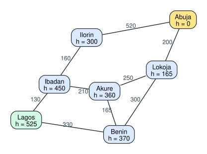

# Heuristics and Heuristic Search

A heuristic is a function that estimates how close a state is to the goal, and heuristic search uses it to look at the most promising states first.

## Before you start
<!-- bite: 49962794-f01d-4f65-af17-b2ebfc2fa02e -->

Read [[artificial-intelligence/02-uninformed-search/10-comparing-uninformed-search|Comparing Uninformed Search Methods]] first. It ends with the problem this section solves: blind search doesn't know which way the goal is.

After this lesson you will be able to:

1. define a heuristic and the heuristic function $h(n)$, in the words of your class notes;
2. give a heuristic for a route problem and check its value for a few cities;
3. explain the trade-off heuristic search makes: speed in exchange for guarantees;
4. say how $f(n)$, the evaluation function, decides which node a best-first search expands.

## What a heuristic is
<!-- bite: 8d296a96-320a-41bb-bc94-5772f9292ec4 -->

Look at the map of Nigeria and ask yourself which way to drive from Lagos to Abuja. You don't need to search. You can *see* Abuja is up and to the right, so you'd favour roads going north-east and ignore ones going south.

None of the six methods in the last section could do that. Even uniform-cost search spread out in every direction, just because those cities were cheap to reach. What it was missing is a sense of direction: some estimate of how far each city still is from Abuja.

That estimate is a **heuristic**. Your class notes put it simply:

A one-sentence version for an exam: a heuristic is a function that estimates how close a state is to the goal state.

## The kid version
<!-- bite: 50a70833-b6f1-461d-a1a8-b955efee0e76 -->

You're playing "hot and cold" to find a hidden sweet. Your friend can't tell you exactly where it is, but they shout "warmer!" or "colder!" as you move. You don't check every corner of the room; you keep walking toward "warmer". A heuristic is the "warmer, colder" voice for a search: it doesn't know the answer, but it gives a good hint about which way to go.

**Where the analogy stops working.** Your friend knows where the sweet is, so "warmer" is always true. A heuristic is only an *estimate* worked out from what the program knows, so it can be wrong, and a bad one can lead the search the wrong way.

## The heuristic function h(n)
<!-- bite: 621f13c7-88a9-440f-a017-6c7736116a79 -->

In search, the heuristic is written as a function of a node: $h(n)$. Your notes define it: $h(n)$ estimates the cost of the cheapest path from the current node $n$ to a goal state.

Two things follow straight from that:

1. **At the goal, $h = 0$.** You're already there, so there's nothing left to estimate.
2. **$h(n)$ is a guess about the future.** Compare it with $g(n)$ from uniform-cost search, which is the *actual* cost already paid to reach $n$. $g$ looks backward and is exact; $h$ looks forward and is estimated.

## A heuristic for the road trip
<!-- bite: 54fbac61-33ce-4224-9e7d-014219c0b2ef -->

For route finding, the classic heuristic is the **straight-line distance** to the goal: how far it is "as the crow flies", ignoring roads. Here's our map with each city's straight-line distance to Abuja (rounded, in km):

Notice the numbers fall as you move toward Abuja: Lagos 525, Ibadan 450, Ilorin 300, Lokoja 165, Abuja 0. And Abuja itself is 0, as it must be.

## Why straight-line distance is a good heuristic
<!-- bite: d5388acc-12c3-4c06-a0a8-fc7e0efcdc6d -->

Why is this a good heuristic? Because it's cheap to compute (just the distance between two points on the map) and it's never more than the real road distance. A road can bend, but it can't be shorter than a straight line. Lokoja's straight-line distance is 165 km; its road distance to Abuja is 200 km. Lagos is 525 straight, 790 by the best roads. That "never overestimates" property will matter a lot in the A\* lessons.

## Heuristic search in state space
<!-- bite: 87f90819-e92e-44c6-8ec9-213619cea092 -->

Your notes describe the heuristic approach to state-space search like this: it uses rules of thumb, domain knowledge and an estimation function, $h(n)$, to guide the search toward the goal efficiently, avoiding exhaustive exploration. Unlike blind searches, it prioritises promising paths, reducing the time and complexity needed to find near-optimal solutions faster.

The key words are **domain knowledge**. Blind search uses only the problem definition: states, actions, goal test, cost. Heuristic search adds knowledge about *this kind* of problem. For maps, we know straight lines are shortcuts. For the 8-puzzle, we know a tile far from its place needs many moves. That extra knowledge is what makes it **informed**.

Your notes list the informed algorithms this section covers: greedy best-first search, A\* search, hill-climbing search and beam search. We'll also meet generate-and-test, simulated annealing and genetic algorithms.

## The trade-off
<!-- bite: c29c0a70-c320-43aa-99bb-cf61e2c58c65 -->

Your notes are honest about what heuristic search gives up:

A one-sentence version for an exam: a heuristic method might not always find the best solution, but is meant to find a good solution in reasonable time; it sacrifices completeness to increase efficiency.

Your notes write "guaranteed to find a good solution in reasonable time", but no heuristic can promise that for every problem: a misleading heuristic can send a search the wrong way. A safer way to say it is that a heuristic is *designed* to find a good solution quickly, most of the time.

And the trade isn't always forced. One method, A\*, keeps the guarantee of the optimal solution as long as its heuristic follows one rule. That's the subject of lessons 04 and 05.

## The evaluation function f(n)
<!-- bite: 38469525-ffb7-432e-9ff2-79e7b2358694 -->

Your notes say the most common informed search techniques are variants of **best-first search**, which uses an **evaluation function** $f(n)$ to decide which node to expand next. It's the same search loop as uniform-cost search, with a priority queue, but the priority is $f(n)$ and the lowest $f$ goes first.

Different choices of $f$ give different methods:

1. $f(n) = g(n)$: cost so far only. That's **uniform-cost search**, from the last section.
2. $f(n) = h(n)$: estimate to the goal only. That's **greedy best-first search**, lesson 03.
3. $f(n) = g(n) + h(n)$: cost so far plus estimate to go. That's **A\***, lessons 04 and 05.

Your notes' "Note" at the end of the heuristic lecture says exactly this third one: total cost $f(n)$ is calculated from two metrics, the distance from the start to the current node and the estimated cost from there to the goal using a heuristic.

## Terms used in this lesson
<!-- bite: 8eb0ab3e-dfb7-43f9-8501-dbf3fc1f9c00 -->

1. **Heuristic**: This is a rule of thumb, based on knowledge of the problem, that estimates how close a state is to the goal.
2. **Heuristic function $h(n)$**: This is the function giving the estimated cost of the cheapest path from node $n$ to a goal. At a goal, $h = 0$.
3. **Straight-line distance**: This is the distance between two places measured directly, ignoring roads. It's the usual heuristic for route finding.
4. **Informed search**: This is also known as **heuristic search** or **intelligent search**. It's search that uses a heuristic to guide which node to expand.
5. **Domain knowledge**: This is knowledge about a particular kind of problem, beyond its formal definition, such as "roads are never shorter than straight lines".
6. **Best-first search**: This is the family of searches that always expand the node with the lowest value of an evaluation function $f(n)$.
7. **Evaluation function $f(n)$**: This is the number a best-first search uses to rank frontier nodes.

## Common pitfalls and traps
<!-- bite: 38bfc770-5271-4690-8022-8c5e8728822d -->

- **Mixing up $g(n)$ and $h(n)$.** $g$ is the exact cost already paid from the start. $h$ is the estimated cost still to go.
- **Thinking a heuristic is the answer.** It's only an estimate. If you knew the exact cost to the goal from every node, you wouldn't need to search at all.
- **Forgetting $h(\text{goal}) = 0$.** Every sensible heuristic gives 0 at the goal.

## Check your understanding
<!-- bite: 44f46000-f337-4dc1-96c0-f75a9c952746 -->

Try each one before you open the answer.

1. <!-- q: gap id="3905ce11" answers="cheapest|lowest-cost|least-cost;goal|goal state" -->
   The heuristic function $h(n)$ estimates the cost of the ___ path from node $n$ to a ___.

   

Answer

   The cheapest path from $n$ to a goal state.

   

2. <!-- q: mcq id="76313f03" -->
   Which evaluation function gives greedy best-first search?

   - [ ] $f(n) = g(n)$
   - [x] $f(n) = h(n)$
   - [ ] $f(n) = g(n) + h(n)$
   - [ ] $f(n) = g(n) - h(n)$

   

Answer

   $f(n) = h(n)$: it ranks nodes only by how close they seem to the goal. $g(n)$ alone is uniform-cost search, and $g(n) + h(n)$ is A\*.

   

3. <!-- q: exact id="65db19fc" answer="0" -->
   A heuristic gives straight-line distances to Kano. What is $h(\text{Kano})$?

   

Answer

   0. At the goal there is no distance left.

   

4. <!-- q: mcq id="99feca5e" -->
   Why is straight-line distance never more than the true road distance to the goal?

   - [ ] Because roads are always straight
   - [x] Because no route between two points can be shorter than the straight line between them
   - [ ] Because it is measured in miles, not km
   - [ ] Because the goal is always north

   

Answer

   A straight line is the shortest possible route between two points, so any road route is at least as long.

   

5. <!-- q: open id="d0059242" -->
   Your notes say heuristic search "sacrifices completeness to increase efficiency". Explain what that means, in two or three sentences.

   

Answer

   Heuristic search follows the paths its heuristic says are most promising and may never look at the others. That makes it much faster than blind search, which checks everything in order. The cost is that, if the heuristic is misleading, the search might miss the best solution, or even fail to find one that exists, so it gives up the guarantees in exchange for speed.

   

## Before moving on
<!-- bite: 093fa5d8-45dc-4869-96f7-ed6a5a01497d -->

You're done when you can define a heuristic and $h(n)$, give a heuristic for a new problem, explain the speed-for-guarantees trade, and match $f(n) = g$, $h$ and $g + h$ to their methods.

Recap: a heuristic estimates how close a state is to the goal; $h(n)$ is the estimated cost from $n$ to the goal, and $h(\text{goal}) = 0$. For maps, straight-line distance is the classic heuristic. Heuristic search uses domain knowledge to look at promising states first, trading guarantees for speed. Best-first search ranks nodes by $f(n)$: $g$ gives uniform-cost search, $h$ gives greedy search, $g + h$ gives A\*.

Next, [[artificial-intelligence/03-heuristic-search/02-generate-and-test|Generate and Test]] is the simplest heuristic method of all: make a guess, check it, and try again.

## Related
<!-- bite: 6ea18655-ffcb-4791-9321-f254cebf9dad -->

- [[artificial-intelligence/02-uninformed-search/07-uniform-cost-search-1|Uniform-Cost Search 1]]: best-first search with $f(n) = g(n)$.

## About this lesson
<!-- bite: bd0b52aa-1868-4a86-9be5-bf9fb7893b14 -->

**Level:** introductory. Lesson 1 of section 03 (heuristic search). It covers heuristics, $h(n)$, straight-line distance, heuristic search in state space, its trade-off, and the evaluation function $f(n)$.

**Source:** University of Lagos SSG 518 class notes, *Informed Search Technique* and *Heuristic / Informed Search Technique* (23/11/25 and 02/02/26), and *Heuristic Search Approach in State Space Search* (10/02/26), including the "Note" on $f(n) = g(n) + h(n)$. The straight-line distances are rounded and chosen to be close to the real geography; `scripts/diagrams/ai_heuristic.py` checks that each is no more than the true road distance to Abuja.
