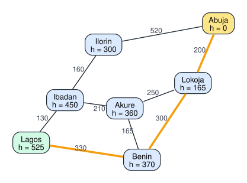
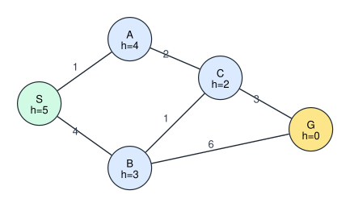

# Greedy Best-First Search

Greedy best-first search always expands the node that appears to be closest to the goal, judged only by the heuristic: $f(n) = h(n)$.

## Before you start
<!-- bite: e17586d6-4772-4368-a733-7567f331f512 -->

Read [[artificial-intelligence/03-heuristic-search/01-heuristics-and-heuristic-search|Heuristics and Heuristic Search]] first. You need $h(n)$, the straight-line distances to Abuja, and the idea of an evaluation function.

After this lesson you will be able to:

1. trace greedy best-first search on the map, writing the frontier with its $h$ values;
2. explain why it's fast, and why it isn't optimal;
3. trace it on the small graph from your slides and compare its answer with the best one;
4. give its properties.

## What greedy best-first search is
<!-- bite: 911b1a56-ac9c-4e90-9d4e-217628c35c20 -->

Your notes describe it like this: it expands the node that appears to be closest to the goal, based solely on the heuristic value. Its goal is to find a solution quickly, even if it isn't the shortest path.

It's called **greedy** because it grabs whatever looks best *right now*, without thinking about what it has already spent. It's the uniform-cost search loop with one change: the priority queue is ordered by $h(n)$ instead of $g(n)$.

$$f(n) = h(n)$$

## The kid version
<!-- bite: 1f61c8cb-8ea2-45e7-855e-f90e3265a78c -->

You're walking home across a field and you can see your house. Greedy search is walking straight toward the house at every step, always choosing the step that brings you closest. Usually it works brilliantly. But if there's a river between you and the house, you'll walk right up to the riverbank, because that's "closest", and only then discover you have to go a long way round.

**Where the analogy stops working.** You'd see the river from a distance and plan round it. Greedy search can't. It only sees $h$, the straight-line distance, and never looks at how much it has already paid or how long the detour will be.

## Greedy search on the map
<!-- bite: d24feff8-1fae-4aeb-8686-d862d0201980 -->

Run it from Lagos to Abuja with the straight-line distances: Lagos 525, Ibadan 450, Benin 370, Akure 360, Ilorin 300, Lokoja 165, Abuja 0. The frontier is ordered by $h$, smallest first, and the search stops when the goal comes off the frontier. Predict the route before reading on.

**Step 1.** Take Lagos off. Add Benin ($h$ 370) and Ibadan ($h$ 450).

Frontier: Benin 370, Ibadan 450.

**Step 2.** Take Benin off: it looks closer to Abuja than Ibadan. Add Akure (360) and Lokoja (165).

Frontier: Lokoja 165, Akure 360, Ibadan 450.

**Step 3.** Take Lokoja off. Add Abuja (0).

Frontier: Abuja 0, Akure 360, Ibadan 450.

**Step 4.** Take Abuja off. Goal!

## The route greedy search returns
<!-- bite: 9acbbbdc-c0ff-4e94-81c4-708f8d98487d -->

The route is Lagos → Benin → Lokoja → Abuja.

That's 330 + 300 + 200 = **830 km**. Greedy search expanded only three cities before reaching the goal. That's fewer than any method in the last section: uniform-cost search expanded six. But it missed the 790 km route.

Why? At step 1 it chose Benin because Benin is closer to Abuja *as the crow flies*. It ignored that the road to Benin costs 330 km, against 130 km to Ibadan. Greedy search never looks at $g$, the cost already paid.

## Greedy search on the slides' graph
<!-- bite: 5d22dba8-d0f9-4d50-a4a5-6c1cd799ecb8 -->

Your course slides use a small graph to compare the methods. The edges have step costs, and each node has a heuristic $h$:

## Tracing greedy search on the slides' graph
<!-- bite: 37327788-860d-406c-96c0-bc3b43860ced -->

Here's greedy search from S to G on that graph:

1. Take S off. Add A ($h$ 4) and B ($h$ 3).
2. Take B off ($h$ 3 is smaller). Add C ($h$ 2) and G ($h$ 0).
3. Take G off. Goal.

The route is S → B → G, cost 4 + 6 = **10**. It expanded just two nodes before the goal. But the cheapest route is S → A → C → G, cost 1 + 2 + 3 = 6. Greedy search was quick and wrong.

## Loops and dead ends
<!-- bite: c36d3884-18ad-4c00-aab7-807b75969cb3 -->

Your notes add a second warning: greedy search can get stuck in infinite loops if it doesn't track visited states.

Imagine a city X whose only road toward the goal is blocked, but which has a neighbour Y slightly further from the goal. Greedy search goes to X (closest), finds nothing new, goes to Y, and from Y the closest-looking neighbour is X again. Without a record of where it has been, it bounces between X and Y forever. Keeping an explored set, as we've done in every trace, prevents that.

## How good is greedy best-first search?
<!-- bite: b709e370-b529-48b2-9f60-1a93d19446a8 -->

1. **Complete?** Not in general. Without an explored set it can loop. With one, on a finite map, it does find a solution.
2. **Optimal?** No. It ignores the cost already paid, as both examples show.
3. **Time:** $O(b^m)$ in the worst case, when the heuristic is misleading. With a good heuristic it's often dramatically faster than that.
4. **Space:** $O(b^m)$ in the worst case, since it keeps all generated nodes.

Your slides sum it up: it's fast, but not optimal, and it can get stuck. It's the method to use when speed matters more than the best answer.

## Terms used in this lesson
<!-- bite: eed36246-1bfc-4370-b974-ede023a67093 -->

1. **Greedy best-first search**: This is the best-first search that expands the node with the smallest $h(n)$, so it always heads for whatever looks closest to the goal.
2. **Greedy**: This describes any method that makes the choice that looks best right now, without considering the cost so far or later consequences.

## Common pitfalls and traps
<!-- bite: 876e80e5-ff18-4305-a4a7-550c805f17cf -->

- **Thinking greedy search finds the shortest route.** It finds a route that *looks* direct. On our map it returns 830 km, not 790 km.
- **Using $g(n)$ in a greedy trace.** Greedy search ranks only by $h$. If you add $g$, you're doing A\*.
- **Leaving out the explored set.** Without it, greedy search can bounce between two cities forever.

## Check your understanding
<!-- bite: 7db82f1b-7248-48db-980b-e2984fc8b3bd -->

Try each one before you open the answer.

1. <!-- q: mcq id="b796f9ba" -->
   Greedy best-first search chooses which node to expand next using:

   - [ ] the cost from the start, $g(n)$
   - [x] the heuristic estimate to the goal, $h(n)$
   - [ ] the sum $g(n) + h(n)$
   - [ ] the depth of the node

   

Answer

   $h(n)$ only: $f(n) = h(n)$.

   

2. <!-- q: exact id="893db605" answer="11" -->
   A graph has edges S–X 2, S–Y 9, X–G 4, Y–G 2. The heuristic is $h(S) = 6$, $h(X) = 4$, $h(Y) = 1$, $h(G) = 0$. Greedy best-first search runs from S to G. What is the cost of the route it returns?

   

Answer

   11. From S it adds X ($h$ 4) and Y ($h$ 1), takes Y off because it looks closer, adds G, and takes G off. Route S → Y → G costs 9 + 2 = 11. The cheapest route is S → X → G at 2 + 4 = 6, which greedy search never tried.

   

3. <!-- q: mcq id="533664d6" -->
   On the Lagos-to-Abuja map, why does greedy search go to Benin first instead of Ibadan?

   - [ ] The road to Benin is shorter.
   - [x] Benin's straight-line distance to Abuja (370) is smaller than Ibadan's (450).
   - [ ] Benin comes first alphabetically.
   - [ ] Benin has more neighbours.

   

Answer

   Greedy search ranks only by $h$, and Benin looks closer to Abuja. It ignores that the road to Benin (330 km) is much longer than the road to Ibadan (130 km).

   

4. <!-- q: open id="c7abde18" -->
   Your slides say greedy best-first search is "fast, but not optimal". Explain both halves using the slides' S–A–B–C–G example.

   

Answer

   It's fast because it heads straight for the node that looks closest: it expanded only S and B before reaching G. It's not optimal because it ignored the cost already paid: it returned S → B → G at cost 10, while S → A → C → G costs only 6.

   

## Before moving on
<!-- bite: cd54ffb6-ff1a-4004-8be7-0dab09da226d -->

You're done when you can trace greedy search on a map or graph with the $h$-ordered frontier, and explain from the trace why it's fast and why it isn't optimal.

Recap: greedy best-first search expands the node with the smallest $h(n)$. It heads straight for the goal and often expands very few nodes, but it ignores the cost already paid, so it isn't optimal, and without an explored set it can loop. On our map it returns 830 km after expanding three cities; on the slides' graph it returns cost 10 instead of 6.

Next, [[artificial-intelligence/03-heuristic-search/04-a-star-search-1|A\* Search 1]] fixes greedy search's blind spot by adding back the cost already paid: $f(n) = g(n) + h(n)$.

## Related
<!-- bite: 29fb3233-8b50-4e86-aeac-6f8a29c7cab9 -->

- [[artificial-intelligence/02-uninformed-search/04-depth-first-search|Depth-First Search]]: another fast, non-optimal method that can loop.

## About this lesson
<!-- bite: 568e47c5-a322-46e1-b7ff-56e366324ae7 -->

**Level:** introductory. Lesson 3 of section 03 (heuristic search). It covers greedy best-first search's rule, traces on the map and the slides' graph, the looping problem, and its properties.

**Source:** University of Lagos SSG 518 class notes, *Greedy Best-First Search* (02/02/26), and the SSG 518 *Introduction to Search* slides (*Informed (Heuristic) Search* and *Worked Example: A\* on a Small Graph*). Both traces are computed and asserted by `scripts/diagrams/ai_heuristic.py`.
