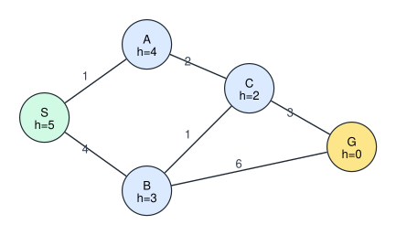
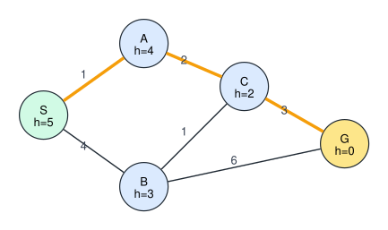

# A* Search 1: Cost So Far Plus Estimate to Go

A\* search expands the node with the lowest $f(n) = g(n) + h(n)$: the actual cost spent to reach it plus the estimated cost from it to the goal.

## Before you start
<!-- bite: 2baa92bb-e194-4356-a291-ef5647f90bec -->

Read [[artificial-intelligence/03-heuristic-search/03-greedy-best-first-search|Greedy Best-First Search]] and [[artificial-intelligence/02-uninformed-search/07-uniform-cost-search-1|Uniform-Cost Search 1]] first. A\* joins the two.

After this lesson you will be able to:

1. state A\*'s evaluation function and say what each part means;
2. trace A\* by hand on the slides' graph, computing $g$, $h$ and $f$ for every frontier node;
3. compare A\*, greedy search and uniform-cost search on the same graph: route, cost and nodes expanded;
4. list where A\* is used.

## What A* is
<!-- bite: b611386d-c431-4c4f-806e-5e50929c22c8 -->

Greedy search looked only ahead, at $h$, and ignored what it had paid. Uniform-cost search looked only behind, at $g$, and had no idea where the goal was. Each one is blind on one side.

A\* looks both ways. Your notes call it the "gold standard" of pathfinding: it combines the actual cost spent to reach a node with the estimated cost to the goal.

$$f(n) = g(n) + h(n)$$

1. $g(n)$ is the cost from the start node to node $n$. It's known exactly.
2. $h(n)$ is the estimated cost from $n$ to the goal. It's a heuristic.
3. $f(n)$ is then the estimated cost of the cheapest solution that passes through $n$.

A\* always expands the frontier node with the lowest $f$. It's pronounced "A-star".

## The kid version
<!-- bite: a843f925-d867-4319-b29e-922205acee4e -->

You're choosing between two bus routes to a friend's house. Route one: you've already spent ₦500 getting to a junction, and from there it's maybe ₦200 more. Route two: you've spent ₦100 so far, but from where you are it's maybe ₦900 more. Greedy you would pick the junction that's closer to your friend; careful you would add up "already spent" plus "still to spend" and pick the smallest total: ₦700 against ₦1,000. A\* is the careful you.

**Where the analogy stops working.** You'd know bus fares fairly well. A\* only has an *estimate* of the cost still to go. If that estimate is too high, A\* can be fooled into skipping the best route, and the next lesson shows exactly when that happens.

## The slides' graph
<!-- bite: ca6135f4-ed3d-4d15-8468-a583373a251a -->

Here's the graph from your course slides again. Step costs are on the edges, and $h$ is written in each node.

In the last lesson, greedy search went S → B → G for cost 10. Let's see what A\* does. Like uniform-cost search, A\* tests for the goal when a node comes *off* the frontier.

## Tracing A*, steps 1 and 2
<!-- bite: 2c7fdf4e-95eb-4f78-b050-eb31ad1ceb4e -->

For each frontier node, write $f = g + h$.

**Step 1.** Take S off ($g = 0$, $f = 0 + 5 = 5$). Expand it:

1. A: $g = 1$, $h = 4$, so $f = 5$.
2. B: $g = 4$, $h = 3$, so $f = 7$.

Frontier: **A 5, B 7**.

Greedy search went to B here, because $h(B) = 3$ is smaller. A\* sees that B has already cost 4, so its total estimate is 7, worse than A's 5.

**Step 2.** Take A off ($f = 5$). Expand it:

1. C: $g = 1 + 2 = 3$, $h = 2$, so $f = 5$.

Frontier: **C 5, B 7**.

## Tracing A*, steps 3 and 4
<!-- bite: 3df13d14-78fb-421c-8d44-a3c910f88721 -->

**Step 3.** Take C off ($f = 5$). Expand it:

1. G: $g = 3 + 3 = 6$, $h = 0$, so $f = 6$.
2. B via C: $g = 3 + 1 = 4$, the same as B's current $g$, so no change.

Frontier: **G 6, B 7**.

**Step 4.** Take G off ($f = 6$). It's the goal. Stop.

## The route A* returns
<!-- bite: 02e710a3-52e8-4256-9b83-abf3248b43c2 -->

Follow the parents back: G ← C ← A ← S. The route is **S → A → C → G, cost 6**, the cheapest route. B was never expanded: with $f = 7$, it couldn't possibly lead to anything cheaper than 6.

## Three methods, one graph
<!-- bite: 159c2e43-5456-4ebe-842d-6bc5bb279db6 -->

Your slides put the three best-first methods side by side on this graph:

| Method | Route | Cost | Nodes expanded |
|---|---|---|---|
| Greedy best-first | S → B → G | 10 | S, B (2) |
| Uniform-cost | S → A → C → G | 6 | S, A, C, B (4) |
| A\* | S → A → C → G | 6 | S, A, C (3) |

Read it row by row:

1. **Greedy** followed the smallest $h$ and ended with a costly path.
2. **Uniform-cost** is optimal, but it expanded B too, just because B was cheap to reach ($g = 4$), even though B leads nowhere useful.
3. **A\*** used $g$ and $h$ together, so it's optimal *and* expanded the fewest nodes of the optimal methods.

That's the whole case for A\*: the right answer, with less work than blind search.

## Why A* skipped B
<!-- bite: 01694de3-aebb-4371-9bfe-55a9319b899e -->

Look at B in the trace. Uniform-cost search ranks by $g$ alone, so B ($g = 4$) comes off before G ($g = 6$). A\* ranks by $f$, and $f(B) = 7 > f(G) = 6$, so the goal comes off first.

The heuristic told A\* that, from B, there is still at least 3 to go. So any route through B costs at least 4 + 3 = 7, worse than the 6 already found. A good heuristic lets A\* rule out nodes without expanding them. The better the heuristic, the more it rules out.

## Where A* is used
<!-- bite: 21287817-5d11-49ec-af57-e72cf44a3d3f -->

Your notes list four applications:

1. **Pathfinding in games**: moving characters around obstacles on a map.
2. **Robotics**: planning a robot's path through a room or warehouse.
3. **Bioinformatics**: aligning sequences of DNA, treated as a search for the cheapest alignment.
4. **Logistics**: planning delivery routes.

And the most familiar of all, from the slides: GPS and map apps use A\* and related methods to find the fastest or shortest route.

## Terms used in this lesson
<!-- bite: b996df18-d1ed-4a12-b85d-f064d61dd6b5 -->

1. **A\* search**: This is the best-first search that expands the node with the lowest $f(n) = g(n) + h(n)$.
2. **$f(n)$ in A\***: This is the estimated cost of the cheapest solution through $n$: the cost already paid to reach $n$ plus the estimated cost from $n$ to the goal.

## Common pitfalls and traps
<!-- bite: 13fc600a-e072-47ad-9473-0c9cab75eda5 -->

- **Using $h$ alone or $g$ alone in an A\* trace.** A\* always uses the sum. With $h$ alone it's greedy search; with $g$ alone it's uniform-cost search.
- **Stopping when the goal is first added.** Like uniform-cost search, A\* stops when the goal comes *off* the frontier.
- **Forgetting to update $g$ when a cheaper path appears.** If a new path to a frontier node has a lower $g$, its $f$ drops too, and its parent changes.

## Check your understanding
<!-- bite: 336d2c2c-3fa2-45ca-b73b-ccd26d651dea -->

Try each one before you open the answer.

1. <!-- q: exact id="18102a13" answer="13" -->
   A node $n$ has been reached with path cost $g(n) = 8$, and its heuristic is $h(n) = 5$. What is $f(n)$ in A\*?

   

Answer

   $f(n) = g(n) + h(n) = 8 + 5 = 13$.

   

2. <!-- q: exact id="b788f51b" answer="6" -->
   A graph has edges S–X 2, S–Y 9, X–G 4, Y–G 2. The heuristic is $h(S) = 6$, $h(X) = 4$, $h(Y) = 1$, $h(G) = 0$. A\* runs from S to G. What is the cost of the route it returns?

   

Answer

   6. From S: X has $f = 2 + 4 = 6$, Y has $f = 9 + 1 = 10$. Take X; add G with $g = 6$, $f = 6$. Take G (6 is smaller than Y's 10). Route S → X → G, cost 6. Greedy search on the same graph returns cost 11.

   

3. <!-- q: mcq id="c0d899fe" -->
   On the slides' graph, uniform-cost search expands B but A\* doesn't. Why?

   - [ ] B is not connected to G.
   - [x] A\* ranks B by $g + h = 7$, which is worse than the goal's 6, so the goal comes off first.
   - [ ] A\* never expands nodes with two neighbours.
   - [ ] Uniform-cost search ranks B by $h$.

   

Answer

   Uniform-cost search ranks by $g$ alone, and $g(B) = 4 < g(G) = 6$. A\* adds the heuristic: $f(B) = 4 + 3 = 7 > 6$, so G is taken off first and B is never expanded.

   

4. <!-- q: gap id="378f3409" answers="g(n)|g;h(n)|h" -->
   In A\*, $f(n) = $ ___ $+$ ___.

   

Answer

   $g(n) + h(n)$: the cost so far plus the estimated cost to go.

   

5. <!-- q: open id="45c26525" -->
   Explain why your notes call A\* the "gold standard" of pathfinding, using greedy search and uniform-cost search as the comparison.

   

Answer

   Greedy search uses only the estimate to the goal, so it's fast but can return an expensive route. Uniform-cost search uses only the cost so far, so it's optimal but explores in every direction. A\* uses both: the cost so far keeps it honest about what each route really costs, and the estimate steers it toward the goal. With a good heuristic, it finds the optimal route while expanding fewer nodes than uniform-cost search.

   

## Before moving on
<!-- bite: dc0f94b0-0273-4312-ae25-288e901c465d -->

You're done when you can trace A\* on a small graph with $g$, $h$ and $f$ written for every frontier node, and explain from the trace why it beats both greedy search and uniform-cost search.

Recap: A\* ranks nodes by $f(n) = g(n) + h(n)$, the estimated cost of the best solution through $n$. It tests for the goal when a node comes off the frontier. On the slides' graph it returns the optimal cost-6 route while expanding three nodes, where uniform-cost search expands four and greedy search returns cost 10.

Next, [[artificial-intelligence/03-heuristic-search/05-a-star-search-2|A\* Search 2]] runs A\* on the Lagos-to-Abuja map and answers the big question: when is A\* guaranteed to find the optimal route?

## Related
<!-- bite: 8565521e-01c0-4ded-a01b-d77e6c01d11e -->

- [[dsa/02-data-structures/09-graphs/index|Graphs]]: A\* alongside Dijkstra's algorithm.

## About this lesson
<!-- bite: 212499ac-6ae6-4b35-9d81-b2656758ccc3 -->

**Level:** introductory to intermediate. Lesson 4 of section 03 (heuristic search), part 1 of 2 on A\*. It covers A\*'s evaluation function, a full trace on the slides' graph, a comparison with greedy and uniform-cost search, and A\*'s applications.

**Source:** University of Lagos SSG 518 class notes, *A\* Search* (02/02/26: "gold standard", $f(n) = g(n) + h(n)$ and the applications), and the SSG 518 *Introduction to Search* slides (*Worked Example: A\* on a Small Graph* and its comparison table). The slide's graph was read from the edge labels on the slide; with the edge B–C costing 1, every number in the slide's table is reproduced, and `scripts/diagrams/ai_heuristic.py` asserts them.
