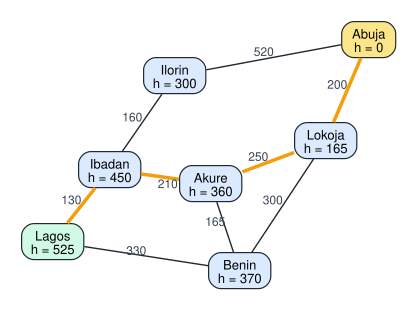

# A* Search 2: The Road Trip and When A* Is Optimal

On the Lagos-to-Abuja map, A\* finds the 790 km route, and it's guaranteed to find the optimal route whenever its heuristic never overestimates the true cost.

## Before you start
<!-- bite: 010298e7-4b04-4439-9a8a-dffd92271ac6 -->

Read [[artificial-intelligence/03-heuristic-search/04-a-star-search-1|A\* Search 1]] first. You need $f(n) = g(n) + h(n)$ and how to trace A\*.

After this lesson you will be able to:

1. trace A\* on the map to the 790 km route;
2. define an admissible heuristic and a consistent heuristic, and check each on a map;
3. show with an example how an overestimating heuristic makes A\* return the wrong route;
4. state A\*'s properties, including its weakness, memory.

## What this lesson covers
<!-- bite: 6cccd5b0-2132-4e01-a552-e77a09787069 -->

In part 1, A\* beat greedy search and uniform-cost search on the slides' small graph. Now two questions. First, does it find the 790 km route on our map? Second, and more important: can we *trust* it? Greedy search used a heuristic too, and got the wrong answer. What makes A\* different?

The answer is one rule about the heuristic, called **admissibility**. Your notes give it in one line: if $h(n)$ is admissible, A\* is both complete and optimal; it will find the shortest path if one exists.

## The kid version
<!-- bite: 145b3bd9-e085-49ef-a061-613428deb4cc -->

You're estimating how much it'll cost to finish building a house. If your estimates are always a bit *too low*, you'll never wrongly give up on a good plan: anything that looks cheap enough is worth checking, and you'll find the truly cheapest. But if you sometimes *overestimate*, you might throw away the cheapest plan because you thought it was dearer than it really was.

**Where the analogy stops working.** Too-low estimates are safe for correctness, but if they're *much* too low (say, always zero), you end up checking nearly every plan. A\* is fastest when its estimates are low but as close to the truth as possible.

## A* on the map, steps 1 to 3
<!-- bite: bc87d5b5-20d6-4f50-8cd5-15071aabbc6a -->

The straight-line distances to Abuja are Lagos 525, Ibadan 450, Benin 370, Akure 360, Ilorin 300, Lokoja 165, Abuja 0. For each node, $f = g + h$; ties go alphabetically.

**Step 1.** Take Lagos off ($f = 0 + 525$). Add Ibadan ($g$ 130, $f = 130 + 450 = 580$) and Benin ($g$ 330, $f = 330 + 370 = 700$).

Frontier: Ibadan 580, Benin 700.

**Step 2.** Take Ibadan off. Add Ilorin ($g$ 290, $f = 290 + 300 = 590$) and Akure ($g$ 340, $f = 340 + 360 = 700$).

Frontier: Ilorin 590, Akure 700, Benin 700.

**Step 3.** Take Ilorin off. Add Abuja ($g$ 810, $f = 810 + 0 = 810$).

Frontier: Akure 700, Benin 700, Abuja 810.

Abuja is on the frontier at 810, but two nodes have lower $f$, so A\* keeps going, exactly as uniform-cost search did.

## A* on the map, steps 4 to 7
<!-- bite: a18d023c-c54f-4f5f-9105-a1d9b4107b80 -->

**Step 4.** Take Akure off (ties with Benin; Akure is first alphabetically). Add Lokoja ($g$ 590, $f = 590 + 165 = 755$). Benin via Akure would have $g$ 505, worse than 330, so no change.

Frontier: Benin 700, Lokoja 755, Abuja 810.

**Step 5.** Take Benin off. Lokoja via Benin would have $g$ 630, worse than 590, so no change.

Frontier: Lokoja 755, Abuja 810.

## A* on the map, steps 6 and 7
<!-- bite: 06000a7b-7cad-48cf-9095-64150d6a8f6d -->

**Step 6.** Take Lokoja off. Abuja via Lokoja has $g$ 790, $f = 790$, better than 810. Update it.

Frontier: Abuja 790.

**Step 7.** Take Abuja off. Goal, at **790 km**.



## Why A* didn't save work on this map
<!-- bite: 20ac9d74-3bab-4002-9664-05cd4947a904 -->

Count the expansions: Lagos, Ibadan, Ilorin, Akure, Benin, Lokoja, Abuja. Seven, the same as uniform-cost search. On the slides' graph A\* saved work; here it didn't. Why?

Here's the rule: A\* expands every node whose $f$ is less than $C^*$, the optimal cost. Our optimal cost is 790, and every city on this small map has $f$ below 790. Even Benin, the "wrong" direction, has $f = 700$. There's simply no city on our map that's clearly off the route.

On a real map with hundreds of cities, the saving is huge. A city like Calabar, far to the south-east, would have a large $g$ *and* a large $h$, giving an $f$ well above 790, and A\* would never touch it. Uniform-cost search, ranking by $g$ alone, would expand every city closer than 790 km in any direction. The better the heuristic, the more nodes it pushes above $C^*$.

## Admissible heuristics
<!-- bite: d79692ea-36f6-40bc-b61e-7eb1e37c008f -->

A heuristic is **admissible** if it never overestimates the true cost to reach the goal. Written with $h^*(n)$ for the true cheapest cost from $n$ to the goal:

$$h(n) \le h^*(n) \quad \text{for every node } n$$

Check ours. The true road costs to Abuja (worked out by uniform-cost search from each city) are Lagos 790, Ibadan 660, Ilorin 520, Benin 500, Akure 450, Lokoja 200, Abuja 0. Every straight-line distance is below its road cost: Lagos 525 ≤ 790, Lokoja 165 ≤ 200, and so on. So straight-line distance is admissible, as it always is for road maps.

**Why does admissibility make A\* optimal?** When the goal comes off the frontier with cost $C^*$, every other frontier node $n$ has $f(n) \ge C^*$. Because $h$ never overestimates, $f(n) = g(n) + h(n)$ is never more than the true cost of the best route through $n$. So every route through those nodes costs at least $C^*$. Nothing cheaper is left.

## What an overestimate does
<!-- bite: cd2a9740-dcaa-4c0c-af31-8528c61ffcee -->

Let's break the rule on purpose. Say someone wrongly sets $h(\text{Akure}) = 700$, when Akure is really only 450 km from Abuja by road. Now at step 2, Akure gets $f = 340 + 700 = 1{,}040$.

Rerun the trace. After Ilorin adds Abuja at $f = 810$, the frontier is Benin 700, Abuja 810, Akure 1,040. Benin comes off and adds Lokoja via Benin ($g$ 630, $f$ 795). Lokoja comes off and offers Abuja at 830, worse than 810. Then Abuja comes off at **810**, and A\* stops with Lagos → Ibadan → Ilorin → Abuja.

The 790 km route went through Akure, and the overestimate made Akure look too expensive to bother with. One bad number, and A\* is no longer optimal. That's why admissibility is the rule to check.

## Consistent heuristics
<!-- bite: 146f01c2-4923-4025-bad6-0c8a298ff16f -->

Your slides give a stronger condition, **consistency** (also called **monotonicity**):

$$h(n) \le c(n, n') + h(n')$$

for every node $n$ and every successor $n'$, where $c(n, n')$ is the step cost between them. In words: the estimate from $n$ is never more than the cost of one step plus the estimate from where that step lands. It's a triangle inequality: going straight from $n$ to the goal can't look longer than going via $n'$.

Check one road: Ibadan to Ilorin. $h(\text{Ibadan}) = 450 \le 160 + h(\text{Ilorin}) = 160 + 300 = 460$. True. The script behind this lesson checks all nine roads in both directions, and the straight-line distances are consistent everywhere.

Your slides add two facts: a consistent heuristic is always admissible, and with graph search (an explored set, as in our traces) A\* needs a *consistent* heuristic to be sure of optimality. Admissible is enough for tree search.

## How good is A*?
<!-- bite: 2297c8f2-d0f5-46e0-973f-db570d8182a4 -->

1. **Complete?** Yes, if step costs are positive and $b$ is finite.
2. **Optimal?** Yes, if $h$ is admissible (tree search) or consistent (graph search).
3. **Time:** exponential in the worst case, but a good heuristic cuts it down enormously.
4. **Space:** it keeps every generated node in memory. This is A\*'s real weakness. On big problems, A\* usually runs out of memory before it runs out of time.

## A* in Python
<!-- bite: 4245429c-9e8b-4a9f-8fa3-8d4c88efa3b2 -->

Save this as `astar.py` and run `python3 astar.py`. Change `H` to try a bad heuristic.

```python
import heapq

ROADS = {("Lagos", "Ibadan"): 130, ("Lagos", "Benin"): 330, ("Ibadan", "Ilorin"): 160,
         ("Ibadan", "Akure"): 210, ("Benin", "Akure"): 165, ("Benin", "Lokoja"): 300,
         ("Ilorin", "Abuja"): 520, ("Akure", "Lokoja"): 250, ("Lokoja", "Abuja"): 200}
H = {"Lagos": 525, "Ibadan": 450, "Benin": 370, "Akure": 360,
     "Ilorin": 300, "Lokoja": 165, "Abuja": 0}   # straight-line km to Abuja

def neighbours(city):
    out = [(b, d) for (a, b), d in ROADS.items() if a == city]
    out += [(a, d) for (a, b), d in ROADS.items() if b == city]
    return sorted(out)

def astar(start, goal, h):
    g = {start: 0}
    parent = {start: None}
    frontier = [(h[start], start)]           # ordered by f = g + h
    done = set()
    while frontier:
        f, city = heapq.heappop(frontier)
        if city in done:
            continue                         # stale copy
        done.add(city)
        if city == goal:
            path = [city]
            while parent[path[-1]]:
                path.append(parent[path[-1]])
            return path[::-1], g[city], len(done)
        for nxt, km in neighbours(city):
            new_g = g[city] + km
            if nxt not in done and new_g < g.get(nxt, float("inf")):
                g[nxt], parent[nxt] = new_g, city
                heapq.heappush(frontier, (new_g + h[nxt], nxt))
    return None, None, len(done)

route, km, expanded = astar("Lagos", "Abuja", H)
print(" -> ".join(route), f"({km} km, {expanded} expanded)")
route, km, expanded = astar("Lagos", "Abuja", dict(H, Akure=700))
print(" -> ".join(route), f"({km} km, {expanded} expanded) with Akure overestimated")
```

## A* in Python: what it prints
<!-- bite: 9669a0dd-0f9e-4793-8f56-0c273ab7b40a -->

Run it, and it prints:

```
Lagos -> Ibadan -> Akure -> Lokoja -> Abuja (790 km, 7 expanded)
Lagos -> Ibadan -> Ilorin -> Abuja (810 km, 6 expanded) with Akure overestimated
```

The second line is the overestimate from earlier: fewer expansions, wrong answer.

## Terms used in this lesson
<!-- bite: f12e28d2-ff71-4153-8ea3-d80c70ad1fdb -->

1. **Admissible heuristic**: This is a heuristic that never overestimates the true cost to reach the goal: $h(n) \le h^*(n)$ for every $n$.
2. **$h^*(n)$**: This is the true cost of the cheapest path from $n$ to the goal.
3. **Consistent heuristic**: This is also known as a **monotone** heuristic. It's one where $h(n) \le c(n, n') + h(n')$ for every node and successor. Every consistent heuristic is admissible.
4. **$C^*$**: This is the cost of the optimal solution. A\* expands every node with $f(n) < C^*$.

## Common pitfalls and traps
<!-- bite: b30b19f8-ad58-4d07-af75-6dd10262ea61 -->

- **Thinking any heuristic makes A\* optimal.** Only an admissible one (consistent, with graph search). An overestimate can hide the best route.
- **Thinking admissible means accurate.** $h = 0$ everywhere is admissible, but it turns A\* into uniform-cost search. Good heuristics are admissible *and* close to the true cost.
- **Forgetting A\*'s memory cost.** It's optimal and often fast, but it stores every node it generates.

## Check your understanding
<!-- bite: 61320236-8054-45ff-8168-78dbde953521 -->

Try each one before you open the answer.

1. <!-- q: mcq id="f801444b" -->
   A heuristic is admissible if:

   - [ ] it is always exactly equal to the true cost to the goal
   - [x] it never overestimates the true cost to the goal
   - [ ] it never underestimates the true cost to the goal
   - [ ] it is larger for nodes nearer the goal

   <details><summary>Answer</summary>

   It never overestimates: $h(n) \le h^*(n)$. It can underestimate, and $h = 0$ at the goal.

   </details>

2. <!-- q: mcq id="ba9d48b2" -->
   The true cheapest costs to a goal are: P 12, Q 7, R 4, goal 0. Which heuristic is admissible?

   - [x] P 10, Q 7, R 3, goal 0
   - [ ] P 13, Q 6, R 4, goal 0
   - [ ] P 12, Q 8, R 2, goal 0
   - [ ] P 10, Q 5, R 4, goal 1

   <details><summary>Answer</summary>

   P 10, Q 7, R 3, goal 0: every value is at most the true cost. The second overestimates P (13 > 12), the third overestimates Q (8 > 7), and the fourth overestimates the goal (1 > 0).

   </details>

3. <!-- q: mcq id="3e54a026" -->
   Two neighbouring nodes M and N are joined by an edge of cost 4. The heuristic gives $h(M) = 10$ and $h(N) = 5$. Is the heuristic consistent on this edge, going from M to N?

   - [ ] Yes, because 10 is larger than 5
   - [x] No, because 10 is more than 4 + 5 = 9
   - [ ] Yes, because 10 is less than 4 × 5
   - [ ] It can't be checked without the goal

   <details><summary>Answer</summary>

   Consistency needs $h(M) \le c(M, N) + h(N)$, that is $10 \le 4 + 5 = 9$, which is false. So it isn't consistent there.

   </details>

4. <!-- q: exact id="89da2f8d" answer="755" -->
   On the Lagos-to-Abuja map, A\* reaches Lokoja through Akure with $g = 590$. Lokoja's straight-line distance to Abuja is 165. What is Lokoja's $f$ value?

   <details><summary>Answer</summary>

   $f = 590 + 165 = 755$.

   </details>

5. <!-- q: open id="05e8b845" -->
   Explain why an admissible heuristic guarantees that the first goal A\* takes off the frontier is optimal.

   <details><summary>Answer</summary>

   When the goal comes off with cost $C^*$, every node still on the frontier has $f \ge C^*$, because A\* always takes the lowest $f$ first. With an admissible heuristic, $f(n) = g(n) + h(n)$ never overestimates the true cost of the best route through $n$, so the true cost of any route through those nodes is at least $f(n) \ge C^*$. So no cheaper route can be waiting.

   </details>

6. <!-- q: open id="ff950038" -->
   A\* expanded seven cities on the Lagos-to-Abuja map, the same as uniform-cost search. Why didn't the heuristic save any work here, and why would it on a large map?

   <details><summary>Answer</summary>

   A\* expands every node with $f$ below the optimal cost, 790. On this small map, every city has $f$ under 790, even Benin at 700, so A\* had to expand them all. On a large map, many cities would be far from the route, with both a large $g$ and a large $h$, pushing their $f$ above 790. A\* would skip all of them, while uniform-cost search would still expand every city it can reach for under 790 km, in every direction.

   </details>

## Before moving on
<!-- bite: c40c2921-d847-4ede-9683-2dcba8fbf8b3 -->

You're done when you can trace A\* on the map to 790 km, define and check admissibility and consistency, and explain with the Akure example what an overestimate does.

Recap: A\* finds the 790 km route on the map. It's optimal when $h$ is admissible (never overestimates), or consistent for graph search, which straight-line distance is. A\* expands every node with $f < C^*$, so a good heuristic saves work by pushing nodes above $C^*$. Overestimating can hide the best route. A\*'s weakness is memory.

Next, [[artificial-intelligence/03-heuristic-search/06-heuristics-for-the-8-puzzle|Heuristics for the 8-Puzzle]] shows how to invent admissible heuristics for a problem that isn't a map, and how much a better heuristic is worth.

## Related
<!-- bite: 35c4b1f1-4bc9-420c-8e72-1bcdb2c848aa -->

- [[artificial-intelligence/02-uninformed-search/08-uniform-cost-search-2|Uniform-Cost Search 2]]: the same map, without a heuristic.

## About this lesson
<!-- bite: cf9d59cb-cbb2-4d23-995d-4952a43c7fb7 -->

**Level:** intermediate. Lesson 5 of section 03 (heuristic search), part 2 of 2 on A\*. It covers a full A\* trace on the map, admissibility and why it gives optimality, an overestimate's effect, consistency, A\*'s properties, and its code.

**Source:** University of Lagos SSG 518 class notes, *A\* Search* (02/02/26: "if $h(n)$ is admissible, A\* is both complete and optimal"), and the SSG 518 *Introduction to Search* slides (admissible and consistent definitions, and "consistent implies admissible"). The trace, the true road costs, the consistency check on all nine roads and the overestimate example are computed and asserted by `scripts/diagrams/ai_heuristic.py`; the Python example was run and its output is copied exactly.
