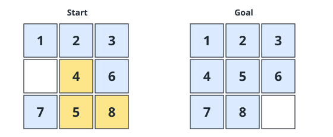
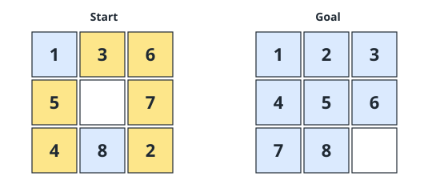

# Heuristics for the 8-Puzzle

The 8-puzzle has two classic admissible heuristics, and the one closer to the truth makes A\* far faster.

## Before you start
<!-- bite: 1cf58b3f-89bf-4762-8522-6bb8e10e61bd -->

Read [[artificial-intelligence/03-heuristic-search/05-a-star-search-2|A\* Search 2]] first. You need admissibility. The 8-puzzle was introduced in [[artificial-intelligence/01-foundations/06-problem-solving-in-ai|Problem Solving in AI]].

After this lesson you will be able to:

1. compute the misplaced-tiles heuristic $h_1$ and the Manhattan-distance heuristic $h_2$ for any 8-puzzle state;
2. explain why both are admissible, using the idea of a relaxed problem;
3. say what it means for one heuristic to dominate another, and why the dominant one is better;
4. read the effect of a better heuristic from real node counts.

## What this lesson is about
<!-- bite: 3fa1e35c-72e6-4cb3-bdce-80938c49b742 -->

For maps, the heuristic was easy: straight-line distance. But most problems aren't maps. What's the "distance to the goal" for a sliding-tile puzzle?

Your slides give two answers for the 8-puzzle: the number of misplaced tiles, or the sum of Manhattan distances. This lesson computes both, shows why both are safe to use with A\*, and measures how much better the second one is. Along the way you'll learn a general trick for inventing heuristics for any problem.

## The kid version
<!-- bite: 3e1fc239-451f-4dff-a9c4-3408211fdd83 -->

You're tidying a bookshelf where every book has a numbered place. One way to guess how much work is left: count the books in the wrong place. A better guess: for each wrong book, count how many shelf-spaces it is from where it belongs, and add those up. A book one space away is a small job; a book on the far end is a big one. The second guess tells you more, so you waste less time.

**Where the analogy stops working.** On a bookshelf you can lift a book straight to its place. In the 8-puzzle, tiles can only slide into the empty square, and they block each other, so the real number of moves is usually more than either guess.

## Heuristic 1: misplaced tiles
<!-- bite: f22847bc-fbd4-434d-a3a5-6ab85f8db6fe -->

**$h_1$ = the number of tiles that aren't in their goal position.** The blank doesn't count.

Here's a start state next to the goal. The shaded tiles are out of place.

Tiles 1, 2, 3, 6 and 7 are home. Tiles 4, 5 and 8 aren't. So $h_1 = 3$.

**Why is it admissible?** Every misplaced tile needs at least one move to get home. So you need at least $h_1$ moves, and $h_1$ never overestimates.

## Heuristic 2: Manhattan distance
<!-- bite: 8553144a-6aee-4308-b2e5-de43db74ff9e -->

**$h_2$ = the sum, over all tiles, of how many rows plus how many columns each tile is from its goal position.** It's called **Manhattan distance** (or city-block distance) because it's how far you'd walk in a city laid out in a grid: along streets, never diagonally.

For the same start state: tile 4 is one column right of its goal (1), tile 5 is one row below its goal (1), tile 8 is one column right of its goal (1). The rest are home (0). So $h_2 = 1 + 1 + 1 = 3$.

Here, both heuristics say 3, and the true answer is also 3: slide 4 left, 5 up, 8 left. Both are spot on. On harder states they come apart.

## A harder state
<!-- bite: f85d3315-c917-4d62-9c7c-598f48e91cd6 -->

Here's a state that is 12 moves from the goal.

**$h_1$:** tiles 1 and 8 are home; 2, 3, 4, 5, 6 and 7 aren't. $h_1 = 6$.

## Manhattan distance for the harder state
<!-- bite: 5f4d6ef5-6433-446f-9bbb-6a348f4a3be8 -->

Now **$h_2$** for the same state, tile by tile:

1. Tile 3 is one column from home: 1.
2. Tile 6 is one row from home: 1.
3. Tile 5 is one column from home: 1.
4. Tile 7 is one row and two columns from home: 3.
5. Tile 4 is one row from home: 1.
6. Tile 2 is two rows and one column from home: 3.

$h_2 = 1 + 1 + 1 + 3 + 1 + 3 = 10$.

The true cost is 12. Both heuristics underestimate, as admissible heuristics should, but $h_2 = 10$ is much closer than $h_1 = 6$.

## Relaxed problems
<!-- bite: c0c8d3da-4264-496b-83e1-c72c28ec6262 -->

Where do heuristics like these come from? There's a neat trick: **relax the rules.** Make a simpler version of the problem by removing a restriction, and use the exact cost of solving the simpler version as your heuristic.

The 8-puzzle rule is: a tile can move to an adjacent square, *if that square is blank*.

1. Drop *both* conditions, so a tile can jump anywhere in one move. Then each misplaced tile takes exactly one move: that's $h_1$.
2. Drop only "if that square is blank", so a tile can slide to any adjacent square even if it's occupied. Then each tile takes exactly its Manhattan distance: that's $h_2$.

A relaxed problem has *more* possible moves than the real one, so its solutions can only be shorter or equal. That's why a heuristic made this way is always admissible. Straight-line distance for maps is the same trick: relax "you must drive on roads".

## Dominance
<!-- bite: 9cdf10ce-a35a-4148-9dad-e55e07e6481c -->

For every state, $h_2 \ge h_1$. A tile that's misplaced adds 1 to $h_1$ but at least 1 to $h_2$. When one admissible heuristic is always at least as large as another, we say it **dominates** the other. Your slides put it this way: if $h_2(n) \ge h_1(n)$ for all $n$, then $h_2$ dominates $h_1$, and better heuristics expand fewer nodes.

Why does bigger mean better? Remember from the last lesson that A\* expands every node with $f(n) < C^*$. A larger admissible $h$ makes $f$ larger, pushing more nodes above $C^*$, and those nodes are never expanded. As long as it stays admissible, a larger heuristic can only help.

## What a better heuristic is worth
<!-- bite: 21b96dbf-f486-437d-9f0c-55c292bcc2ed -->

Here's A\* run on the 12-move state above with three heuristics. These are real counts from the program behind this lesson:

| Heuristic | Nodes expanded | Solution length |
|---|---|---|
| $h = 0$ (uniform-cost search) | 2,327 | 12 |
| $h_1$, misplaced tiles | 119 | 12 |
| $h_2$, Manhattan distance | 36 | 12 |

All three find the same 12-move solution, because all three are admissible. But the work drops from 2,327 nodes with no heuristic, to 119 with $h_1$, to 36 with $h_2$: about 65 times less work than no heuristic at all. On deeper puzzles the gap grows into millions.

The exact counts depend on small details, such as how ties are broken, but the pattern doesn't: the dominant heuristic always does at least as well.

## Terms used in this lesson
<!-- bite: a3e77987-f55f-43c2-b95a-9db2213a4ed7 -->

1. **Misplaced-tiles heuristic ($h_1$)**: This is the number of tiles not in their goal position, not counting the blank.
2. **Manhattan distance ($h_2$)**: This is also known as **city-block distance**. For each tile, it's the number of rows plus the number of columns between its position and its goal position; $h_2$ adds these up over all tiles.
3. **Relaxed problem**: This is a version of a problem with some of its rules removed, so it's easier to solve. Its exact solution cost is an admissible heuristic for the original.
4. **Dominance**: One admissible heuristic dominates another if it's at least as large for every state. The dominant heuristic never makes A\* expand more nodes.

## Common pitfalls and traps
<!-- bite: 8a426ab3-f540-44a3-8aea-85deb7efa475 -->

- **Counting the blank as a misplaced tile.** The blank isn't a tile; leave it out of both heuristics.
- **Using diagonal distance.** Tiles move only up, down, left and right, so distance is rows plus columns.
- **Thinking bigger is always better.** Bigger is better only while the heuristic stays admissible. A heuristic that overestimates can make A\* miss the optimal solution.

## Check your understanding
<!-- bite: 966925fd-6ea5-4daa-93e5-3ac94cdbb4a3 -->

Try each one before you open the answer.

1. <!-- q: exact id="66afa17f" answer="4" -->
   An 8-puzzle state reads, row by row: 2 1 3 / 4 5 6 / 8 7 _ (with _ the blank). The goal is 1 2 3 / 4 5 6 / 7 8 _. What is the misplaced-tiles heuristic $h_1$?

   

Answer

   4. Tiles 2 and 1 are swapped, and tiles 8 and 7 are swapped. Tiles 3, 4, 5 and 6 are home.

   

2. <!-- q: exact id="af93d9a1" answer="4" -->
   For the same state, 2 1 3 / 4 5 6 / 8 7 _, what is the Manhattan-distance heuristic $h_2$?

   

Answer

   4. Tiles 2 and 1 are each one column from home (1 each), and tiles 8 and 7 are each one column from home (1 each). The others are home. 1 + 1 + 1 + 1 = 4.

   

3. <!-- q: exact id="79d1c554" answer="4" -->
   An 8-puzzle state reads _ 2 3 / 4 5 6 / 7 8 1, with the goal 1 2 3 / 4 5 6 / 7 8 _. What is the Manhattan-distance heuristic $h_2$?

   

Answer

   4. Only tile 1 is out of place. It's in the bottom-right corner and belongs in the top-left: 2 rows and 2 columns away, so its Manhattan distance is 4.

   

4. <!-- q: mcq id="85cfa40b" -->
   Why is the misplaced-tiles heuristic admissible?

   - [ ] Because it is always equal to the true number of moves
   - [x] Because every misplaced tile needs at least one move, so the true number of moves is at least the number of misplaced tiles
   - [ ] Because it counts the blank
   - [ ] Because it is larger than the Manhattan distance

   

Answer

   Each misplaced tile must move at least once, so you can't solve the puzzle in fewer moves than there are misplaced tiles. It never overestimates.

   

5. <!-- q: open id="bf324df4" -->
   Explain what it means that $h_2$ dominates $h_1$, and why A\* with $h_2$ expands fewer nodes.

   

Answer

   $h_2$ dominates $h_1$ because, for every state, $h_2 \ge h_1$, and both are admissible. A\* expands every node with $f = g + h$ below the optimal cost. A larger $h$ gives a larger $f$, so more nodes end up with $f$ at or above the optimal cost and are never expanded. On a 12-move puzzle, A\* expanded 119 nodes with $h_1$ but only 36 with $h_2$.

   

## Before moving on
<!-- bite: 36820b9a-74ab-40b9-a14b-78ec96d3a956 -->

You're done when you can compute $h_1$ and $h_2$ for any state, explain why both are admissible using relaxed problems, and explain dominance with the node counts.

Recap: $h_1$ counts misplaced tiles; $h_2$ adds up each tile's Manhattan distance. Both come from relaxing the puzzle's rules, so both are admissible. $h_2 \ge h_1$ everywhere, so $h_2$ dominates and A\* expands fewer nodes with it: 36 against 119 (and 2,327 with no heuristic) on a 12-move puzzle.

Next, [[artificial-intelligence/03-heuristic-search/07-hill-climbing-1|Hill Climbing 1]] changes the question. Instead of searching for a path, it looks for the best state, and keeps almost nothing in memory.

## Related
<!-- bite: 38f4f53b-d948-4a3e-b497-9e04589b7ae4 -->

- [[artificial-intelligence/01-foundations/06-problem-solving-in-ai|Problem Solving in AI]]: the 8-puzzle's formulation.

## About this lesson
<!-- bite: 8d9f79e4-494d-4fe3-8ea8-edfebe2b839f -->

**Level:** intermediate. Lesson 6 of section 03 (heuristic search). It covers the misplaced-tiles and Manhattan-distance heuristics, relaxed problems, dominance, and measured node counts.

**Source:** University of Lagos SSG 518 *Introduction to Search* slides (*Informed (Heuristic) Search*: the two 8-puzzle heuristics and dominance). The heuristic values, the 12-move solution and the node counts are computed and asserted by `scripts/diagrams/ai_heuristic.py`, which runs A\* on the 8-puzzle with each heuristic.
