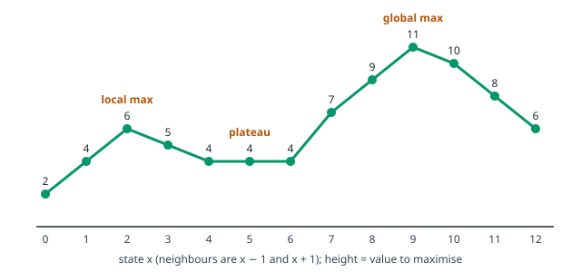

# Hill Climbing 1: Climbing to the Nearest Peak

Hill climbing is a local search method that keeps one current state and repeatedly moves to the best neighbouring state, stopping when no neighbour is better.

## Before you start
<!-- bite: e0726768-c02a-4682-94d6-e802e591b4e3 -->

Read [[artificial-intelligence/03-heuristic-search/02-generate-and-test|Generate and Test]] first. Hill climbing is generate-and-test with feedback.

After this lesson you will be able to:

1. explain what local search is, and when the path to the goal doesn't matter;
2. run hill climbing by hand on a small landscape;
3. name and recognise its three traps: local maxima, plateaus and ridges;
4. describe random-restart hill climbing and when hill climbing is a good choice.

## What local search is
<!-- bite: e75270d3-528b-446a-9e38-984e225425d5 -->

Every method so far has searched for a **path**: the sequence of roads from Lagos to Abuja. But in many problems the path doesn't matter at all, only the final state does.

Think of an exam timetable. Nobody cares about the order in which you shuffled exams around to build it. They care whether the final timetable has clashes. Or placing eight queens on a chessboard so none attacks another: only the final board matters.

Your slides call these problems where only the final state matters, not the path to it. For them, we don't need a frontier or a search tree. We can keep just *one* state, and keep improving it. That's **local search**. It uses almost no memory and works on enormous problems, but it gives up the guarantee of finding the best answer.

## The kid version
<!-- bite: b9214d62-c60d-4bce-ba06-fa51b6582a50 -->

You're standing on a hillside in thick fog and you want to reach the top. You can't see the summit, only the ground right around your feet. So you feel which direction slopes upward most steeply and take a step that way. Then again. And again. When every direction around you slopes down, you stop: you're at a top.

**Where the analogy stops working.** In fog, you can't tell whether you're on the real summit or just a small bump on the side of the mountain. Hill climbing can't either. It stops at the first top it reaches, which may not be the highest.

## How hill climbing works
<!-- bite: 986abe36-b543-4b90-9890-b439b5d9a061 -->

To use hill climbing you need two things:

1. **An objective function**: a number to maximise for each state, such as "how good is this timetable?". (If you'd rather minimise something, like the number of clashes, just climb on its negative.)
2. **Neighbours**: the states you can reach from the current one with one small change, such as moving one exam to a different slot.

Then the algorithm, which your slides describe as "move to the best neighbouring state until none is better":

```
current ← a starting state
loop:
    neighbour ← the best neighbour of current
    if value(neighbour) ≤ value(current): return current
    current ← neighbour
```

It's generate-and-test where the test returns a score, and the generator uses the score to choose the next state.

## A landscape to climb
<!-- bite: 8069e4c5-b64e-405c-9146-01b5089ad216 -->

Here's a small problem drawn as a landscape. The states are the whole numbers 0 to 12. Each state's neighbours are the numbers either side of it, and its value (height) is shown above each point. We want the highest point.



The highest point is state 9, value 11. Let's see whether hill climbing finds it, starting from three different places.

## Three climbs
<!-- bite: 5e5c1977-2ba6-426c-88fa-971d91af5655 -->

**Start at state 7** (value 7). Neighbours: 6 (value 4) and 8 (value 9). Best is 8. Move. At 8, neighbours 7 (7) and 9 (11). Move to 9. At 9, neighbours 8 (9) and 10 (10). Neither beats 11. Stop at **9, value 11**: the best answer.

**Start at state 0** (value 2). Climb to 1 (4), then 2 (6). At 2, neighbours 1 (4) and 3 (5): neither beats 6. Stop at **2, value 6**. Hill climbing is stuck on a small hill, nowhere near the top.

**Start at state 5** (value 4). Neighbours 4 and 6 both have value 4, no better. Stop *immediately* at **5, value 4**. It didn't move at all.

Same algorithm, three very different answers. Where you start decides where you end.

## The three traps
<!-- bite: bce50b25-bfc3-45cb-b84b-af530a61dfc9 -->

Those last two climbs show two of hill climbing's three classic traps. Your slides name all three:

1. **Local maximum.** A peak that's higher than all its neighbours but lower than the highest peak, the **global maximum**. State 2 is a local maximum. Hill climbing stops there because every step is downhill, even though higher ground exists elsewhere.
2. **Plateau.** A flat area where neighbours all have the same value. States 4 to 6 form a plateau. With no uphill direction, hill climbing has nothing to choose, and stops.
3. **Ridge.** A narrow upward ridge running diagonally to the directions you're allowed to move in. Each single allowed step goes downhill off the side of the ridge, so hill climbing stops, even though the ridge leads higher. You can't draw one on a one-dimensional landscape; picture a knife-edge mountain path where you can only step north, south, east or west.

## Getting out of the traps
<!-- bite: 7555f33c-99ab-474e-9410-cc09f4f2c8e9 -->

There are standard fixes:

1. **Random-restart hill climbing.** Run hill climbing many times from random starting states, and keep the best result. On our landscape, starts at 7 to 12 all reach the top, so a handful of random restarts will almost certainly find it.
2. **Sideways moves.** Allow a limited number of moves to equally good neighbours, to walk across a plateau. From state 5, a few sideways steps right would reach 6, then 7, and the climb resumes.
3. **Accept some downhill moves.** Occasionally take a worse step, to escape a local maximum. That's simulated annealing, lesson 10.

## How good is hill climbing?
<!-- bite: 5addb68b-ef5e-44f4-86bd-8f1826a54469 -->

1. **Complete?** No. It can get stuck before finding a solution.
2. **Optimal?** No. It returns the first peak it reaches.
3. **Time:** usually very fast; each step only looks at the current state's neighbours.
4. **Space:** tiny, just the current state.

Your slides sum it up: very fast and uses almost no memory, but it can get stuck on local maxima, plateaus and ridges. It's used for problems like the n-queens puzzle, timetabling and scheduling, circuit layout and the travelling salesman problem, where a good answer fast is worth more than the perfect answer slowly.

## Terms used in this lesson
<!-- bite: 39212712-191c-4cf2-a03f-11d6b5c55e02 -->

1. **Local search**: This is search that keeps only a current state and moves to neighbouring states, used when only the final state matters, not the path.
2. **Objective function**: This is the number being maximised (or minimised) for each state.
3. **Neighbour**: This is a state reachable from the current state by one small change.
4. **Hill climbing**: This is also known as **greedy local search**. It's local search that always moves to the best neighbour and stops when none is better.
5. **Global maximum**: This is the state with the highest value of all.
6. **Local maximum**: This is a state higher than all its neighbours but lower than the global maximum.
7. **Plateau**: This is a flat region where neighbouring states have equal value.
8. **Ridge**: This is a narrow rising region running across the allowed directions of movement, so every single step from it goes down.
9. **Random-restart hill climbing**: This is running hill climbing from many random starting states and keeping the best result.

## Common pitfalls and traps
<!-- bite: f49aad95-454f-4104-ab7b-1b46017824a0 -->

- **Thinking hill climbing finds the best state.** It finds a peak, and only the global maximum is guaranteed best.
- **Using hill climbing when you need a path.** It returns a final state, not a route.
- **Mixing up a plateau and a local maximum.** At a local maximum, neighbours are *lower*. On a plateau, they're *equal*.

## Check your understanding
<!-- bite: d2841304-492a-4d40-b49e-bc7ac3e90506 -->

Try each one before you open the answer.

1. <!-- q: exact id="f0922bf6" answer="3" -->
   States are the numbers 0 to 6, each state's neighbours are the numbers either side of it, and the values are: 0 → 1, 1 → 3, 2 → 5, 3 → 8, 4 → 6, 5 → 9, 6 → 2. Hill climbing starts at state 0. At which state does it stop?

   <details><summary>Answer</summary>

   3. It climbs 0 (1) → 1 (3) → 2 (5) → 3 (8). At 3, the neighbours are 2 (5) and 4 (6), both lower than 8, so it stops. State 3 is a local maximum: the global maximum is state 5, value 9.

   </details>

2. <!-- q: mcq id="1b4a4f4b" -->
   Hill climbing stops at a state where every neighbour has exactly the same value as the current state. Which trap is this?

   - [ ] A local maximum
   - [x] A plateau
   - [ ] A ridge
   - [ ] The global maximum

   <details><summary>Answer</summary>

   A plateau: the ground is flat, so there's no uphill direction to choose.

   </details>

3. <!-- q: mcq id="e3e6f4a3" -->
   For which problem does hill climbing fit best?

   - [ ] Finding the cheapest route from Lagos to Abuja
   - [x] Arranging exams into a timetable with as few clashes as possible
   - [ ] Proving that a route is the shortest possible
   - [ ] Finding every possible solution to a puzzle

   <details><summary>Answer</summary>

   The timetable: only the final arrangement matters, not the order of changes, and a good timetable quickly is useful. The route problem needs a path and an optimal guarantee; the last two need completeness.

   </details>

4. <!-- q: gap id="5bca6a3c" answers="random-restart|random restart;best" -->
   One fix for local maxima is ___ hill climbing: run it from many random starting states and keep the ___ result.

   <details><summary>Answer</summary>

   Random-restart hill climbing, keeping the best result.

   </details>

5. <!-- q: open id="59d7e8c6" -->
   Explain why hill climbing uses so little memory compared with A\*.

   <details><summary>Answer</summary>

   Hill climbing keeps only the current state and looks at its neighbours; it never stores a frontier, a search tree or the path it took. A\* keeps every node it generates on its frontier and explored set, so its memory grows with the size of the search.

   </details>

## Before moving on
<!-- bite: 521f237e-0224-422d-9666-1ae9d1de8044 -->

You're done when you can explain when local search fits, run hill climbing on a small landscape, name and recognise local maxima, plateaus and ridges, and describe random restarts.

Recap: local search keeps one state and improves it, for problems where only the final state matters. Hill climbing moves to the best neighbour until none is better: fast, tiny memory, but neither complete nor optimal. It gets stuck on local maxima, plateaus and ridges; random restarts and sideways moves help. On our landscape, starting at 7 finds the top (11), starting at 0 sticks at 6, and starting at 5 doesn't move.

Next, [[artificial-intelligence/03-heuristic-search/08-hill-climbing-2|Hill Climbing 2]] names the other regions of the landscape, including the shoulder, and the three types of hill climbing.

## Related
<!-- bite: 1570e2e7-c820-4217-ac95-2400e271adfc -->

- [[artificial-intelligence/03-heuristic-search/10-simulated-annealing|Simulated Annealing]]: hill climbing that sometimes steps downhill on purpose.
- [[operations-research/index|Operations Research]]: optimisation methods for the same kinds of problems.

## About this lesson
<!-- bite: 48183c67-b5ba-4ccb-af5f-8910c98dde75 -->

**Level:** introductory. Lesson 7 of section 03 (heuristic search), part 1 of 2 on hill climbing. It covers local search, the hill-climbing algorithm, three climbs on a small landscape, local maxima, plateaus and ridges, and how to escape them.

**Source:** University of Lagos SSG 518 class notes (hill-climbing search in the list of informed algorithms, 23/11/25) and the SSG 518 *Introduction to Search* slides (*Local Search and Optimisation*: hill climbing and its three traps, and the typical uses). The three climbs are computed and asserted by `scripts/diagrams/ai_heuristic.py`.
