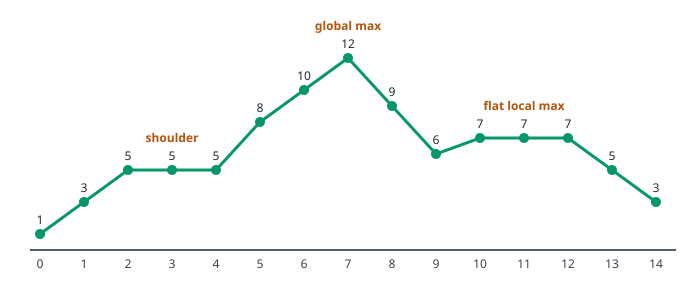

# Hill Climbing 2: Shoulders and the Three Types

Hill climbing comes in three types, and a landscape has more regions than peaks and plateaus.

## Before you start
<!-- bite: 9445b27e-65a5-4fba-92da-453034247f46 -->

Read [[artificial-intelligence/03-heuristic-search/07-hill-climbing-1|Hill Climbing 1]] first. You need the hill-climbing loop, local maxima, plateaus and ridges.

After this lesson you will be able to:

1. list the three features of hill climbing;
2. label a state-space landscape: global maximum, local maximum, flat local maximum, shoulder and current state;
3. say what simple, steepest-ascent and stochastic hill climbing each do, and pick the move each would make from a given state;
4. explain how sideways moves get hill climbing across a shoulder, and why they don't help on a flat local maximum.

## What this lesson adds
<!-- bite: c65438c9-e946-4df1-9c44-98e48af362db -->

Hill Climbing 1 gave you one version of hill climbing: look at the neighbours, move to the best one, stop when none is better. Your classmate's notes, which cover the same SSG 518 lecture, add three more things the exams like:

1. the **features** that make hill climbing what it is;
2. a fuller map of the **landscape**, with a region called the **shoulder**;
3. three **types** of hill climbing, which differ in how they pick the next move.

The old SSG 503 papers ask for short notes on "hill climbing, foothills, plateaus, ridges", so this is well-trodden exam ground. ("Foothills" is the old name for local maxima.)

## The kid version
<!-- bite: e526eacf-9082-4f84-b960-957b4286856c -->

Three friends are climbing a hill in the fog. The first takes the very first step she finds that goes up at all. The second feels every direction around her first, and takes the steepest. The third picks any upward direction at random. All three get higher, but they take different routes, and sometimes reach different tops.

**Where the analogy stops working.** On a real hill you can always feel *some* slope. In a state space there can be flat stretches with no slope at all, and then none of the three knows which way to go.

## The three features of hill climbing
<!-- bite: b48e76d3-5954-4f55-9e9d-a8c7be3690a2 -->

Your classmate's notes list them:

1. **A variant of generate-and-test.** It generates a neighbour, tests it, and uses the test's feedback (better or worse?) to decide which direction to move in the search space.
2. **Greedy.** It moves in the direction that improves the value most (or, for costs, reduces the cost most) right now.
3. **No backtracking.** It doesn't remember previous states, so it can never go back to try another route.

Those three features explain both its strength (fast, tiny memory) and its weakness (it can get stuck and can't recover).

## The regions of the landscape
<!-- bite: ffed9ead-dedc-441d-b9fc-e0e7691aa59c -->

Here's a landscape with all the regions your notes name. The states are 0 to 14; each state's neighbours are the numbers either side, and its height is its value.

## Naming the regions
<!-- bite: 690b42e7-126b-4929-9e61-7cc9597bc086 -->

Here are the regions in that picture:

1. **Global maximum**: the highest value of all, the best possible state. Here: state 7, value 12.
2. **Local maximum**: a state better than its neighbours, but with a higher state somewhere else.
3. **Flat local maximum**: a flat stretch at the top of a small hill: every state on it has equal neighbours, and the ground around it is lower. Here: states 10 to 12, value 7.
4. **Shoulder**: a plateau that has an uphill edge, a flat stretch partway up a slope that rises again further on. Here: states 2 to 4, value 5, which rises to 8 at state 5.
5. **Current state**: wherever the search is right now.

The shoulder and the flat local maximum are both flat, and that's the trap: plain hill climbing stops on any flat ground. But they're different. From a shoulder, there *is* higher ground if you keep walking. From a flat local maximum, there isn't.

## Climbing into a shoulder
<!-- bite: d4f01b96-779e-4ab6-93e6-c5136640f87e -->

Run plain hill climbing from state 0 (value 1). It climbs to 1 (value 3), then 2 (value 5). At state 2, the neighbours are 1 (value 3) and 3 (value 5). Neither is *better* than 5, so it stops at **state 2, value 5**: stuck on the shoulder, even though state 7 has 12.

## Sideways moves
<!-- bite: e04f93c2-f7e5-421f-a20a-1b5a089c7f86 -->

The fix for a shoulder is to allow **sideways moves**: moves to a neighbour with *equal* value, up to a fixed limit so the search can't wander forever.

Allow up to 3 sideways moves. From state 2, it steps sideways to 3 (value 5), then 4 (value 5). At 4, the neighbour 5 has value 8, uphill again, so the climb resumes: 5 (8), 6 (10), 7 (12). It stops at **state 7, the global maximum**.

Now start on the flat local maximum, at state 11. Sideways moves take it along to state 10 or 12, but both ends drop to lower ground, so there's nothing uphill anywhere. It stops at **value 7**, still stuck. Sideways moves rescue you from a shoulder, but not from a flat local maximum. For that you need random restarts or simulated annealing.

## The three types of hill climbing
<!-- bite: 5880a7d0-bed9-4aac-9bdd-f1c7340a6176 -->

The types differ only in **which uphill neighbour to move to**. Take a current state with value 5, whose neighbours are generated in this order with values 6, 9 and 7.

1. **Simple hill climbing**: check neighbours one at a time and move to the **first one that's better** than the current state. Here it checks 6 first: better than 5, so it moves there at once, without even looking at 9 or 7.
2. **Steepest-ascent hill climbing**: check **all** the neighbours and move to the **best** one. Here it looks at 6, 9 and 7, and moves to **9**.
3. **Stochastic hill climbing**: pick **at random** among the uphill neighbours. Here all three are uphill, so it moves to 6, 9 or 7 at random (it may weight the choice by how much each improves).

The version in Hill Climbing 1 was steepest-ascent.

## Comparing the three types
<!-- bite: dcf332b2-7ad0-475d-80b2-cfa5a235811f -->

| Type | Which move | Cost per step | Strength | Weakness |
|---|---|---|---|---|
| Simple | First better neighbour | Low: stops checking early | Fast when there are many neighbours | May take small steps and climb slowly |
| Steepest-ascent | Best of all neighbours | High: checks every neighbour | Biggest gain each step | Expensive when there are very many neighbours |
| Stochastic | Random uphill neighbour | Low to medium | Different runs explore different routes | Each step may be a small gain |

All three share the same traps: local maxima, plateaus and ridges. Stochastic hill climbing, run many times, behaves a bit like random restarts, because different runs take different routes.

## Terms used in this lesson
<!-- bite: d5a73f33-2ef1-481d-b5f7-a7184a6ce77d -->

1. **Global maximum**: This is the highest value in the whole state space.
2. **Flat local maximum**: This is a flat region at the top of a small hill, where every state has equal neighbours and the surroundings are lower.
3. **Shoulder**: This is a plateau with an uphill edge: a flat region partway up a slope that rises again further on.
4. **Sideways move**: This is a move to a neighbour with the same value, allowed a limited number of times to cross flat regions.
5. **Simple hill climbing**: This moves to the first neighbour found that is better than the current state.
6. **Steepest-ascent hill climbing**: This checks every neighbour and moves to the best.
7. **Stochastic hill climbing**: This moves to a randomly chosen uphill neighbour.

## Common pitfalls and traps
<!-- bite: 3fd614ee-56fe-4363-bb76-a55122e1ff53 -->

- **Mixing up a shoulder and a flat local maximum.** Both are flat, but a shoulder rises again further on; a flat local maximum doesn't.
- **Thinking simple hill climbing picks the best neighbour.** It picks the *first better* one. Steepest-ascent picks the best.
- **Allowing unlimited sideways moves.** On a flat local maximum, the search would walk back and forth forever. Always set a limit.

## Check your understanding
<!-- bite: f4400790-00c0-4048-98af-b3b8fda6c37a -->

Try each one before you open the answer.

1. <!-- q: mcq id="393c4442" -->
   A state has value 10. Its neighbours, in the order they're generated, have values 12, 15 and 11. Which neighbour does **simple** hill climbing move to?

   - [x] The one with value 12
   - [ ] The one with value 15
   - [ ] The one with value 11
   - [ ] It doesn't move

   

Answer

   12: simple hill climbing takes the first neighbour that is better, and 12 is checked first. Steepest-ascent would take 15.

   

2. <!-- q: exact id="654e7173" answer="15" -->
   Same state, value 10, with neighbours 12, 15 and 11. Which value does **steepest-ascent** hill climbing move to?

   

Answer

   15, the best of all the neighbours.

   

3. <!-- q: mcq id="b87b8ff3" -->
   On a landscape, a flat stretch of equal values sits partway up a slope, and further along it the values rise again. What is this region called?

   - [ ] A global maximum
   - [ ] A flat local maximum
   - [x] A shoulder
   - [ ] A ridge

   

Answer

   A shoulder: a plateau with an uphill edge. A flat local maximum is a flat top with lower ground all around.

   

4. <!-- q: gap id="f1cd87a5" answers="generate-and-test|generate and test;greedy;backtracking|backtrack" -->
   The three features of hill climbing are: it's a variant of ___, it's ___, and it does no ___.

   

Answer

   Generate-and-test, greedy, and no backtracking.

   

5. <!-- q: open id="e8563297" -->
   Explain why allowing a few sideways moves helps hill climbing on a shoulder but not on a flat local maximum.

   

Answer

   On a shoulder, the flat stretch leads somewhere higher: a few sideways moves carry the search across the flat part until it reaches the uphill edge, and the climb resumes. On a flat local maximum, the flat stretch is surrounded by lower ground on every side, so sideways moves only walk along the top; there's no uphill edge to find, and the search still stops below the global maximum.

   

## Before moving on
<!-- bite: 78bcca76-1a14-4e7b-aabb-74f89a3c2af0 -->

You're done when you can list the three features, label every region of a landscape, say which move each type of hill climbing makes from a given state, and explain what sideways moves can and can't fix.

Recap: hill climbing is a greedy variant of generate-and-test with no backtracking. Landscapes have global maxima, local maxima, flat local maxima and shoulders. Simple hill climbing takes the first better neighbour, steepest-ascent the best, stochastic a random uphill one. Limited sideways moves cross a shoulder (state 2 reaches the top at 12), but not a flat local maximum (stuck at 7).

Next, [[artificial-intelligence/03-heuristic-search/09-beam-search|Beam Search]] keeps several states at once instead of one.

## Related
<!-- bite: 84e65a74-339b-4fef-b7d4-4ff36685265d -->

- [[artificial-intelligence/03-heuristic-search/10-simulated-annealing|Simulated Annealing]]: escaping local maxima by sometimes going downhill.

## About this lesson
<!-- bite: 9cc24971-c511-4459-b26b-33fdd8c2f20d -->

**Level:** introductory. Lesson 8 of section 03 (heuristic search), part 2 of 2 on hill climbing. It covers the features of hill climbing, the regions of a state-space landscape, sideways moves, and the three types of hill climbing.

**Source:** the SSG 518 classmate's notes on the hill-climbing algorithm (features, the state-space diagram with shoulder and flat local maximum, and the three types), and the SSG 503 2012/13 and 2014/15 papers (short notes on hill climbing, foothills, plateaus and ridges). The climbs are computed and asserted by `scripts/diagrams/ai_gaps.py`.
