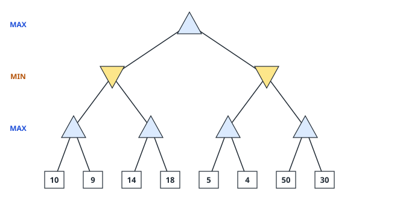

# Games as Search

Adversarial search is search in a world with an opponent, someone whose moves you don't control and who is trying to make you lose.

## Before you start
<!-- bite: 53067f41-ec7c-4e6c-bc83-6729819dbcfc -->

Read [[artificial-intelligence/02-uninformed-search/01-what-search-is|What Search Is]] first, for search trees. It helps to have read [[artificial-intelligence/01-foundations/06-types-of-problems-and-techniques|Types of Problems and Techniques]], where chess was the classic irrecoverable problem.

After this lesson you will be able to:

1. explain what changes when a search problem has an opponent;
2. describe a game formally: players, moves, terminal states and utility;
3. draw a game tree with MAX and MIN levels, and say what a ply is;
4. estimate how big a game tree is, and say why we can't search all of chess.

## What adversarial search is
<!-- bite: c99b47b0-21f1-4e36-b0ee-6923935d3e7e -->

In every search so far, you were the only one acting. Drive from Lagos to Ibadan, and you're in Ibadan. Nobody moved you back to Lagos while you weren't looking.

Games aren't like that. In draughts, chess or tic-tac-toe, you make a move, and then your opponent makes one, and their aim is the exact opposite of yours. You can't plan a fixed path to victory, because you don't know what they'll do. You have to plan for every reply they might make.

Search with an opponent is called **adversarial search** (an *adversary* is an opponent). It's the agents-and-environments idea from section 01, with a **multi-agent** environment where the other agent is working against you.

## The kid version
<!-- bite: 2d63c339-5862-4a30-afdd-f6611cbdd238 -->

Planning a road trip is like walking through a maze alone. Playing a game is like walking through a maze where, every time you choose a turning, your little brother gets to choose the next one, and he wants you to get lost. You can't just find a path; you have to find a path that works *whatever he picks*. So you think: "if I go left, the worst he can do is send me here, and from there I can still get out." That's adversarial search.

**Where the analogy stops working.** A little brother might pick randomly or make mistakes. Adversarial search usually assumes the opponent plays *perfectly*, always choosing the move that's worst for you. That's a safe assumption: if they play worse, you only do better.

## The kind of games we study
<!-- bite: 722f0aa6-bc59-4d96-9e35-dba0fc5041d1 -->

The classic methods work on a particular kind of game. Each word in the description matters:

1. **Two players**, taking turns.
2. **Zero-sum**: whatever one player wins, the other loses. If I win, you lose; if it's a draw, nobody gains. There's no outcome that's good for both.
3. **Deterministic**: no dice or random cards. A move always has the same result.
4. **Perfect information**: both players can see the whole game at all times, like a chessboard. (Card games, where you can't see the other hands, aren't.)

Chess, draughts, tic-tac-toe and ayo (the Yoruba name for the mancala game, also called oware) all fit. Ludo doesn't, because of the dice.

## A game as a search problem
<!-- bite: 08b5baca-8d28-4f45-a8b7-52836bfc911e -->

A game can be formulated just like the problems in section 01, with a few changes:

1. **Initial state**: the starting position, and whose turn it is.
2. **Players**: which player is to move in each state.
3. **Actions**: the legal moves in a state.
4. **Transition model**: the position each move leads to.
5. **Terminal test**: is the game over? States where it's over are **terminal states**.
6. **Utility function**: a number for each terminal state, saying how good it is for the player we're helping. Your class notes say these values represent the outcome of the game: win, lose or draw. For example: +1 for a win, 0 for a draw, −1 for a loss.

The goal test is replaced by the terminal test, and the path cost by the utility.

## MAX and MIN
<!-- bite: c147d2e0-de45-4dc6-a73c-614668e6af51 -->

We call the two players **MAX** and **MIN**, and your notes describe each:

1. **MAX**, the maximising player, aims to maximise their score or utility value. MAX chooses the move that leads to the highest possible utility, assuming the opponent will play optimally.
2. **MIN**, the minimising player, aims to minimise MAX's score. MIN chooses the move that leads to the lowest possible utility, assuming the opponent will play optimally.

There's only *one* utility number, always measured from MAX's point of view. A big number is good for MAX and bad for MIN. Because the game is zero-sum, MIN doesn't need its own score: it just wants MAX's to be as low as possible.

## The game tree
<!-- bite: 12f9ac9a-d7cc-4437-9d45-bff64d0e5e96 -->

As with route finding, we search by building a tree. Your notes describe it: create a tree representing all possible moves from the current game state; each node represents a game state, and each edge represents a possible move.

The difference is that the levels alternate. The root is MAX's turn; the next level is MIN's turn; then MAX again; and so on down to the leaves, which are terminal states labelled with their utility.

## Reading the notes' tree
<!-- bite: b78f6f8e-9aba-4a91-945d-4b71a4f93347 -->

This is the tree from your notes, shown above. MAX nodes are drawn pointing up and MIN nodes pointing down. One level of the tree, one player's single move, is called a **ply**. This tree is 3 plies deep: MAX moves, MIN replies, MAX moves again, and the game ends. The next lesson works out what MAX should do here.

## How big game trees get
<!-- bite: 8a3a0c41-dec4-4e03-b8f4-c26913a1cc04 -->

Game trees grow just like search trees, as $b^m$, where $b$ is the number of legal moves and $m$ is how many moves the game lasts.

**Tic-tac-toe** is small. The first player has 9 choices, the next 8, and so on, so there are at most $9! = 362{,}880$ ways to play. Many games end early with a win, so the exact number of different complete games is **255,168**. A computer can search all of them in a moment, which is why a computer never loses at tic-tac-toe: played perfectly by both sides, it's always a draw.

**Chess** is another matter. A position has about 35 legal moves, and a game often lasts about 100 plies (50 moves each). That's about $35^{100}$, roughly $10^{154}$ positions in the tree. There are only about $10^{80}$ atoms in the observable universe. No computer will ever search the whole chess tree.

So for real games we need two tricks: stop searching at some depth and *estimate* how good the position is, and skip the parts of the tree that can't change the answer. Those are lessons 03 and 04.

## Terms used in this lesson
<!-- bite: f89cf361-e1c4-4243-bbe4-6e0b9f8dfa1e -->

1. **Adversarial search**: This is search in an environment with an opponent who works against you, such as a two-player game.
2. **Zero-sum game**: This is a game where one player's gain is exactly the other's loss, so the two players' payoffs always add up to the same total.
3. **Perfect information**: This means both players can see the whole state of the game at all times.
4. **Terminal state**: This is a state where the game is over.
5. **Utility function**: This is also known as the **payoff function**. It gives a number for each terminal state, from MAX's point of view, such as +1 win, 0 draw, −1 loss.
6. **MAX**: This is the player trying to maximise the utility. MAX moves at the root.
7. **MIN**: This is the opponent, trying to minimise MAX's utility.
8. **Game tree**: This is the search tree of a game, with levels alternating between MAX's moves and MIN's moves, and utilities at the leaves.
9. **Ply**: This is one level of a game tree: a single move by one player.

## Common pitfalls and traps
<!-- bite: dc24d453-9bc2-4d79-98fb-ebb49342b1f2 -->

- **Giving MIN its own utility.** There's one utility, from MAX's side. MIN wants it low.
- **Counting a "move" as both players.** In game-tree language, one ply is one player's move. Two plies are a move and a reply.
- **Forgetting the assumptions.** The basic methods assume two players, zero-sum, deterministic, perfect information. Ludo and poker need extensions.

## Check your understanding
<!-- bite: 4e9ccfcd-68b1-4a8f-a706-65c6ff37ba16 -->

Try each one before you open the answer.

1. <!-- q: mcq id="bf1e0bd1" -->
   Which games fit the classic adversarial-search assumptions: two players, zero-sum, deterministic, perfect information? (choose all that apply)

   - [x] Chess
   - [x] Tic-tac-toe
   - [ ] Ludo
   - [ ] Poker
   - [x] Draughts

   

Answer

   Chess, tic-tac-toe and draughts. Ludo uses dice, so it isn't deterministic. Poker hides the other players' cards, so it isn't perfect information.

   

2. <!-- q: gap id="d6da1cfc" answers="maximise|maximize|increase;minimise|minimize|reduce" -->
   In a game tree, MAX tries to ___ the utility and MIN tries to ___ it.

   

Answer

   MAX maximises and MIN minimises the same utility, which is measured from MAX's side.

   

3. <!-- q: exact id="f2597d26" answer="4" -->
   A game tree has MAX at the root and goes MAX, MIN, MAX, MIN, then the leaves. How many plies deep is it?

   

Answer

   4. Each of the four levels above the leaves is one player's move, one ply.

   

4. <!-- q: mcq id="c2648b85" -->
   A game has about 10 legal moves in every position and lasts 6 plies. About how many leaves does its full game tree have?

   - [ ] 60
   - [ ] 10,000
   - [x] 1,000,000
   - [ ] 6,000,000

   

Answer

   $10^6 = 1{,}000{,}000$: 10 choices at each of 6 plies.

   

5. <!-- q: open id="08bdf0bc" -->
   Why can't you use A\* to choose a move in chess the way you used it to find a route from Lagos to Abuja?

   

Answer

   A\* plans a whole path assuming every action is yours and has a known result. In chess, every other move is the opponent's, chosen to make you lose, so you can't fix a path in advance: you need a plan that works against every reply. Adversarial search looks at all of the opponent's possible replies and assumes they'll pick the one that's worst for you. And the chess tree is far too big to search to the end anyway.

   

## Before moving on
<!-- bite: eed58cd6-044c-4b1d-90fa-6bfa26d69114 -->

You're done when you can name the four assumptions of classic games, formulate a game with its six parts, draw a small game tree with MAX and MIN levels, and explain why the full chess tree can't be searched.

Recap: adversarial search plans against an opponent. Classic games are two-player, zero-sum, deterministic and perfect-information. A game has an initial state, players, actions, a transition model, a terminal test and a utility, measured from MAX's side. The game tree alternates MAX and MIN levels; one level is a ply. Tic-tac-toe has 255,168 games; chess has about $10^{154}$ positions.

Next, [[artificial-intelligence/04-adversarial-search/02-minimax-1|Minimax 1]] gives MAX a way to choose the best move in a game tree, assuming MIN plays perfectly.

## Related
<!-- bite: 9485a653-6621-424f-b147-e4dde43589a7 -->

- [[artificial-intelligence/01-foundations/04-agents-and-environments|Agents and Environments]]: multi-agent environments.
- [[artificial-intelligence/01-foundations/03-foundations-and-history-of-ai|Foundations and History of AI]]: Deep Blue, the chess machine that beat the world champion in 1997.

## About this lesson
<!-- bite: 2262a9b5-8277-493c-a807-a5d746eaf555 -->

**Level:** introductory. Lesson 1 of section 04 (adversarial search). It covers what makes search adversarial, the classic game assumptions, the formal parts of a game, MAX and MIN, game trees and plies, and the size of game trees.

**Source:** University of Lagos SSG 518 class notes, *The Minimax and Alpha-Beta Algorithms and Heuristic Approaches to State Space Search Problem* (10/03/26: the players involved, generating the game tree, evaluating terminal states). The tic-tac-toe game count is computed by brute force, and the chess estimate checked, by `scripts/diagrams/ai_games.py`.
