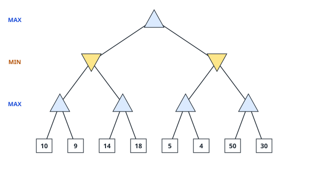
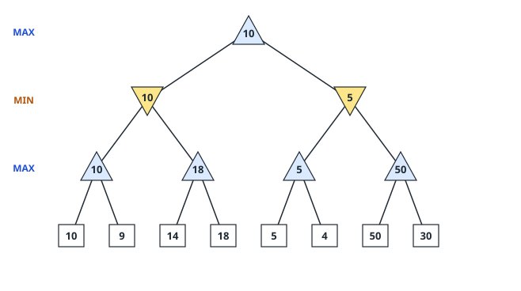

# Minimax 1: Choosing the Best Move

Minimax chooses the move with the best result for you, assuming your opponent always replies with the move that's worst for you.

## Before you start
<!-- bite: 417b9fb9-af74-4702-9d3f-2b75bbe75e9f -->

Read [[artificial-intelligence/04-adversarial-search/01-games-as-search|Games as Search]] first. You need game trees, MAX and MIN, and utility.

After this lesson you will be able to:

1. explain the minimax idea, and where its name comes from;
2. list the four steps of the minimax algorithm from your class notes;
3. back up minimax values by hand through a game tree, level by level;
4. read MAX's best move and the game's value from the root.

## What minimax is
<!-- bite: 33f0aba6-175e-4a00-a739-0796867ed683 -->

Your notes define it: minimax is a decision rule used in artificial intelligence, particularly in game theory and computer games. It is designed to **minimise the possible loss in a worst-case scenario** (hence "min") and **maximise the potential gain** (hence "max"). When dealing with gains, it's called "maximin": maximise the minimum gain.

In plain words: for each move you could make, ask "what's the worst my opponent can do to me after this?". Then pick the move whose worst case is the best. You're not hoping the opponent blunders; you're planning for them to play perfectly.

## The kid version
<!-- bite: 5b1284bb-e4b2-45d6-93df-6cf448625754 -->

You and your sister are sharing out sweets. You get to pick one of two bags, and then she gets to take out the biggest sweet from whichever bag you picked. Bag A has sweets of sizes 10 and 9; bag B has 18 and 4. If you're greedy, you'd want bag B for the 18. But she'll take the 18, leaving you the 4! With bag A, she takes the 10 and leaves you the 9. So you pick bag A: its worst case (9) beats bag B's worst case (4). That's minimax: pick the option whose worst outcome is best.

**Where the analogy stops working.** Here there's only one choice each. In a real game tree, choices alternate for many levels, so you work out the worst case at the bottom first and pass it up, level by level.

## The four steps
<!-- bite: 367673f2-d7ff-48d0-a888-0b6247ec4f47 -->

Your notes give the algorithm as four steps, executed recursively until the optimal move is found:

1. **Generate the game tree.** Build a tree of all possible moves from the current state.
2. **Evaluate the terminal states.** Give every leaf its utility value: win, lose or draw, or a score.
3. **Propagate utility values upwards.** Starting from the leaves, pass values up the tree. At each non-terminal node:
   1. if it's MAX's turn, take the **maximum** value of its children;
   2. if it's MIN's turn, take the **minimum** value of its children.
4. **Select the optimal move.** At the root, the **maximising** player picks the move leading to the child with the highest value.

## A correction, and the minimax value
<!-- bite: 03f6e135-e302-4841-a745-ee8388547612 -->

One correction to the notes: step 4 in the notes says the *minimising* player chooses at the root. The root is MAX's turn, and MAX chooses the highest value, which is what the notes' own example does.

The value a node gets in step 3 is its **minimax value**: the utility MAX gets from that position if both players play perfectly from there on.

## Backing up the notes' tree, bottom level
<!-- bite: c5d14bff-d981-4570-9bf7-b04901573458 -->

Here's the tree from your notes. Leaves, left to right: 10, 9, 14, 18, 5, 4, 50, 30.

Start just above the leaves. These four nodes are MAX nodes, so each takes the **larger** of its two leaves:

1. Over 10 and 9: max is **10**.
2. Over 14 and 18: max is **18**.
3. Over 5 and 4: max is **5**.
4. Over 50 and 30: max is **50**.

## Backing up the notes' tree, upper levels
<!-- bite: 24b51e00-a4ff-43d7-87ec-f09fd738ca45 -->

Next level up: two MIN nodes. Each takes the **smaller** of its two children.

1. Left MIN node, over 10 and 18: min is **10**.
2. Right MIN node, over 5 and 50: min is **5**.

Predict before reading on: what's the value at the root, and which way should MAX move?

The root is MAX, over 10 and 5: max is **10**.

## Reading the answer
<!-- bite: effff361-c642-4589-aa4e-3099121fcb96 -->

The root's value is 10, and it came from the **left** child. So MAX's best move is **left**, and if both sides play perfectly, MAX ends with **10**.

Look at what MAX *didn't* do. The biggest leaf in the whole tree is 50, on the right. A greedy MAX might go right, hoping for it. But on the right, MIN would steer toward the 5 (choosing the left grandchild), and MAX would end up with only 5. Going left guarantees 10 whatever MIN does. That's the point of minimax: it doesn't chase the best case, it secures the best *worst case*.

And notice that the 18 on the left side is never reached either. MIN, on the left, will choose the branch leading to 10, not 18.

## Terms used in this lesson
<!-- bite: 687f6cc2-a9f1-4c3f-8c6a-1464792e9ffe -->

1. **Minimax**: This is the decision rule that chooses the move maximising your outcome, assuming the opponent always replies to minimise it.
2. **Maximin**: This is the same rule described in terms of gains: maximise the minimum gain.
3. **Minimax value**: This is the utility MAX will get from a position if both players play perfectly from there on. A MAX node's value is the maximum of its children's; a MIN node's is the minimum.
4. **Backing up**: This means passing values from the leaves up the tree, taking a max or a min at each level.

## Common pitfalls and traps
<!-- bite: f7d555d5-7567-4c25-8214-4fc8f09acd88 -->

- **Taking max at every level.** Alternate: max at MAX levels, min at MIN levels. Check which level you're on before each step.
- **Choosing the move toward the biggest leaf.** MAX can't reach a leaf just by wanting it; MIN gets a say. Choose by the backed-up values.
- **Letting MIN choose at the root.** The root is always MAX's turn in these trees. (Your notes have a slip here.)

## Check your understanding
<!-- bite: 6b232a2d-ba94-44e1-9a30-e7f2fbc3f8a1 -->

Try each one before you open the answer.

1. <!-- q: exact id="9b7a77a3" answer="5" -->
   A game tree has a MAX root with three MIN children. The first MIN node's leaves are 4 and 7; the second's are 2 and 9; the third's are 6 and 5. What is the minimax value of the root?

   

Answer

   5. The MIN nodes take 4, 2 and 5. The root, MAX, takes the largest: 5. MAX should play the third move.

   

2. <!-- q: mcq id="0ade4847" -->
   In the same tree (MIN nodes over 4, 7 / 2, 9 / 6, 5), the biggest leaf is 9, under the second MIN node. Why doesn't MAX play the second move?

   - [ ] Because 9 is an odd number
   - [x] Because MIN would reply with the move leading to 2, so MAX would only get 2
   - [ ] Because MAX always plays the first move
   - [ ] Because the second move is not legal

   

Answer

   After the second move, it's MIN's choice, and MIN picks the smaller leaf, 2. MAX only gets 9 if MIN blunders, and minimax assumes it won't.

   

3. <!-- q: gap id="77950797" answers="maximum|max|highest|largest;minimum|min|lowest|smallest" -->
   When backing up values, a MAX node takes the ___ of its children's values, and a MIN node takes the ___.

   

Answer

   A MAX node takes the maximum; a MIN node takes the minimum.

   

4. <!-- q: exact id="ccf25d35" answer="7" -->
   A tree has a MAX root with two MIN children. The left MIN node has two MAX children, over leaves 3, 7 and 8, 1. The right MIN node has two MAX children, over leaves 2, 6 and 4, 5. What is the value of the root?

   

Answer

   Work it out level by level. MAX nodes: max(3, 7) = 7, max(8, 1) = 8, max(2, 6) = 6, max(4, 5) = 5. MIN nodes: min(7, 8) = 7, min(6, 5) = 5. Root: max(7, 5) = 7.

   

5. <!-- q: open id="7e0c7af9" -->
   Your notes say minimax minimises the possible loss in a worst-case scenario. Using the notes' tree (root value 10, right branch containing the leaf 50), explain what this means.

   

Answer

   MAX could go right, where the biggest leaf, 50, is. But after that move MIN chooses, and MIN would steer toward the branch worth 5, so the worst case on the right is 5. On the left, the worst MIN can do is hold MAX to 10. Minimax compares worst cases, 10 against 5, and goes left, guaranteeing 10 no matter how MIN plays.

   

## Before moving on
<!-- bite: 9d5d6271-a983-4521-8b3b-c7da4c7cc38e -->

You're done when you can list the four steps, back up values through any small tree level by level, and read off MAX's best move and the game's value.

Recap: minimax picks the move whose worst case is best, assuming a perfect opponent. Give the leaves their utilities, then back values up: max at MAX nodes, min at MIN nodes. At the root, MAX takes the move to the highest child. On the notes' tree the root is 10, and MAX goes left, even though the biggest leaf, 50, is on the right.

Next, [[artificial-intelligence/04-adversarial-search/03-minimax-2|Minimax 2]] asks what minimax costs, and what to do in games like chess where you can't reach the leaves at all.

## Related
<!-- bite: e80dcd13-3387-4ec1-baae-6b458c810a62 -->

- [[machine-learning/08-other-architectures/06-rational-decision-making-1|Rational Decision Making 1]]: choosing by net benefit, the same kind of best-choice reasoning without an opponent.

## About this lesson
<!-- bite: bd2c1f18-1e95-4a2e-99fd-d725586817ee -->

**Level:** introductory. Lesson 2 of section 04 (adversarial search), part 1 of 2 on minimax. It covers the minimax idea, the four-step algorithm, and a full worked example on the class-notes tree.

**Source:** University of Lagos SSG 518 class notes, *Minimax Algorithms* (10/03/26: the definition, "max min", the players, the four steps and the example tree). One correction is made: the notes' step 4 names the minimising player at the root, but the notes' own example has MAX at the root choosing the highest value. Every backed-up value is computed and asserted by `scripts/diagrams/ai_games.py`.
