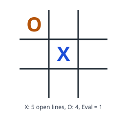

# Minimax 2: Cost, Cut-offs and Evaluation Functions

Minimax searches the whole game tree, so real games cut it off early and estimate the positions there.

## Before you start
<!-- bite: ee3ffffb-6917-42cd-8a6a-f5ddab11417a -->

Read [[artificial-intelligence/04-adversarial-search/02-minimax-1|Minimax 1]] first. You need to back up values through a tree. [[artificial-intelligence/02-uninformed-search/04-depth-first-search|Depth-First Search]] helps for the cost.

After this lesson you will be able to:

1. write minimax as a recursive function, and run it in Python on tic-tac-toe;
2. state minimax's properties: complete, optimal, $O(b^m)$ time and $O(bm)$ space;
3. explain depth-limited minimax and design a simple evaluation function;
4. describe the horizon effect.

## What this lesson covers
<!-- bite: 7b45aabd-8df5-43d5-9c49-f685fe292f4e -->

In part 1 you backed up values through a tree by hand, level by level. A program does the same thing, but recursively: to value a node, value its children first. That makes minimax a depth-first search, and it tells us what minimax costs.

The cost is the problem. For chess, the tree has about $10^{154}$ positions. So this lesson also covers the fix every real game program uses: stop at a fixed depth, and *estimate* the positions there instead of playing them out to the end.

## The kid version
<!-- bite: 5109f5c3-1208-4233-a951-dfb5c44e95f8 -->

When you play draughts with a friend, you don't think through every move to the end of the game. You think "if I move here, they'll probably take there, then I can jump two pieces", maybe three moves ahead, and then you just look at the board and judge: "I'll have more pieces, that's good for me." That last judgement is an evaluation function. Minimax with a cut-off is exactly how you already play.

**Where the analogy stops working.** You'd look further ahead in a tense moment and less in a quiet one. Basic depth-limited minimax looks exactly the same number of moves ahead everywhere, which causes the horizon effect described below.

## Minimax as a recursive function
<!-- bite: c5a69027-6000-4359-8ce7-803b6cc1c84e -->

Here's minimax written the way a program does it:

```
function minimax(state, player):
    if state is terminal:
        return utility(state)
    if player is MAX:
        return the maximum of minimax(child, MIN) over all children
    else:
        return the minimum of minimax(child, MAX) over all children
```

To value a node, it calls itself on each child, then takes the max or min. The calls go all the way down one branch to a leaf before coming back up, which is depth-first search, from section 02.

## How good is minimax?
<!-- bite: a4c790f9-ab17-4048-8485-f6300e55e55e -->

1. **Complete?** Yes, if the game tree is finite.
2. **Optimal?** Yes, against an opponent who also plays optimally. (Against a weaker opponent, it still never does worse than its minimax value.)
3. **Time:** $O(b^m)$. It visits every node in the tree, where $b$ is the number of legal moves and $m$ is the maximum depth.
4. **Space:** $O(bm)$. Like depth-first search, it only stores one path and its siblings at a time.

The space is fine. The time is what kills it. For chess, $b \approx 35$ and $m \approx 100$, which is hopeless.

## Minimax in Python: tic-tac-toe
<!-- bite: d8397580-78e5-48da-a46d-62f53855bf61 -->

Tic-tac-toe is small enough to search completely. This program finds the minimax value of the empty board and X's best first move. Save it as `ttt.py` and run `python3 ttt.py`.

```python
from functools import lru_cache

LINES = [(0, 1, 2), (3, 4, 5), (6, 7, 8), (0, 3, 6), (1, 4, 7), (2, 5, 8), (0, 4, 8), (2, 4, 6)]

def winner(b):
    for a, c, d in LINES:
        if b[a] != "." and b[a] == b[c] == b[d]:
            return b[a]
    return None

@lru_cache(maxsize=None)            # remember positions already valued
def minimax(b, player):
    w = winner(b)
    if w:                            # terminal: someone has won
        return 1 if w == "X" else -1
    if "." not in b:                 # terminal: board full, a draw
        return 0
    nxt = "O" if player == "X" else "X"
    values = [minimax(b[:i] + player + b[i + 1:], nxt) for i, c in enumerate(b) if c == "."]
    return max(values) if player == "X" else min(values)   # X is MAX, O is MIN

empty = "." * 9
print("value of the empty board:", minimax(empty, "X"))
for i in range(9):
    print("X plays square", i, "-> value", minimax(empty[:i] + "X" + empty[i + 1:], "O"))
```

## Minimax in Python: what it prints
<!-- bite: 77d73a69-b718-4f34-a7ea-d9d249fc6449 -->

Run it, and it prints:

```
value of the empty board: 0
X plays square 0 -> value 0
X plays square 1 -> value 0
X plays square 2 -> value 0
X plays square 3 -> value 0
X plays square 4 -> value 0
X plays square 5 -> value 0
X plays square 6 -> value 0
X plays square 7 -> value 0
X plays square 8 -> value 0
```

Every first move is worth 0: with perfect play from both sides, tic-tac-toe is always a draw. The `lru_cache` line stores the value of each position the first time it's worked out, so the same position reached by different move orders isn't searched twice.

## Cutting the search off
<!-- bite: b0ce0eab-f51d-427c-8d96-4b6d19314d10 -->

For chess you can't reach the leaves. So **depth-limited minimax** changes two things:

1. **A cut-off test** replaces the terminal test: stop when the game is over *or* when the search has gone a fixed number of plies deep.
2. **An evaluation function** replaces the utility at the cut-off: a quick estimate of how good the position is for MAX.

Then minimax runs exactly as before, backing up the estimates instead of true utilities. It's the same idea as a heuristic in section 03: an estimate standing in for something too expensive to compute exactly.

## Evaluation functions
<!-- bite: 6e1966b4-aef5-43f6-9d22-64c86f060490 -->

A good evaluation function is fast to compute and agrees with the true chances of winning. In chess, the classic one counts material: pawn 1, knight 3, bishop 3, rook 5, queen 9, and subtracts the opponent's total from yours.

## An evaluation function for tic-tac-toe
<!-- bite: df296be8-e992-4c67-9311-d3b49d399abc -->

For tic-tac-toe, a simple one counts **open lines**: rows, columns and diagonals that a player could still complete because the opponent has no mark in them.

$$\text{Eval} = (\text{open lines for X}) - (\text{open lines for O})$$



On this board, X has the centre and O a corner. X's open lines are the 8 lines minus the 3 through O's corner: 5. O's open lines are the 8 minus the 4 through the centre: 4. Eval = 5 − 4 = **1**, a slight edge to X. Taking the centre is good because it sits on 4 lines.

## The horizon effect
<!-- bite: cf024507-f1f2-4218-a167-8be5dadf86ee -->

Depth-limited minimax has a known weakness. It can only see as far as its cut-off, its **horizon**. Suppose that, just past the horizon, MAX is about to lose its queen. A program might play a pointless delaying move that pushes the loss *beyond* the horizon, where it can't see it, and judge the position fine. The loss still happens; the program just stopped seeing it.

This is the **horizon effect**. Real programs reduce it with **quiescence search**: when a position is "noisy" (pieces are about to be captured), they search a bit deeper before evaluating, and only cut off at quiet positions.

Your slides also mention **Monte Carlo tree search**, used in modern Go programs. Instead of an evaluation function, it estimates a position by playing many quick random games from it and counting how often each side wins.

## Terms used in this lesson
<!-- bite: 76cfc987-d4b8-4744-b917-d4c3bf9a0e07 -->

1. **Depth-limited minimax**: This is minimax that stops at a fixed depth and uses an evaluation function there instead of the true utility.
2. **Cut-off test**: This is the test for when to stop searching: the game is over, or the depth limit is reached.
3. **Evaluation function**: This is a quick estimate of how good a non-terminal position is for MAX, such as a material count in chess.
4. **Horizon effect**: This is when a depth-limited search fails to see a coming disaster because a delaying move pushes it just past the depth limit.
5. **Quiescence search**: This is searching deeper at unstable positions, such as mid-capture, so that positions are only evaluated when they're quiet.
6. **Monte Carlo tree search**: This is a game-tree search that estimates positions by playing many random games from them.

## Common pitfalls and traps
<!-- bite: ed75f4aa-486f-436a-b3f8-8d570a6b3dac -->

- **Thinking minimax's memory is the problem.** Its space is only $O(bm)$. Its *time*, $O(b^m)$, is the problem.
- **Treating an evaluation as a true result.** It's an estimate. The deeper the cut-off, the less it matters if the estimate is rough.
- **Writing an evaluation from the wrong side.** Like the utility, it's always measured for MAX: positive is good for MAX.

## Check your understanding
<!-- bite: d7446c29-0212-4f3a-8aeb-2b2837f21ca1 -->

Try each one before you open the answer.

1. <!-- q: exact id="268c41a7" answer="4" -->
   A tree has a MAX root with two MIN children. The left MIN node has two MAX children, over leaves 3, 1 and 8, 2. The right MIN node has two MAX children, over leaves 7, 6 and 0, 4. What is the minimax value of the root?

   <details><summary>Answer</summary>

   MAX nodes: max(3, 1) = 3, max(8, 2) = 8, max(7, 6) = 7, max(0, 4) = 4. MIN nodes: min(3, 8) = 3, min(7, 4) = 4. Root: max(3, 4) = 4.

   </details>

2. <!-- q: exact id="4f64af54" answer="4" -->
   A tic-tac-toe board has only an X in the centre. Using Eval = (open lines for X) − (open lines for O), what is the evaluation?

   <details><summary>Answer</summary>

   X's open lines: all 8, since O has no marks. O's open lines: the 4 lines not through the centre. 8 − 4 = 4.

   </details>

3. <!-- q: mcq id="7da39bbc" -->
   What are minimax's time and space complexity?

   - [x] Time $O(b^m)$, space $O(bm)$
   - [ ] Time $O(bm)$, space $O(b^m)$
   - [ ] Time $O(b^d)$, space $O(b^d)$
   - [ ] Time $O(b^{m/2})$, space $O(b)$

   <details><summary>Answer</summary>

   It searches the whole tree depth-first: $O(b^m)$ time, $O(bm)$ space, like depth-first search.

   </details>

4. <!-- q: gap id="4bef1f27" answers="evaluation function|evaluation|eval" -->
   In depth-limited minimax, positions at the cut-off are scored with an ___ instead of the true utility.

   <details><summary>Answer</summary>

   An evaluation function: a quick estimate of how good the position is for MAX.

   </details>

5. <!-- q: open id="6364925e" -->
   Explain the horizon effect, and one way to reduce it.

   <details><summary>Answer</summary>

   A depth-limited search can't see past its cut-off. If a loss is coming just beyond it, the program may make delaying moves that push the loss past the horizon and judge the position fine, even though the loss can't really be avoided. Quiescence search reduces this by searching deeper at unstable positions, such as during a series of captures, and only evaluating quiet positions.

   </details>

## Before moving on
<!-- bite: 588e95a3-cc07-41a2-ae2f-a1ab583ee264 -->

You're done when you can write minimax recursively, state its properties, design and compute a simple evaluation function, and explain the horizon effect.

Recap: minimax is a depth-first search of the game tree: complete and optimal, with $O(b^m)$ time and $O(bm)$ space. Tic-tac-toe is small enough to solve fully (it's a draw). For bigger games, depth-limited minimax stops at a fixed depth and uses an evaluation function, such as open lines in tic-tac-toe or material in chess. Stopping at a fixed depth causes the horizon effect.

Next, [[artificial-intelligence/04-adversarial-search/04-alpha-beta-pruning-1|Alpha-Beta Pruning 1]] makes minimax faster by skipping branches that can't change the answer, with the same result.

## Related
<!-- bite: 16ca93b2-8bd9-4b98-9812-03ba59d5b76e -->

- [[artificial-intelligence/03-heuristic-search/01-heuristics-and-heuristic-search|Heuristics and Heuristic Search]]: evaluation functions are heuristics for games.

## About this lesson
<!-- bite: b4680acf-9b78-41e9-9b4b-e37ceecaeedf -->

**Level:** intermediate. Lesson 3 of section 04 (adversarial search), part 2 of 2 on minimax. It covers recursive minimax with a runnable tic-tac-toe solver, its properties, depth-limited minimax, evaluation functions, the horizon effect and quiescence search.

**Source:** University of Lagos SSG 518 class notes (*Steps involved in the min-max algorithm*, 10/03/26) and the SSG 518 *Introduction to Search* slides (*Where Search Is Used*: minimax with alpha-beta pruning and Monte Carlo tree search for game playing). The evaluation values and tree values are computed and asserted by `scripts/diagrams/ai_games.py`; the Python example was run and its output is copied exactly.
