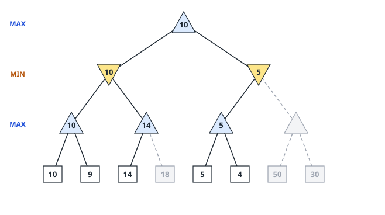

# Alpha-Beta Pruning 1: Skipping What Can't Matter

Alpha-beta pruning makes minimax faster by not exploring branches that cannot affect the final decision, and it always gives exactly the same answer as minimax.

## Before you start
<!-- bite: 5d7218bd-d86f-4ad9-925a-639d490b5986 -->

Read [[artificial-intelligence/04-adversarial-search/02-minimax-1|Minimax 1]] first. You need to back up minimax values through the class-notes tree.

After this lesson you will be able to:

1. define alpha and beta in the words of your class notes;
2. state the pruning rule, $\alpha \ge \beta$;
3. trace alpha-beta on the class-notes tree, writing $\alpha$ and $\beta$ at every step, and name the branches it prunes;
4. explain in plain words why each pruned branch couldn't have changed the answer.

## What alpha-beta pruning is
<!-- bite: dac19045-28f9-4534-b68b-ce6ed75614ce -->

Your notes put it in one sentence: alpha-beta pruning enhances the minimax algorithm by eliminating branches that do not affect the final decision.

Go back to the notes' tree. Minimax looked at all eight leaves. But some of those leaves never had a chance of mattering, and you can tell *before looking at them*. Alpha-beta spots those moments and skips the rest of the branch. That's called **pruning**, like cutting branches off a tree.

The answer doesn't change. Alpha-beta returns the same root value and the same best move as minimax, just with less work.

## The kid version
<!-- bite: 85140b22-de13-4a69-a644-64dc34b16076 -->

You're choosing between two market stalls for tomatoes, and you want the stall whose *worst* basket is best (you'll be handed whichever basket the seller picks). At the first stall you check every basket: the worst is 10 tomatoes. At the second stall, the very first basket you check has only 5. You stop right there. The second stall's worst basket is 5 or fewer, which is already worse than the first stall's 10. You don't need to see its other baskets.

**Where the analogy stops working.** In the market there are only two levels: you pick a stall, the seller picks a basket. In a game tree the levels keep alternating, so alpha and beta are passed down and updated at every level, not just the top two.

## Alpha and beta
<!-- bite: 3afcdf4a-0a16-40f2-8d8b-eeb9dc73d47b -->

Alpha-beta keeps two numbers as it searches, and your notes define both:

1. **Alpha ($\alpha$)**: the best value that the maximising player can guarantee so far. It starts at $-\infty$ and only goes up.
2. **Beta ($\beta$)**: the best value that the minimising player can guarantee so far. It starts at $+\infty$ and only goes down.

Think of them as two promises already in hand. MAX can already guarantee at least $\alpha$ somewhere else. MIN can already guarantee at most $\beta$ somewhere else.

And the rule, from your notes: during the search, **if $\alpha \ge \beta$, prune the remaining branches**.

Why? If MAX is already guaranteed at least $\alpha$, and on this branch MIN can hold MAX to at most $\beta$, with $\beta \le \alpha$, then neither player will ever let the game come down this branch. MAX has something at least as good elsewhere. So nothing left on this branch can matter.

## Tracing the left side
<!-- bite: 4b5f2b6f-7338-4efb-b485-17a3274b06e6 -->

Here's the notes' tree again: leaves 10, 9, 14, 18, 5, 4, 50, 30. Alpha-beta searches it left to right, depth-first, passing $\alpha$ and $\beta$ down to each child.

Start at the root (MAX) with $\alpha = -\infty$, $\beta = +\infty$, and go down to the left MIN node, then to its first MAX child.

1. **First MAX node** (leaves 10, 9). Leaf 10: value 10, so $\alpha = 10$. Leaf 9: value stays 10. Return **10**.
2. **Back at the left MIN node.** Its value so far is 10, so $\beta = 10$. MIN can now guarantee at most 10.
3. **Second MAX node** (leaves 14, 18), with $\alpha = -\infty$, $\beta = 10$ passed down. Leaf 14: value 14, so $\alpha = 14$. Now $\alpha = 14 \ge \beta = 10$. **Prune leaf 18.** Return **14**.
4. **Back at the left MIN node.** min(10, 14) = **10**. Return 10 to the root.

## Why 18 didn't matter
<!-- bite: f318c3d4-1370-43eb-aaec-9916d0ed00a8 -->

Step 3 is the first prune, so say it in words. The left MIN node already had a branch worth 10. The second MAX node had just found 14, and MAX nodes only go *up*, so its value would be at least 14, whatever leaf 18 said. MIN, choosing between "10" and "at least 14", will always pick 10. So 18 can't change MIN's choice, and alpha-beta never looks at it.

Check it against minimax: the second MAX node really was 18, but MIN still chose 10. Same answer.

## Tracing the right side
<!-- bite: 8dd19bce-1c20-4b03-a266-13856a1122d6 -->

Back at the root: its value so far is 10, so $\alpha = 10$. MAX can guarantee at least 10 by going left.

5. **Right MIN node**, with $\alpha = 10$, $\beta = +\infty$ passed down. Go to its first MAX child.
6. **Third MAX node** (leaves 5, 4), with $\alpha = 10$, $\beta = +\infty$. Leaf 5: value 5; $\alpha$ stays 10, because 5 is less than 10. Leaf 4: value stays 5. Return **5**.
7. **Back at the right MIN node.** Its value so far is 5, so $\beta = 5$. Now $\alpha = 10 \ge \beta = 5$. **Prune the whole fourth MAX node**, with leaves 50 and 30. Return **5**.
8. **Back at the root.** max(10, 5) = **10**. MAX goes left.

## Why the 50 didn't matter
<!-- bite: d996805d-aff8-402c-b4b8-67e06f67253f -->

Step 7 is the second prune. The root (MAX) already had 10 from the left. On the right, MIN had just found a branch worth 5, and MIN nodes only go *down*, so the right MIN node's value would be at most 5. MAX, choosing between "10" and "at most 5", picks 10. So the whole fourth MAX node, including the tempting 50, can't change MAX's choice.

Alpha-beta looked at 5 of the 8 leaves (10, 9, 14, 5, 4) and returned **10**, exactly what minimax returned after looking at all 8.

## Terms used in this lesson
<!-- bite: 31dafa18-328a-4f54-af04-5b40b07f4dda -->

1. **Alpha-beta pruning**: This is minimax with two bounds, alpha and beta, that let it skip branches which cannot affect the final decision. It returns the same value as minimax.
2. **Alpha ($\alpha$)**: This is the best value the maximising player can guarantee so far on the path to the current node. It starts at $-\infty$.
3. **Beta ($\beta$)**: This is the best value the minimising player can guarantee so far on the path to the current node. It starts at $+\infty$.
4. **Pruning**: This is skipping the remaining children of a node because they can't affect the result. The rule is: prune when $\alpha \ge \beta$.

## Common pitfalls and traps
<!-- bite: 30990288-8b3f-432e-bdbf-ebfa46fab520 -->

- **Thinking alpha-beta can give a different answer from minimax.** It never does. It only skips work.
- **Updating the wrong bound.** MAX nodes raise $\alpha$; MIN nodes lower $\beta$.
- **Forgetting to pass the bounds down.** Each child starts with its parent's current $\alpha$ and $\beta$. In step 3, the second MAX node started with $\beta = 10$ from its MIN parent, which is what let it prune.

## Check your understanding
<!-- bite: 3370bb3b-bb29-49cc-8d26-b398bbbde323 -->

Try each one before you open the answer.

1. <!-- q: gap id="ddd6a7ba" answers="maximising|maximizing|MAX|max;minimising|minimizing|MIN|min" -->
   Alpha is the best value the ___ player can guarantee so far, and beta is the best value the ___ player can guarantee so far.

   

Answer

   Alpha is for the maximising player; beta is for the minimising player.

   

2. <!-- q: mcq id="bb70a7f0" -->
   When does alpha-beta prune the remaining children of a node?

   - [ ] When $\alpha < \beta$
   - [x] When $\alpha \ge \beta$
   - [ ] When a leaf is negative
   - [ ] When the node has more than two children

   

Answer

   When $\alpha \ge \beta$: the players already have better options elsewhere, so the rest of this branch can't matter.

   

3. <!-- q: exact id="9f085a1e" answer="9" -->
   A game tree has a MAX root with two MIN children. The left MIN node's leaves are 6 and 8; the right MIN node's leaves are 3 and 9. Alpha-beta searches left to right. Which leaf is pruned?

   

Answer

   9. The left MIN node is worth 6, so the root has $\alpha = 6$. At the right MIN node, the first leaf, 3, gives $\beta = 3$. Now $\alpha = 6 \ge \beta = 3$, so the right MIN node is worth at most 3, worse than 6 for MAX, and its last leaf, 9, is pruned. The root's value is 6.

   

4. <!-- q: exact id="51752a35" answer="10" -->
   Minimax on the class-notes tree (leaves 10, 9, 14, 18, 5, 4, 50, 30) gives the root value 10. What root value does alpha-beta give on the same tree?

   

Answer

   10. Alpha-beta always gives the same value as minimax; it only examines fewer leaves (5 instead of 8 here).

   

5. <!-- q: open id="998864e9" -->
   On the class-notes tree, alpha-beta prunes the right-hand MAX node with the leaf 50, the biggest number in the tree. Explain in plain words why that's safe.

   

Answer

   By then, MAX at the root can already guarantee 10 by going left. On the right, MIN has found a reply worth only 5, and MIN will never pick anything better for MAX than that, so the whole right side is worth at most 5 to MAX. Since 5 is less than 10, MAX will go left whatever is in the last branch. The 50 could only be reached if MIN chose it, and MIN never would.

   

## Before moving on
<!-- bite: 9498ce9e-64ae-4696-8559-22e93e00286c -->

You're done when you can define alpha and beta, state the pruning rule, trace alpha-beta on a small tree writing the bounds at each step, and explain each prune in words.

Recap: alpha is the best MAX can guarantee so far; beta is the best MIN can guarantee so far. MAX nodes raise alpha, MIN nodes lower beta, and the bounds are passed down to children. When $\alpha \ge \beta$, the rest of the branch is pruned. On the notes' tree, alpha-beta prunes the 18 and the whole 50/30 branch, examines 5 of 8 leaves, and returns 10, the same as minimax.

Next, [[artificial-intelligence/04-adversarial-search/05-alpha-beta-pruning-2|Alpha-Beta Pruning 2]] traces a wider tree, shows that the order of the moves decides how much gets pruned, and works out how much faster alpha-beta can be.

## Related
<!-- bite: 4b530873-3077-40cf-ba62-7c09034412cd -->

- [[artificial-intelligence/04-adversarial-search/02-minimax-1|Minimax 1]]: the same tree, without pruning.

## About this lesson
<!-- bite: 238e8288-de23-4a16-b459-0d6b8df6aa58 -->

**Level:** intermediate. Lesson 4 of section 04 (adversarial search), part 1 of 2 on alpha-beta pruning. It covers alpha, beta and the pruning rule, and a full step-by-step trace on the class-notes tree with the reason for each prune.

**Source:** University of Lagos SSG 518 class notes, *Alpha-Beta Pruning Optimization* (10/03/26: the definition, alpha, beta, and "if $\alpha \ge \beta$, prune the remaining branches"). The trace, the pruned branches and the leaf count are computed and asserted by `scripts/diagrams/ai_games.py`.
