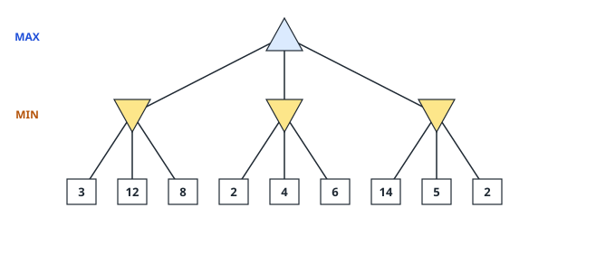
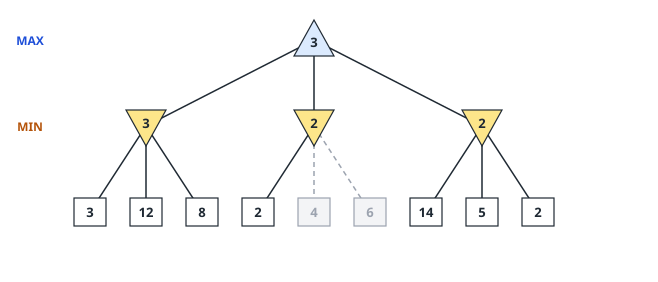
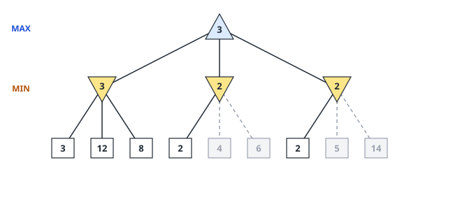

# Alpha-Beta Pruning 2: Move Ordering and How Much It Saves

How much alpha-beta prunes depends on the order in which moves are examined: with the best moves first, it can search about twice as deep as minimax in the same time.

## Before you start
<!-- bite: e92e4daf-2ce1-4816-b8b8-a8a223ad8966 -->

Read [[artificial-intelligence/04-adversarial-search/04-alpha-beta-pruning-1|Alpha-Beta Pruning 1]] first. You need alpha, beta and the pruning rule.

After this lesson you will be able to:

1. trace alpha-beta on a tree with three moves at each node;
2. show with an example that move ordering changes how much is pruned, but never the answer;
3. state alpha-beta's best-case time, $O(b^{m/2})$, and explain what it means for search depth;
4. write alpha-beta as a recursive function.

## What this lesson covers
<!-- bite: 2a5e16b9-fb74-4ef2-8d8f-d58e10aaeb44 -->

In part 1, alpha-beta pruned 3 of the 8 leaves in your notes' tree. Was that luck? Partly. The amount alpha-beta prunes depends on *when* it meets the good moves. Meet them early, and the bounds tighten fast and cut off a lot. Meet them late, and it prunes almost nothing.

This lesson shows that with one tree, examined in two different orders, and then works out how big the saving can get. It also finishes the subject's SSG 518 material.

## The kid version
<!-- bite: a039acb4-2ddf-4d6e-8d24-9af9fa1d775c -->

You're picking one of several bags of oranges, and your friend will hand you the *worst* orange from whichever bag you pick. So you want the bag whose worst orange is biggest. Say the first bag's worst orange is size 3: that's your bar. At every other bag, the moment you spot an orange smaller than 3, you stop checking that bag, because its worst is already below your bar. If the small oranges happen to sit on top of each bag, you stop almost at once. If they're hidden at the bottom, you dig through nearly everything.

**Where the analogy stops working.** With the oranges, you can't choose where the small ones sit. In a game you *can* choose the order you look at moves, and although you don't know the best move in advance, you can often guess well, for example by trying captures first in chess. A good guess is enough.

## A wider tree
<!-- bite: f7c18041-3c82-47cd-abd9-e4a3f9e5b201 -->

Here's a tree with three moves at each level: a MAX root and three MIN nodes, with leaves 3, 12, 8; 2, 4, 6; and 14, 5, 2.



Minimax first, quickly: the MIN nodes take 3, 2 and 2, so the root is 3, and MAX plays the first move.

## Tracing alpha-beta on it
<!-- bite: 9a02dfae-2a26-4478-809e-d5b1ab5a5ee7 -->

Search left to right, starting with $\alpha = -\infty$, $\beta = +\infty$.

1. **First MIN node.** Leaves 3, 12, 8: $\beta$ goes to 3 and stays there. Nothing to prune, since $\alpha$ is still $-\infty$. Value **3**. Back at the root, $\alpha = 3$.
2. **Second MIN node**, with $\alpha = 3$. Leaf 2: $\beta = 2$. Now $\alpha = 3 \ge \beta = 2$. **Prune 4 and 6.** Value **2**. (MIN can hold MAX to 2 here, and MAX already has 3 elsewhere.)
3. **Third MIN node**, with $\alpha = 3$. Leaf 14: $\beta = 14$; $3 < 14$, carry on. Leaf 5: $\beta = 5$; $3 < 5$, carry on. Leaf 2: $\beta = 2$. Value **2**. No leaves left to prune.
4. **Root:** max(3, 2, 2) = **3**.

## The natural order, pictured
<!-- bite: aa940d97-53fc-4ada-a5ff-f06449e4596a -->

Here's that search, with the pruned leaves greyed out.



Seven of the nine leaves examined. Only 4 and 6 were pruned. The third MIN node was unlucky: its low leaf, 2, came last.

## Changing the order
<!-- bite: e663d702-5e39-4a67-8f33-a931b5d8e170 -->

Now swap the order of the third MIN node's moves so its best reply for MIN comes first: 2, 5, 14 instead of 14, 5, 2. The game is the same; only the order we look at the moves has changed.

Steps 1 and 2 are unchanged. Step 3 becomes:

3. **Third MIN node**, with $\alpha = 3$. Leaf 2: $\beta = 2$. Now $\alpha = 3 \ge \beta = 2$. **Prune 5 and 14.** Value **2**.

## The better order, pictured
<!-- bite: b64ef21d-729f-419c-b4ae-510330ffe7d1 -->

Here's the search with the reordered moves.



The root is still **3**, and MAX still plays the first move. But now only **5** of 9 leaves are examined, instead of 7.

So move ordering never changes the answer, but it changes the work a great deal. The best order examines each player's best move first: at MAX nodes, the highest-valued move first; at MIN nodes, the lowest first.

## How much alpha-beta can save
<!-- bite: 52026f57-d074-4f50-ad54-049207aff28f -->

With the worst possible ordering, alpha-beta prunes nothing and costs the same as minimax: $O(b^m)$.

With perfect ordering, it can be shown that alpha-beta examines only about

$$O(b^{m/2})$$

nodes. That's the same square-root saving as bidirectional search in section 02, and it has a striking meaning. If minimax can afford to search 4 plies, alpha-beta with good ordering can search about **8 plies** in the same time. For chess, with $b \approx 35$: $35^4 = 1{,}500{,}625$ positions, and alpha-beta with perfect ordering reaches depth 8 for about that cost, where plain minimax would need $35^8 \approx 2.25$ trillion.

Twice the depth is a huge difference in playing strength. With random ordering, the saving is smaller, roughly $O(b^{3m/4})$, but still large. Real chess programs order moves cleverly (captures first, moves that were best last time first), and get close to the best case.

## Alpha-beta as a recursive function
<!-- bite: e70541f9-cb52-4dad-ba08-05c5da48fb36 -->

Here's alpha-beta as pseudocode. Compare it with minimax in [[artificial-intelligence/04-adversarial-search/03-minimax-2|Minimax 2]]: it's the same recursion, plus the two bounds and the prune.

```
function alphabeta(state, alpha, beta, player):
    if state is terminal or at the cut-off:
        return evaluate(state)
    if player is MAX:
        value ← −∞
        for each child of state:
            value ← max(value, alphabeta(child, alpha, beta, MIN))
            alpha ← max(alpha, value)
            if alpha ≥ beta: break          # prune the remaining children
        return value
    else:
        value ← +∞
        for each child of state:
            value ← min(value, alphabeta(child, alpha, beta, MAX))
            beta ← min(beta, value)
            if alpha ≥ beta: break          # prune the remaining children
        return value

call it as alphabeta(root, −∞, +∞, MAX)
```

## Minimax, alpha-beta and heuristics together
<!-- bite: e766818e-702d-41f3-bfec-62f6d530a482 -->

Your notes put minimax, alpha-beta and heuristic approaches to state-space search in one lecture title, and now you can see why they belong together. A real game program uses all three:

1. **Minimax** decides how to choose against a perfect opponent.
2. **Alpha-beta** skips branches that can't matter, so the search goes deeper.
3. **Heuristics** supply the evaluation function at the cut-off, and good move ordering, both of which are rules of thumb about the game.

That's how Deep Blue beat the world chess champion in 1997: minimax with alpha-beta, a carefully tuned evaluation function, and special hardware to search hundreds of millions of positions a second.

## Terms used in this lesson
<!-- bite: e725ca2c-ca2c-484e-a78e-013676489b11 -->

1. **Move ordering**: This is the order in which a node's moves are examined. It changes how much alpha-beta prunes, but never the result.
2. **Perfect ordering**: This means examining each player's best move first: the highest-valued move at MAX nodes, the lowest at MIN nodes. Alpha-beta then examines about $O(b^{m/2})$ nodes.
3. **Effective branching factor**: This is the branching factor a search behaves as if it had. Perfect ordering cuts it from $b$ to about $\sqrt{b}$, roughly 6 instead of 35 for chess.

## Common pitfalls and traps
<!-- bite: cb8c9074-2f14-446b-a65a-77b06744d15b -->

- **Thinking reordering changes the best move.** It changes only how many leaves are examined. The root value and best move are the same in every order.
- **Thinking alpha-beta always halves the work.** The $O(b^{m/2})$ figure is the *best* case, with perfect ordering. With bad ordering it saves nothing.
- **Forgetting the bounds on the way down.** In step 3, the third MIN node could prune only because it received $\alpha = 3$ from the root.

## Check your understanding
<!-- bite: 0d406435-f857-49ad-bb5e-ad19ef31d87d -->

Try each one before you open the answer.

1. <!-- q: exact id="598b955a" answer="7" -->
   A MAX root has three MIN children with leaves 5, 2, 7; 1, 8, 3; and 6, 4, 9. Alpha-beta searches left to right. How many of the 9 leaves does it examine?

   <details><summary>Answer</summary>

   7. First MIN node: 5, 2, 7, value 2, so $\alpha = 2$. Second: leaf 1 gives $\beta = 1 \le \alpha = 2$, so 8 and 3 are pruned. Third: 6 ($\beta$ 6), 4 ($\beta$ 4), 9 (stays 4), never $\le 2$, so all three are examined. Leaves examined: 5, 2, 7, 1, 6, 4, 9.

   </details>

2. <!-- q: exact id="7d000ddf" answer="4" -->
   In the same tree (5, 2, 7; 1, 8, 3; 6, 4, 9), what is the value of the root?

   <details><summary>Answer</summary>

   4. The MIN nodes are worth 2, 1 and 4, and MAX takes the largest. Pruning doesn't change it.

   </details>

3. <!-- q: mcq id="9ec6c721" -->
   You reorder the moves at every node of a game tree and run alpha-beta again. What can change?

   - [ ] The value at the root
   - [ ] MAX's best move
   - [x] The number of leaves examined
   - [ ] The minimax value of each leaf

   <details><summary>Answer</summary>

   Only the number of leaves examined. Alpha-beta always returns the minimax value, whatever the order.

   </details>

4. <!-- q: mcq id="d353641a" -->
   With perfect move ordering, roughly how deep can alpha-beta search in the time plain minimax searches 6 plies?

   - [ ] 3 plies
   - [ ] 6 plies
   - [x] 12 plies
   - [ ] 36 plies

   <details><summary>Answer</summary>

   About 12. Perfect ordering makes alpha-beta cost about $b^{m/2}$, so in the time minimax pays for $b^6$, alpha-beta can reach depth $m$ with $m/2 = 6$, that is $m = 12$.

   </details>

5. <!-- q: open id="eee756fe" -->
   Explain why examining the best move first at each node makes alpha-beta prune more.

   <details><summary>Answer</summary>

   Pruning happens when $\alpha \ge \beta$. Examining the best move first sets the tightest bound straight away: at a MAX node, the highest value raises $\alpha$ as far as it will go; at a MIN node, the lowest value drops $\beta$ as far as it will go. With tight bounds, the next branches hit $\alpha \ge \beta$ after their first move or two and the rest is pruned. If the best move comes last, the bounds stay loose until the end and almost nothing can be pruned.

   </details>

## Before moving on
<!-- bite: ad5a7c44-39bf-4f34-886c-a7c723928d06 -->

You're done when you can trace alpha-beta on a tree with three moves per node, show with a reordering that the work changes but the answer doesn't, and explain what $O(b^{m/2})$ means for depth.

Recap: on the 3-by-3 tree, alpha-beta examines 7 of 9 leaves in the natural order and 5 of 9 with the third node's best reply first, returning 3 both times. Move ordering never changes the answer but decides the saving. With perfect ordering alpha-beta costs about $O(b^{m/2})$, letting it search twice as deep as minimax. Minimax, alpha-beta and heuristic evaluation together are how real game programs play.

Next, [[artificial-intelligence/04-adversarial-search/06-nim|Nim]] solves a whole game from start to finish with minimax, a question straight from the past papers.

## Related
<!-- bite: 251b40ec-9ab5-4fed-bcf3-edd94db8298e -->

- [[artificial-intelligence/02-uninformed-search/09-bidirectional-search|Bidirectional Search]]: the same square-root saving, from searching two half-depth trees.

## About this lesson
<!-- bite: faba7bc1-c54e-431b-be2d-794709f43a7a -->

**Level:** intermediate. Lesson 5 of section 04 (adversarial search), part 2 of 2 on alpha-beta pruning. It covers a trace on a tree with three moves per node, move ordering, best-case complexity, pseudocode, and how minimax, alpha-beta and heuristics work together.

**Source:** University of Lagos SSG 518 class notes, *The Minimax and Alpha-Beta Algorithms and Heuristic Approaches to State Space Search Problem* (10/03/26). The 3-by-3 tree is the standard textbook example (Russell and Norvig). Every value, pruned leaf and leaf count, in both orders, is computed and asserted by `scripts/diagrams/ai_games.py`.
