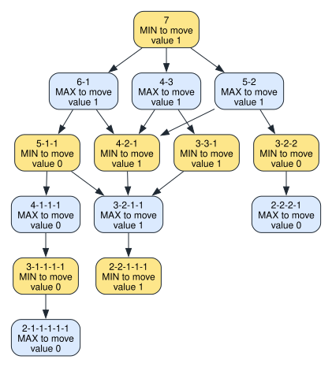

# Nim: Solving a Whole Game with Minimax

Nim is a small two-player game you can solve completely with minimax, to find who wins with perfect play.

## Before you start
<!-- bite: f70ae1b3-69e1-4f08-8763-63b90141e3bb -->

Read [[artificial-intelligence/04-adversarial-search/02-minimax-1|Minimax 1]] first. You need to back up values: max at MAX's turns, min at MIN's turns.

After this lesson you will be able to:

1. state the rules of this version of Nim and list the legal moves from any position;
2. build the full Nim game tree from a stack of 7 tokens;
3. assign utilities to the terminal states and back them up with minimax;
4. say who wins with perfect play, and explain why.

## What Nim is
<!-- bite: 970798d9-3b2f-455e-87b4-af17a6ba3772 -->

The 2019/20 SSG 503 exam asks this:

> Nim is a two-player game. The game starts with a single stack of 7 tokens. At each move a player selects one stack and divides it into two non-empty, non-equal stacks. A player who is unable to move loses the game. Two players, MIN and MAX, play Nim; MIN plays first. A terminal state that is a win for MIN gets utility 0; a win for MAX gets utility 1. Apply minimax to assign utilities to all states, and say who wins if both play a perfect game.

Unlike chess, Nim is small enough to search to the very end. So instead of estimating anything, minimax tells us exactly who wins.

## The kid version
<!-- bite: d6a851e5-e87d-455d-9b1a-11a7beccd11f -->

You and a friend take turns breaking a bar of chocolate with 7 squares into two uneven pieces, then breaking any piece again, always into two uneven parts. A piece of 1 can't be broken, and a piece of 2 can only be broken into 1 and 1, which aren't uneven, so that's not allowed either. Whoever can't break anything loses. Because there are so few ways to play, you can sit down and work out every possible game in advance, and find out who should win.

**Where the analogy stops working.** You'd get tired of listing games long before you'd finished. Minimax does it systematically, and it reuses work: the same position reached in different ways is only worked out once.

## The moves
<!-- bite: 6f210c9f-8388-41f1-ab39-9666bd3efe22 -->

A move picks one stack and splits it into two **non-empty, non-equal** parts.

1. A stack of **1** can't be split.
2. A stack of **2** could only become 1 and 1, which are equal, so it can't be split either.
3. A stack of **3** can become 2 and 1.
4. A stack of **4** can become 3 and 1 (not 2 and 2).
5. A stack of **7** can become 6 and 1, 5 and 2, or 4 and 3.

So the game is over when every stack is a 1 or a 2. The player to move then can't move, and loses.

## The game tree
<!-- bite: b1223074-f9ef-4e22-8faf-36551c6ed77c -->

Write each position as its stack sizes, biggest first. Starting from 7 with MIN to move, these are all the positions that can happen:

Positions reached by different routes, such as 4-2-1, are drawn once. Altogether there are 14 different stack positions, and 3 of them are terminal: 2-1-1-1-1-1, 2-2-1-1-1 and 2-2-2-1.

## Giving the terminal states their utilities
<!-- bite: 3c01e8da-e25b-435a-b583-9bc926e927d8 -->

A terminal state is a loss for whoever is to move there.

1. **2-2-1-1-1, MIN to move.** MIN can't move, so MIN loses and MAX wins: **utility 1**.
2. **2-1-1-1-1-1, MAX to move.** MAX can't move, so MAX loses: **utility 0**.
3. **2-2-2-1, MAX to move.** MAX can't move: **utility 0**.

Notice that the same stacks would have the opposite value with the other player to move. That's why each node records whose turn it is.

## Backing up the values
<!-- bite: f9ec6c39-61d6-4990-a92b-e80538f46a82 -->

Now work upward. At a MAX node take the largest child value; at a MIN node, the smallest.

1. **3-2-1-1, MAX to move.** Its only move is to 2-2-1-1-1 (value 1). So its value is **1**.
2. **3-1-1-1-1, MIN to move.** Its only move is to 2-1-1-1-1-1 (value 0). Value **0**.
3. **4-2-1, MIN to move.** Its only move is to 3-2-1-1 (value 1). Value **1**.
4. **3-3-1, MIN to move.** Its only move is to 3-2-1-1 (value 1). Value **1**.
5. **5-1-1, MIN to move.** Moves to 4-1-1-1 (value 0) or 3-2-1-1 (value 1). MIN takes the smaller: **0**.
6. **3-2-2, MIN to move.** Only move to 2-2-2-1 (value 0). Value **0**.
7. **6-1, MAX to move.** Moves to 5-1-1 (0) or 4-2-1 (1). MAX takes the larger: **1**.
8. **5-2, MAX to move.** Moves to 4-2-1 (1) or 3-2-2 (0). Value **1**.
9. **4-3, MAX to move.** Moves to 4-2-1 (1) or 3-3-1 (1). Value **1**.
10. **7, MIN to move.** All three children are worth 1, so the root is **1**.

## Who wins with perfect play
<!-- bite: 88e474ff-c405-492b-bb1a-49668060f791 -->

The root's value is 1, so **MAX wins** if both play perfectly.

Here's the winning strategy in words. Whatever MIN does first, MAX replies by moving to 4-2-1 (from 6-1 or 5-2) or to 4-2-1 or 3-3-1 (from 4-3). From either of those, MIN has only one move, to 3-2-1-1. MAX then splits the 3, leaving 2-2-1-1-1, and MIN can't move. MIN loses.

MIN's only hope is that MAX makes a mistake, for example by moving from 6-1 to 5-1-1, which is worth 0.

## Other starting sizes
<!-- bite: ffcea61c-f2c8-4be1-87b6-595bf23a341c -->

The same method works for any starting stack. Running minimax for every size from 1 to 10 tokens, with MIN moving first:

| Tokens | 1 | 2 | 3 | 4 | 5 | 6 | 7 | 8 | 9 | 10 |
|---|---|---|---|---|---|---|---|---|---|---|
| Winner with perfect play | MAX | MAX | MIN | MAX | MIN | MIN | MAX | MIN | MIN | MAX |

With 1 or 2 tokens, MIN can't make the first move at all, so MAX wins at once. With 3 tokens, MIN splits into 2-1, and now MAX can't move, so MIN wins.

## Terms used in this lesson
<!-- bite: 3f2d4a30-8398-463d-a892-417c496051bd -->

1. **Nim (this version)**: This is a two-player game where each move splits one stack of tokens into two non-empty, unequal stacks, and the player who can't move loses.
2. **Terminal state**: This is a position where the player to move has no legal move, so the game ends.
3. **Perfect play**: This means both players always choose the move with the best minimax value for themselves.

## Common pitfalls and traps
<!-- bite: 40e0549d-3ad4-43d6-939b-9183568b269d -->

- **Splitting a stack into two equal parts.** 4 can't become 2 and 2, and 2 can't become 1 and 1.
- **Forgetting whose turn it is at a terminal state.** The player who can't move loses, so the same stacks are worth 1 or 0 depending on who must move.
- **Backing up with the wrong operation.** Max at MAX's turns, min at MIN's turns. MIN moves first here, so the root is a MIN node.

## Check your understanding
<!-- bite: 03469cd7-38b1-42bc-be20-c5d562f5b578 -->

Try each one before you open the answer.

1. <!-- q: mcq id="93aff101" -->
   Which of these is a legal Nim move from a single stack of 6?

   - [ ] 3 and 3
   - [x] 4 and 2
   - [ ] 6 and 0
   - [ ] 2, 2 and 2

   

Answer

   4 and 2. A move splits one stack into two non-empty, non-equal stacks, so 3 and 3 (equal), 6 and 0 (empty) and three stacks are all illegal. The other legal move is 5 and 1.

   

2. <!-- q: exact id="6d1355dd" answer="0" -->
   The position 2-2-2-1 has MAX to move. What is its utility (1 for a MAX win, 0 for a MIN win)?

   

Answer

   0. Every stack is a 1 or a 2, so no move is possible; MAX is to move and can't, so MAX loses.

   

3. <!-- q: mcq id="9424565f" -->
   Nim starts with 3 tokens, and MIN moves first. Who wins with perfect play?

   - [x] MIN
   - [ ] MAX
   - [ ] It's a draw

   

Answer

   MIN. MIN's only move is 3 → 2-1. Now MAX must move, but neither 2 nor 1 can be split, so MAX can't move and loses.

   

4. <!-- q: open id="ae785fb4" -->
   With 7 tokens and MIN moving first, explain MAX's winning strategy.

   

Answer

   After MIN's first move (6-1, 5-2 or 4-3), MAX moves to 4-2-1, or to 3-3-1 if MIN played 4-3. From either, MIN's only move is to 3-2-1-1. MAX then splits the 3 into 2-1, leaving 2-2-1-1-1, where MIN can't move and loses. The root's minimax value is 1, so this works against every MIN move.

   

## Before moving on
<!-- bite: ec097563-ecd3-4bf3-b5ff-afe1ecce5014 -->

You're done when you can list the legal moves from any position, build the 7-token tree, assign terminal utilities from whose turn it is, back them up, and explain MAX's winning strategy.

Recap: in this Nim, a move splits a stack into two unequal non-empty stacks, and whoever can't move loses. From 7 tokens there are 14 positions and 3 terminal ones. Backing up the values gives the root 1: MAX wins with perfect play, by always heading for 4-2-1 or 3-3-1.

That's the end of section 04. The [[artificial-intelligence/index|Artificial Intelligence]] subject continues with constraint satisfaction, starting with [[artificial-intelligence/05-constraint-satisfaction/01-constraint-satisfaction-problems|Constraint Satisfaction Problems]].

## Related
<!-- bite: 22388df5-0c2d-4842-a5e4-f32cc368fb8b -->

- [[artificial-intelligence/ssg-518-question-bank|SSG 518 question bank]]: this question as it appeared in the exam.

## About this lesson
<!-- bite: b7a5e84b-4b0e-406f-8420-89011deddb7f -->

**Level:** introductory. Lesson 6 of section 04 (adversarial search). It covers the rules of Nim, its full game tree from 7 tokens, assigning utilities, backing them up, and the winner with perfect play.

**Source:** University of Lagos SSG 503 2019/20 exam, question 5(b) and 5(c). Every position, utility and the winner table are computed by minimax and asserted by `scripts/diagrams/ai_gaps.py` and `scripts/diagrams/ai_question_bank.py`.
