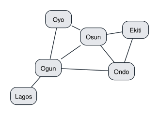
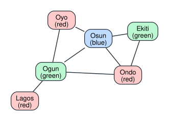

# Constraint Satisfaction Problems

A constraint satisfaction problem gives every variable a value so that every rule is satisfied, like colouring a map.

## Before you start
<!-- bite: a367eba9-1fff-4f5e-aacd-6d1ba66e5bd5 -->

Read [[artificial-intelligence/01-foundations/07-types-of-problems-and-techniques|Types of Problems and Techniques]] (where CSP was first named) and [[artificial-intelligence/02-uninformed-search/04-depth-first-search|Depth-First Search]] (backtracking is a depth-first search).

After this lesson you will be able to:

1. define a CSP by its three parts: variables, domains and constraints;
2. formulate map colouring and exam timetabling as CSPs;
3. trace backtracking search on a map, including a backtrack;
4. explain how forward checking, a kind of constraint propagation, cuts the search.

## What a CSP is
<!-- bite: 38ffdc7e-3192-4d2d-94cf-920daff248fa -->

In section 02 a state was a black box: the search could only ask "is this the goal?". Many problems have more structure than that. An exam timetable isn't just "good" or "bad": it's a set of exams, each with a slot, and a list of clashes to avoid. If you can see *which* rule a partial timetable breaks, you can stop early, long before the whole timetable is filled in.

That's a **constraint satisfaction problem**. Your class notes give two techniques: **backtracking** (systematically exploring possible solutions) and **constraint propagation** (narrowing down the possibilities by applying the constraints). This lesson covers both.

## The kid version
<!-- bite: 0e38bad5-0cff-4e57-ba16-7367a2161abc -->

You're seating guests at a wedding. Each guest needs a table (that's their value), there are only so many tables (the choices), and there are rules: the two aunties who quarrelled can't share a table, the couple must sit together. You seat people one at a time, and the moment a rule breaks, you move the last person instead of carrying on with a seating plan that's already wrong.

**Where the analogy stops working.** At a wedding you'd also juggle "nice to have" wishes. A basic CSP only has hard rules: a solution either satisfies every constraint or it isn't a solution.

## The three parts of a CSP
<!-- bite: 2e47fd99-4c2a-4460-80e5-33119ed9b284 -->

1. **Variables**: the things that need values. *The states on a map.*
2. **Domains**: the allowed values for each variable. *Red, green or blue.*
3. **Constraints**: rules about which combinations of values are allowed. *Two states that share a border must have different colours.*

A **solution** is an assignment of a value to every variable that satisfies all the constraints. A **partial assignment** gives values to some of the variables; it's **consistent** if it breaks no constraint so far.

## Example: colouring the South-West
<!-- bite: 4d3e690b-c8b2-43e1-96c5-d482fecaf96e -->

Colour the six south-western states with three colours (red, green, blue) so that no two neighbouring states match. The lines below join states that share a border.

## The map as a CSP
<!-- bite: b0a9aad3-941a-43ad-b819-ae2a88614902 -->

Here are the three parts for the map:

1. **Variables**: Lagos, Ogun, Oyo, Osun, Ekiti, Ondo.
2. **Domains**: {red, green, blue} for each.
3. **Constraints**: for every border, different colours: Lagos ≠ Ogun, Ogun ≠ Oyo, Ogun ≠ Osun, Ogun ≠ Ondo, Oyo ≠ Osun, Osun ≠ Ondo, Osun ≠ Ekiti, Ondo ≠ Ekiti.

A picture like this, with variables as nodes and constraints as lines, is called a **constraint graph**.

Generate-and-test would try all $3^6 = 729$ colourings and check each. Backtracking does far better.

## Backtracking search
<!-- bite: 9a1b9f1e-6639-40ee-8719-de9e219a023a -->

**Backtracking** assigns variables one at a time, in a fixed order, trying each value in turn. As soon as a value breaks a constraint with an already-coloured neighbour, it tries the next value. If a variable has *no* value left that works, it goes back to the previous variable and changes that one. That's a depth-first search over partial assignments, with the constraints checked at every step.

Colour in the order Lagos, Ogun, Oyo, Osun, Ekiti, Ondo, trying red, then green, then blue.

1. **Lagos**: red. Fine.
2. **Ogun**: red clashes with Lagos. Green. Fine.
3. **Oyo**: red. Its only coloured neighbour is Ogun (green), so fine.
4. **Osun**: red clashes with Oyo; green clashes with Ogun. Blue. Fine.
5. **Ekiti**: red. Its coloured neighbour is Osun (blue), so fine.

## The backtrack
<!-- bite: 176ae5f6-2c68-4c55-a480-1edc0acaea0b -->

6. **Ondo**: its neighbours are Ogun (green), Osun (blue) and Ekiti (red). Red clashes, green clashes, blue clashes. **No colour works.**

So we **backtrack** to the last choice, Ekiti, and try its next colour.

7. **Ekiti**: green. Its neighbours Osun (blue) and Ondo (not yet coloured) are fine.
8. **Ondo**: red. Ogun green, Osun blue, Ekiti green: fine.

**Solution:** Lagos red, Ogun green, Oyo red, Osun blue, Ekiti green, Ondo red. Backtracking made **13 tries** (counting every colour it tested, including the clashes), instead of up to 729.

## Constraint propagation: forward checking
<!-- bite: a88d63ba-4dc6-4f7e-970f-f9aab898d333 -->

Look at step 5 again. When Ekiti took red, Ondo had already lost green (to Ogun) and blue (to Osun). Red was its last option, and Ekiti just took it. The search didn't notice until it reached Ondo and tried all three colours.

**Constraint propagation** uses the constraints to cross values off *ahead of time*. The simplest form is **forward checking**: whenever you assign a variable, remove that value from the domains of its uncoloured neighbours. If any neighbour's domain becomes empty, undo the assignment straight away.

Rerun with forward checking. After Ekiti = red, Ondo's domain becomes empty, so Ekiti switches to green at once, without trying anything for Ondo. The whole search now takes **7 tries**, against 13. On big problems, propagation is the difference between seconds and years.

## Another CSP: the exam timetable
<!-- bite: f3be59b0-4d27-4447-b097-341ea18235f7 -->

Your notes' example of a CSP is scheduling. Formulate an exam timetable:

1. **Variables**: the exams (SSG 518, SSG 513, SSG 532, ...).
2. **Domains**: the available slots (Monday 9am, Monday 2pm, ...).
3. **Constraints**: two exams sharing any student must be in different slots; an exam's hall must be big enough; an examiner can't be in two places at once.

It's map colouring in disguise: exams are states, shared students are borders, and slots are colours. Backtracking with forward checking is how real timetabling programs begin.

## Terms used in this lesson
<!-- bite: 44366b73-2373-42dd-8c06-75d914bd2562 -->

1. **CSP (constraint satisfaction problem)**: The letters stand for those three words. It's a problem defined by variables, their domains, and constraints that the values must satisfy.
2. **Variable**: This is something that needs a value, such as a state on a map.
3. **Domain**: This is the set of values a variable may take, such as {red, green, blue}.
4. **Constraint**: This is a rule about which combinations of values are allowed, such as "neighbours differ".
5. **Constraint graph**: This is a picture with a node for each variable and a line for each constraint between two variables.

## More terms used in this lesson
<!-- bite: fe072ac1-8a51-43fc-b170-1b659c3b926c -->

6. **Consistent assignment**: This is a partial assignment that breaks no constraint so far.
7. **Backtracking search**: This assigns variables one at a time and, when a variable has no allowed value left, goes back and changes the previous choice.
8. **Constraint propagation**: This means using the constraints to remove impossible values from domains before trying them.
9. **Forward checking**: This is the simplest constraint propagation: after each assignment, remove that value from the neighbours' domains, and backtrack at once if a domain becomes empty.

## Common pitfalls and traps
<!-- bite: f73f9492-5ac8-4b30-9578-c2133382f68e -->

- **Checking constraints only at the end.** That's generate-and-test. Backtracking checks after every single assignment.
- **Backtracking too far.** Go back to the *most recent* choice that still has untried values, not to the start.
- **Thinking forward checking changes the answer.** It finds the same solution; it just wastes fewer tries.

## Check your understanding
<!-- bite: 987a0a67-3426-4813-8d5c-34cc57fd5a87 -->

Try each one before you open the answer.

1. <!-- q: gap id="d7f882a7" answers="variables;domains;constraints" -->
   A CSP is defined by three parts: ___, ___ and ___.

   

Answer

   Variables, domains and constraints.

   

2. <!-- q: exact id="8bcdff70" answer="81" -->
   Four regions are to be coloured with 3 colours. How many complete colourings would generate-and-test have to consider?

   

Answer

   $3^4 = 81$.

   

3. <!-- q: mcq id="36299ba0" -->
   Three regions A, B and C all border each other. A is red and B is green. Using forward checking with colours {red, green, blue}, what is left in C's domain?

   - [ ] {red, green, blue}
   - [ ] {red}
   - [x] {blue}
   - [ ] Nothing

   

Answer

   {blue}. A = red removes red from C, and B = green removes green, leaving blue.

   

4. <!-- q: mcq id="4d979dc9" -->
   During backtracking, a variable has no value left that satisfies the constraints. What does the search do?

   - [ ] Stops and reports that there's no solution
   - [x] Goes back to the most recently assigned variable and tries its next value
   - [ ] Starts again from the first variable with a new order
   - [ ] Gives the variable a value anyway

   

Answer

   It backtracks to the most recent choice that still has untried values. It only reports no solution when it has backtracked past the first variable.

   

5. <!-- q: open id="7369852c" -->
   Formulate a class seating plan as a CSP: 12 students, 4 tables of 3, and a list of pairs who mustn't sit together. Give the variables, domains and constraints.

   

Answer

   Variables: the 12 students. Domains: {table 1, table 2, table 3, table 4} for each. Constraints: for each listed pair, the two students' tables are different; and no table has more than 3 students assigned to it.

   

## Before moving on
<!-- bite: 2018201d-b981-4dce-bbdf-5f75fd4d745e -->

You're done when you can define a CSP by its three parts, formulate a map or timetable as one, trace backtracking on a small map including a backtrack, and show how forward checking avoids it.

Recap: a CSP gives values from domains to variables so that every constraint holds. Backtracking assigns one variable at a time and backs up when stuck: colouring the South-West took 13 tries with one backtrack (at Ekiti), against 729 colourings for generate-and-test. Forward checking removes neighbours' values ahead of time and cut it to 7 tries.

Next, [[artificial-intelligence/05-constraint-satisfaction/02-cryptarithmetic-1|Cryptarithmetic 1]] applies the same idea to the puzzle the SSG 503 exams ask most: sums where every letter stands for a digit.

## Related
<!-- bite: 5fc3d6ec-ed63-4a59-ab0e-b14dfaec5c8b -->

- [[artificial-intelligence/02-uninformed-search/11-river-crossing-puzzles|River-Crossing Puzzles]]: puzzles where constraints decide which states are legal.
- [[planning-and-scheduling/index|Planning and Scheduling]]: scheduling projects, where constraints are about time.

## About this lesson
<!-- bite: b0e7aa0c-ac03-4d61-9f04-1c666191309b -->

**Level:** introductory to intermediate. Lesson 1 of section 05 (constraint satisfaction). It covers the three parts of a CSP, map colouring and timetabling as CSPs, backtracking search with a worked backtrack, and forward checking.

**Source:** University of Lagos SSG 518 class notes, *Problem Solving in AI* (09/03/26: constraint satisfaction problems, backtracking and constraint propagation). The South-West borders are the real ones between those six states. The backtracking and forward-checking traces are computed and asserted by `scripts/diagrams/ai_gaps.py`.
