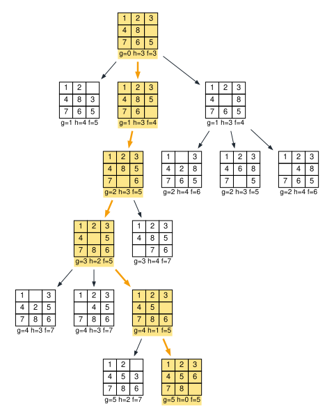

# SSG 518 Mock Exam 1: The 2025/26 Paper

This is the real 2025/2026 first-semester SSG 518 (Artificial Intelligence II) exam, set out as a timed paper. Sit it like the real thing: closed book, on paper, with a calculator, in one go.

**Instructions:** answer any **four** questions. Each question carries 15 marks, so the paper is out of 60. Time allowed: **2 hours**, about 30 minutes a question. Draw neat diagrams where a question asks for one. The worked answers and marking scheme open after you submit; mark your own long answers against them honestly.

## Question 1

### (a) The pattern recognition system and its steps
<!-- q: open id="a2e10e8e" marks="8" -->

Evaluate the pattern recognition system and the steps to achieve the pattern recognition system with the aid of a diagram. (8 marks)

Solution

**What it is (1–2 marks).** Pattern recognition is the ability to classify patterns in data and the environment by finding similarities, trends and regularities. A pattern-recognition system converts raw data into features a machine can use, and then either classifies items into known categories (supervised) or groups similar items without labels (clustering).

**What a good system should do (1–2 marks).** It should recognise familiar patterns quickly and accurately; recognise and classify unfamiliar objects; recognise shapes and objects from different angles; and identify patterns and objects even when they are partly hidden.

**The steps, with the diagram (4 marks).** Draw the five boxes in a line with arrows, from "Start" to "Termination":

1. **Data collection**: gather the data used to train and test the system.
2. **Feature choice**: choose the characteristics of the data that are relevant to the pattern.
3. **Model choice**: select a model or algorithm (statistical, structural or neural) to suit the data and the problem.
4. **Training the classifier**: fit the model to a labelled training set, usually about 80% of the data.
5. **Evaluation**: test the trained system on data it has not seen, the testing set.

**"Evaluate" marks (1–2 marks).** Say what makes it work or fail: the features decide the ceiling on performance; testing must use unseen data or the score only shows memorisation; and when evaluation is poor you loop back to better data, features or model. You can also name the four phases (preprocessing, training, testing, deployment).

**Revise:** [[machine-learning/03-classical-ml/21-pattern-recognition-1|Pattern Recognition 1]], [[machine-learning/03-classical-ml/22-pattern-recognition-2|Pattern Recognition 2]].

### (b) Design a plant disease detection system
<!-- q: open id="91471a9c" marks="7" -->

Design a complete Pattern Recognition system for automatic plant disease detection. (7 marks)

Solution

Follow the steps and phases, filling each with the plant problem. One mark or so for each part:

1. **Problem and classes.** Classify a photo of a leaf as healthy or as one of several diseases, for example cassava mosaic disease, cassava brown streak and healthy.
2. **Data collection.** Thousands of leaf photos taken with phone cameras in farms, each labelled by a plant pathologist. Include different lighting, angles and growth stages, and partly hidden leaves, so the system meets the "different angles" and "partly hidden" requirements.
3. **Preprocessing.** Resize every image to the same size, remove the background so only the leaf remains, and normalise colour and brightness. Remove blurry photos.
4. **Feature choice.** Colour (yellowing, brown patches), texture (mosaic patterns), the shape and area of lesions, and the proportion of the leaf affected. With a neural network, the features are learned from the pixels instead.
5. **Model choice.** A convolutional neural network for raw images (high accuracy, handles noisy data), or a statistical classifier such as naive Bayes or KNN on hand-made features when data is limited.
6. **Training.** Train on about 80% of the labelled images; tune hyperparameters on part of the training data or by cross-validation.
7. **Testing.** Measure accuracy, kappa and a confusion matrix on the held-back 20%, which the model never saw. Check which diseases it confuses.
8. **Deployment.** Put the model in a phone app so a farmer photographs a leaf and gets a diagnosis and a treatment suggestion, working offline in the field. Collect new photos to retrain later.

A neat block diagram of these stages, from camera to app, earns the diagram marks.

**Revise:** [[machine-learning/03-classical-ml/22-pattern-recognition-2|Pattern Recognition 2]].

## Question 2

Part (b) uses this table of results for four classifiers, tested two ways on the same dataset.

**Table 2.1**

| Classifier | Kappa (training set) | MAE | ROC area | RMSE | Kappa (10-fold) | MAE | ROC area | RMSE |
|---|---|---|---|---|---|---|---|---|
| Naive Bayes | 0.2724 | 0.2463 | 0.746 | 0.3577 | 0.1165 | 0.2674 | 0.653 | 0.3845 |
| Multi-layer perceptron | 0.9144 | 0.0303 | 0.9200 | 0.1516 | 0.0450 | 0.2646 | 0.5560 | 0.4684 |
| Logistic regression | 0.2232 | 0.2397 | 0.7870 | 0.3464 | 0.1165 | 0.2672 | 0.6220 | 0.3901 |
| Bayesian net | 0.2724 | 0.2463 | 0.7460 | 0.3577 | 0.1165 | 0.2674 | 0.6530 | 0.3845 |

### (a) Parametric versus non-parametric classifiers
<!-- q: open id="3bd80e2e" marks="5" -->

Compare and contrast how parametric and non-parametric classifiers handle the underlying data distribution, citing examples of each. (5 marks)

Solution

1. **Parametric classifiers assume a form for each class's distribution**, usually a Gaussian, and learn a fixed number of parameters that describe it, such as a mean and a variance per feature. The model's size doesn't grow with the data. Examples from the course tree: naive Bayes, Bayesian classifier, multivariate Gaussian, maximum likelihood classifier, minimal distance classifier.
2. **Non-parametric classifiers assume no fixed form.** They estimate the density from the training points themselves, so the model grows with the data. Examples: K-nearest neighbour, Parzen window (kernel density estimation). The course tree also lists logistic regression and the multilayer perceptron here.
3. **Compare.** Parametric classifiers need less data and are fast and stable *when the assumed shape is right*; when it's wrong (for example, a class that really has two clumps), they fit the wrong curve and misclassify. Non-parametric classifiers follow the real shape, however odd, but need more data, more memory and more time to classify, and can be noisy with few points.
4. **Contrast in one line:** parametric = assume the shape, estimate a few numbers; non-parametric = let the data decide the shape.

For full marks, add a short example: with class A at 1, 2, 2, 9, 10 and class B at 5, 5, 6, 6, 7, a Gaussian classifier labels 7.5 as A, while a Parzen window and KNN correctly say B.

**Revise:** [[machine-learning/03-classical-ml/23-parametric-and-non-parametric-classifiers-1|Parametric and Non-Parametric Classifiers 1]].

### (b)(i) Use Training Set versus 10-fold cross-validation
<!-- q: open id="04672c93" marks="5" -->

Evaluate the effectiveness of the "Use Training Set" method versus the "10 Cross Fold" method, based on the performance metrics in Table 2.1. Justify which method was found to be better for the overall set of classifiers, and why. (5 marks)

Solution

First give what the table shows, because that's what "was found" asks for. Every classifier scores better under "Use Training Set": higher kappa (e.g. naive Bayes 0.2724 against 0.1165), higher ROC area (0.746 against 0.653) and lower MAE and RMSE (0.2463 and 0.3577 against 0.2674 and 0.3845). So, as the source paper concluded, **"Use Training Set" was found to be better** on every metric.

Then evaluate it, for the "evaluate" marks. "Use Training Set" tests each classifier on the same data it was trained on, so it measures how well the model memorised its examples, not how well it predicts new cases. 10-fold cross-validation tests every case with a model that never saw it, so it is the honest estimate. The gap is the overfitting. The clearest case is the multilayer perceptron: kappa 0.9144 on the training set, 0.0450 under cross-validation. So the training-set method *looks* better, but cross-validation is the more trustworthy method for judging classifiers.

**Revise:** [[machine-learning/03-classical-ml/24-parametric-and-non-parametric-classifiers-2|Parametric and Non-Parametric Classifiers 2]].

### (b)(ii) Reading the metrics
<!-- q: open id="5ac31571" marks="5" -->

Analyse and interpret the performance metrics shown in Table 2.1. (5 marks)

Solution

Read each metric, then each classifier:

1. **Kappa** is agreement beyond chance (1 perfect, 0 chance; 0.40–0.59 moderate, 0.60–0.79 substantial, above 0.80 outstanding). Under cross-validation all four are poor (0.045 to 0.1165): the dataset is hard to predict.
2. **MAE and RMSE** are error sizes; smaller is better. RMSE is always above MAE because it squares, punishing big errors.
3. **ROC area** is separation across all thresholds; 0.5 is guessing, 1 is perfect. Cross-validated values of 0.556 to 0.653 are only a little better than guessing.
4. **Multilayer perceptron:** best on the training set (kappa 0.91, MAE 0.03, ROC 0.92), worst under cross-validation (kappa 0.045, RMSE 0.4684, ROC 0.556). It memorised the training data: classic overfitting.
5. **Naive Bayes and Bayesian net:** identical on every metric, in both methods. The Bayesian net most likely learned the same structure as naive Bayes on this data.
6. **Logistic regression:** close to the Bayesian pair. Under cross-validation its kappa matches them (0.1165) and its ROC area is a little lower (0.622).
7. **Overall:** the parametric pair (naive Bayes, Bayesian net) and logistic regression generalise best; no classifier does well; and a training-set score must never be trusted on its own.

**Revise:** [[machine-learning/03-classical-ml/24-parametric-and-non-parametric-classifiers-2|Parametric and Non-Parametric Classifiers 2]].

## Question 3

### (a) State-space terms
<!-- q: open id="5bea2c59" marks="5" -->

Analyse the following terms: state; initial state; goal state; state space; action; transition model; path; path cost; time complexity and space complexity. (5 marks)

Solution

Half a mark each; use one running example, a road trip from Lagos to Abuja.

1. **State**: a description of the situation at one moment. *In Ibadan.*
2. **Initial state**: the state the agent starts in. *In Lagos.*
3. **Goal state**: a state that passes the goal test, where the problem is solved. *In Abuja.*
4. **State space**: all states reachable from the initial state, with the actions joining them. *Every city on the map and the roads between them.*
5. **Action**: something the agent can do in a state. *Drive from Ibadan to Akure.*
6. **Transition model**: what state each action leads to. *Driving to Akure from Ibadan puts you in Akure.*
7. **Path**: a sequence of states joined by actions. *Lagos → Ibadan → Akure.*
8. **Path cost**: the total cost of the actions along a path. *130 + 210 = 340 km.*
9. **Time complexity**: how the number of nodes generated grows with the problem, written with $b$ and $d$, such as $O(b^d)$.
10. **Space complexity**: how the largest number of nodes stored at once grows, such as $O(b^d)$ for breadth-first search or $O(bm)$ for depth-first search.

**Revise:** [[artificial-intelligence/01-foundations/06-problem-solving-in-ai|Problem Solving in AI]], [[artificial-intelligence/02-uninformed-search/02-measuring-a-search-method|Measuring a Search Method]].

### (b) Search strategies on the 8-puzzle or TSP
<!-- q: open id="7900885b" marks="5" -->

Given a classical AI problem such as the 8-puzzle or the travelling salesman problem (TSP), analyse the strengths and weaknesses of different search strategies (e.g. breadth-first search, depth-first search, A\* search). Discuss their computational trade-offs and scenarios where one outperforms the others. (5 marks)

Solution

Use the 8-puzzle (181,440 reachable states, branching factor about 3, every move costs 1).

1. **Breadth-first search.** Strength: complete, and optimal here because every move costs 1, so it finds the fewest moves. Weakness: $O(b^d)$ memory; for a 20-move puzzle it must hold a huge frontier. Best when the solution is shallow.
2. **Depth-first search.** Strength: $O(bm)$ memory, tiny. Weakness: not optimal and, without a visited list, can wander through the whole state space or loop; a solution 5 moves away may be found after thousands of moves. Rarely the right choice here.
3. **A\* search.** Strength: optimal with an admissible heuristic (misplaced tiles or Manhattan distance) and expands far fewer nodes. On a 12-move puzzle, A\* expanded 2,327 nodes with no heuristic, 119 with misplaced tiles and 36 with Manhattan distance. Weakness: still keeps every generated node in memory.
4. **Trade-offs.** BFS buys optimality with memory; DFS buys memory with optimality; A\* buys speed with domain knowledge, and the better the heuristic, the bigger the saving.
5. **Scenarios.** Shallow puzzle and plenty of memory: BFS is fine. Tight memory and unknown depth: iterative deepening. Any real 8-puzzle: A\* with Manhattan distance outperforms both. For TSP, which only cares about the final tour, local search (hill climbing, simulated annealing, genetic algorithms) gives good tours fast where A\* would run out of memory.

**Revise:** [[artificial-intelligence/02-uninformed-search/10-comparing-uninformed-search|Comparing Uninformed Search Methods]], [[artificial-intelligence/03-heuristic-search/06-heuristics-for-the-8-puzzle|Heuristics for the 8-Puzzle]].

### (c) Uninformed versus informed search
<!-- q: open id="7a059eaa" marks="5" -->

Evaluate the effectiveness of uninformed versus informed search strategies in complex problem domains. Include criteria such as completeness, optimality, time complexity and space complexity in your discussion. (5 marks)

Solution

| Criterion | Uninformed (BFS, UCS, DFS, IDS) | Informed (greedy, A\*) |
|---|---|---|
| Completeness | BFS, UCS and IDS are complete; DFS is not | A\* is complete; greedy is not in general |
| Optimality | UCS optimal; BFS and IDS only for equal step costs; DFS never | A\* optimal with an admissible heuristic; greedy never |
| Time | $O(b^d)$ or worse; explores in every direction | Exponential in the worst case, but a good heuristic cuts it dramatically |
| Space | BFS and UCS exponential; DFS and IDS linear | A\* keeps all nodes (its weakness); greedy also large |

**Evaluation.** In complex domains the state space is huge, and uninformed search, knowing nothing about where the goal is, becomes impractical: it spends its time on states that lead nowhere. Informed search uses domain knowledge to look at promising states first, so it scales to far bigger problems. The cost is that its quality depends on the heuristic: an admissible one keeps A\* optimal, an inadmissible one can mislead it. When no heuristic is available, iterative deepening is the best uninformed choice, and when memory is the limit, local search or memory-bounded methods take over.

**Revise:** [[artificial-intelligence/02-uninformed-search/10-comparing-uninformed-search|Comparing Uninformed Search Methods]], [[artificial-intelligence/03-heuristic-search/05-a-star-search-2|A\* Search 2]].

## Question 4

### (a) The 8-puzzle by heuristic search
<!-- q: sketch id="fa944d47" marks="10" -->

Draw the search tree to get to the goal state given below from the initial state using the heuristic method and show the details. (10 marks)

Initial state, row by row: 1 2 3 / 4 8 _ / 7 6 5. Goal state: 1 2 3 / 4 5 6 / 7 8 _ (where _ is the blank).

Solution

**State the method first (1–2 marks).** Use A\* with $f(n) = g(n) + h(n)$, where $g(n)$ is the number of moves made so far and $h(n)$ is the number of misplaced tiles (not counting the blank). Expand the node with the smallest $f$; on a tie, take the smaller $h$. Never move the blank straight back to where it just was.

**The start.** Tiles 5, 6 and 8 are out of place, so $h = 3$ and $f = 0 + 3 = 3$.

**The tree (6 marks).** Each node shows $g$, $h$ and $f$; the solution path is shaded.

**The expansions, in order:**

1. Expand the start ($f = 3$). Children: blank up ($h = 4$, $f = 5$), blank down ($h = 3$, $f = 4$), blank left ($h = 3$, $f = 4$).
2. Expand **blank down**, 1 2 3 / 4 8 5 / 7 6 _ ($f = 4$; ties with blank left, taken first). Child: blank left, 1 2 3 / 4 8 5 / 7 _ 6, $f = 2 + 3 = 5$.
3. Expand **blank left** from the start, 1 2 3 / 4 _ 8 / 7 6 5 ($f = 4$). Its children all have $f = 5$ or 6. This branch looks as good as the other at first, so A\* has to check it.
4. Expand 1 2 3 / 4 8 5 / 7 _ 6 ($f = 5$, $h = 3$). Children: blank up, 1 2 3 / 4 _ 5 / 7 8 6, $f = 3 + 2 = 5$; blank left, $f = 7$.
5. Expand 1 2 3 / 4 _ 5 / 7 8 6 ($f = 5$, $h = 2$). Children include blank right, 1 2 3 / 4 5 _ / 7 8 6, $f = 4 + 1 = 5$.
6. Expand 1 2 3 / 4 5 _ / 7 8 6 ($f = 5$, $h = 1$). Child: blank down, the goal, $f = 5 + 0 = 5$.
7. Take the goal off the frontier ($f = 5$). Done.

**The solution (2 marks): 5 moves.** Move the blank down, left, up, right, down; or in tiles: 5 up, 6 right, 8 down, 5 left, 6 up. A\* expanded 7 nodes and generated 14.

**What to check in your drawing:**

- The method and the heuristic are named, with $f = g + h$.
- Every node shows its board and its $g$, $h$ and $f$.
- The start has $h = 3$; the blank-left branch is expanded too, because it also has $f = 4$.
- The solution path is marked and is 5 moves long, ending at the goal with $f = 5$.

Using Manhattan distance ($h = 5$ at the start) is also correct: the blank-left branch gets $f = 7$ and is never expanded, giving 6 nodes expanded, 11 generated and the same 5-move answer.

**Revise:** [[artificial-intelligence/03-heuristic-search/06-heuristics-for-the-8-puzzle|Heuristics for the 8-Puzzle]], [[artificial-intelligence/03-heuristic-search/04-a-star-search-1|A\* Search 1]].

### (b) The goat, the yam and the lion
<!-- q: open id="8d8b36be" marks="5" -->

A man is travelling with three possessions: a goat, a yam and a lion. He arrives at a narrow bridge and is informed that he can cross the bridge with only one item at a time. If left alone together, the lion will eat the goat, and the goat will eat the yam. The man must always be present to prevent one item from destroying another. Formulate this problem as a state space search problem, and determine the sequence of actions that allows the man to safely transport all items across the bridge. (5 marks)

Solution

**Formulation (2 marks).**

1. **State**: which side of the bridge the man, goat, yam and lion are on. Write it as the items on the starting side and where the man is, e.g. {goat, yam, lion | man} for the start.
2. **Initial state**: everything and the man on the starting side.
3. **Actions**: the man crosses alone, or crosses carrying one item that is on his side.
4. **Transition model**: the man (and the item, if carried) moves to the other side.
5. **Constraint**: a state is illegal if the man is absent from a side holding lion and goat, or goat and yam.
6. **Goal test**: everything is on the far side. **Path cost**: 1 per crossing.

**Solution (3 marks): 7 crossings**, found by breadth-first search, so it's the shortest.

| Crossing | Action | Start side afterwards | Far side afterwards |
|---|---|---|---|
| 1 | Take the goat across | yam, lion | man, goat |
| 2 | Come back alone | man, yam, lion | goat |
| 3 | Take the lion across | yam | man, goat, lion |
| 4 | Bring the goat back | man, goat, yam | lion |
| 5 | Take the yam across | goat | man, yam, lion |
| 6 | Come back alone | man, goat | yam, lion |
| 7 | Take the goat across | (empty) | man, goat, yam, lion |

The key idea: the goat is the problem item (it's in both dangerous pairs), so it goes first and comes back once. Taking the yam at step 3 and the lion at step 5 also works.

**Revise:** [[artificial-intelligence/02-uninformed-search/11-river-crossing-puzzles|River-Crossing Puzzles]].

## Question 5

### (a) Entropy
<!-- q: open id="48682160" marks="2" -->

Analyse entropy as applied to information theory. (2 marks)

Solution

Entropy measures the uncertainty, or average surprise, in a random variable: the average number of bits needed to describe its outcome. $H(X) = -\sum_i p_i \log_2 p_i$. It's highest when all outcomes are equally likely (a fair coin, 1 bit) and zero when one outcome is certain. Rare outcomes carry more information, because $-\log_2 p$ is large when $p$ is small.

**Revise:** [[information-theory/01-what-information-is|What Information Is]].

### (b) Mutual information
<!-- q: open id="f2fc2482" marks="13" -->

Find the mutual information I(X; Y) of the system represented in the table below, where X = study method {Self-study (S), Group study (G), Online course (O)} and Y = exam result {Fail (F), Pass (P), Distinction (D)}. (13 marks)

| Y \ X | S | G | O |
|---|---|---|---|
| Fail (F) | 1/12 | 1/12 | 1/6 |
| Pass (P) | 1/6 | 1/12 | 1/12 |
| Distinction (D) | 1/12 | 1/6 | 0 |

Solution

**Step 1: check the table (2 marks; state this in your answer).** The nine probabilities add up to $\frac{1}{12} + \frac{1}{12} + \frac{1}{6} + \frac{1}{6} + \frac{1}{12} + \frac{1}{12} + \frac{1}{12} + \frac{1}{6} + 0 = \frac{11}{12}$, not 1. A joint distribution must add up to 1, so write: "The table sums to 11/12; I normalise it by dividing every entry by 11/12." Dividing by 11/12 turns $\frac{1}{12}$ into $\frac{1}{11}$ and $\frac{1}{6}$ into $\frac{2}{11}$:

| Y \ X | S | G | O | p(y) |
|---|---|---|---|---|
| F | 1/11 | 1/11 | 2/11 | 4/11 |
| P | 2/11 | 1/11 | 1/11 | 4/11 |
| D | 1/11 | 2/11 | 0 | 3/11 |
| p(x) | 4/11 | 4/11 | 3/11 | 1 |

**Step 2: H(X) (3 marks).** $H(X) = -\left[2 \times \frac{4}{11}\log_2\frac{4}{11} + \frac{3}{11}\log_2\frac{3}{11}\right] = 2(0.5307) + 0.5112 = 1.5726$ bits.

**Step 3: H(Y) (2 marks).** The row totals are the same numbers, 4/11, 4/11, 3/11, so $H(Y) = 1.5726$ bits.

**Step 4: H(X, Y) (3 marks).** Five cells are $\frac{1}{11}$, three are $\frac{2}{11}$ and one is 0 (which contributes nothing, since $0 \log 0 = 0$):

$H(X,Y) = 5 \times \frac{1}{11}\log_2 11 + 3 \times \frac{2}{11}\log_2\frac{11}{2} = 5(0.3145) + 3(0.4472) = 2.9140$ bits.

**Step 5: mutual information (3 marks).**

$$I(X;Y) = H(X) + H(Y) - H(X,Y) = 1.5726 + 1.5726 - 2.9140 = 0.2313 \text{ bits}$$

So knowing the study method removes about 0.23 bits of the 1.57 bits of uncertainty about the exam result.

**If you took the 0 as a misprint for 1/12** (that would make the table add up to exactly 1, with every row and column total 1/3), and said so, mark yourself against these numbers instead: $H(X) = H(Y) = \log_2 3 = 1.585$, $H(X,Y) = 3.085$ and $I(X;Y) = 0.085$ bits. Either answer earns the method marks if the assumption is stated. If you didn't notice the table was broken at all, take off the Step 1 marks.

**Revise:** [[information-theory/02-entropy-joint-conditional-and-mutual|Entropy, Joint, Conditional and Mutual Information]].

## Question 6

### (a) Minimax and alpha-beta
<!-- q: open id="ffeabce2" marks="5" -->

Evaluate the minimax and alpha-beta pruning algorithms, stating their usage and limitations. (5 marks)

Solution

**Minimax** chooses the move that maximises your result assuming the opponent always replies to minimise it: back up values from the leaves, taking the maximum at MAX nodes and the minimum at MIN nodes. **Usage:** two-player, zero-sum, deterministic, perfect-information games such as chess, draughts, tic-tac-toe and ayo. **Limitation:** it searches the whole tree, $O(b^m)$ time, which is impossible for chess ($b \approx 35$), so real programs cut off at a fixed depth with an evaluation function, which brings the horizon effect.

**Alpha-beta pruning** returns exactly the minimax value while skipping branches that can't change it, using $\alpha$ (the best MAX can guarantee so far) and $\beta$ (the best MIN can guarantee so far), pruning when $\alpha \ge \beta$. **Usage:** every serious game program. **Limitation:** the saving depends on move ordering: $O(b^{m/2})$ with perfect ordering, nothing with the worst; and it still needs an evaluation function and a depth cut-off for big games.

**Revise:** [[artificial-intelligence/04-adversarial-search/02-minimax-1|Minimax 1]], [[artificial-intelligence/04-adversarial-search/04-alpha-beta-pruning-1|Alpha-Beta Pruning 1]].

### (b) Alpha-beta on a game tree
<!-- q: sketch id="07114eda" marks="10" -->

Solve the graph using alpha-beta pruning. (10 marks)

The tree has a MAX root, two MIN nodes below it, four MAX nodes below those, eight MIN nodes below those, and sixteen leaves. Each node has two children. The leaves, left to right, are: 10, 5, 7, 11, 12, 8, 9, 8, 5, 12, 11, 12, 9, 8, 7, 10.

Solution

Search left to right with $\alpha = -\infty$, $\beta = +\infty$ at the root.

1. **First MIN node (10, 5):** value 5. Its MAX parent now has $\alpha = 5$.
2. **Second MIN node (7, 11), with $\alpha = 5$:** 7, then 11; value 7. MAX parent = **7**. The left MIN node above now has $\beta = 7$.
3. **Third MIN node (12, 8), passed $\beta = 7$:** 12, then 8; value 8. Its MAX parent now has $\alpha = 8 \ge \beta = 7$: **prune the fourth MIN node (leaves 9 and 8)**. That MAX node returns 8.
4. **Left MIN node:** min(7, 8) = **7**. The root now has $\alpha = 7$.
5. **Fifth MIN node (5, 12), with $\alpha = 7$:** leaf 5 gives $\beta = 5 \le \alpha = 7$: **prune the leaf 12**. Value 5.
6. **Sixth MIN node (11, 12), with $\alpha = 7$:** 11, then 12; value 11. Its MAX parent = **11**. The right MIN node now has $\beta = 11$.
7. **Seventh MIN node (9, 8), with $\alpha = 7$, $\beta = 11$:** 9, then 8; value 8. Its MAX parent has $\alpha = 8$.
8. **Eighth MIN node (7, 10), with $\alpha = 8$:** leaf 7 gives $\beta = 7 \le \alpha = 8$: **prune the leaf 10**. Value 7. The MAX parent = max(8, 7) = **8**.
9. **Right MIN node:** min(11, 8) = **8**.
10. **Root:** max(7, 8) = **8**. MAX should take the **right** branch.

**Answer: the root value is 8.** Three prunes (the MIN node over 9 and 8, the leaf 12, and the leaf 10), so 12 of the 16 leaves are examined. Plain minimax gives the same 8.

**What to check in your drawing:**

- Every internal node has its backed-up value: the two MIN nodes under the root are 7 and 8, and the root is 8.
- The three prunes are marked: the whole MIN node over 9 and 8, the leaf 12 (tenth leaf), and the leaf 10 (last leaf).
- Each prune is justified by an $\alpha \ge \beta$ comparison written next to it.
- The chosen move (the right branch) is stated.

**Revise:** [[artificial-intelligence/04-adversarial-search/04-alpha-beta-pruning-1|Alpha-Beta Pruning 1]], [[artificial-intelligence/04-adversarial-search/05-alpha-beta-pruning-2|Alpha-Beta Pruning 2]].

## About this paper

The questions are copied from the 2025/2026 first-semester SSG 518 exam with typos fixed; the alpha-beta tree, a picture in the original, is described in words. The older SSG 503 questions are in the [[artificial-intelligence/question-bank|AI question bank]]. Every number in them is computed and asserted by `scripts/diagrams/ai_question_bank.py`, which also draws the diagrams. The mark split inside each worked answer is a guide for marking yourself, not the examiner's official scheme. Two more mock papers, with new questions in the same format, come later.
