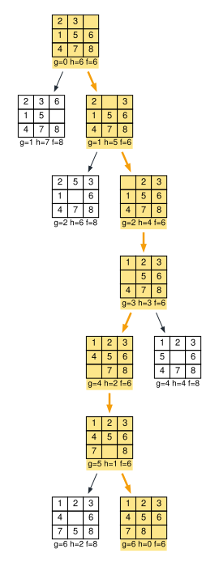

# SSG 518 Mock Exam 2

A full practice paper in the format of the real SSG 518 (Artificial Intelligence II) exam, with new questions on the same topics: pattern recognition, classifiers and how to measure them, state-space search, heuristic search, information theory, and game playing. Sit it like the real thing: closed book, on paper, with a calculator, in one go.

**Instructions:** answer any **four** questions. Each question carries 15 marks, so the paper is out of 60. Time allowed: **2 hours**, about 30 minutes a question. Draw neat diagrams where a question asks for one. Where a question asks for a number, give it to at least 3 significant figures. The worked answers and marking scheme open after you submit; mark your own long answers against them honestly.

## Question 1

A cassava processor wants to sort tubers into two varieties, X and Y, using two features scored from 1 to 10: starch content and bitterness. Six labelled tubers are measured.

| Tuber | Variety | Starch | Bitterness |
|---|---|---|---|
| 1 | X | 2 | 7 |
| 2 | X | 3 | 8 |
| 3 | X | 4 | 9 |
| 4 | Y | 7 | 2 |
| 5 | Y | 8 | 3 |
| 6 | Y | 9 | 1 |

### (a) The phases of a pattern-recognition system
<!-- q: open id="6a1f0c3e" marks="6" -->

Explain the difference between classification and clustering, and describe the four phases a pattern-recognition system goes through, using this cassava problem as your example. (6 marks)

Solution

**Classification versus clustering (2 marks).** Classification puts items into known, labelled categories, learned from labelled examples (supervised): here, variety X or Y. Clustering groups items by similarity with no labels (unsupervised): if the processor had no labels, it could still find two natural groups of tubers.

**The four phases (1 mark each):**

1. **Preprocessing**: clean and prepare the data: measure every tuber the same way, remove damaged ones, put both features on the same 1–10 scale.
2. **Training**: fit the model to labelled examples: here, compute each variety's mean starch and bitterness.
3. **Testing**: measure performance on tubers the model hasn't seen, to check it generalises.
4. **Deployment**: use it on the processing line to sort new tubers, and keep collecting labelled ones to retrain.

**Revise:** [[machine-learning/03-classical-ml/21-pattern-recognition-1|Pattern Recognition 1]], [[machine-learning/03-classical-ml/22-pattern-recognition-2|Pattern Recognition 2]].

### (b) Distance to variety X
<!-- q: exact id="b72e19d4" marks="3" answer="3.605551" sigfigs="3" -->

A nearest-mean (minimum-distance) classifier is trained on the six tubers. A new tuber scores starch 5, bitterness 5. What is its Euclidean distance from the mean of variety X? (3 marks)

Solution

Variety X's mean is $((2 + 3 + 4)/3, (7 + 8 + 9)/3) = (3, 8)$. Distance from (5, 5): $\sqrt{(5 - 3)^2 + (5 - 8)^2} = \sqrt{4 + 9} = \sqrt{13} = 3.61$.

### (c) Distance to variety Y
<!-- q: exact id="0d4c8a57" marks="3" answer="4.242641" sigfigs="3" -->

What is the new tuber's Euclidean distance from the mean of variety Y? (3 marks)

Solution

Variety Y's mean is $((7 + 8 + 9)/3, (2 + 3 + 1)/3) = (8, 2)$. Distance from (5, 5): $\sqrt{(5 - 8)^2 + (5 - 2)^2} = \sqrt{9 + 9} = \sqrt{18} = 4.24$.

### (d) The verdict and a weakness
<!-- q: open id="e35b9f21" marks="3" -->

Which variety does the classifier assign the new tuber to? Give one situation in which a nearest-mean classifier would classify badly. (3 marks)

Solution

**Variety X (1 mark)**: 3.61 is less than 4.24, so the X mean is nearer.

**A weakness (2 marks):** the classifier keeps only one mean per class, so it assumes each class is a single round blob. If a class has two separate clumps (say, variety Y grown in two very different soils), its mean can fall in the empty space between them, near the other class's points, and new tubers get misclassified. KNN or a Parzen window, which look at the actual nearby points, handle that.

**Revise:** [[machine-learning/03-classical-ml/22-pattern-recognition-2|Pattern Recognition 2]].

## Question 2

Parts (b) and (c) use this confusion matrix, from a classifier tested on 100 cases: 45 true positives, 15 false negatives, 10 false positives and 30 true negatives. Parts (d) and (e) use a second classifier that outputs probabilities; on five test cases its errors (the gap between its probability and the true answer) are 0.2, 0.5, 0.1, 0.4 and 0.3.

### (a) Overfitting and honest testing
<!-- q: open id="4f8a2c6d" marks="5" -->

A student reports that a multilayer perceptron scored a kappa of 0.93 using the "Use Training Set" test option in Weka, and concludes it's the best classifier. Explain what overfitting is, why this result doesn't support the student's conclusion, and how 10-fold cross-validation gives a more honest estimate. (5 marks)

Solution

1. **Overfitting (1 mark):** a model learns its training examples, noise included, so well that it does badly on new data. It has memorised instead of learning the pattern.
2. **Why the result proves little (2 marks):** "Use Training Set" tests the model on the same data it trained on, so it measures memory, not prediction. A multilayer perceptron has enough weights to memorise a dataset, so a high training-set kappa is exactly what overfitting looks like; in the course's breast-feeding study, an MLP with training-set kappa 0.91 fell to 0.045 under cross-validation.
3. **10-fold cross-validation (2 marks):** split the data into 10 parts; train on 9 and test on the held-out part; repeat so every part is tested once; average the 10 scores. Every case is predicted by a model that never saw it, so the score estimates performance on new data. The student should compare classifiers on their cross-validated scores.

**Revise:** [[machine-learning/03-classical-ml/24-parametric-and-non-parametric-classifiers-2|Parametric and Non-Parametric Classifiers 2]].

### (b) Chance agreement
<!-- q: exact id="91c7e0b2" marks="2" answer="0.51" accept="51%|51/100" -->

For the confusion matrix above, what is $p_e$, the agreement expected by chance, used in Cohen's kappa? (2 marks)

Solution

60 cases are really positive ($45 + 15$) and the classifier said "positive" 55 times ($45 + 10$); 40 are really negative and it said "negative" 45 times. So $p_e = (60 \times 55 + 40 \times 45) / 100^2 = (3{,}300 + 1{,}800) / 10{,}000 = 0.51$.

### (c) Kappa
<!-- q: exact id="2be56f8a" marks="3" answer="0.489796" sigfigs="2" -->

For the confusion matrix above, what is Cohen's kappa? (3 marks)

Solution

Observed agreement $p_o = (45 + 30) / 100 = 0.75$. So $\kappa = (p_o - p_e)/(1 - p_e) = (0.75 - 0.51)/(1 - 0.51) = 0.24 / 0.49 = 0.490$: **moderate** agreement (0.40–0.59), even though the accuracy is 75%, because 51% agreement would be expected by luck alone.

### (d) Mean absolute error
<!-- q: exact id="c4093e1f" marks="2" answer="0.3" -->

What is the second classifier's MAE? (2 marks)

Solution

$(0.2 + 0.5 + 0.1 + 0.4 + 0.3) / 5 = 1.5 / 5 = 0.3$.

### (e) Root mean square error
<!-- q: exact id="7e52ad90" marks="3" answer="0.331662" sigfigs="3" -->

What is the second classifier's RMSE? (3 marks)

Solution

Square the errors: 0.04, 0.25, 0.01, 0.16, 0.09. Their mean is $0.55 / 5 = 0.11$, so $\text{RMSE} = \sqrt{0.11} = 0.332$. It's larger than the MAE of 0.3 because squaring makes the 0.5 error count extra.

**Revise:** [[machine-learning/03-classical-ml/24-parametric-and-non-parametric-classifiers-2|Parametric and Non-Parametric Classifiers 2]].

## Question 3

### (a) Search terms
<!-- q: open id="38d1b6e4" marks="5" -->

Explain the following terms, with an example of each from route planning: frontier; explored set; branching factor; completeness; optimality. (5 marks)

Solution

One mark each. Running example: driving from Lagos to Abuja.

1. **Frontier**: the nodes generated but not yet expanded, waiting their turn. *After expanding Lagos: Ibadan and Benin.*
2. **Explored set**: the states already expanded, kept so they aren't expanded again (graph search). *Lagos, once it's been expanded.*
3. **Branching factor $b$**: the largest number of successors any node has. *Ibadan has three neighbours, more than any other city, so $b = 3$.*
4. **Completeness**: a method is complete if it always finds a solution when one exists. *BFS will find some route to Abuja; DFS without an explored set might drive in circles.*
5. **Optimality**: a method is optimal if it finds the lowest-cost solution. *Uniform-cost search finds the 790 km route; BFS returns an 830 km one.*

**Revise:** [[artificial-intelligence/02-uninformed-search/01-what-search-is|What Search Is]], [[artificial-intelligence/02-uninformed-search/02-measuring-a-search-method|Measuring a Search Method]].

### (b) Bidirectional search
<!-- q: exact id="a0f6d258" marks="3" answer="2728" accept="2,728" -->

A breadth-first search with branching factor $b = 4$ and the goal at depth $d = 10$ generates $4 + 4^2 + \dots + 4^{10} = 1{,}398{,}100$ nodes. Bidirectional search runs two breadth-first searches, each to depth 5. How many nodes do they generate together? (3 marks)

Solution

Each half generates $4 + 16 + 64 + 256 + 1{,}024 = 1{,}364$, so together $2 \times 1{,}364 = 2{,}728$: over 500 times fewer. Halving the depth takes roughly the square root of $b^d$.

**Revise:** [[artificial-intelligence/02-uninformed-search/09-bidirectional-search|Bidirectional Search]].

### (c) Uniform-cost, greedy and A\*
<!-- q: open id="f1b47c39" marks="7" -->

Evaluate uniform-cost search, greedy best-first search and A\* search for finding routes on a national road map. For each, state what it ranks the frontier by, whether it is complete and optimal, and the kind of situation where it is the best choice. (7 marks)

Solution

**Uniform-cost search (2 marks).** Ranks by $g(n)$, the cost so far. Complete and optimal when every step cost is positive. But it has no sense of direction: it spreads out evenly by cost, expanding cheap cities in the wrong direction too. Best when step costs differ and there's no heuristic.

**Greedy best-first search (2 marks).** Ranks by $h(n)$, the estimated distance to go, such as straight-line distance. Fast, often expanding very few nodes, but not optimal (it ignores the cost already paid, so it takes an expensive road that points the right way) and not complete without an explored set. Best when a quick, reasonable route matters more than the best one.

**A\* (2 marks).** Ranks by $f(n) = g(n) + h(n)$. Complete, and optimal when $h$ is admissible (tree search) or consistent (graph search); straight-line distance is both on road maps. With a good heuristic it expands far fewer nodes than uniform-cost search. Best for most route planning: it's what map apps build on.

**Overall evaluation (1 mark).** A\* gives the optimality of uniform-cost search with much of the speed of greedy search. Its weakness is memory, since it keeps every generated node, so on very large maps memory-bounded variants or a fast greedy answer may be used instead.

**Revise:** [[artificial-intelligence/03-heuristic-search/03-greedy-best-first-search|Greedy Best-First Search]], [[artificial-intelligence/03-heuristic-search/05-a-star-search-2|A\* Search 2]].

## Question 4

Initial state, row by row: 2 3 _ / 1 5 6 / 4 7 8. Goal state: 1 2 3 / 4 5 6 / 7 8 _ (where _ is the blank).

### (a) The length of the solution
<!-- q: exact id="5c3e8b07" marks="2" answer="6" -->

How many moves does the shortest solution take? (2 marks)

Solution

**6 moves.** Move the blank left, left, down, down, right, right; or in tiles: 3 right, 2 right, 1 up, 4 up, 7 left, 8 left.

### (b) The A\* search tree
<!-- q: sketch id="d8e40a12" marks="8" -->

Draw the A\* search tree from the initial state to the goal using the Manhattan-distance heuristic, showing $g$, $h$ and $f$ at every node. Never move the blank straight back to where it just was. (8 marks)

Solution

**The method (1 mark).** $f(n) = g(n) + h(n)$, with $g$ the moves so far and $h$ the sum of each tile's rows plus columns from its goal square. The start has $h = 6$: tiles 2, 3, 1, 4, 7 and 8 are each one square from home.

**The tree (5 marks).** Every node on the solution path has $f = 6$, because here the Manhattan distance happens to equal the true number of moves left. Each side branch has $f = 8$, so A\* never expands it.

**What to check in your drawing:**

- The start node shows $g = 0$, $h = 6$, $f = 6$.
- Every child generated is drawn with its $g$, $h$ and $f$: the ones on the path have $f = 6$, and the side branches (4 of them) have $f = 8$. Some nodes have only one child, because the blank may not move straight back.
- Only the $f = 6$ nodes are expanded: 7 nodes expanded (including the goal), 10 generated.
- The goal is reached at $g = 6$, $h = 0$, $f = 6$, and the solution path is marked (2 marks for the path and its length).

### (c) The Tower of Hanoi
<!-- q: open id="61af2d95" marks="5" -->

Three discs of different sizes sit on peg A, largest at the bottom. You may move one disc at a time, taking only the top disc of a peg, and never put a larger disc on a smaller one. Formulate this as a state-space search problem, say how many states the state space has, and give the shortest sequence of moves that puts all three discs on peg C. (5 marks)

Solution

**Formulation (2 marks).**

1. **State**: which peg each disc is on, written (small, medium, large). The order of discs on a peg is forced by the size rule, so this is enough. **Initial state**: (A, A, A). **Goal**: (C, C, C).
2. **Actions**: move the top disc of one peg to another peg whose top disc is larger, or which is empty.
3. **Path cost**: 1 per move.

**Size (1 mark):** each of 3 discs can be on any of 3 pegs, so $3^3 = 27$ states, all reachable.

**Solution (2 marks): 7 moves**, the fewest, found by breadth-first search:

1. Small disc A → C.
2. Medium disc A → B.
3. Small disc C → B.
4. Large disc A → C.
5. Small disc B → A.
6. Medium disc B → C.
7. Small disc A → C.

**Revise:** [[artificial-intelligence/02-uninformed-search/12-water-jugs-and-tower-of-hanoi|Water Jugs and the Tower of Hanoi]], [[artificial-intelligence/01-foundations/06-problem-solving-in-ai|Problem Solving in AI]], [[artificial-intelligence/02-uninformed-search/11-river-crossing-puzzles|River-Crossing Puzzles]].

## Question 5

A survey records how students travel to lectures, X = {bus, keke, walk}, and whether they arrive Y = {early, late}. The joint probabilities are:

| Y \ X | Bus | Keke | Walk |
|---|---|---|---|
| Early | 1/4 | 1/8 | 1/8 |
| Late | 1/8 | 1/4 | 1/8 |

### (a) What mutual information measures
<!-- q: open id="0b9e5a73" marks="2" -->

Explain what the mutual information $I(X; Y)$ measures. (2 marks)

Solution

It measures how much knowing one variable reduces uncertainty about the other, in bits: $I(X; Y) = H(X) - H(X \mid Y) = H(X) + H(Y) - H(X, Y)$. It's 0 when X and Y are independent, and it's symmetric. Here, it says how much knowing how a student travels tells you about whether they arrive early.

### (b) H(X)
<!-- q: exact id="9d27c1b6" marks="3" answer="1.561278" sigfigs="3" -->

What is the entropy $H(X)$, in bits? (3 marks)

Solution

The column totals give $p(\text{bus}) = 3/8$, $p(\text{keke}) = 3/8$, $p(\text{walk}) = 1/4$. Check: the table adds up to 1. So $H(X) = -\left[2 \times \frac{3}{8}\log_2\frac{3}{8} + \frac{1}{4}\log_2\frac{1}{4}\right] = 2(0.5306) + 0.5 = 1.56$ bits.

### (c) H(Y)
<!-- q: exact id="3f60e81d" marks="2" answer="1" accept="1.0|1 bit" -->

What is the entropy $H(Y)$, in bits? (2 marks)

Solution

The row totals are $p(\text{early}) = 1/4 + 1/8 + 1/8 = 1/2$ and $p(\text{late}) = 1/2$, so $H(Y) = 1$ bit, like a fair coin.

### (d) H(X, Y)
<!-- q: exact id="e7a1534c" marks="4" answer="2.5" -->

What is the joint entropy $H(X, Y)$, in bits? (4 marks)

Solution

Two cells are $1/4$ and four are $1/8$: $H(X, Y) = 2 \times \frac{1}{4}\log_2 4 + 4 \times \frac{1}{8}\log_2 8 = 2(0.5) + 4(0.375) = 1 + 1.5 = 2.5$ bits.

### (e) I(X; Y)
<!-- q: exact id="2a8f97e5" marks="4" answer="0.0612781" sigfigs="2" -->

What is the mutual information $I(X; Y)$, in bits? (4 marks)

Solution

$$I(X; Y) = H(X) + H(Y) - H(X, Y) = 1.5613 + 1 - 2.5 = 0.0613 \text{ bits}$$

Small: knowing how a student travels removes only about 0.06 of the 1 bit of uncertainty about whether they're early. Bus riders lean early and keke riders lean late, but not by much.

**Revise:** [[information-theory/01-what-information-is|What Information Is]], [[information-theory/02-entropy-joint-conditional-and-mutual|Entropy, Joint, Conditional and Mutual Information]].

## Question 6

Parts (b) and (c) use this game tree. It has a MAX root, two MIN nodes below it, four MAX nodes below those, eight MIN nodes below those, and sixteen leaves; each node has two children. The leaves, left to right, are: 8, 7, 5, 14, 14, 14, 1, 3, 1, 7, 12, 13, 15, 13, 8, 10.

### (a) Move ordering
<!-- q: open id="c96e2f48" marks="5" -->

Explain how alpha-beta pruning decides that a branch can be skipped, and evaluate how the order in which moves are examined affects how much it saves. (5 marks)

Solution

1. **The two bounds (1 mark):** $\alpha$ is the best value MAX can already guarantee on the path so far; $\beta$ is the best (lowest) value MIN can already guarantee.
2. **The rule (2 marks):** at any node, once $\alpha \ge \beta$, the remaining children can't affect the result: the player above already has a better option elsewhere and will never let play reach this node. So they're pruned. The answer is always exactly the minimax value.
3. **Move ordering (2 marks):** if the best moves are examined first, the bounds tighten early and prune the most: with perfect ordering, alpha-beta looks at about $O(b^{m/2})$ nodes instead of $O(b^m)$, which lets a program search twice as deep in the same time. With the worst ordering it prunes nothing and costs the same as minimax. Real programs order moves with cheap heuristics (captures first, the best move from a shallower search first).

**Revise:** [[artificial-intelligence/04-adversarial-search/04-alpha-beta-pruning-1|Alpha-Beta Pruning 1]], [[artificial-intelligence/04-adversarial-search/05-alpha-beta-pruning-2|Alpha-Beta Pruning 2]].

### (b) The value of the root
<!-- q: exact id="4b17d0e6" marks="2" answer="12" -->

What is the minimax value of the root of the tree above? (2 marks)

Solution

**12.** The left MIN node is 7 and the right MIN node is 12, so MAX takes the right branch for 12.

### (c) Solving it with alpha-beta
<!-- q: sketch id="1e5d9a37" marks="8" -->

Solve the tree above using alpha-beta pruning, searching left to right. Show the backed-up values, mark every pruned branch, and justify each prune. (8 marks)

Solution

Start with $\alpha = -\infty$, $\beta = +\infty$ at the root.

1. **First MIN node (8, 7):** value 7. Its MAX parent now has $\alpha = 7$.
2. **Second MIN node, with $\alpha = 7$:** leaf 5 gives $\beta = 5 \le \alpha = 7$: **prune the leaf 14** (fourth leaf). Value 5. The MAX parent = max(7, 5) = **7**. The left MIN node above it now has $\beta = 7$.
3. **Third MIN node (14, 14), passed $\beta = 7$:** value 14. Its MAX parent now has $\alpha = 14 \ge \beta = 7$: **prune the fourth MIN node (leaves 1 and 3)**. That MAX node returns 14.
4. **Left MIN node:** min(7, 14) = **7**. The root now has $\alpha = 7$.
5. **Fifth MIN node, with $\alpha = 7$:** leaf 1 gives $\beta = 1 \le 7$: **prune the leaf 7** (tenth leaf). Value 1.
6. **Sixth MIN node (12, 13), with $\alpha = 7$:** value 12. Its MAX parent = max(1, 12) = **12**. The right MIN node now has $\beta = 12$.
7. **Seventh MIN node (15, 13), with $\alpha = 7$, $\beta = 12$:** value 13. Its MAX parent now has $\alpha = 13 \ge \beta = 12$: **prune the eighth MIN node (leaves 8 and 10)**. That MAX node returns 13.
8. **Right MIN node:** min(12, 13) = **12**.
9. **Root:** max(7, 12) = **12**. MAX should take the **right** branch.

**What to check in your drawing:**

- The two MIN nodes under the root are 7 and 12, and the root is 12, the same as minimax.
- Four prunes are marked: the fourth leaf (14), the whole MIN node over 1 and 3, the tenth leaf (7), and the whole MIN node over 8 and 10. Only 10 of the 16 leaves are examined.
- Each prune has its $\alpha \ge \beta$ comparison written beside it.
- The chosen move (the right branch) is stated.

**Revise:** [[artificial-intelligence/04-adversarial-search/04-alpha-beta-pruning-1|Alpha-Beta Pruning 1]].

## About this paper

Written for the AI subject on 2026-11-26 in the format of the 2025/26 SSG 518 paper ([[artificial-intelligence/mock-exam-1|Mock Exam 1]]): six questions on the same topics, answer any four in 2 hours. The questions are new, not taken from the lessons, the checkpoints or the past papers; the [[artificial-intelligence/question-bank|AI question bank]] has more practice. Every number, trace and diagram is computed and asserted by `scripts/diagrams/ai_mocks.py`, which also draws the two answer pictures. The mark split inside each worked answer is a guide for marking yourself, not an official scheme.
