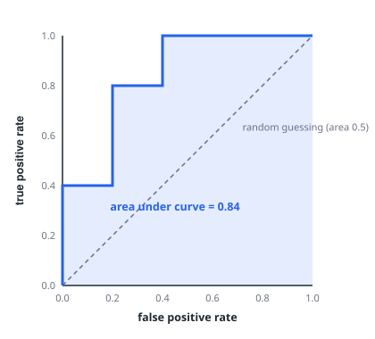

# SSG 518 Mock Exam 4

The last full practice paper in the format of the real SSG 518 (Artificial Intelligence II) exam, with new questions on the same topics. Like the real paper, it mixes "with the aid of a diagram" questions, calculations and a broken table you have to spot. Sit it like the real thing: closed book, on paper, with a calculator, in one go.

**Instructions:** answer any **four** questions. Each question carries 15 marks, so the paper is out of 60. Time allowed: **2 hours**, about 30 minutes a question. Draw neat, labelled diagrams where a question asks for one. Where a question asks for a number, give it to at least 3 significant figures. The worked answers and marking scheme open after you submit; mark your own long answers and drawings against them honestly.

## Question 1

Parts (b) to (d) use these six labelled training points, each with two features.

| Point | Class | Feature 1 | Feature 2 |
|---|---|---|---|
| 1 | A | 1 | 1 |
| 2 | A | 2 | 2 |
| 3 | A | 5 | 4 |
| 4 | B | 4 | 6 |
| 5 | B | 6 | 5 |
| 6 | B | 6 | 7 |

### (a) Classification and clustering
<!-- q: open id="2366f5b5" marks="6" -->

With the aid of diagrams, distinguish classification from clustering in pattern recognition, and give a real example of each. (6 marks)

Solution

**The diagrams (2 marks):**

**What to check in your diagrams:**

- Classification: points drawn in two different marks (or colours) for the two labelled classes, with a boundary line between them.
- Clustering: points all drawn the same (no labels), with the groups the method finds circled.
- Both diagrams labelled with their names.

**The difference (2 marks).** Classification is **supervised**: it learns from examples whose class is known, then assigns new items to one of those known classes. Clustering is **unsupervised**: there are no labels, and it groups items by similarity, discovering groups nobody named in advance.

**Examples (2 marks).** Classification: sorting emails into spam or not spam, from emails already labelled. Clustering: grouping a bank's customers by spending patterns to find customer types nobody had defined.

**Revise:** [[machine-learning/03-classical-ml/21-pattern-recognition-1|Pattern Recognition 1]].

### (b) Distances to a new point
<!-- q: exact id="ceead697" marks="3" answer="2.236068" sigfigs="3" accept="√5|sqrt(5)" -->

A new point is at (4, 4). Using Euclidean distance, how far is it from its **third**-nearest training point? (3 marks)

Solution

The distances from (4, 4): point 3 (5, 4) is 1; point 4 (4, 6) is 2; point 5 (6, 5) is $\sqrt{4 + 1} = \sqrt{5} = 2.24$; point 2 (2, 2) is $\sqrt{8} = 2.83$; the rest are further. So the third-nearest is point 5, at **2.24**.

### (c) The effect of k
<!-- q: gap id="9640d976" marks="4" answers="A;B" -->

Fill in the class K-nearest neighbour predicts for the new point (4, 4). (4 marks)

With $k = 1$, KNN predicts class ___. With $k = 3$, KNN predicts class ___.

Solution

1. **$k = 1$: A.** The single nearest point is point 3, class A, at distance 1.
2. **$k = 3$: B.** The three nearest are point 3 (A), point 4 (B) and point 5 (B): two votes to one for **B**.

### (d) Choosing k
<!-- q: open id="a6cefec0" marks="2" -->

Why did the prediction change, and how would you choose $k$ in practice? (2 marks)

Solution

With $k = 1$ the prediction rests on one point, so a single nearby example (perhaps an unusual one) decides it; a larger $k$ smooths that out by voting, but too large a $k$ blurs the boundary and lets the bigger class win. In practice, choose $k$ by cross-validation, trying several odd values (odd avoids ties between two classes) and keeping the one with the best validated score.

**Revise:** [[machine-learning/03-classical-ml/01-k-nearest-neighbours-1|K-Nearest Neighbours 1]].

## Question 2

Parts (c) and (d) use this confusion matrix, from a classifier tested on 100 cases: 30 true positives, 10 false negatives, 20 false positives and 40 true negatives.

### (a) The ROC curve
<!-- q: open id="f832757a" marks="5" -->

With the aid of a sketch, explain what an ROC curve shows and what the area under it (the ROC area) tells you about a classifier. (5 marks)

Solution

**The sketch (2 marks).** For example, this classifier, scored on ten cases:

**What to check in your sketch:**

- Axes labelled: false positive rate across, true positive rate up, both from 0 to 1.
- The diagonal from (0, 0) to (1, 1) drawn as random guessing.
- A curve rising from (0, 0) to (1, 1) above the diagonal.

**What it shows (2 marks).** A classifier outputs a score, and predicts positive when the score is above a threshold. Each threshold gives one point: the fraction of real positives caught (true positive rate) against the fraction of negatives wrongly flagged (false positive rate). Sliding the threshold from strict to lenient traces the curve.

**The area (1 mark).** It summarises separation across *all* thresholds: 1 is perfect, 0.5 is no better than guessing. Here 0.84 means a randomly chosen positive case gets a higher score than a randomly chosen negative 84% of the time.

**Revise:** [[machine-learning/03-classical-ml/24-parametric-and-non-parametric-classifiers-2|Parametric and Non-Parametric Classifiers 2]], [[machine-learning/04-model-evaluation/02-evaluation-metrics-2|Evaluation Metrics 2]].

### (b) Reading a results table
<!-- q: open id="60e5bec8" marks="5" -->

Three classifiers were tested two ways on the same dataset. Analyse and interpret the results, and say which classifier you would use and why.

| Classifier | Kappa (training set) | ROC area (training set) | Kappa (10-fold) | ROC area (10-fold) |
|---|---|---|---|---|
| KNN, $k = 1$ | 1.000 | 1.000 | 0.31 | 0.66 |
| Naive Bayes | 0.42 | 0.78 | 0.39 | 0.75 |
| Decision tree (unpruned) | 0.88 | 0.95 | 0.28 | 0.63 |

(5 marks)

Solution

1. **The training-set scores flatter (1 mark).** KNN with $k = 1$ scores a perfect 1.000 on the training set because every training point is its own nearest neighbour: it's memory, not prediction. The unpruned tree does the same by growing a leaf for almost every example.
2. **Cross-validation is the honest test (1 mark).** Under 10-fold cross-validation both collapse: KNN to kappa 0.31, the tree to 0.28, with ROC areas only a little above 0.5. That gap is **overfitting**.
3. **Naive Bayes barely changes (1 mark):** 0.42 to 0.39, ROC 0.78 to 0.75. A simple parametric model can't memorise, so what it scores on training data is close to what it scores on new data.
4. **Choice (2 marks): naive Bayes.** It has the best cross-validated kappa (0.39, just below moderate) and ROC area (0.75), and the smallest gap, so it's the most trustworthy on new cases. KNN might be improved with a larger $k$, and the tree by pruning, but as tested they generalise worst.

### (c) Chance agreement
<!-- q: exact id="c05507e1" marks="2" answer="0.5" accept="1/2|50%" -->

For the confusion matrix above, what is $p_e$, the agreement expected by chance, used in Cohen's kappa? (2 marks)

Solution

40 cases are really positive ($30 + 10$) and the classifier said "positive" 50 times ($30 + 20$); 60 are really negative and it said "negative" 50 times. $p_e = (40 \times 50 + 60 \times 50) / 100^2 = 5{,}000 / 10{,}000 = 0.5$.

### (d) Kappa
<!-- q: exact id="f493a8fc" marks="3" answer="0.4" accept="2/5" -->

For the same confusion matrix, what is Cohen's kappa? (3 marks)

Solution

$p_o = (30 + 40) / 100 = 0.7$, so $\kappa = (0.7 - 0.5) / (1 - 0.5) = 0.4$: **moderate**, the bottom of the 0.40–0.59 band, though the accuracy is 70%.

**Revise:** [[machine-learning/03-classical-ml/24-parametric-and-non-parametric-classifiers-2|Parametric and Non-Parametric Classifiers 2]].

## Question 3

Parts (b) to (d) use this state space. Each state's neighbours are listed in the order a search tries them.

| State | Neighbours |
|---|---|
| A | B, C |
| B | A, D |
| C | A, D |
| D | B, C, E |
| E | D |

### (a) State space and search tree
<!-- q: open id="d6f61d31" marks="6" -->

With the aid of diagrams, explain the difference between a state space and a search tree, using this state space and its search tree from A down to depth 3. Explain why graph search is used instead of tree search. (6 marks)

Solution

**The diagrams (2 marks):**

**What to check in your diagrams:**

- The state space has each of the five states exactly once, with the five connections.
- The tree has A at the root, B and C below it, and keeps branching to depth 3, with states repeated (A, B and C appear several times).
- Both are labelled.

**The difference (2 marks).** The **state space** has each state once: 5 states here. The **search tree** has one node per *path* the search tries, so a state appears once for every way of reaching it: down to depth 3 there are already 17 nodes. Because A–B–D–C–A is a loop, the tree would grow forever.

**Graph search (2 marks).** Tree search re-expands the same state every time it reaches it by a new path, wasting time and possibly looping forever. Graph search keeps an **explored set** and never expands a state twice, so on this space it expands at most 5 states.

**Revise:** [[artificial-intelligence/02-uninformed-search/01-what-search-is|What Search Is]].

### (b) Breadth-first order
<!-- q: exact id="f7195518" marks="3" answer="A, B, C, D, E" accept="ABCDE" -->

Breadth-first graph search starts at A and is run until the frontier is empty. In what order are the states expanded? (3 marks)

Solution

**A, B, C, D, E.** Expand A: queue B, C. Expand B: A is seen, add D. Expand C: A and D are seen. Expand D: add E. Expand E. Level by level: A at depth 0, B and C at 1, D at 2, E at 3.

### (c) Depth-first order
<!-- q: exact id="27ff4899" marks="3" answer="A, B, D, C, E" accept="ABDCE" -->

Depth-first graph search starts at A, goes to the first unvisited neighbour each time, and never revisits a state. In what order does it visit the states? (3 marks)

Solution

**A, B, D, C, E.** From A go to B; from B (A visited) to D; from D (B visited) to C; from C, A and D are visited, so back up to D and go to E.

### (d) Which is better here?
<!-- q: open id="98064c3d" marks="3" -->

The goal is E. Compare breadth-first and depth-first search on this space for completeness, the length of the path each returns, and memory. (3 marks)

Solution

1. **Completeness (1 mark):** both are complete here: the space is finite and both keep a visited set.
2. **Path (1 mark):** BFS returns A → B → D → E, 3 steps, the fewest possible. DFS reaches E by A → B → D → C, backing up, then D → E: its path is also A → B → D → E here, but only by luck of the neighbour order; in general DFS returns whatever it reaches first, not the shortest.
3. **Memory (1 mark):** BFS keeps a whole level in its queue, $O(b^d)$; DFS keeps only the current path and its waiting siblings, $O(bm)$. On five states it doesn't matter; on a large space DFS needs far less.

**Revise:** [[artificial-intelligence/02-uninformed-search/03-breadth-first-search|Breadth-First Search]], [[artificial-intelligence/02-uninformed-search/04-depth-first-search|Depth-First Search]].

## Question 4

Parts (a) and (b) use this 8-puzzle state, row by row: 1 2 3 / 7 4 6 / _ 5 8 (where _ is the blank). The goal is 1 2 3 / 4 5 6 / 7 8 _.

### (a) Misplaced tiles
<!-- q: exact id="8df7bd5c" marks="2" answer="4" -->

What is the misplaced-tiles heuristic $h_1$ for this state? (2 marks)

Solution

**4**: tiles 7, 4, 5 and 8 are out of place; 1, 2, 3 and 6 are home.

### (b) Manhattan distance
<!-- q: exact id="80862f2e" marks="2" answer="4" -->

What is the Manhattan-distance heuristic $h_2$ for this state? (2 marks)

Solution

**4.** Each misplaced tile is exactly one square from home: 7 one row up, 4 one column right, 5 one row down, 8 one column left. So here $h_2 = h_1$; dominance means $h_2 \ge h_1$, and equality is allowed.

**Revise:** [[artificial-intelligence/03-heuristic-search/06-heuristics-for-the-8-puzzle|Heuristics for the 8-Puzzle]].

### (c) The water jugs
<!-- q: open id="a1d6c727" marks="6" -->

You have a 5-litre jug and a 3-litre jug, a tap, and no markings. You can fill a jug, empty a jug, or pour one into the other until the first is empty or the second is full. Formulate this as a state-space search problem and find the fewest actions that leave exactly 4 litres in the 5-litre jug. (6 marks)

Solution

**Formulation (3 marks).** State $(a, b)$: litres in the 5-litre and 3-litre jugs. Initial state $(0, 0)$. Actions: fill either jug, empty either jug, pour one into the other (pouring $a$ into $b$ moves $\min(a, 3 - b)$). Goal test: $a = 4$. Path cost: 1 per action.

**Solution (3 marks): 6 actions**, found by breadth-first search:

| Action | State $(a, b)$ |
|---|---|
| Start | (0, 0) |
| Fill the 5-litre jug | (5, 0) |
| Pour the 5-litre into the 3-litre | (2, 3) |
| Empty the 3-litre jug | (2, 0) |
| Pour the 5-litre into the 3-litre | (0, 2) |
| Fill the 5-litre jug | (5, 2) |
| Pour the 5-litre into the 3-litre | (4, 3) |

The last pour only fits 1 litre, because the 3-litre jug already holds 2, so 4 are left.

**Revise:** [[artificial-intelligence/01-foundations/06-problem-solving-in-ai|Problem Solving in AI]].

### (d) Roulette-wheel selection
<!-- q: exact id="8ee50ee1" marks="2" answer="0.403226" sigfigs="3" -->

A genetic algorithm's population is 11001, 01010, 10100 and 00111, with fitness equal to the number $x$ each 5-bit string represents. What is the probability that 11001 is chosen on one spin of the roulette wheel? (2 marks)

Solution

The fitnesses are 25, 10, 20 and 7, total 62. $P(11001) = 25 / 62 = 0.403$.

### (e) Crossover
<!-- q: gap id="e6fc9303" marks="3" answers="11000;10101" -->

11001 and 10100 are crossed over with the cut after bit 3. Fill in the two children. (3 marks)

The child that starts like 11001 is ___, and the child that starts like 10100 is ___.

Solution

Cut as 110 | 01 and 101 | 00, and swap the tails: **11000** (24) and **10101** (21).

**Revise:** [[artificial-intelligence/03-heuristic-search/11-genetic-algorithms|Genetic Algorithms]].

## Question 5

A survey records when a lecture is held, X = {morning, afternoon, evening}, and whether a student attends, Y = {attend, absent}. The table gives the joint probabilities as printed.

| Y \ X | Morning | Afternoon | Evening |
|---|---|---|---|
| Attend | 3/8 | 1/8 | 1/8 |
| Absent | 1/8 | 1/8 | 0 |

### (a) Check the table
<!-- q: exact id="3ce18e1d" marks="2" answer="0.875" accept="7/8" -->

What do the six probabilities add up to? (2 marks)

Solution

$\frac{3}{8} + \frac{1}{8} + \frac{1}{8} + \frac{1}{8} + \frac{1}{8} + 0 = \frac{7}{8} = 0.875$.

### (b) What to do about it
<!-- q: open id="b41eae9c" marks="2" -->

What is wrong with the table, and how should you proceed in the exam? (2 marks)

Solution

A joint probability distribution must add up to exactly 1, and this one adds up to 7/8, so it isn't valid as printed. Say so in one line, then **normalise**: divide every entry by 7/8 (multiply by 8/7), which keeps the proportions and makes the total 1. That turns 3/8 into 3/7 and each 1/8 into 1/7. State the fix and carry on.

### (c) H(X)
<!-- q: exact id="35be9fa0" marks="3" answer="1.378783" sigfigs="3" -->

Using the normalised table, what is $H(X)$, in bits? (3 marks)

Solution

Normalised column totals: $p(\text{morning}) = 3/7 + 1/7 = 4/7$, $p(\text{afternoon}) = 2/7$, $p(\text{evening}) = 1/7$. So $H(X) = -\left[\frac{4}{7}\log_2\frac{4}{7} + \frac{2}{7}\log_2\frac{2}{7} + \frac{1}{7}\log_2\frac{1}{7}\right] = 0.4613 + 0.5164 + 0.4011 = 1.38$ bits.

### (d) H(X, Y)
<!-- q: exact id="48d0581e" marks="4" answer="2.128085" sigfigs="3" -->

Using the normalised table, what is the joint entropy $H(X, Y)$, in bits? (4 marks)

Solution

One cell is 3/7, four are 1/7, and one is 0 (which adds nothing, since $0 \log 0 = 0$): $H(X, Y) = \frac{3}{7}\log_2\frac{7}{3} + 4 \times \frac{1}{7}\log_2 7 = 0.5239 + 4(0.4011) = 2.13$ bits.

### (e) I(X; Y)
<!-- q: exact id="ba1b2591" marks="4" answer="0.1138188" sigfigs="3" -->

Using the normalised table, what is the mutual information $I(X; Y)$, in bits? (4 marks)

Solution

First $H(Y)$: the normalised row totals are $p(\text{attend}) = 5/7$ and $p(\text{absent}) = 2/7$, so $H(Y) = 0.3467 + 0.5164 = 0.8631$ bits. Then

$$I(X; Y) = H(X) + H(Y) - H(X, Y) = 1.3788 + 0.8631 - 2.1281 = 0.114 \text{ bits}$$

Knowing when the lecture is held tells you a little about whether a student attends: evening lectures, in this survey, are always attended.

**Revise:** [[information-theory/02-entropy-joint-conditional-and-mutual|Entropy, Joint, Conditional and Mutual Information]].

## Question 6

Nim is played on stacks of tokens. A move picks one stack and splits it into two non-empty stacks of **different** sizes; a player who can't move loses. The game starts with one stack of **6** tokens, and **MAX moves first**. A terminal state where MAX has won has utility 1; where MIN has won, utility 0.

### (a) Who wins
<!-- q: mcq id="2f1a7133" marks="2" -->

If both players play perfectly, who wins? (2 marks)

- [x] MAX, the first player
- [ ] MIN, the second player
- [ ] It depends on MIN's first move

Solution

**MAX**: the root's minimax value is 1.

### (b) The game tree
<!-- q: sketch id="ac96452c" marks="8" -->

Draw the complete game tree, writing each position as its stack sizes with whose turn it is, and apply minimax to give every position its utility. Draw a position reached by two routes only once. (8 marks)

Solution

From 6, MAX can split into 5-1 or 4-2. A stack of 1 or 2 can't be split (2 would make 1 and 1, which are equal), so the game ends when every stack is 1 or 2.

**Backing up the values:**

1. **2-2-1-1, MIN to move:** MIN can't move, so MAX has won: **1**.
2. **2-1-1-1-1, MAX to move:** MAX can't move: **0**.
3. **3-2-1, MAX to move:** only move to 2-2-1-1 (1): **1**.
4. **3-1-1-1, MIN to move:** only move to 2-1-1-1-1 (0): **0**.
5. **4-1-1, MAX to move:** only move to 3-1-1-1 (0): **0**.
6. **4-2, MIN to move:** only move to 3-2-1 (1): **1**.
7. **5-1, MIN to move:** to 4-1-1 (0) or 3-2-1 (1); MIN takes **0**.
8. **6, MAX to move:** to 5-1 (0) or 4-2 (1); MAX takes **1**.

**What to check in your drawing:**

- Eight positions, each with its stacks, whose turn it is, and its value: 3-2-1 drawn once, with arrows from both 5-1 and 4-2.
- The two terminal positions, 2-2-1-1 (value 1) and 2-1-1-1-1 (value 0).
- The root valued 1, with MAX's move to 4-2 marked as the winning one.

### (c) The strategy, and why chess is different
<!-- q: open id="8570c939" marks="5" -->

Describe MAX's winning strategy, and explain why minimax can solve Nim completely but can only estimate in chess. (5 marks)

Solution

**The strategy (2 marks).** MAX must split 6 into **4-2**, not 5-1. From 4-2, MIN's only move is to 3-2-1; MAX then splits the 3, leaving 2-2-1-1, and MIN can't move. If MAX wrongly plays 5-1, MIN replies 4-1-1 and MAX loses.

**Why Nim can be solved (1 mark):** the tree is tiny, 8 positions, so minimax can search every line to the end and back up exact win/loss values.

**Why chess can't (2 marks):** chess has a branching factor around 35 and games of about 80 moves each, roughly $35^{80}$ positions, far beyond any computer. So programs search to a fixed depth, estimate the positions there with an evaluation function, and back those estimates up; the result is a good move, not a proven one, and it suffers from the horizon effect.

**Revise:** [[artificial-intelligence/04-adversarial-search/06-nim|Nim]], [[artificial-intelligence/04-adversarial-search/03-minimax-2|Minimax 2]].

## About this paper

Written for the AI subject on 2026-11-26 in the format of the 2025/26 SSG 518 paper ([[artificial-intelligence/mock-exam-1|Mock Exam 1]]): six questions on the same topics, answer any four in 2 hours. The questions are new, not taken from the lessons, the checkpoints or the past papers; the [[artificial-intelligence/question-bank|AI question bank]] has more practice. Every number, trace and diagram is computed and asserted by `scripts/diagrams/ai_mocks.py`, which also draws the four answer pictures. The results table in Question 2(b) is invented to show overfitting, not taken from a study. The mark split inside each worked answer is a guide for marking yourself, not an official scheme.
