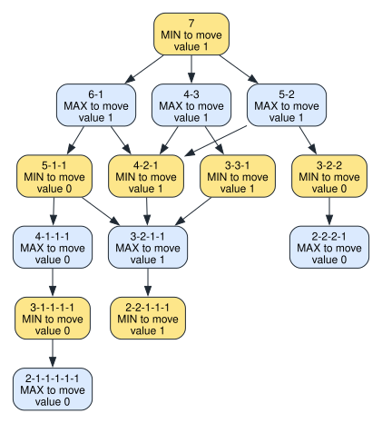
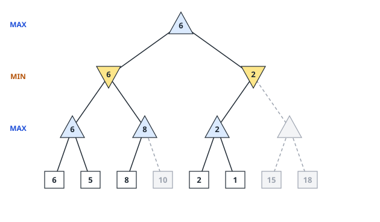
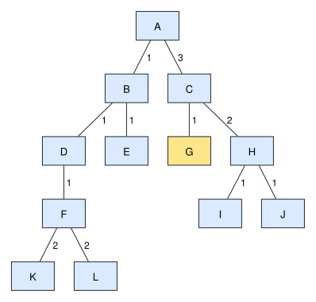

# SSG 503 Revision Questions

The questions that keep coming back in the older SSG 503 (Artificial Intelligence) papers, with worked solutions. SSG 503 was the course before SSG 518, with the same lecturers' topics, so its calculations and theory questions are good practice for the SSG 518 exam. Each question points to the lesson that teaches the method, and the worked solution is hidden under **Solution** so you attempt it first.

**How to use this:** pick a question on a section you've finished and attempt it closed-book, on paper, with a calculator. Open the solution only after you have an answer, then compare step by step. For timed practice on the real SSG 518 paper, sit [[artificial-intelligence/mock-exam-1|SSG 518 Mock Exam 1]].

**Which papers are here:** SSG 503, 2012/13, 2014/15, 2015/16, 2016/17, 2017/18 and 2019/20. Questions SSG 503 asked that aren't on the SSG 518 outline (speech recognition, speech feature vectors, morphemes and parsing) are left out.

**One of the papers' tables is broken**, and the solution shows what to do: the 2019/20 entropy table adds up to 2. In an exam, say so in one line, state the fix you're using, and carry on.

## Calculation questions

### Cryptarithmetic: `BASE + BALL = GAMES` (2019/20)

→ [[artificial-intelligence/05-constraint-satisfaction/02-cryptarithmetic-1|Cryptarithmetic 1]], [[artificial-intelligence/05-constraint-satisfaction/03-cryptarithmetic-2|Cryptarithmetic 2]]

**(i) What is cryptarithmetic? (2 marks) (ii) Solve: `BASE + BALL = GAMES`. (8 marks)**

Solution

**(i)** A cryptarithmetic puzzle is a sum in which each letter stands for a different digit. The rules: digits are 0 to 9; each letter has one value and different letters have different values; a number can't begin with 0; and ordinary arithmetic must hold once the letters are replaced. It's a constraint satisfaction problem, solved by reasoning about each column and its carry, with backtracking when a guess breaks a rule.

**(ii)** Columns from the right are 1 (units) to 5. Write $c_1, c_2, c_3, c_4$ for the carries.

1. **Column 5:** `GAMES` has 5 letters and the addends have 4, so G is a carry: **G = 1**.
2. **Column 4:** B + B + $c_3$ = A + 10. So $2B + c_3 \ge 10$, and B is at least 5.
3. **Column 3:** A + A + $c_2$ = M + 10$c_3$.
4. **Column 2:** S + L + $c_1$ = E + 10$c_2$.
5. **Column 1:** E + L = S + 10$c_1$.
6. Trying values with these constraints (B from 5 to 9) gives one solution: **B = 7, A = 4, S = 8, E = 3, L = 5, M = 9, G = 1**.
7. **Check:** 7483 + 7455 = 14938. Column 1: 3 + 5 = 8 = S, no carry. Column 2: 8 + 5 = 13: E = 3, carry 1. Column 3: 4 + 4 + 1 = 9 = M. Column 4: 7 + 7 = 14: A = 4, carry 1 = G. ✓

It's the only solution.

### Cryptarithmetic: `RED + ROE = DEER` (2012/13, 2014/15, 2016/17)

→ [[artificial-intelligence/05-constraint-satisfaction/03-cryptarithmetic-2|Cryptarithmetic 2]]

**Without necessarily solving the problem, draw a search tree for the solution of `RED + ROE = DEER`, explaining in detail the basis for the branching at each level.**

Solution

**The basis for branching.** Work column by column from the right. In each column the unknown is whether that column produces a carry (0 or 1), so each level of the tree branches two ways: **no carry** and **carry**. A branch dies as soon as its column equation can't be satisfied with distinct digits.

1. **Root:** `RED + ROE = DEER`. `DEER` has one more digit than the addends, so **D = 1** (the final carry).
2. **Level 1, units:** D + E = R + 10$c_1$, i.e. 1 + E = R + 10$c_1$. Branches: $c_1 = 0$ (R = E + 1) and $c_1 = 1$ (E = 9, R = 0, which fails, since R leads a number and can't be 0).
3. **Level 2, tens:** E + O + $c_1$ = E + 10$c_2$, so O + $c_1$ = 10$c_2$. Branches: $c_2 = 0$ (O = 0 when $c_1 = 0$) and $c_2 = 1$ (O = 10 − $c_1$, impossible for a digit when $c_1 = 0$).
4. **Level 3, hundreds:** R + R + $c_2$ = E + 10$c_3$, with $c_3 = 1$ = D. With $c_2 = 0$: 2R = E + 10, and with R = E + 1: 2E + 2 = E + 10, so **E = 8, R = 9**.

Drawing it: the root box, two children for $c_1$ (one crossed out), two children for $c_2$ under the live one (one crossed out), then the final column.

**The solution the tree leads to:** R = 9, E = 8, D = 1, O = 0. Check: 981 + 908 = 1889. ✓ It's unique.

### Cryptarithmetic: `SEND + MORE = MONEY`, and `CROSS + ROADS = DANGER` (SSG 503 class exercises)

Solution

**`SEND + MORE = MONEY`:** M = 1 (the carry into the fifth column), then O = 0, S = 9, E = 5, N = 6, D = 7, R = 8, Y = 2. Check: 9567 + 1085 = 10652. ✓ Unique.

**`CROSS + ROADS = DANGER`:** D = 1 (the carry), then C = 9, R = 6, O = 2, S = 3, A = 5, N = 8, G = 7, E = 4. Check: 96233 + 62513 = 158746. ✓ Unique.

### Missionaries and cannibals (2019/20)

→ [[artificial-intelligence/02-uninformed-search/11-river-crossing-puzzles|River-Crossing Puzzles]]

**On one bank of a river are three missionaries and three cannibals. There is one boat available that can hold up to two people. If the cannibals ever outnumber the missionaries on either bank, the missionaries will get eaten. How can the boat be used to safely carry all the missionaries and cannibals across the river? (7 marks)**

Solution

**Formulation.** A state is (missionaries on the start bank, cannibals on the start bank, boat on the start bank or not), so the start is (3, 3, start) and the goal (0, 0, far). Actions: the boat carries 1 or 2 people (two missionaries, two cannibals, one of each, or one person alone) to the other side. A state is legal only if, on each bank, missionaries are either 0 or at least as many as cannibals.

**Solution: 11 crossings** (the fewest, found by breadth-first search). The numbers are what's left on the start bank.

| Crossing | Boat carries | Start bank (M, C) | Far bank (M, C) |
|---|---|---|---|
| 1 | 2 cannibals across | 3, 1 | 0, 2 |
| 2 | 1 cannibal back | 3, 2 | 0, 1 |
| 3 | 2 cannibals across | 3, 0 | 0, 3 |
| 4 | 1 cannibal back | 3, 1 | 0, 2 |
| 5 | 2 missionaries across | 1, 1 | 2, 2 |
| 6 | 1 missionary and 1 cannibal back | 2, 2 | 1, 1 |
| 7 | 2 missionaries across | 0, 2 | 3, 1 |
| 8 | 1 cannibal back | 0, 3 | 3, 0 |
| 9 | 2 cannibals across | 0, 1 | 3, 2 |
| 10 | 1 cannibal back | 0, 2 | 3, 1 |
| 11 | 2 cannibals across | 0, 0 | 3, 3 |

Check every row: no bank ever has missionaries outnumbered while missionaries are present. Crossing 6 is the clever step: one missionary and one cannibal go back together, so both banks stay balanced.

### Nim with 7 tokens (2019/20)

→ [[artificial-intelligence/04-adversarial-search/06-nim|Nim]]

**Nim: the game starts with a single stack of 7 tokens. At each move a player selects one stack and divides it into two non-empty, non-equal stacks. A player who is unable to move loses. MIN plays first. A terminal state that is a win for MIN gets utility 0; a win for MAX gets utility 1. (b) Apply the minimax algorithm to the search tree to assign utilities to all states. (3 marks) (c) If both MIN and MAX play a perfect game, who will win? Explain. (3 marks)**

Solution

**(b)** From 7, MIN can split into 6-1, 5-2 or 4-3. Keep splitting until no stack can be divided (stacks of 1 and 2 can't be split into two unequal non-empty parts). A terminal state is a loss for whoever is to move there. Back up: max at MAX's turns, min at MIN's turns. (Identical states reached by different routes are drawn once.)

**(c) MAX wins.** The root's value is 1. Whatever MIN does first (6-1, 5-2 or 4-3), MAX has a reply worth 1: from 6-1 or 5-2 MAX moves to 4-2-1, and from 4-3 to 4-2-1 or 3-3-1. From those, every line ends with MIN facing a position with no legal move (2-2-1-1-1), so MIN loses. MIN's only hope is MAX making a mistake.

### Alpha-beta on the A–O tree (2019/20)

→ [[artificial-intelligence/04-adversarial-search/04-alpha-beta-pruning-1|Alpha-Beta Pruning 1]]

**Given the search tree (MAX root A; MIN nodes B, C; MAX nodes D, E, F, G; leaves H = 6, I = 5, J = 8, K = 10, L = 2, M = 1, N = 15, O = 18), apply alpha-beta pruning and show where the alpha and beta cuts are applied and which parts of the tree are pruned. (9 marks)**

Solution

1. **D** (MAX): H = 6, I = 5 → D = 6. **B** now has $\beta = 6$.
2. **E** (MAX), passed $\beta = 6$: J = 8 → $\alpha = 8 \ge \beta = 6$. **Beta cut: prune K.** E returns 8.
3. **B** = min(6, 8) = 6. **A** now has $\alpha = 6$.
4. **F** (MAX), passed $\alpha = 6$: L = 2, M = 1 → F = 2 (neither beats $\alpha$).
5. **C** (MIN): $\beta = 2 \le \alpha = 6$. **Alpha cut: prune G** and its leaves N and O.
6. **A** = max(6, 2) = **6**.

Leaves examined: H, I, J, L, M (5 of 8). The cut at E is a **beta cut** (a MAX node stops because MIN above already has better); the cut at C is an **alpha cut** (a MIN node stops because MAX above already has better).

### Search orders on a tree with arc lengths (2015/16)

→ [[artificial-intelligence/02-uninformed-search/10-comparing-uninformed-search|Comparing Uninformed Search Methods]]

**Consider the tree below (numbers on arcs are arc lengths). Nodes are expanded in alphabetical order when no other order is specified, the goal is G, and no visited or expanded lists are used. What order would the states be expanded in by each type of search? Stop when you expand G.**

Solution

1. **Breadth-first:** A, B, C, D, E, G.
2. **Depth-first:** A, B, D, F, K, L, E, C, G.
3. **Uniform-cost** (by path cost, ties alphabetical): A (0), B (1), D (2), E (2), C (3), F (3), G (4).
4. **Iterative deepening:** limit 0: A. Limit 1: A, B, C. Limit 2: A, B, D, E, C, G.

### Backtracking depth-first search space (2015/16)

**A backtracking depth-first search generates only one child at a time, backtracking to the last node with unchecked children when it reaches a dead end. With branching factor $b$, maximum depth $m$ and the first goal at depth $d$, what is its space complexity?**

Solution

**$O(m)$.** Ordinary depth-first search stores, at each level of the current path, all the siblings it hasn't tried yet: $O(bm)$. Backtracking search generates one child at a time and only remembers which child to try next, so it stores just the current path, at most $m$ nodes deep.

### Entropy from a joint table (2019/20)

→ [[information-theory/02-entropy-joint-conditional-and-mutual|Entropy, Joint, Conditional and Mutual Information]]

**Find the entropy of the following (15 marks):**

| X | Y | P(X, Y) |
|---|---|---|
| \* | \* | 1/8 |
| 1 | a | 1/16 |
| 0 | b | 1/8 |
| 1 | c | 1/2 |
| 0 | d | 1/16 |
| 0 | a | 1/4 |
| 1 | b | 1/8 |
| 0 | c | 1/4 |
| 1 | d | 1/2 |

Solution

**Check the table first.** The probabilities add up to **2**, not 1, so it isn't a valid distribution. (This is the same table worked in the SSG 518 class notes, which ended with a negative entropy and a mutual information larger than either entropy, both impossible.) State the fix: "The table sums to 2, so I divide every entry by 2." Each probability halves: 1/16, 1/32, 1/16, 1/4, 1/32, 1/8, 1/16, 1/8, 1/4.

**Joint entropy:** $H(X,Y) = -\sum p \log_2 p = 2.8125$ bits.

**Marginals:** p(X = \*) = 1/16, p(X = 1) = 19/32, p(X = 0) = 11/32. p(Y = \*) = 1/16, p(a) = 5/32, p(b) = 1/8, p(c) = 3/8, p(d) = 9/32.

**H(X) = 1.2261 bits, H(Y) = 2.0888 bits**, so the mutual information is $I = H(X) + H(Y) - H(X,Y) = 0.5024$ bits.

Every result is non-negative, and $I$ is smaller than both $H(X)$ and $H(Y)$, as it must be.

### Why a loaded coin has lower entropy (2016/17, 2017/18)

→ [[information-theory/01-what-information-is|What Information Is]]

**Explain, using sample numerical values, why the entropy of a loaded coin is lower than that of a fair coin.**

Solution

$H = -[p \log_2 p + (1-p)\log_2(1-p)]$, where $p$ is the probability of heads.

| P(heads) | P(tails) | Entropy (bits) |
|---|---|---|
| 0.5 | 0.5 | 1.000 |
| 0.4 | 0.6 | 0.971 |
| 0.3 | 0.7 | 0.881 |
| 0.2 | 0.8 | 0.722 |
| 0.1 | 0.9 | 0.469 |

Entropy measures uncertainty. A fair coin is as unpredictable as a two-outcome event can be, so each toss carries the full 1 bit. A loaded coin mostly lands the same way, so you can often guess the result; each toss surprises you less and carries less information. At the extreme, a two-headed coin has entropy 0: every toss is certain.

### Classifying leaves by nearest neighbour and centroid (2012/13, 2014/15)

→ [[machine-learning/03-classical-ml/22-pattern-recognition-2|Pattern Recognition 2]], [[machine-learning/03-classical-ml/01-k-nearest-neighbours-1|K-Nearest Neighbours 1]]

**A chart shows a two-dimensional plot of two features of leaves: class 1 points around feature 1 = 8 to 13, feature 2 = 9 to 13; class 2 around 10 to 14, 3 to 6; class 3 around 28 to 37, 15 to 20. Classify these samples using both the nearest neighbour and centroid methods: (a) 14 mm, 6.5 mm; (b) 10 mm, 13.5 mm; (c) 35 mm, 18 mm.**

Solution

**Method.** Nearest neighbour: find the single closest plotted point and take its class. Centroid: average each class's points to get its centre, then take the class whose centre is closest. Use Euclidean distance.

Centres read off the chart (approximate, which the examiner accepts): class 1 ≈ (10, 11), class 2 ≈ (12, 4.5), class 3 ≈ (31, 16.5).

1. **(a) (14, 6.5):** distance to class 2's centre ≈ 2.83; to class 1's ≈ 6.02; class 3 is far. The nearest plotted point is also a class 2 point (around (14, 6)). **Class 2** by both methods.
2. **(b) (10, 13.5):** right above the class 1 group; nearest point and nearest centre are both class 1. **Class 1** by both.
3. **(c) (35, 18):** inside the class 3 group. **Class 3** by both.

Say in your answer that the two methods agree here because the classes are well separated; they would differ for a point near the edge of a long or oddly shaped class, where one plotted point can be closer than the class's centre.

---

## Theory questions that keep coming back

These appear in the SSG 503 papers year after year. Short model answers; follow the link for the full lesson.

### Intelligence and artificial intelligence

**Define intelligence and propose a definition for AI. Explain how the difficulty of defining intelligence is solved to allow a working definition. (2012/13, 2014/15, 2016/17, 2017/18, 2015/16)**

Solution

Intelligence can't be defined exactly, but it can be recognised: we define it by intelligent behaviour, the ability to acquire knowledge and use it to act sensibly in new situations. So a working definition of AI defines it by what a system *does*, not by what thinking *is*: AI is the design of computer systems that perform tasks which would need intelligence if a person did them. That is the "acting" side of the four approaches, and the Turing test is one way of checking it. See [[artificial-intelligence/01-foundations/02-ways-of-knowing|Ways of Knowing]], [[artificial-intelligence/01-foundations/01-what-ai-is|What Artificial Intelligence Is]] and [[artificial-intelligence/01-foundations/03-the-four-approaches-to-ai|The Four Approaches to AI]].

### The three ways of knowing

**Humans can answer "How do you know?" in three primary ways. Enumerate them and say which demand intelligence; relate them to how humans interact with the environment; explain the relationship in the light of the data–knowledge continuum.**

Solution

From the SSG 503 notes:

1. **By recall (experience):** you remember it. Books and databases recall better than humans, so recall alone doesn't need intelligence.
2. **By calculation:** you work it out by a fixed procedure. Calculation can be routinely mechanised, so it doesn't demand intelligence either, but it can't handle what wasn't anticipated.
3. **By reasoning:** you infer something new from what you know, by manipulating symbols. **This one demands intelligence.**

**Relation to the environment:** humans sense the environment (stimulation of the sense organs), interpret what is sensed (perception), and then use recall, calculation or reasoning to decide and act (cognition).

**The data–knowledge continuum** (taught in [[artificial-intelligence/01-foundations/02-ways-of-knowing|Ways of Knowing]]): data is raw facts and figures; information is processed data; knowledge is applied information, information with rules for its use, and it is dynamic. Recall works mostly on stored data, calculation turns data into information, and reasoning turns information into knowledge that can be applied to new situations.

### Weak and strong AI; narrow intelligence (2015/16, 2016/17)

Solution

**Weak (narrow) AI** is built for one task, such as playing chess, filtering spam or planning a route, and has no general understanding beyond it. Every AI system that exists today is narrow. **Strong (general) AI** would have human-level intelligence across any task, and possibly a mind in the full sense. It doesn't exist. See [[machine-learning/00-foundations/01-what-is-ai|What is AI, actually]].

### Combinatorial explosion (2012/13, 2014/15, 2015/16, 2016/17)

**Describe combinatorial explosion and explain its relevance to algorithms for problems that require intelligence. What is the tyranny of combinatorial explosion?**

Solution

Combinatorial explosion is the exponential (or faster) growth in the number of possible states as a problem gets bigger. With $z$ possible values for each of $n$ variables there are $z^n$ combinations; a search tree with branching factor $b$ has $b^d$ nodes at depth $d$. With $b = 10$, depth 6 already means 1,111,110 nodes, and chess has about $10^{154}$ positions. **The tyranny** is that no increase in computer speed keeps up: each extra level multiplies the work. That's why intelligent problem solving can't rely on brute force and needs heuristics, pruning and good problem formulation. See [[artificial-intelligence/01-foundations/08-combinatorial-explosion|Combinatorial Explosion]].

### Brute-force search algorithms (2012/13, 2014/15, 2015/16, 2016/17)

**Describe three brute-force (blind) search algorithms and explain the differences between them.**

Solution

Breadth-first search (level by level, FIFO queue, fewest steps, $O(b^d)$ memory), depth-first search (deepest first, stack, $O(bm)$ memory, not complete or optimal) and uniform-cost search (cheapest path first, priority queue, optimal). Iterative deepening or depth-limited search can replace any of them. Compare them on completeness, optimality, time and space. See [[artificial-intelligence/02-uninformed-search/10-comparing-uninformed-search|Comparing Uninformed Search Methods]].

### Hill climbing, foothills, plateaus, ridges, beam search and best-first search (2012/13, 2014/15)

Solution

**Hill climbing** moves to the best neighbouring state until no neighbour is better. **Foothills** is the old name for **local maxima**: small peaks where every step goes down but higher ground exists. **Plateaus** are flat regions where neighbours are equal, so there's no direction to climb. **Ridges** rise across the allowed directions of movement, so every single step goes down. **Beam search** keeps only the best $k$ states at each level. **Best-first search** always expands the most promising node by an evaluation function (greedy: $h$; A\*: $g + h$). **Window search** is an old name for searching with a narrow alpha-beta window, guessing a small range for the value and re-searching if the true value falls outside it. See [[artificial-intelligence/03-heuristic-search/07-hill-climbing-1|Hill Climbing]], [[artificial-intelligence/03-heuristic-search/09-beam-search|Beam Search]] and [[artificial-intelligence/03-heuristic-search/03-greedy-best-first-search|Greedy Best-First Search]], and [[artificial-intelligence/03-heuristic-search/08-hill-climbing-2|Hill Climbing 2]] for shoulders and the three types of hill climbing.

### Mancala (ayo) complexity and its heuristic (2012/13, 2014/15, 2016/17)

**Derive the worst-case time complexity for the African game Mancala (ayo, awari). Explain why it may be necessary to consider the worst case. A common heuristic is to avoid a state with contiguous empty holes: explain how this reduces the search space.**

Solution

In ayo each player has 6 pits, so a move chooses one of at most 6 pits: branching factor $b \le 6$. If the search looks $m$ moves ahead, the game tree has at most $6^m$ leaves: worst-case time $O(6^m)$ (space $O(6m)$ with depth-first minimax). The worst case matters because a game program must answer in fixed time on *every* move; the average case says nothing about the worst position, where it might run out of time. The heuristic prunes the tree: positions with runs of empty holes leave the opponent easy captures, so the program doesn't explore moves that create them. Each skipped move removes a whole subtree, shrinking the effective branching factor below 6. See [[artificial-intelligence/01-foundations/08-combinatorial-explosion|Combinatorial Explosion]].

### Heuristic search as a quintuple (2016/17, 2017/18)

**"Heuristic search is a quintuple." Explain the implications for the use of a search tree as a means of knowledge representation.**

Solution

A heuristic search problem is described by five parts: the set of **states**, the **initial state**, the **operators** (actions and their transition model), the **goal test**, and the **heuristic (evaluation) function**, often with path cost alongside. The implication: the search tree *is* the knowledge representation. Nodes stand for states, edges for operators, and the heuristic attaches knowledge about the problem to each node, telling the search which branches to grow. So the quality of the representation (how states and operators are chosen) and of the heuristic decides how efficiently the problem can be solved. See [[artificial-intelligence/01-foundations/06-problem-solving-in-ai|Problem Solving in AI]] and [[artificial-intelligence/03-heuristic-search/01-heuristics-and-heuristic-search|Heuristics and Heuristic Search]].

### Self-organising systems (2016/17, 2017/18, 2019/20)

**What is a self-organising system? Give three examples and explain why each can be said to be self-organising.**

Solution

A self-organising system is one in which overall order arises from local interactions between the parts of an initially disordered system, with no central control or external guidance. Examples: **an ant colony** (ants follow simple local rules and pheromone trails, and efficient paths to food emerge with no leader); **a flock of birds or school of fish** (each animal keeps a distance from its neighbours and the flock moves as one); **a self-organising map** (neurons compete for each input and the map arranges itself so similar inputs land near each other). Each is self-organising because the order isn't designed or imposed; it emerges from many local interactions. See [[machine-learning/08-other-architectures/04-self-organising-systems-1|Self-Organising Systems 1]].

### Stochastic search (2015/16)

**Explain what a stochastic search technique is, and why it is useful.**

Solution

A stochastic search uses randomness in choosing its next move: simulated annealing picks a random neighbour and sometimes accepts a worse one; stochastic hill climbing chooses among uphill moves at random; genetic algorithms select and mutate at random. It's useful because randomness lets the search escape local maxima, plateaus and ridges that trap deterministic hill climbing, and it explores very large spaces cheaply. See [[artificial-intelligence/03-heuristic-search/10-simulated-annealing|Simulated Annealing]].

### Greedy search and local optima (2015/16)

**Why are greedy search algorithms prone to ending in local optima rather than the global optimum of the search space?**

Solution

A greedy algorithm always takes the move that looks best right now and never takes a worse step or reconsiders. When it reaches a point where every neighbour looks worse, it stops, even if a better point exists elsewhere that could only be reached by first going down. It has no memory of alternatives and no way to see past the local neighbourhood. See [[artificial-intelligence/03-heuristic-search/07-hill-climbing-1|Hill Climbing]].

---

## About this page

Built from six SSG 503 papers (2012/13, 2014/15, 2015/16, 2016/17, 2017/18, 2019/20), supplied as scans. Questions are copied from the papers with typos fixed. The leaf-classification chart is described in words because the original is a scan; its class centres are read off the chart and are approximate. Every calculation is computed and asserted by `scripts/diagrams/ai_question_bank.py`, which also draws the diagrams. First added 2026-11-26 as the SSG 518 question bank; on the same day its 2025/26 SSG 518 paper moved to [[artificial-intelligence/mock-exam-1|SSG 518 Mock Exam 1]] and this page kept the SSG 503 questions.
