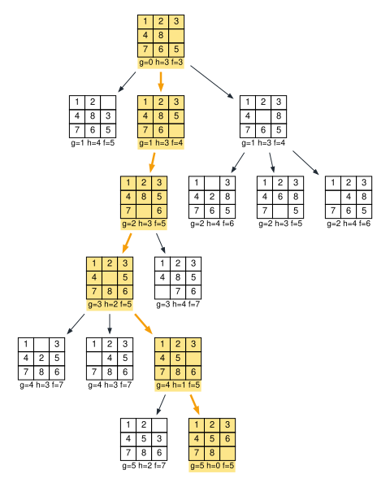
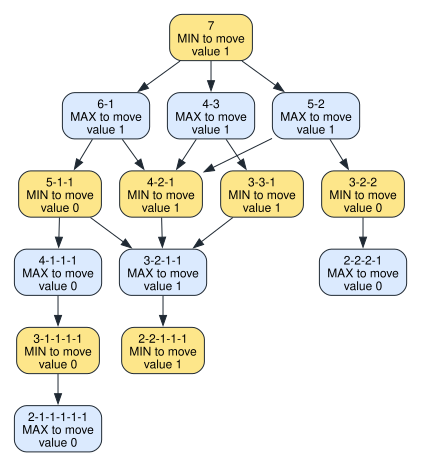
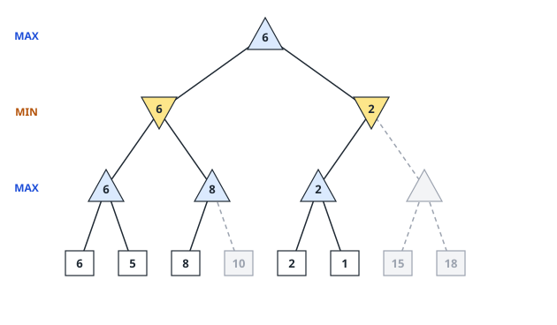
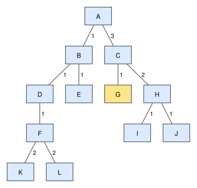

# SSG 518 Question Bank

Every question from the 2025/2026 SSG 518 (Artificial Intelligence) exam, and the questions that keep coming back in the older SSG 503 (Artificial Intelligence) papers, in one place. Each question points to the lesson that teaches the method, and the worked solution is hidden under **Solution** so you attempt it first.

**How to use this:** attempt each question closed-book, on paper, with a calculator. Open the solution only after you have an answer, then compare step by step. Every number in the solutions is computed and checked by `scripts/diagrams/ai_question_bank.py`.

**Which papers are here:** SSG 518, 2025/2026 (the current course, answer any four in 2 hours), and SSG 503, the older course with the same lecturers' topics: 2012/13, 2014/15, 2015/16, 2016/17, 2017/18 and 2019/20. Questions SSG 503 asked that aren't on the SSG 518 outline (speech recognition, speech feature vectors, morphemes and parsing) are left out.

**Two of the papers' tables are broken**, and the solutions show what to do: the 2025/26 mutual-information table adds up to 11/12, and the 2019/20 entropy table adds up to 2. In an exam, say so in one line, state the fix you're using, and carry on.

---

## Part 1: SSG 518, 2025/2026 first semester exam

Answer any four questions. Time allowed: 2 hours.

### Question 1a: The pattern recognition system and its steps

→ [[machine-learning/03-classical-ml/21-pattern-recognition-1|Pattern Recognition 1]], [[machine-learning/03-classical-ml/22-pattern-recognition-2|Pattern Recognition 2]]

**Evaluate the pattern recognition system and the steps to achieve the pattern recognition system with the aid of a diagram. (8 marks)**

Solution

**What it is (1–2 marks).** Pattern recognition is the ability to classify patterns in data and the environment by finding similarities, trends and regularities. A pattern-recognition system converts raw data into features a machine can use, and then either classifies items into known categories (supervised) or groups similar items without labels (clustering).

**What a good system should do (1–2 marks).** It should recognise familiar patterns quickly and accurately; recognise and classify unfamiliar objects; recognise shapes and objects from different angles; and identify patterns and objects even when they are partly hidden.

**The steps, with the diagram (4 marks).** Draw the five boxes in a line with arrows, from "Start" to "Termination":

1. **Data collection**: gather the data used to train and test the system.
2. **Feature choice**: choose the characteristics of the data that are relevant to the pattern.
3. **Model choice**: select a model or algorithm (statistical, structural or neural) to suit the data and the problem.
4. **Training the classifier**: fit the model to a labelled training set, usually about 80% of the data.
5. **Evaluation**: test the trained system on data it has not seen, the testing set.

**"Evaluate" marks (1–2 marks).** Say what makes it work or fail: the features decide the ceiling on performance; testing must use unseen data or the score only shows memorisation; and when evaluation is poor you loop back to better data, features or model. You can also name the four phases (preprocessing, training, testing, deployment).

### Question 1b: Design a plant disease detection system

→ [[machine-learning/03-classical-ml/22-pattern-recognition-2|Pattern Recognition 2]]

**Design a complete Pattern Recognition system for automatic plant disease detection. (7 marks)**

Solution

Follow the steps and phases, filling each with the plant problem. One mark or so for each part:

1. **Problem and classes.** Classify a photo of a leaf as healthy or as one of several diseases, for example cassava mosaic disease, cassava brown streak and healthy.
2. **Data collection.** Thousands of leaf photos taken with phone cameras in farms, each labelled by a plant pathologist. Include different lighting, angles and growth stages, and partly hidden leaves, so the system meets the "different angles" and "partly hidden" requirements.
3. **Preprocessing.** Resize every image to the same size, remove the background so only the leaf remains, and normalise colour and brightness. Remove blurry photos.
4. **Feature choice.** Colour (yellowing, brown patches), texture (mosaic patterns), the shape and area of lesions, and the proportion of the leaf affected. With a neural network, the features are learned from the pixels instead.
5. **Model choice.** A convolutional neural network for raw images (high accuracy, handles noisy data), or a statistical classifier such as naive Bayes or KNN on hand-made features when data is limited.
6. **Training.** Train on about 80% of the labelled images; tune hyperparameters on part of the training data or by cross-validation.
7. **Testing.** Measure accuracy, kappa and a confusion matrix on the held-back 20%, which the model never saw. Check which diseases it confuses.
8. **Deployment.** Put the model in a phone app so a farmer photographs a leaf and gets a diagnosis and a treatment suggestion, working offline in the field. Collect new photos to retrain later.

A neat block diagram of these stages, from camera to app, earns the diagram marks.

### Question 2a: Parametric versus non-parametric classifiers

→ [[machine-learning/03-classical-ml/23-parametric-and-non-parametric-classifiers-1|Parametric and Non-Parametric Classifiers 1]]

**Compare and contrast how parametric and non-parametric classifiers handle the underlying data distribution, citing examples of each. (5 marks)**

Solution

1. **Parametric classifiers assume a form for each class's distribution**, usually a Gaussian, and learn a fixed number of parameters that describe it, such as a mean and a variance per feature. The model's size doesn't grow with the data. Examples from the course tree: naive Bayes, Bayesian classifier, multivariate Gaussian, maximum likelihood classifier, minimal distance classifier.
2. **Non-parametric classifiers assume no fixed form.** They estimate the density from the training points themselves, so the model grows with the data. Examples: K-nearest neighbour, Parzen window (kernel density estimation). The course tree also lists logistic regression and the multilayer perceptron here.
3. **Compare.** Parametric classifiers need less data and are fast and stable *when the assumed shape is right*; when it's wrong (for example, a class that really has two clumps), they fit the wrong curve and misclassify. Non-parametric classifiers follow the real shape, however odd, but need more data, more memory and more time to classify, and can be noisy with few points.
4. **Contrast in one line:** parametric = assume the shape, estimate a few numbers; non-parametric = let the data decide the shape.

For full marks, add a short example: with class A at 1, 2, 2, 9, 10 and class B at 5, 5, 6, 6, 7, a Gaussian classifier labels 7.5 as A, while a Parzen window and KNN correctly say B.

### Question 2b: Use Training Set versus 10-fold cross-validation

→ [[machine-learning/03-classical-ml/24-parametric-and-non-parametric-classifiers-2|Parametric and Non-Parametric Classifiers 2]]

**Table 2.1**

| Classifier | Kappa (training set) | MAE | ROC area | RMSE | Kappa (10-fold) | MAE | ROC area | RMSE |
|---|---|---|---|---|---|---|---|---|
| Naive Bayes | 0.2724 | 0.2463 | 0.746 | 0.3577 | 0.1165 | 0.2674 | 0.653 | 0.3845 |
| Multi-layer perceptron | 0.9144 | 0.0303 | 0.9200 | 0.1516 | 0.0450 | 0.2646 | 0.5560 | 0.4684 |
| Logistic regression | 0.2232 | 0.2397 | 0.7870 | 0.3464 | 0.1165 | 0.2672 | 0.6220 | 0.3901 |
| Bayesian net | 0.2724 | 0.2463 | 0.7460 | 0.3577 | 0.1165 | 0.2674 | 0.6530 | 0.3845 |

**(i) Evaluate the effectiveness of the "Use Training Set" method versus the "10 Cross Fold" method, based on the performance metrics in Table 2.1. Justify which method was found to be better for the overall set of classifiers, and why. (5 marks)**

**(ii) Analyse and interpret the performance metrics shown in Table 2.1. (5 marks)**

Solution

**(i)** First give what the table shows, because that's what "was found" asks for. Every classifier scores better under "Use Training Set": higher kappa (e.g. naive Bayes 0.2724 against 0.1165), higher ROC area (0.746 against 0.653) and lower MAE and RMSE (0.2463 and 0.3577 against 0.2674 and 0.3845). So, as the source paper concluded, **"Use Training Set" was found to be better** on every metric.

Then evaluate it, for the "evaluate" marks. "Use Training Set" tests each classifier on the same data it was trained on, so it measures how well the model memorised its examples, not how well it predicts new cases. 10-fold cross-validation tests every case with a model that never saw it, so it is the honest estimate. The gap is the overfitting. The clearest case is the multilayer perceptron: kappa 0.9144 on the training set, 0.0450 under cross-validation. So the training-set method *looks* better, but cross-validation is the more trustworthy method for judging classifiers.

**(ii)** Read each metric, then each classifier:

1. **Kappa** is agreement beyond chance (1 perfect, 0 chance; 0.40–0.59 moderate, 0.60–0.79 substantial, above 0.80 outstanding). Under cross-validation all four are poor (0.045 to 0.1165): the dataset is hard to predict.
2. **MAE and RMSE** are error sizes; smaller is better. RMSE is always above MAE because it squares, punishing big errors.
3. **ROC area** is separation across all thresholds; 0.5 is guessing, 1 is perfect. Cross-validated values of 0.556 to 0.653 are only a little better than guessing.
4. **Multilayer perceptron:** best on the training set (kappa 0.91, MAE 0.03, ROC 0.92), worst under cross-validation (kappa 0.045, RMSE 0.4684, ROC 0.556). It memorised the training data: classic overfitting.
5. **Naive Bayes and Bayesian net:** identical on every metric, in both methods. The Bayesian net most likely learned the same structure as naive Bayes on this data.
6. **Logistic regression:** close to the Bayesian pair. Under cross-validation its kappa matches them (0.1165) and its ROC area is a little lower (0.622).
7. **Overall:** the parametric pair (naive Bayes, Bayesian net) and logistic regression generalise best; no classifier does well; and a training-set score must never be trusted on its own.

### Question 3a: State-space terms

→ [[artificial-intelligence/01-foundations/06-problem-solving-in-ai|Problem Solving in AI]], [[artificial-intelligence/02-uninformed-search/02-measuring-a-search-method|Measuring a Search Method]]

**Analyse the following terms: state; initial state; goal state; state space; action; transition model; path; path cost; time complexity and space complexity. (5 marks)**

Solution

Half a mark each; use one running example, a road trip from Lagos to Abuja.

1. **State**: a description of the situation at one moment. *In Ibadan.*
2. **Initial state**: the state the agent starts in. *In Lagos.*
3. **Goal state**: a state that passes the goal test, where the problem is solved. *In Abuja.*
4. **State space**: all states reachable from the initial state, with the actions joining them. *Every city on the map and the roads between them.*
5. **Action**: something the agent can do in a state. *Drive from Ibadan to Akure.*
6. **Transition model**: what state each action leads to. *Driving to Akure from Ibadan puts you in Akure.*
7. **Path**: a sequence of states joined by actions. *Lagos → Ibadan → Akure.*
8. **Path cost**: the total cost of the actions along a path. *130 + 210 = 340 km.*
9. **Time complexity**: how the number of nodes generated grows with the problem, written with $b$ and $d$, such as $O(b^d)$.
10. **Space complexity**: how the largest number of nodes stored at once grows, such as $O(b^d)$ for breadth-first search or $O(bm)$ for depth-first search.

### Question 3b: Search strategies on the 8-puzzle or TSP

→ [[artificial-intelligence/02-uninformed-search/10-comparing-uninformed-search|Comparing Uninformed Search Methods]], [[artificial-intelligence/03-heuristic-search/06-heuristics-for-the-8-puzzle|Heuristics for the 8-Puzzle]]

**Given a classical AI problem such as the 8-puzzle or the travelling salesman problem (TSP), analyse the strengths and weaknesses of different search strategies (e.g. breadth-first search, depth-first search, A\* search). Discuss their computational trade-offs and scenarios where one outperforms the others. (5 marks)**

Solution

Use the 8-puzzle (181,440 reachable states, branching factor about 3, every move costs 1).

1. **Breadth-first search.** Strength: complete, and optimal here because every move costs 1, so it finds the fewest moves. Weakness: $O(b^d)$ memory; for a 20-move puzzle it must hold a huge frontier. Best when the solution is shallow.
2. **Depth-first search.** Strength: $O(bm)$ memory, tiny. Weakness: not optimal and, without a visited list, can wander through the whole state space or loop; a solution 5 moves away may be found after thousands of moves. Rarely the right choice here.
3. **A\* search.** Strength: optimal with an admissible heuristic (misplaced tiles or Manhattan distance) and expands far fewer nodes. On a 12-move puzzle, A\* expanded 2,327 nodes with no heuristic, 119 with misplaced tiles and 36 with Manhattan distance. Weakness: still keeps every generated node in memory.
4. **Trade-offs.** BFS buys optimality with memory; DFS buys memory with optimality; A\* buys speed with domain knowledge, and the better the heuristic, the bigger the saving.
5. **Scenarios.** Shallow puzzle and plenty of memory: BFS is fine. Tight memory and unknown depth: iterative deepening. Any real 8-puzzle: A\* with Manhattan distance outperforms both. For TSP, which only cares about the final tour, local search (hill climbing, simulated annealing, genetic algorithms) gives good tours fast where A\* would run out of memory.

### Question 3c: Uninformed versus informed search

→ [[artificial-intelligence/02-uninformed-search/10-comparing-uninformed-search|Comparing Uninformed Search Methods]], [[artificial-intelligence/03-heuristic-search/05-a-star-search-2|A\* Search 2]]

**Evaluate the effectiveness of uninformed versus informed search strategies in complex problem domains. Include criteria such as completeness, optimality, time complexity and space complexity in your discussion. (5 marks)**

Solution

| Criterion | Uninformed (BFS, UCS, DFS, IDS) | Informed (greedy, A\*) |
|---|---|---|
| Completeness | BFS, UCS and IDS are complete; DFS is not | A\* is complete; greedy is not in general |
| Optimality | UCS optimal; BFS and IDS only for equal step costs; DFS never | A\* optimal with an admissible heuristic; greedy never |
| Time | $O(b^d)$ or worse; explores in every direction | Exponential in the worst case, but a good heuristic cuts it dramatically |
| Space | BFS and UCS exponential; DFS and IDS linear | A\* keeps all nodes (its weakness); greedy also large |

**Evaluation.** In complex domains the state space is huge, and uninformed search, knowing nothing about where the goal is, becomes impractical: it spends its time on states that lead nowhere. Informed search uses domain knowledge to look at promising states first, so it scales to far bigger problems. The cost is that its quality depends on the heuristic: an admissible one keeps A\* optimal, an inadmissible one can mislead it. When no heuristic is available, iterative deepening is the best uninformed choice, and when memory is the limit, local search or memory-bounded methods take over.

### Question 4a: The 8-puzzle by heuristic search

→ [[artificial-intelligence/03-heuristic-search/06-heuristics-for-the-8-puzzle|Heuristics for the 8-Puzzle]], [[artificial-intelligence/03-heuristic-search/04-a-star-search-1|A\* Search 1]]

**Draw the search tree to get to the goal state given below from the initial state using the heuristic method and show the details. (10 marks)**

Initial state, row by row: 1 2 3 / 4 8 _ / 7 6 5. Goal state: 1 2 3 / 4 5 6 / 7 8 _ (where _ is the blank).

Solution

**State the method first (1–2 marks).** Use A\* with $f(n) = g(n) + h(n)$, where $g(n)$ is the number of moves made so far and $h(n)$ is the number of misplaced tiles (not counting the blank). Expand the node with the smallest $f$; on a tie, take the smaller $h$. Never move the blank straight back to where it just was.

**The start.** Tiles 5, 6 and 8 are out of place, so $h = 3$ and $f = 0 + 3 = 3$.

**The tree (6 marks).** Each node shows $g$, $h$ and $f$; the solution path is shaded.

**The expansions, in order:**

1. Expand the start ($f = 3$). Children: blank up ($h = 4$, $f = 5$), blank down ($h = 3$, $f = 4$), blank left ($h = 3$, $f = 4$).
2. Expand **blank down**, 1 2 3 / 4 8 5 / 7 6 _ ($f = 4$; ties with blank left, taken first). Child: blank left, 1 2 3 / 4 8 5 / 7 _ 6, $f = 2 + 3 = 5$.
3. Expand **blank left** from the start, 1 2 3 / 4 _ 8 / 7 6 5 ($f = 4$). Its children all have $f = 5$ or 6. This branch looks as good as the other at first, so A\* has to check it.
4. Expand 1 2 3 / 4 8 5 / 7 _ 6 ($f = 5$, $h = 3$). Children: blank up, 1 2 3 / 4 _ 5 / 7 8 6, $f = 3 + 2 = 5$; blank left, $f = 7$.
5. Expand 1 2 3 / 4 _ 5 / 7 8 6 ($f = 5$, $h = 2$). Children include blank right, 1 2 3 / 4 5 _ / 7 8 6, $f = 4 + 1 = 5$.
6. Expand 1 2 3 / 4 5 _ / 7 8 6 ($f = 5$, $h = 1$). Child: blank down, the goal, $f = 5 + 0 = 5$.
7. Take the goal off the frontier ($f = 5$). Done.

**The solution (2 marks): 5 moves.** Move the blank down, left, up, right, down; or in tiles: 5 up, 6 right, 8 down, 5 left, 6 up. A\* expanded 7 nodes and generated 14.

**Note for the "details" marks.** Misplaced tiles stays at 3 for the first two moves, so A\* has to look at the blank-left branch too. With Manhattan distance ($h = 5$ at the start) the blank-left branch gets $f = 7$ and is never expanded: 6 nodes expanded, 11 generated, same 5-move answer.

### Question 4b: The goat, the yam and the lion

→ [[artificial-intelligence/02-uninformed-search/11-river-crossing-puzzles|River-Crossing Puzzles]]

**A man is travelling with three possessions: a goat, a yam and a lion. He arrives at a narrow bridge and is informed that he can cross the bridge with only one item at a time. If left alone together, the lion will eat the goat, and the goat will eat the yam. The man must always be present to prevent one item from destroying another. Formulate this problem as a state space search problem, and determine the sequence of actions that allows the man to safely transport all items across the bridge. (5 marks)**

Solution

**Formulation (2 marks).**

1. **State**: which side of the bridge the man, goat, yam and lion are on. Write it as the items on the starting side and where the man is, e.g. {goat, yam, lion | man} for the start.
2. **Initial state**: everything and the man on the starting side.
3. **Actions**: the man crosses alone, or crosses carrying one item that is on his side.
4. **Transition model**: the man (and the item, if carried) moves to the other side.
5. **Constraint**: a state is illegal if the man is absent from a side holding lion and goat, or goat and yam.
6. **Goal test**: everything is on the far side. **Path cost**: 1 per crossing.

**Solution (3 marks): 7 crossings**, found by breadth-first search, so it's the shortest.

| Crossing | Action | Start side afterwards | Far side afterwards |
|---|---|---|---|
| 1 | Take the goat across | yam, lion | man, goat |
| 2 | Come back alone | man, yam, lion | goat |
| 3 | Take the lion across | yam | man, goat, lion |
| 4 | Bring the goat back | man, goat, yam | lion |
| 5 | Take the yam across | goat | man, yam, lion |
| 6 | Come back alone | man, goat | yam, lion |
| 7 | Take the goat across | (empty) | man, goat, yam, lion |

The key idea: the goat is the problem item (it's in both dangerous pairs), so it goes first and comes back once. Taking the yam at step 3 and the lion at step 5 also works.

### Question 5: Entropy and mutual information

→ [[information-theory/01-what-information-is|What Information Is]], [[information-theory/02-entropy-joint-conditional-and-mutual|Entropy, Joint, Conditional and Mutual Information]]

**(a) Analyse entropy as applied to information theory. (2 marks)**

**(b) Find the mutual information I(X; Y) of the system represented in the table below, where X = study method {Self-study (S), Group study (G), Online course (O)} and Y = exam result {Fail (F), Pass (P), Distinction (D)}. (13 marks)**

| Y \ X | S | G | O |
|---|---|---|---|
| Fail (F) | 1/12 | 1/12 | 1/6 |
| Pass (P) | 1/6 | 1/12 | 1/12 |
| Distinction (D) | 1/12 | 1/6 | 0 |

Solution

**(a)** Entropy measures the uncertainty, or average surprise, in a random variable: the average number of bits needed to describe its outcome. $H(X) = -\sum_i p_i \log_2 p_i$. It's highest when all outcomes are equally likely (a fair coin, 1 bit) and zero when one outcome is certain. Rare outcomes carry more information, because $-\log_2 p$ is large when $p$ is small.

**(b) Step 1: check the table (state this in your answer).** The nine probabilities add up to $\frac{1}{12} + \frac{1}{12} + \frac{1}{6} + \frac{1}{6} + \frac{1}{12} + \frac{1}{12} + \frac{1}{12} + \frac{1}{6} + 0 = \frac{11}{12}$, not 1. A joint distribution must add up to 1, so write: "The table sums to 11/12; I normalise it by dividing every entry by 11/12." Dividing by 11/12 turns $\frac{1}{12}$ into $\frac{1}{11}$ and $\frac{1}{6}$ into $\frac{2}{11}$:

| Y \ X | S | G | O | p(y) |
|---|---|---|---|---|
| F | 1/11 | 1/11 | 2/11 | 4/11 |
| P | 2/11 | 1/11 | 1/11 | 4/11 |
| D | 1/11 | 2/11 | 0 | 3/11 |
| p(x) | 4/11 | 4/11 | 3/11 | 1 |

**Step 2: H(X).** $H(X) = -\left[2 \times \frac{4}{11}\log_2\frac{4}{11} + \frac{3}{11}\log_2\frac{3}{11}\right] = 2(0.5307) + 0.5112 = 1.5726$ bits.

**Step 3: H(Y).** The row totals are the same numbers, 4/11, 4/11, 3/11, so $H(Y) = 1.5726$ bits.

**Step 4: H(X, Y).** Five cells are $\frac{1}{11}$, three are $\frac{2}{11}$ and one is 0 (which contributes nothing, since $0 \log 0 = 0$):

$H(X,Y) = 5 \times \frac{1}{11}\log_2 11 + 3 \times \frac{2}{11}\log_2\frac{11}{2} = 5(0.3145) + 3(0.4472) = 2.9140$ bits.

**Step 5: mutual information.**

$$I(X;Y) = H(X) + H(Y) - H(X,Y) = 1.5726 + 1.5726 - 2.9140 = 0.2313 \text{ bits}$$

So knowing the study method removes about 0.23 bits of the 1.57 bits of uncertainty about the exam result.

**If you think the 0 was a misprint for 1/12** (that would make the table add up to exactly 1, with every row and column total 1/3), state that assumption instead. Then $H(X) = H(Y) = \log_2 3 = 1.585$, $H(X,Y) = 3.085$ and $I(X;Y) = 0.085$ bits. Either answer earns the method marks if the assumption is stated.

### Question 6: Minimax and alpha-beta

→ [[artificial-intelligence/04-adversarial-search/02-minimax-1|Minimax 1]], [[artificial-intelligence/04-adversarial-search/04-alpha-beta-pruning-1|Alpha-Beta Pruning 1]], [[artificial-intelligence/04-adversarial-search/05-alpha-beta-pruning-2|Alpha-Beta Pruning 2]]

**(a) Evaluate the minimax and alpha-beta pruning algorithms, stating their usage and limitations. (5 marks)**

**(b) Solve the graph using alpha-beta pruning. (10 marks)** The tree has a MAX root (rectangle), two MIN nodes (ellipses), four MAX nodes, eight MIN nodes, and sixteen leaves, left to right: 10, 5, 7, 11, 12, 8, 9, 8, 5, 12, 11, 12, 9, 8, 7, 10.

Solution

**(a)** **Minimax** chooses the move that maximises your result assuming the opponent always replies to minimise it: back up values from the leaves, taking the maximum at MAX nodes and the minimum at MIN nodes. **Usage:** two-player, zero-sum, deterministic, perfect-information games such as chess, draughts, tic-tac-toe and ayo. **Limitation:** it searches the whole tree, $O(b^m)$ time, which is impossible for chess ($b \approx 35$), so real programs cut off at a fixed depth with an evaluation function, which brings the horizon effect.

**Alpha-beta pruning** returns exactly the minimax value while skipping branches that can't change it, using $\alpha$ (the best MAX can guarantee so far) and $\beta$ (the best MIN can guarantee so far), pruning when $\alpha \ge \beta$. **Usage:** every serious game program. **Limitation:** the saving depends on move ordering: $O(b^{m/2})$ with perfect ordering, nothing with the worst; and it still needs an evaluation function and a depth cut-off for big games.

**(b)** Search left to right with $\alpha = -\infty$, $\beta = +\infty$ at the root.

1. **First MIN node (10, 5):** value 5. Its MAX parent now has $\alpha = 5$.
2. **Second MIN node (7, 11), with $\alpha = 5$:** 7, then 11; value 7. MAX parent = **7**. The left MIN node above now has $\beta = 7$.
3. **Third MIN node (12, 8), passed $\beta = 7$:** 12, then 8; value 8. Its MAX parent now has $\alpha = 8 \ge \beta = 7$: **prune the fourth MIN node (leaves 9 and 8)**. That MAX node returns 8.
4. **Left MIN node:** min(7, 8) = **7**. The root now has $\alpha = 7$.
5. **Fifth MIN node (5, 12), with $\alpha = 7$:** leaf 5 gives $\beta = 5 \le \alpha = 7$: **prune the leaf 12**. Value 5.
6. **Sixth MIN node (11, 12), with $\alpha = 7$:** 11, then 12; value 11. Its MAX parent = **11**. The right MIN node now has $\beta = 11$.
7. **Seventh MIN node (9, 8), with $\alpha = 7$, $\beta = 11$:** 9, then 8; value 8. Its MAX parent has $\alpha = 8$.
8. **Eighth MIN node (7, 10), with $\alpha = 8$:** leaf 7 gives $\beta = 7 \le \alpha = 8$: **prune the leaf 10**. Value 7. The MAX parent = max(8, 7) = **8**.
9. **Right MIN node:** min(11, 8) = **8**.
10. **Root:** max(7, 8) = **8**. MAX should take the **right** branch.

**Answer: the root value is 8.** Three prunes (the MIN node over 9 and 8, the leaf 12, and the leaf 10), so 12 of the 16 leaves are examined. Plain minimax gives the same 8.

---

## Part 2: SSG 503 calculation questions

### Cryptarithmetic: `BASE + BALL = GAMES` (2019/20)

→ [[artificial-intelligence/05-constraint-satisfaction/02-cryptarithmetic-1|Cryptarithmetic 1]], [[artificial-intelligence/05-constraint-satisfaction/03-cryptarithmetic-2|Cryptarithmetic 2]]

**(i) What is cryptarithmetic? (2 marks) (ii) Solve: `BASE + BALL = GAMES`. (8 marks)**

Solution

**(i)** A cryptarithmetic puzzle is a sum in which each letter stands for a different digit. The rules: digits are 0 to 9; each letter has one value and different letters have different values; a number can't begin with 0; and ordinary arithmetic must hold once the letters are replaced. It's a constraint satisfaction problem, solved by reasoning about each column and its carry, with backtracking when a guess breaks a rule.

**(ii)** Columns from the right are 1 (units) to 5. Write $c_1, c_2, c_3, c_4$ for the carries.

1. **Column 5:** `GAMES` has 5 letters and the addends have 4, so G is a carry: **G = 1**.
2. **Column 4:** B + B + $c_3$ = A + 10. So $2B + c_3 \ge 10$, and B is at least 5.
3. **Column 3:** A + A + $c_2$ = M + 10$c_3$.
4. **Column 2:** S + L + $c_1$ = E + 10$c_2$.
5. **Column 1:** E + L = S + 10$c_1$.
6. Trying values with these constraints (B from 5 to 9) gives one solution: **B = 7, A = 4, S = 8, E = 3, L = 5, M = 9, G = 1**.
7. **Check:** 7483 + 7455 = 14938. Column 1: 3 + 5 = 8 = S, no carry. Column 2: 8 + 5 = 13: E = 3, carry 1. Column 3: 4 + 4 + 1 = 9 = M. Column 4: 7 + 7 = 14: A = 4, carry 1 = G. ✓

It's the only solution.

### Cryptarithmetic: `RED + ROE = DEER` (2012/13, 2014/15, 2016/17)

→ [[artificial-intelligence/05-constraint-satisfaction/03-cryptarithmetic-2|Cryptarithmetic 2]]

**Without necessarily solving the problem, draw a search tree for the solution of `RED + ROE = DEER`, explaining in detail the basis for the branching at each level.**

Solution

**The basis for branching.** Work column by column from the right. In each column the unknown is whether that column produces a carry (0 or 1), so each level of the tree branches two ways: **no carry** and **carry**. A branch dies as soon as its column equation can't be satisfied with distinct digits.

1. **Root:** `RED + ROE = DEER`. `DEER` has one more digit than the addends, so **D = 1** (the final carry).
2. **Level 1, units:** D + E = R + 10$c_1$, i.e. 1 + E = R + 10$c_1$. Branches: $c_1 = 0$ (R = E + 1) and $c_1 = 1$ (E = 9, R = 0, which fails, since R leads a number and can't be 0).
3. **Level 2, tens:** E + O + $c_1$ = E + 10$c_2$, so O + $c_1$ = 10$c_2$. Branches: $c_2 = 0$ (O = 0 when $c_1 = 0$) and $c_2 = 1$ (O = 10 − $c_1$, impossible for a digit when $c_1 = 0$).
4. **Level 3, hundreds:** R + R + $c_2$ = E + 10$c_3$, with $c_3 = 1$ = D. With $c_2 = 0$: 2R = E + 10, and with R = E + 1: 2E + 2 = E + 10, so **E = 8, R = 9**.

Drawing it: the root box, two children for $c_1$ (one crossed out), two children for $c_2$ under the live one (one crossed out), then the final column.

**The solution the tree leads to:** R = 9, E = 8, D = 1, O = 0. Check: 981 + 908 = 1889. ✓ It's unique.

### Cryptarithmetic: `SEND + MORE = MONEY`, and `CROSS + ROADS = DANGER` (SSG 503 class exercises)

Solution

**`SEND + MORE = MONEY`:** M = 1 (the carry into the fifth column), then O = 0, S = 9, E = 5, N = 6, D = 7, R = 8, Y = 2. Check: 9567 + 1085 = 10652. ✓ Unique.

**`CROSS + ROADS = DANGER`:** D = 1 (the carry), then C = 9, R = 6, O = 2, S = 3, A = 5, N = 8, G = 7, E = 4. Check: 96233 + 62513 = 158746. ✓ Unique.

### Missionaries and cannibals (2019/20)

→ [[artificial-intelligence/02-uninformed-search/11-river-crossing-puzzles|River-Crossing Puzzles]]

**On one bank of a river are three missionaries and three cannibals. There is one boat available that can hold up to two people. If the cannibals ever outnumber the missionaries on either bank, the missionaries will get eaten. How can the boat be used to safely carry all the missionaries and cannibals across the river? (7 marks)**

Solution

**Formulation.** A state is (missionaries on the start bank, cannibals on the start bank, boat on the start bank or not), so the start is (3, 3, start) and the goal (0, 0, far). Actions: the boat carries 1 or 2 people (two missionaries, two cannibals, one of each, or one person alone) to the other side. A state is legal only if, on each bank, missionaries are either 0 or at least as many as cannibals.

**Solution: 11 crossings** (the fewest, found by breadth-first search). The numbers are what's left on the start bank.

| Crossing | Boat carries | Start bank (M, C) | Far bank (M, C) |
|---|---|---|---|
| 1 | 2 cannibals across | 3, 1 | 0, 2 |
| 2 | 1 cannibal back | 3, 2 | 0, 1 |
| 3 | 2 cannibals across | 3, 0 | 0, 3 |
| 4 | 1 cannibal back | 3, 1 | 0, 2 |
| 5 | 2 missionaries across | 1, 1 | 2, 2 |
| 6 | 1 missionary and 1 cannibal back | 2, 2 | 1, 1 |
| 7 | 2 missionaries across | 0, 2 | 3, 1 |
| 8 | 1 cannibal back | 0, 3 | 3, 0 |
| 9 | 2 cannibals across | 0, 1 | 3, 2 |
| 10 | 1 cannibal back | 0, 2 | 3, 1 |
| 11 | 2 cannibals across | 0, 0 | 3, 3 |

Check every row: no bank ever has missionaries outnumbered while missionaries are present. Crossing 6 is the clever step: one missionary and one cannibal go back together, so both banks stay balanced.

### Nim with 7 tokens (2019/20)

→ [[artificial-intelligence/04-adversarial-search/06-nim|Nim]]

**Nim: the game starts with a single stack of 7 tokens. At each move a player selects one stack and divides it into two non-empty, non-equal stacks. A player who is unable to move loses. MIN plays first. A terminal state that is a win for MIN gets utility 0; a win for MAX gets utility 1. (b) Apply the minimax algorithm to the search tree to assign utilities to all states. (3 marks) (c) If both MIN and MAX play a perfect game, who will win? Explain. (3 marks)**

Solution

**(b)** From 7, MIN can split into 6-1, 5-2 or 4-3. Keep splitting until no stack can be divided (stacks of 1 and 2 can't be split into two unequal non-empty parts). A terminal state is a loss for whoever is to move there. Back up: max at MAX's turns, min at MIN's turns. (Identical states reached by different routes are drawn once.)

**(c) MAX wins.** The root's value is 1. Whatever MIN does first (6-1, 5-2 or 4-3), MAX has a reply worth 1: from 6-1 or 5-2 MAX moves to 4-2-1, and from 4-3 to 4-2-1 or 3-3-1. From those, every line ends with MIN facing a position with no legal move (2-2-1-1-1), so MIN loses. MIN's only hope is MAX making a mistake.

### Alpha-beta on the A–O tree (2019/20)

→ [[artificial-intelligence/04-adversarial-search/04-alpha-beta-pruning-1|Alpha-Beta Pruning 1]]

**Given the search tree (MAX root A; MIN nodes B, C; MAX nodes D, E, F, G; leaves H = 6, I = 5, J = 8, K = 10, L = 2, M = 1, N = 15, O = 18), apply alpha-beta pruning and show where the alpha and beta cuts are applied and which parts of the tree are pruned. (9 marks)**

Solution

1. **D** (MAX): H = 6, I = 5 → D = 6. **B** now has $\beta = 6$.
2. **E** (MAX), passed $\beta = 6$: J = 8 → $\alpha = 8 \ge \beta = 6$. **Beta cut: prune K.** E returns 8.
3. **B** = min(6, 8) = 6. **A** now has $\alpha = 6$.
4. **F** (MAX), passed $\alpha = 6$: L = 2, M = 1 → F = 2 (neither beats $\alpha$).
5. **C** (MIN): $\beta = 2 \le \alpha = 6$. **Alpha cut: prune G** and its leaves N and O.
6. **A** = max(6, 2) = **6**.

Leaves examined: H, I, J, L, M (5 of 8). The cut at E is a **beta cut** (a MAX node stops because MIN above already has better); the cut at C is an **alpha cut** (a MIN node stops because MAX above already has better).

### Search orders on a tree with arc lengths (2015/16)

→ [[artificial-intelligence/02-uninformed-search/10-comparing-uninformed-search|Comparing Uninformed Search Methods]]

**Consider the tree below (numbers on arcs are arc lengths). Nodes are expanded in alphabetical order when no other order is specified, the goal is G, and no visited or expanded lists are used. What order would the states be expanded in by each type of search? Stop when you expand G.**

Solution

1. **Breadth-first:** A, B, C, D, E, G.
2. **Depth-first:** A, B, D, F, K, L, E, C, G.
3. **Uniform-cost** (by path cost, ties alphabetical): A (0), B (1), D (2), E (2), C (3), F (3), G (4).
4. **Iterative deepening:** limit 0: A. Limit 1: A, B, C. Limit 2: A, B, D, E, C, G.

### Backtracking depth-first search space (2015/16)

**A backtracking depth-first search generates only one child at a time, backtracking to the last node with unchecked children when it reaches a dead end. With branching factor $b$, maximum depth $m$ and the first goal at depth $d$, what is its space complexity?**

Solution

**$O(m)$.** Ordinary depth-first search stores, at each level of the current path, all the siblings it hasn't tried yet: $O(bm)$. Backtracking search generates one child at a time and only remembers which child to try next, so it stores just the current path, at most $m$ nodes deep.

### Entropy from a joint table (2019/20)

→ [[information-theory/02-entropy-joint-conditional-and-mutual|Entropy, Joint, Conditional and Mutual Information]]

**Find the entropy of the following (15 marks):**

| X | Y | P(X, Y) |
|---|---|---|
| \* | \* | 1/8 |
| 1 | a | 1/16 |
| 0 | b | 1/8 |
| 1 | c | 1/2 |
| 0 | d | 1/16 |
| 0 | a | 1/4 |
| 1 | b | 1/8 |
| 0 | c | 1/4 |
| 1 | d | 1/2 |

Solution

**Check the table first.** The probabilities add up to **2**, not 1, so it isn't a valid distribution. (This is the same table worked in the SSG 518 class notes, which ended with a negative entropy and a mutual information larger than either entropy, both impossible.) State the fix: "The table sums to 2, so I divide every entry by 2." Each probability halves: 1/16, 1/32, 1/16, 1/4, 1/32, 1/8, 1/16, 1/8, 1/4.

**Joint entropy:** $H(X,Y) = -\sum p \log_2 p = 2.8125$ bits.

**Marginals:** p(X = \*) = 1/16, p(X = 1) = 19/32, p(X = 0) = 11/32. p(Y = \*) = 1/16, p(a) = 5/32, p(b) = 1/8, p(c) = 3/8, p(d) = 9/32.

**H(X) = 1.2261 bits, H(Y) = 2.0888 bits**, so the mutual information is $I = H(X) + H(Y) - H(X,Y) = 0.5024$ bits.

Every result is non-negative, and $I$ is smaller than both $H(X)$ and $H(Y)$, as it must be.

### Why a loaded coin has lower entropy (2016/17, 2017/18)

→ [[information-theory/01-what-information-is|What Information Is]]

**Explain, using sample numerical values, why the entropy of a loaded coin is lower than that of a fair coin.**

Solution

$H = -[p \log_2 p + (1-p)\log_2(1-p)]$, where $p$ is the probability of heads.

| P(heads) | P(tails) | Entropy (bits) |
|---|---|---|
| 0.5 | 0.5 | 1.000 |
| 0.4 | 0.6 | 0.971 |
| 0.3 | 0.7 | 0.881 |
| 0.2 | 0.8 | 0.722 |
| 0.1 | 0.9 | 0.469 |

Entropy measures uncertainty. A fair coin is as unpredictable as a two-outcome event can be, so each toss carries the full 1 bit. A loaded coin mostly lands the same way, so you can often guess the result; each toss surprises you less and carries less information. At the extreme, a two-headed coin has entropy 0: every toss is certain.

### Classifying leaves by nearest neighbour and centroid (2012/13, 2014/15)

→ [[machine-learning/03-classical-ml/22-pattern-recognition-2|Pattern Recognition 2]], [[machine-learning/03-classical-ml/01-k-nearest-neighbours-1|K-Nearest Neighbours 1]]

**A chart shows a two-dimensional plot of two features of leaves: class 1 points around feature 1 = 8 to 13, feature 2 = 9 to 13; class 2 around 10 to 14, 3 to 6; class 3 around 28 to 37, 15 to 20. Classify these samples using both the nearest neighbour and centroid methods: (a) 14 mm, 6.5 mm; (b) 10 mm, 13.5 mm; (c) 35 mm, 18 mm.**

Solution

**Method.** Nearest neighbour: find the single closest plotted point and take its class. Centroid: average each class's points to get its centre, then take the class whose centre is closest. Use Euclidean distance.

Centres read off the chart (approximate, which the examiner accepts): class 1 ≈ (10, 11), class 2 ≈ (12, 4.5), class 3 ≈ (31, 16.5).

1. **(a) (14, 6.5):** distance to class 2's centre ≈ 2.83; to class 1's ≈ 6.02; class 3 is far. The nearest plotted point is also a class 2 point (around (14, 6)). **Class 2** by both methods.
2. **(b) (10, 13.5):** right above the class 1 group; nearest point and nearest centre are both class 1. **Class 1** by both.
3. **(c) (35, 18):** inside the class 3 group. **Class 3** by both.

Say in your answer that the two methods agree here because the classes are well separated; they would differ for a point near the edge of a long or oddly shaped class, where one plotted point can be closer than the class's centre.

---

## Part 3: Theory questions that keep coming back

These appear in the SSG 503 papers year after year. Short model answers; follow the link for the full lesson.

### Intelligence and artificial intelligence

**Define intelligence and propose a definition for AI. Explain how the difficulty of defining intelligence is solved to allow a working definition. (2012/13, 2014/15, 2016/17, 2017/18, 2015/16)**

Solution

Intelligence can't be defined exactly, but it can be recognised: we define it by intelligent behaviour, the ability to acquire knowledge and use it to act sensibly in new situations. So a working definition of AI defines it by what a system *does*, not by what thinking *is*: AI is the design of computer systems that perform tasks which would need intelligence if a person did them. That is the "acting" side of the four approaches, and the Turing test is one way of checking it. See [[artificial-intelligence/01-foundations/02-ways-of-knowing|Ways of Knowing]], [[artificial-intelligence/01-foundations/01-what-ai-is|What Artificial Intelligence Is]] and [[artificial-intelligence/01-foundations/03-the-four-approaches-to-ai|The Four Approaches to AI]].

### The three ways of knowing

**Humans can answer "How do you know?" in three primary ways. Enumerate them and say which demand intelligence; relate them to how humans interact with the environment; explain the relationship in the light of the data–knowledge continuum.**

Solution

From the SSG 503 notes:

1. **By recall (experience):** you remember it. Books and databases recall better than humans, so recall alone doesn't need intelligence.
2. **By calculation:** you work it out by a fixed procedure. Calculation can be routinely mechanised, so it doesn't demand intelligence either, but it can't handle what wasn't anticipated.
3. **By reasoning:** you infer something new from what you know, by manipulating symbols. **This one demands intelligence.**

**Relation to the environment:** humans sense the environment (stimulation of the sense organs), interpret what is sensed (perception), and then use recall, calculation or reasoning to decide and act (cognition).

**The data–knowledge continuum** (taught in [[artificial-intelligence/01-foundations/02-ways-of-knowing|Ways of Knowing]]): data is raw facts and figures; information is processed data; knowledge is applied information, information with rules for its use, and it is dynamic. Recall works mostly on stored data, calculation turns data into information, and reasoning turns information into knowledge that can be applied to new situations.

### Weak and strong AI; narrow intelligence (2015/16, 2016/17)

Solution

**Weak (narrow) AI** is built for one task, such as playing chess, filtering spam or planning a route, and has no general understanding beyond it. Every AI system that exists today is narrow. **Strong (general) AI** would have human-level intelligence across any task, and possibly a mind in the full sense. It doesn't exist. See [[machine-learning/00-foundations/01-what-is-ai|What is AI, actually]].

### Combinatorial explosion (2012/13, 2014/15, 2015/16, 2016/17)

**Describe combinatorial explosion and explain its relevance to algorithms for problems that require intelligence. What is the tyranny of combinatorial explosion?**

Solution

Combinatorial explosion is the exponential (or faster) growth in the number of possible states as a problem gets bigger. With $z$ possible values for each of $n$ variables there are $z^n$ combinations; a search tree with branching factor $b$ has $b^d$ nodes at depth $d$. With $b = 10$, depth 6 already means 1,111,110 nodes, and chess has about $10^{154}$ positions. **The tyranny** is that no increase in computer speed keeps up: each extra level multiplies the work. That's why intelligent problem solving can't rely on brute force and needs heuristics, pruning and good problem formulation. See [[artificial-intelligence/01-foundations/08-combinatorial-explosion|Combinatorial Explosion]].

### Brute-force search algorithms (2012/13, 2014/15, 2015/16, 2016/17)

**Describe three brute-force (blind) search algorithms and explain the differences between them.**

Solution

Breadth-first search (level by level, FIFO queue, fewest steps, $O(b^d)$ memory), depth-first search (deepest first, stack, $O(bm)$ memory, not complete or optimal) and uniform-cost search (cheapest path first, priority queue, optimal). Iterative deepening or depth-limited search can replace any of them. Compare them on completeness, optimality, time and space. See [[artificial-intelligence/02-uninformed-search/10-comparing-uninformed-search|Comparing Uninformed Search Methods]].

### Hill climbing, foothills, plateaus, ridges, beam search and best-first search (2012/13, 2014/15)

Solution

**Hill climbing** moves to the best neighbouring state until no neighbour is better. **Foothills** is the old name for **local maxima**: small peaks where every step goes down but higher ground exists. **Plateaus** are flat regions where neighbours are equal, so there's no direction to climb. **Ridges** rise across the allowed directions of movement, so every single step goes down. **Beam search** keeps only the best $k$ states at each level. **Best-first search** always expands the most promising node by an evaluation function (greedy: $h$; A\*: $g + h$). **Window search** is an old name for searching with a narrow alpha-beta window, guessing a small range for the value and re-searching if the true value falls outside it. See [[artificial-intelligence/03-heuristic-search/07-hill-climbing-1|Hill Climbing]], [[artificial-intelligence/03-heuristic-search/09-beam-search|Beam Search]] and [[artificial-intelligence/03-heuristic-search/03-greedy-best-first-search|Greedy Best-First Search]], and [[artificial-intelligence/03-heuristic-search/08-hill-climbing-2|Hill Climbing 2]] for shoulders and the three types of hill climbing.

### Mancala (ayo) complexity and its heuristic (2012/13, 2014/15, 2016/17)

**Derive the worst-case time complexity for the African game Mancala (ayo, awari). Explain why it may be necessary to consider the worst case. A common heuristic is to avoid a state with contiguous empty holes: explain how this reduces the search space.**

Solution

In ayo each player has 6 pits, so a move chooses one of at most 6 pits: branching factor $b \le 6$. If the search looks $m$ moves ahead, the game tree has at most $6^m$ leaves: worst-case time $O(6^m)$ (space $O(6m)$ with depth-first minimax). The worst case matters because a game program must answer in fixed time on *every* move; the average case says nothing about the worst position, where it might run out of time. The heuristic prunes the tree: positions with runs of empty holes leave the opponent easy captures, so the program doesn't explore moves that create them. Each skipped move removes a whole subtree, shrinking the effective branching factor below 6. See [[artificial-intelligence/01-foundations/08-combinatorial-explosion|Combinatorial Explosion]].

### Heuristic search as a quintuple (2016/17, 2017/18)

**"Heuristic search is a quintuple." Explain the implications for the use of a search tree as a means of knowledge representation.**

Solution

A heuristic search problem is described by five parts: the set of **states**, the **initial state**, the **operators** (actions and their transition model), the **goal test**, and the **heuristic (evaluation) function**, often with path cost alongside. The implication: the search tree *is* the knowledge representation. Nodes stand for states, edges for operators, and the heuristic attaches knowledge about the problem to each node, telling the search which branches to grow. So the quality of the representation (how states and operators are chosen) and of the heuristic decides how efficiently the problem can be solved. See [[artificial-intelligence/01-foundations/06-problem-solving-in-ai|Problem Solving in AI]] and [[artificial-intelligence/03-heuristic-search/01-heuristics-and-heuristic-search|Heuristics and Heuristic Search]].

### Self-organising systems (2016/17, 2017/18, 2019/20)

**What is a self-organising system? Give three examples and explain why each can be said to be self-organising.**

Solution

A self-organising system is one in which overall order arises from local interactions between the parts of an initially disordered system, with no central control or external guidance. Examples: **an ant colony** (ants follow simple local rules and pheromone trails, and efficient paths to food emerge with no leader); **a flock of birds or school of fish** (each animal keeps a distance from its neighbours and the flock moves as one); **a self-organising map** (neurons compete for each input and the map arranges itself so similar inputs land near each other). Each is self-organising because the order isn't designed or imposed; it emerges from many local interactions. See [[machine-learning/08-other-architectures/04-self-organising-systems-1|Self-Organising Systems 1]].

### Stochastic search (2015/16)

**Explain what a stochastic search technique is, and why it is useful.**

Solution

A stochastic search uses randomness in choosing its next move: simulated annealing picks a random neighbour and sometimes accepts a worse one; stochastic hill climbing chooses among uphill moves at random; genetic algorithms select and mutate at random. It's useful because randomness lets the search escape local maxima, plateaus and ridges that trap deterministic hill climbing, and it explores very large spaces cheaply. See [[artificial-intelligence/03-heuristic-search/10-simulated-annealing|Simulated Annealing]].

### Greedy search and local optima (2015/16)

**Why are greedy search algorithms prone to ending in local optima rather than the global optimum of the search space?**

Solution

A greedy algorithm always takes the move that looks best right now and never takes a worse step or reconsiders. When it reaches a point where every neighbour looks worse, it stops, even if a better point exists elsewhere that could only be reached by first going down. It has no memory of alternatives and no way to see past the local neighbourhood. See [[artificial-intelligence/03-heuristic-search/07-hill-climbing-1|Hill Climbing]].

---

## About this question bank

Built from the SSG 518 2025/2026 first-semester exam and six SSG 503 papers (2012/13, 2014/15, 2015/16, 2016/17, 2017/18, 2019/20), supplied as scans. Questions are copied from the papers with typos fixed. The leaf-classification chart is described in words because the original is a scan; its class centres are read off the chart and are approximate. Every calculation is computed and asserted by `scripts/diagrams/ai_question_bank.py`, which also draws the diagrams. Added 2026-11-26.
