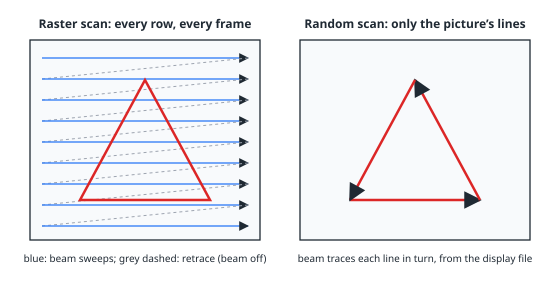
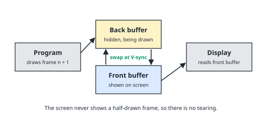

# Graphics Systems and Display Hardware

Before we draw anything, we need to know what we’re drawing on.

## What display hardware is
<!-- bite: 74cc2562-c350-4338-9e6c-7400118c21e8 -->

We’ve already said that computer graphics is about drawing on a screen…

Remember the feedback loop from lesson 1? The screen is the computer’s half of it.

### CRT

The video monitor is the primary output device of a graphics system. The classic monitor uses a cathode ray tube (CRT). Today’s screens are LCD or LED, but the same ideas carry over: pixels, a frame buffer, and refreshing.

## How a CRT works
<!-- bite: 0c33389f-c8da-4be1-904d-55fd660a336c -->

1. An electron gun fires a beam of electrons (the cathode ray)
2. The beam passes through focusing and deflection systems, which aim it at specific positions on the phosphor-coated screen.
3. Where the beam hits, the phosphor glows, giving a small spot of light.
4. The glow fades very quickly, so the picture must be redrawn again and again. That is refreshing.

## Ways of drawing a picture: raster scan
<!-- bite: 71cffd38-3008-40fa-9fdd-023256c47bf6 -->

There are two ways of drawing pictures on a screen.

1. **Raster scan:** The beam sweeps the whole screen, one row at a time, top to bottom. As it moves along a row, its intensity is switched on and off to make a pattern of lit spots.
    - The picture is stored in the frame buffer (also called the refresh buffer): an intensity value for every screen point
    - Each screen point is a pixel
    - After each row the beam returns to the start of the next row (horizontal retrace). After the last row it returns to the top (vertical retrace). The beam is off during a retrace.
## Way 2: random scan (vector scan)
<!-- bite: 81c362cb-e92d-49c1-984f-b9ea60bc9633 -->

2. **Random scan (vector scan).** The beam goes only where the picture is. It is also called a vector display, stroke-writing display or calligraphic display.
    - The picture is stored as a list of line-drawing commands in the display file (refresh display file).
    - The system cycles through the list and draws each line in turn.
    - It can redraw 30 to 60 times a second

## Raster scan vs random scan
<!-- bite: a79fa673-c4fc-45b6-be2a-a58e3f524c69 -->

| | Raster scan | Random scan |
|---|---|---|
| **Stored** | Intensity for every pixel | List of line commands |
| **Beam** | Sweeps whole screen | Follows only the lines |
| **Good at** | Filled areas, colour, shading, realistic images | Sharp, smooth lines |
| **Weak at** | Jagged lines (staircase effect) | Filled areas, shading; many lines means slow cycle and flicker |
| **Used today** | Almost every screen | Old vector and CAD displays |

Remember this one: because raster screens are grids, a diagonal line has to be approximated with pixels. That is exactly why DDA and Bresenham exist, and we’ll reach them soon.

## Seeing the two ways of scanning
<!-- bite: 6b8ad079-fd4b-4f8e-b58b-f94ffe8d9379 -->

On the left the beam sweeps every row, whether or not anything is drawn there, and switches off for each retrace. On the right it only travels along the triangle’s three lines.

## RASTER BASICS
<!-- bite: 039af8fa-6455-4ce8-85f0-2f91b0a56d29 -->

Things we should know…

1. The screen is a 2D array of pixels. In OpenGL the origin (0,0) is the lower-left corner. Upper-left is another common convention.
2. With N bits per pixel, a pixel can show 2^N intensities of colors.
3. In greyscale, there’s only one byte per pixel. 1 byte = 8 bits. So total intensities of colors is 2^8 = 256 shades. For colour, it’s 3 bytes per pixel (RGB). That is 2^24 shades
4. Two primitive (most basic) operations: setpixel(x,y,color): go to the pixel at column x, row y, and put this color there. This is the write operation. getpixel(x,y): look at the pixel at (x,y) and tell me what color it is right now. This is the read operation
5. Scan conversion is turning lines, circles and polygons into pixels. It is usually an approximation, because the grid is discrete.

## Refresh rate
<!-- bite: 7df7517f-6cca-459e-9299-7abe0bde7666 -->

**Why refreshing is needed on a CRT:** the phosphor glows only briefly. Unless each spot is redrawn again and again, the picture fades and flickers. **Redrawn fast enough — roughly 50–60 times a second or more — the eye sees a steady image.**

**Raster scan:** every cycle, the hardware reads the *entire* frame buffer and paints it, even if nothing changed. **The pixel rate is pixels per frame times the refresh rate**: $1920 \times 1080 \times 60 \approx 124$ million pixels per second.

**Random scan:** every cycle redraws every line. **More lines means a longer cycle, so the refresh rate drops and the picture flickers** — which is why random scan cannot handle complex pictures.

## Interlaced scan, and modern screens
<!-- bite: 58d06246-80fd-4a22-9751-5333521854f3 -->

**Interlaced versus non-interlaced.** Older CRTs and TVs drew odd lines on one pass and even lines on the next, so two passes make one frame. That reduces visible flicker without sending the whole picture each pass. **Non-interlaced (progressive)** scan draws every line in order on every pass.

**Modern LCD and LED panels** have no beam and no fading phosphor: a pixel holds its state until changed. **Refresh rate now means how often the panel can update what it shows.** Common values: 60, 120, 144, 240 Hz.

**The time between refreshes is 1000 divided by the refresh rate, in milliseconds.**

| Refresh rate | 30 Hz | 60 Hz | 120 Hz | 144 Hz | 240 Hz |
|---|---|---|---|---|---|
| Time between refreshes | 33.3 ms | 16.7 ms | 8.3 ms | 6.9 ms | 4.2 ms |

## Refresh rate is not frame rate
<!-- bite: b55eca69-578e-4c71-a5b4-dc9781f062a1 -->

- **Refresh rate** (Hz) is what the *display* can do.
- **Frame rate** (FPS) is what the *computer* produces.
- A 60 Hz screen shows at most 60 different pictures a second. **Render 120 FPS on it and the extra frames are never all shown; render 30 FPS and each picture is shown for two refreshes.**

## Double buffering and tearing
<!-- bite: 9aac6459-7f29-443d-9529-6cb6037a5564 -->

If the program writes into the frame buffer *while* the display is reading it, the screen can show the top of the old picture and the bottom of the new one — **tearing**. **The fix is double buffering:** draw the next frame into a hidden **back buffer**, then swap it with the **front buffer** (the one on screen), ideally during vertical retrace — **V-sync**. OpenGL programs commonly use double buffering. → [[computer-graphics/14-the-gpu-graphics-pipeline|The GPU pipeline]] for the modern swap chain.

> **Back to interactive computing.** The delay between your action and the picture changing (latency) depends partly on refresh rate: at most one new picture every 16.7 ms at 60 Hz, every 6.9 ms at 144 Hz. **A low refresh rate makes dragging and drawing feel laggy, which breaks the feedback loop.**

## Seeing double buffering
<!-- bite: dcbb639c-db28-4f7d-9e17-ab71d3f6af0a -->

The program only ever draws into the hidden back buffer. The display only ever reads the front buffer. At vertical retrace they swap places, so a half-drawn frame is never on screen.

## Bitmap and vector graphics
<!-- bite: 2aeda7b3-a10f-4fe2-aa93-1df283a9e616 -->

**A bitmap is not an algorithm — it is a way of *storing* an image**, and it is the opposite of vector graphics.

**Bitmap (raster) graphics** store the picture as a grid, with a colour (for example RGB values) for every pixel. Used for photographs. **The frame buffer is a bitmap.**

**Vector graphics** store the *shapes* — lines, curves, polygons, with their coordinates, colours and widths — and draw the picture from those instructions. **Random-scan displays worked this way.**

## Bitmap vs vector
<!-- bite: 1d3d7685-0134-4cb0-a699-3e012a57c752 -->

| | Bitmap (raster) | Vector |
|---|---|---|
| Stored as | Grid of pixel colours | List of shapes and coordinates |
| Resizing | Enlarging goes blurry or blocky | Scales cleanly to any size |
| File size | Grows with $W \times H \times$ bpp | Grows with number of shapes |
| Best for | Photographs, realistic images | Logos, diagrams, fonts, technical drawings |
| Formats | BMP, PNG, JPEG | SVG; the shapes inside PDF files |

## Disadvantages of bitmaps
<!-- bite: 968e5432-481c-4a2a-9d8b-34e07ec0aa11 -->

1. **They cannot be resized without losing quality.** Enlarging either magnifies pixels into blocks or forces the computer to guess new values (interpolation), which looks blurry. Shrinking throws detail away.
2. **Colour bitmaps are large.** 1920 × 1080 at 24 bpp is about 6.2 MB uncompressed; PNG and JPEG compression reduce that.

**Terminology:** strictly, a **bitmap** has 1 bit per pixel (black or white), and an image with more bits per pixel is a **pixmap**. In everyday use "bitmap" covers both.

## Common pitfalls
<!-- bite: ca212338-6671-48bb-a1bf-c564cedc6ca0 -->

1. **Mixing up refresh rate and frame rate.** One is the display, the other the program.
2. **Forgetting bits versus bytes** in frame-buffer sums. 24 bits per pixel is 3 bytes.
3. **Calling a bitmap a drawing or clipping algorithm.** It is a data representation.

## Check your understanding
<!-- bite: f25a22c9-33e9-483f-85a7-3a9a47771140 -->

Try each one before you open the answer.

1. <!-- q: open id="be438fe1" -->
   A random-scan display is drawing a CAD model, and the designer adds thousands more lines. What happens to the picture, and why?

   

Answer

   Each refresh cycle must redraw every line, so the cycle gets longer, the refresh rate falls, and the picture flickers.

   

2. <!-- q: exact id="28d39b85" answer="14.7456" accept="14.7 MB|14745600|14,745,600 bytes|14745600 bytes" sigfigs="2" -->
   How many megabytes does a 2560 × 1440 frame buffer need at 32 bits per pixel? (1 MB = 1,000,000 bytes.)

   

Answer

   2560 × 1440 = 3,686,400 pixels. At 4 bytes that is 14,745,600 bytes ≈ 14.7 MB. At 8 bits (1 byte) per pixel, it would be about 3.7 MB.

   

3. <!-- q: mcq id="9e5c56ae" -->
   A game renders at 90 FPS on a 60 Hz monitor without V-sync. What artefact might you see?

   - [x] Tearing
   - [ ] Jagged lines
   - [ ] Flicker from fading phosphor

   

Answer

   Tearing: the buffer is overwritten mid-scan. The fix is double buffering, with the swap during vertical retrace (V-sync).

   

4. <!-- q: exact id="4437f058" answer="256" -->
   A greyscale image uses 8 bits per pixel. How many shades can each pixel show?

   

Answer

   256. With N bits per pixel, a pixel can show 2^N intensities, and 2^8 = 256.

   

5. <!-- q: gap id="9e396d70" answers="16.6666666667|16.7 ms;6.94444444444|6.9 ms" sigfigs="2" -->
   Fill in the gaps. The time between refreshes is 1000 ÷ the refresh rate, in milliseconds. At 60 Hz it is ___ ms, and at 144 Hz it is ___ ms.

   

Answer

   16.7 ms and 6.9 ms. A low refresh rate makes dragging and drawing feel laggy.

   

6. <!-- q: mcq id="ed89b3f9" -->
   Why would you store a company logo as a vector image but a holiday photo as a bitmap?

   - [x] The logo must scale cleanly and is a few shapes; the photo has continuous detail no small list of shapes can describe
   - [ ] Vector files are always smaller
   - [ ] Bitmaps can't store colour

   

Answer

   The logo must scale cleanly to any size and is made of a few shapes; the photo has continuous detail that no small list of shapes describes.

   

## Check your understanding: worked problems
<!-- bite: 5b569ab1-9e19-4e43-b766-c6778b30e2ea -->

Work each one out on paper first, then type your answer.

1. <!-- q: exact id="6904983a" answer="6220800" accept="6,220,800" -->
   How many bytes does a 1920 × 1080 frame buffer need at 24 bits per pixel?

   

Answer

   6,220,800 bytes. 1920 × 1080 = 2,073,600 pixels, × 3 bytes = 6,220,800 (about 6.2 MB).

   

2. <!-- q: exact id="d57291ce" answer="60000" accept="60,000" -->
   An 800 × 600 black-and-white bitmap uses 1 bit per pixel. How many bytes is it?

   

Answer

   60,000 bytes. 800 × 600 = 480,000 bits, ÷ 8 = 60,000 bytes.

   

3. <!-- q: exact id="18ecc9ee" answer="55296000" accept="55,296,000" sigfigs="2" -->
   A 1280 × 720 raster display refreshes at 60 Hz. How many pixels per second must it paint?

   

Answer

   55,296,000, about 55 million. Pixels per frame × refresh rate = 921,600 × 60.

   

## Practice
<!-- bite: e51f7236-a4fe-4152-9a79-e4fe255ea709 -->

Write `framebuffer_size(w, h, bpp)` and `pixel_rate(w, h, hz)` in Python. **Done when** they reproduce 6,220,800 bytes and ≈124 million pixels/s for 1080p at 24 bpp and 60 Hz, and you can explain each factor out loud.

## Before moving on
<!-- bite: c32d62a5-7f8f-4514-9d14-1b989a0a81c5 -->

You can explain how a CRT draws a picture, raster versus random scan, the frame buffer, and why refresh exists. **Next:** [[computer-graphics/03-line-drawing-and-antialiasing|Line Drawing and Antialiasing]] — the first scan-conversion algorithm, and the raster weakness it fights.

## Related
<!-- bite: 1d0d55ca-bc13-442e-a256-df07fb5cea6c -->
- [[computer-graphics/09-how-rendering-works|How Rendering Works]] — the modern view of the same pipeline
- [[computer-graphics/14-the-gpu-graphics-pipeline|The GPU Graphics Pipeline]] — swap chains and presentation today
- [[computer-graphics/index|Computer graphics map]]

## About this lesson
<!-- bite: 5142a9ec-b23e-41e1-a4b7-4405387fae82 -->

**Level:** Beginner → Intermediate. **Covers:** the hardware the picture ends up on: the CRT, raster and random scan, the frame buffer, raster basics, refresh rate, and bitmap versus vector images.

**Where it sits:** the second lesson of Part 1, after [[computer-graphics/01-introduction-to-computer-graphics|Introduction to Computer Graphics]].

**Source:** the author's own SSG 511 notes, with the refresh-rate and bitmap sections cross-checked against standard textbook treatments.

**Before you start:** You need nothing beyond school maths: coordinates, multiplication, and the idea of a grid.

**After this lesson you will be able to:**
1. Explain how a CRT draws a picture, and compare raster scan with random scan.
2. Work out frame-buffer size and pixel rate for a given resolution and refresh rate.
3. Say when a bitmap is the right representation and when a vector one is.
