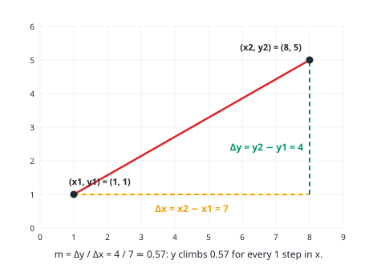
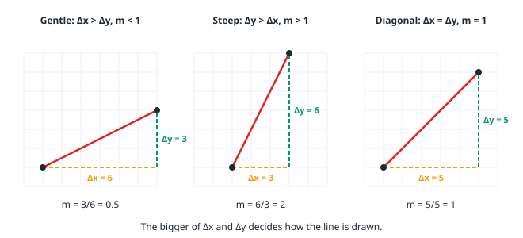
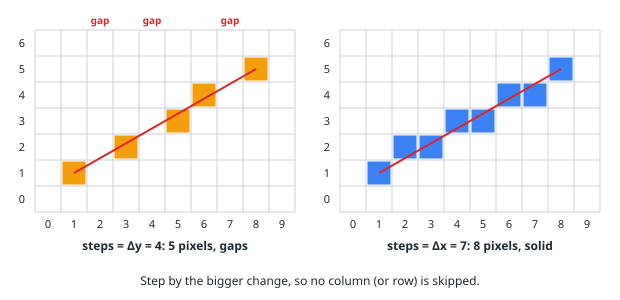
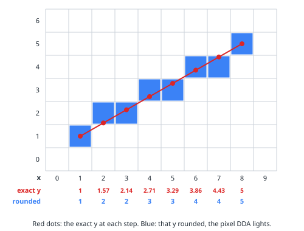
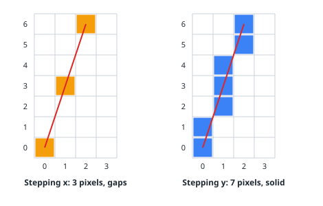
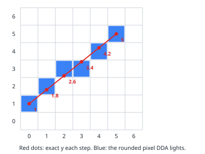

# Line Drawing and Antialiasing 1: Slopes and the DDA Algorithm

Line drawing is choosing which pixels to light up so they look like a straight line.

## Before you start
<!-- bite: bbde384e-3893-4547-9e76-0988ecb49731 -->

You can use `setpixel(x, y, colour)` on a grid ([[computer-graphics/02-graphics-systems-and-display-hardware|note 02]]), you remember the line equation $y = mx + b$ from school, and you can write a Python `for` loop.

**After this lesson you will be able to:**
1. Find $\Delta x$, $\Delta y$ and the slope of a line from its two end points, and say whether the slope is gentle, steep or diagonal.
2. Explain why DDA steps by the bigger of $\Delta x$ and $\Delta y$.
3. Build a DDA table by hand, round it to pixels, and check it with a program.

## What line drawing and antialiasing are
<!-- bite: d2c131ee-a342-4f1b-aff2-33ac1d7ffba9 -->

Line drawing is the job of choosing which pixels on the screen's grid to light up so that together they look like a straight line. Antialiasing is softening the jagged, staircase edges that this leaves, which is why lines and text on your phone look smooth instead of blocky.

The topic is big, so it comes in six parts, listed next.

## The six parts of line drawing
<!-- bite: a6eb94e0-3559-43b0-b2d2-8c63ba9be189 -->

Each part is one sitting, and each one needs the part before it:

1. **Slopes and the DDA algorithm** (this part): the first, simplest way to draw a line.
2. **Where DDA goes wrong**: why it drifts off the line on big screens, and why it is slow.
3. **Bresenham for gentle slopes**: the fix, using whole numbers only.
4. **Bresenham for steep slopes and every direction**: the exam derivation, and the full program.
5. **The midpoint view and drawing shapes**: the same algorithm seen another way, then polygons and dashed lines.
6. **Antialiasing**: making the staircase look smooth.

## The kid version
<!-- bite: f1219cdb-ea2c-4f47-819e-6821f58ec641 -->

You want to draw a slanted line on squared paper, but you may only colour whole squares. So you walk along the paper one square at a time. At every step, the line climbs by the same small amount, say a little more than half a square. You keep a running total of how high the line should be, and colour the square nearest to that height. **That is DDA: add the same climb every step, then round to the nearest square.**

**Where the analogy stops working.** On paper you can write "a little more than half" exactly as a fraction. A computer has to store it as a decimal with a limited number of digits, so every step adds a tiny mistake, and the mistakes pile up.

## Terms used in line drawing
<!-- bite: 2ced3f9e-4f69-4601-8c76-39b5357bb62a -->

1. **Scan conversion**: This is the turning of a geometric line into the set of pixels that approximates it.
2. **Slope**: This is also known as the **gradient**, written $m$. This is how much $y$ changes for each unit change in $x$: $m = \Delta y / \Delta x$.
3. **Gentle slope**: This is also known as a **shallow line**. This is a line with $\Delta x > \Delta y$, so $m < 1$. It changes more across than up.
4. **Steep slope**: This is a line with $\Delta y > \Delta x$, so $m > 1$. It changes more up than across.

## More terms used in line drawing
<!-- bite: 31a5bb4b-f071-4056-8f3f-57032d84a782 -->

5. **Diagonal slope**: This is a line with $\Delta x = \Delta y$, so $m = 1$. It goes up exactly one pixel for every pixel across.
6. **DDA**: The letters stand for **digital differential analyser**. This is the line algorithm that steps one pixel at a time along the direction that changes most, adds a fixed amount on the other direction, and rounds.
7. **Increment**: This is the fixed amount added to $x$ or $y$ at every step. In DDA they are written $x_{inc}$ and $y_{inc}$.

## Why line and curve algorithms matter
<!-- bite: ef22f7e2-1215-4e9b-85a6-263127e9db3b -->

Every picture on a raster screen is built from lines and curves, and the screen is a grid, so **every line or curve must be scan-converted**. It happens thousands to millions of times per picture, so the algorithm must be:

1. **Fast** — to keep interaction smooth ([[computer-graphics/01-introduction-to-computer-graphics|the feedback loop]]).
2. **Accurate** — the line looks straight and hits its end points.
3. **Simple** — simple enough to build into hardware.

**A good line should** be straight and pass through both end points, **be independent of point order** (A→B lights the same pixels as B→A), and **be uniformly bright whatever its slope**.

So we need a way to go from two end points to a set of pixels. That starts with the line itself.

## Two end points give a line
<!-- bite: 52172011-f3ab-4421-8a88-6a369b67d5fb -->

Given two end points, we can get a line: $(x_1, y_1)$ and $(x_2, y_2)$.

Recall $y = mx + b$. The slope $m$ is how much the line goes up, divided by how much it goes across:

$$m = \frac{\Delta y}{\Delta x} = \frac{y_2 - y_1}{x_2 - x_1}$$

Take the line from $(1, 1)$ to $(8, 5)$. It goes $\Delta x = 8 - 1 = 7$ across and $\Delta y = 5 - 1 = 4$ up, so $m = 4/7 \approx 0.57$. The orange and green dashes are $\Delta x$ and $\Delta y$:



## Three types of slope
<!-- bite: ef97cbcc-87bb-438c-b86d-b520d4f2c621 -->

Comparing $\Delta x$ with $\Delta y$, we can have 3 types of slopes:

1. **Gentle slope**: $\Delta x > \Delta y$, so $m < 1$. The line is closer to flat.
2. **Steep slope**: $\Delta y > \Delta x$, so $m > 1$. The line is closer to standing up.
3. **Diagonal slope**: $\Delta x = \Delta y$, so $m = 1$. This is the unusual case: exactly 45°.



Remember this one: **whichever of $\Delta x$ and $\Delta y$ is bigger decides how the line is drawn.** You'll see why in a moment.

## The straight way: work out y = mx + b at every x
<!-- bite: 75d1737d-2974-496d-8ea8-dc8265939008 -->

The most direct way to draw the line is to walk along $x$ and put each $x$ into the line equation. Here $y$ is the slope times the distance along $x$, plus the starting height:

$$y = m(x - x_1) + y_1$$

```text
m = (y2 - y1) / (x2 - x1)
for (x = x1; x <= x2; ++x) {
  y = m * (x - x1) + y1
  setpixel(x, round(y), linecolor)
}
```

This works, but every pixel costs a multiplication, and it breaks on steep lines (you'll see the gaps in a moment). DDA keeps the idea and removes the multiplication: since $y$ goes up by the same $m$ at every step, you can just **add** $m$ each time instead of multiplying.

## DDA: the basis is approximation
<!-- bite: 1619c39d-9d1f-43b0-a68c-6a7fff4f635b -->

The basis for DDA is approximation. The true line passes between pixel centres, but we can only light whole pixels. So at every step, DDA works out exactly where the line is, then lights the pixel nearest to it.

Our running example is the line from $(1, 1)$ to $(8, 5)$:

$$\Delta x = 8 - 1 = 7 \qquad \Delta y = 5 - 1 = 4$$

The first question is how many steps to take. We could step 7 times (one per column) or 4 times (one per row). Which one?

## Why the bigger change is our steps
<!-- bite: 8544eafa-4c81-4492-a6b0-a7e278949e66 -->

In DDA, the bigger change will be our steps to use. The reason is that if you use the smaller steps, your line on the screen won't draw well: there'll be dotted pixels with gaps between them. But if the steps are the bigger one, you know it covers up, because every column (or row) gets a pixel.

Here is our line both ways. On the left, steps $= \Delta y = 4$, so $x$ jumps 1.75 at a time and columns 2, 4 and 7 are skipped. On the right, steps $= \Delta x = 7$, and every column gets one pixel.



So for our line, $\text{steps} = \Delta x = 7$.

## DDA: the increments
<!-- bite: 5ed4fc3a-2d9a-4a15-afe9-a5a531b94556 -->

Now share each change equally over the steps. That gives how much to add to $x$ and to $y$ at every step:

$$x_{inc} = \frac{\Delta x}{\text{steps}} = \frac{7}{7} = 1 \qquad y_{inc} = \frac{\Delta y}{\text{steps}} = \frac{4}{7} = 0.57$$

So every step, $x$ goes up by exactly 1 and $y$ goes up by 0.57. Notice $y_{inc}$ is just the slope $m$: that's the "add $m$ instead of multiplying" idea from before.

**The whole algorithm, for any line:**

1. $\Delta x = x_2 - x_1$, $\Delta y = y_2 - y_1$.
2. $\text{steps} = \max(|\Delta x|, |\Delta y|)$.
3. $x_{inc} = \Delta x / \text{steps}$, $y_{inc} = \Delta y / \text{steps}$.
4. Start at $(x_1, y_1)$ and plot it.
5. Repeat `steps` times: $x \mathrel{+}= x_{inc}$, $y \mathrel{+}= y_{inc}$, then plot `(round(x), round(y))`.

## DDA: the table for (1, 1) to (8, 5)
<!-- bite: f84666af-1ac1-4b06-901f-7368478ecb2b -->

Start at $(1, 1)$, then keep adding $x_{inc} = 1$ and $y_{inc} = 0.57$:

| x | 1 | 2 | 3 | 4 | 5 | 6 | 7 | 8 |
|---|---|---|---|---|---|---|---|---|
| y | 1 | 1.57 | 2.14 | 2.71 | 3.29 | 3.86 | 4.43 | 5 |

In DDA, you round off, so the points for $y$ become:

| x | 1 | 2 | 3 | 4 | 5 | 6 | 7 | 8 |
|---|---|---|---|---|---|---|---|---|
| y | 1 | 2 | 2 | 3 | 3 | 4 | 4 | 5 |

The pixels are $(1,1)$, $(2,2)$, $(3,2)$, $(4,3)$, $(5,3)$, $(6,4)$, $(7,4)$ and $(8,5)$. Eight pixels, one per column, ending exactly on $(8, 5)$.

## Seeing the DDA table on the grid
<!-- bite: ee710299-0cb1-4ad0-8027-43b5e7a900bf -->

The red dots are the exact $y$ values from the first table. Each one is rounded to the nearest whole row, and that row is the blue pixel DDA lights. The two rows under the grid are the two tables.



## DDA: the three slope types again
<!-- bite: 4c7f5c61-1a65-4a4f-9589-d66bdc4ef3ef -->

Go back to the three types of slope. **DDA handles all three without you working out the slope first**, because step 2 picks the bigger change for you:

| Slope type | Condition | steps | $x$ increment | $y$ increment |
|---|---|---|---|---|
| Gentle | $\Delta x > \Delta y$, $m < 1$ | $\Delta x$ | 1 | $m$ |
| Steep | $\Delta y > \Delta x$, $m > 1$ | $\Delta y$ | $1/m$ | 1 |
| Diagonal | $\Delta x = \Delta y$, $m = 1$ | either | 1 | 1 |

> **For a gentle slope, it is $x$ that increases by 1 every step, not $y$.** Getting this backwards is the most common DDA mistake. And write the steep update as $x_{i+1} = x_i + 1/m$, not "$x_1 + 1/m$".

## Seeing a steep line done both ways
<!-- bite: b1f75916-fbe1-432d-9ade-6375b8f528da -->

For a steep line the roles swap: $y$ gets the step of 1. Here is $(0, 0)$ to $(2, 6)$, where $\Delta y = 6$ is the bigger change. Stepping $x$ (the smaller change) lights only 3 pixels. Stepping $y$ gives `steps = 6`, $x_{inc} = 2/6 = 0.33$, $y_{inc} = 1$, and every row gets a pixel.



## DDA: a second example, (0, 1) to (5, 5)
<!-- bite: a8245bd1-a4de-4b47-85b6-99ae7ea31276 -->

One more, so you can check yourself. $\Delta x = 5$, $\Delta y = 4$, a gentle slope, so steps $= 5$, $x_{inc} = 1$, $y_{inc} = 0.8$.

| i | x | y | pixel |
|---|---|---|---|
| 0 | 0 | 1 | (0, 1) |
| 1 | 1 | 1.8 | (1, 2) |
| 2 | 2 | 2.6 | (2, 3) |
| 3 | 3 | 3.4 | (3, 3) |
| 4 | 4 | 4.2 | (4, 4) |
| 5 | 5 | 5.0 | (5, 5) |

## Seeing the second example
<!-- bite: 35dee7e8-e82c-4828-ac8e-4fd5941aa67e -->

The red dots are the exact $y$ values from the table, and the blue pixels are those values rounded.



## DDA program
<!-- bite: 7dffcb64-8de3-4304-a02d-83bea9cac532 -->

```python
# dda.py — run: python3 dda.py, then type: 1 1 8 5
import math

def dda(x1, y1, x2, y2):
    dx, dy = x2 - x1, y2 - y1
    steps = max(abs(dx), abs(dy))
    if steps == 0:
        return [(x1, y1)]
    xinc, yinc = dx / steps, dy / steps
    x, y = x1, y1
    pixels = [(math.floor(x + 0.5), math.floor(y + 0.5))]
    for _ in range(steps):
        x += xinc
        y += yinc
        pixels.append((math.floor(x + 0.5), math.floor(y + 0.5)))
    return pixels

x1, y1, x2, y2 = map(int, input("x1 y1 x2 y2: ").split())
print(dda(x1, y1, x2, y2))
```

**Expected:** `1 1 8 5` → `[(1, 1), (2, 2), (3, 2), (4, 3), (5, 3), (6, 4), (7, 4), (8, 5)]`, the same as the table.

> **Use `math.floor(x + 0.5)`, not `round`.** Python's `round` rounds halves to the nearest *even* number (`round(2.5) == 2`), which can move a pixel.

DDA works. So why does every textbook move on to Bresenham? Because DDA has two disadvantages, and the first one hides on small examples like ours. That is the next part.

## Common pitfalls with DDA
<!-- bite: c5bb77da-db87-4890-8fc6-6ea1eceecc07 -->

1. **Stepping the smaller change.** The bigger of $\Delta x$ and $\Delta y$ gets the step of 1, or the line has gaps.
2. **Mixing up which increment is 1.** For a gentle slope $x_{inc} = 1$ and $y_{inc} = m$; for a steep slope $y_{inc} = 1$ and $x_{inc} = 1/m$.
3. **Using Python's `round`.** It rounds 2.5 down to 2. Use `math.floor(v + 0.5)`.
4. **Forgetting the first pixel.** Plot $(x_1, y_1)$ before the loop, so the line has steps $+ 1$ pixels.

## Check your understanding
<!-- bite: 00963a29-6cc9-437d-a264-98c84aeb51aa -->

Try each one before you open the answer.

1. <!-- q: mcq id="3d5b8e21" -->
   A line goes from (2, 3) to (4, 9). What type of slope is it?

   - [ ] Gentle, because Δx > Δy
   - [x] Steep, because Δy > Δx
   - [ ] Diagonal, because Δx = Δy

   <details><summary>Answer</summary>

   Steep. Δx = 4 − 2 = 2 and Δy = 9 − 3 = 6, so Δy is bigger and m = 6/2 = 3, which is more than 1.

   </details>

2. <!-- q: mcq id="20641934" -->
   A friend's DDA draws (1, 1) to (3, 9) as just three pixels. What did they do wrong?

   - [x] They stepped along x, the short axis, instead of y
   - [ ] They used integers instead of floats
   - [ ] They forgot to swap the end points

   <details><summary>Answer</summary>

   They stepped along x. dx = 2 and dy = 8, so the long axis is y and steps = max(2, 8) = 8, which gives 9 pixels, one per row.

   </details>

3. <!-- q: gap id="2583942d" answers="8;0.375|3/8" -->
   Fill in the gaps. DDA from (1, 1) to (9, 4) takes ___ steps, and the y increment per step is ___.

   <details><summary>Answer</summary>

   dx = 8 and dy = 3, so steps = max(8, 3) = 8, x_inc = 1 and y_inc = 3/8 = 0.375.

   </details>

4. <!-- q: exact id="9c47a0e3" answer="0.4" accept="2/5" -->
   DDA draws the line from (2, 1) to (12, 5). What is y_inc?

   <details><summary>Answer</summary>

   0.4. Δx = 10 and Δy = 4, so steps = 10 and y_inc = 4/10 = 0.4. The y values go 1, 1.4, 1.8, 2.2, …

   </details>

5. <!-- q: grid id="b81f6c2d" cols="8" rows="6" answer="0,0 1,1 2,1 3,2 4,3 5,3 6,4" given="0,0" line="0,0 6,4" axes="true" -->
   Light every pixel DDA chooses for the line from (0, 0) to (6, 4). The start pixel is given.

   <details><summary>Answer</summary>

   (0,0) (1,1) (2,1) (3,2) (4,3) (5,3) (6,4). steps = 6, x_inc = 1, y_inc = 4/6 ≈ 0.67, so the exact y values are 0, 0.67, 1.33, 2, 2.67, 3.33, 4, which round to 0, 1, 1, 2, 3, 3, 4.

   </details>

## Practice: independent tasks
<!-- bite: bfe44dd7-8e60-4ed7-bfa1-dc15dc369db7 -->

1. **$A(20,10)$ to $B(30,18)$ by DDA by hand**, then compare with your program. **Done when** both give 11 pixels, ending at $(30, 18)$.

All of these are collected, with the rest of the paper, in the [[computer-graphics/25-ssg-511-question-bank|question bank]].

## Before moving on
<!-- bite: a8e0f0e0-f2c7-467c-95cb-71aac51dd315 -->

You can find $\Delta x$, $\Delta y$ and the slope type, pick the steps, and build, round and check a DDA table. **Next:** [[computer-graphics/04-line-drawing-and-antialiasing-2|Line Drawing and Antialiasing 2: Where DDA Goes Wrong]]. Our 8-pixel line came out perfect, so it's fair to ask why anybody needs another algorithm. Part 2 stretches the same line across a 4K screen and shows you.

## Related
<!-- bite: 3118e4a3-e284-4d88-8b64-774cef488570 -->

- [[computer-graphics/04-line-drawing-and-antialiasing-2|Line Drawing and Antialiasing 2]] — where DDA goes wrong
- [[computer-graphics/27-ssg-511-formula-sheet|Formula sheet]]
- [[computer-graphics/index|Computer graphics map]]

## About this lesson
<!-- bite: 2cf212cd-70c4-4eb7-afc7-fa0ea0b4127d -->

**Level:** Beginner. **Covers:** End points, $\Delta x$, $\Delta y$ and the slope; the three slope types; the straight $y = mx + b$ method; why DDA steps by the bigger change; the DDA increments, table, rounding and program.

Part 1 of 6 on line drawing and antialiasing, in Part 1 of the course, after [[computer-graphics/02-graphics-systems-and-display-hardware|note 02]]. Line drawing is **the most-examined topic in SSG 511**. The flow of this part follows the author's own DDA notes.
