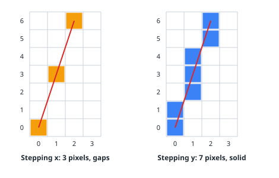
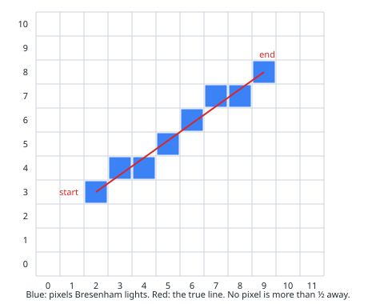

# Line Drawing and Antialiasing

Line drawing is choosing which pixels to light up so they look like a straight line.

## Before you start
<!-- bite: bbde384e-3893-4547-9e76-0988ecb49731 -->

You can use `setpixel(x, y, colour)` on a grid ([[computer-graphics/02-graphics-systems-and-display-hardware|note 02]]), find a line's slope $m = \frac{y_1 - y_0}{x_1 - x_0}$, and write a Python `for` loop.

**After this note you will be able to:**
1. Explain why line algorithms matter and give three reasons Bresenham beats DDA.
2. Derive Bresenham's decision parameter for $0 < m < 1$ **and** $m > 1$, including $p_0$.
3. Trace a Bresenham table by hand for any line, and check it against code.
4. Explain four antialiasing methods and their trade-off.

## What line drawing and antialiasing are
<!-- bite: d2c131ee-a342-4f1b-aff2-33ac1d7ffba9 -->

Line drawing is the job of choosing which pixels on the screen's grid to light up so that together they look like a straight line. Antialiasing is softening the jagged, staircase edges that this leaves, which is why lines and text on your phone look smooth instead of blocky.

Next: the kid version, then the words you need.

## The kid version
<!-- bite: 4560c9e4-4d48-4719-ba9d-985a60e3ad03 -->

You want to draw a diagonal line on squared paper, but you are only allowed to colour whole squares. Walk along the long direction one square at a time. At each step, ask one question: "is the true line closer to the square I'm level with, or to the one just above?" Colour the closer one. **Bresenham's trick is that you can answer that question by keeping a running score and only ever adding whole numbers to it.**

**Where the analogy stops working.** On paper you can *see* which square is closer. The computer cannot; it needs the score (the *decision parameter*) precisely because comparing the real distances would need fractions.

## Terms used in line drawing
<!-- bite: 2ced3f9e-4f69-4601-8c76-39b5357bb62a -->

1. **Scan conversion**: This is the turning of a geometric line into the set of pixels that approximates it.
2. **Slope**: This is also known as the **gradient**, written $m$. This is how much $y$ changes for each unit change in $x$: $m = dy/dx$.
3. **Shallow line**: This is a line with $|m| < 1$. It changes more in $x$ than in $y$, so it is stepped along $x$.
4. **Steep line**: This is a line with $|m| > 1$. It changes more in $y$ than in $x$, so it is stepped along $y$.
## More terms used in line drawing
<!-- bite: 31a5bb4b-f071-4056-8f3f-57032d84a782 -->

5. **DDA**: The letters stand for **digital differential analyser**. This is the line algorithm that steps one pixel along the longer axis and adds a constant fractional increment on the other.
6. **Decision parameter**: This is the integer $p_k$ whose sign tells Bresenham which of two candidate pixels to colour next.
7. **Aliasing**: This is the jagged, stair-step look of a smooth edge drawn on a pixel grid, caused by sampling a continuous shape at too few points.
8. **Antialiasing**: This is any technique that reduces aliasing, usually by shading edge pixels with in-between intensities.

## 1. Why line and curve algorithms matter
<!-- bite: ef22f7e2-1215-4e9b-85a6-263127e9db3b -->

Every picture on a raster screen is built from lines and curves, and the screen is a grid, so **every line or curve must be scan-converted**. It happens thousands to millions of times per picture, so the algorithm must be:

1. **Fast** — to keep interaction smooth ([[computer-graphics/01-introduction-to-computer-graphics|the feedback loop]]).
2. **Accurate** — the line looks straight and hits its end points.
3. **Simple** — simple enough to build into hardware.

**A good line should** be straight and pass through both end points, **be independent of point order** (A→B lights the same pixels as B→A), and **be uniformly bright whatever its slope**.

## 2. The naive algorithm
<!-- bite: 75d1737d-2974-496d-8ea8-dc8265939008 -->

**The line equation says $y$ is the slope times the distance along $x$, plus the starting height.**

$$y = mx + b,\qquad m = \frac{y_1 - y_0}{x_1 - x_0},\qquad b = y_0 - m x_0 \;\;\Rightarrow\;\; y = m(x - x_0) + y_0$$

```text
m = (y1 - y0) / (x1 - x0)
for (x = x0; x <= x1; ++x) {
  y = m * (x - x0) + y0
  setpixel(x, round(y), linecolor)
}
```

## The naive algorithm's three problems
<!-- bite: 8544eafa-4c81-4492-a6b0-a7e278949e66 -->

| Problem | Fix |
|---|---|
| If $x_1 < x_0$, nothing is drawn | Swap the points |
| For $m > 1$, too few pixels are lit — the line has **gaps** and looks dimmer | When $m > 1$ loop over $y$, with $x = \frac{1}{m}(y - y_0) + x_0$ |
| Inefficient: a float multiply and a round **per pixel** | Bresenham |

**Why stepping the wrong axis leaves gaps:** for $(0,0)$ to $(2,6)$, stepping $x$ gives 3 pixels for a line that spans 7 rows. Stepping $y$ gives `steps = 6`, $x_{inc} = 0.33$, $y_{inc} = 1$ — no gaps.

Here is the line from (0, 0) to (2, 6) drawn both ways. On the left we step along x, the short axis, so only 3 pixels get lit and the line breaks up. On the right we step along y, the long axis, and every row gets a pixel.



## 3. DDA
<!-- bite: 5ed4fc3a-2d9a-4a15-afe9-a5a531b94556 -->

**Step one pixel along the longer axis, and add a constant increment on the other.**

1. $dx = x_1 - x_0$, $dy = y_1 - y_0$.
2. $\text{steps} = \max(|dx|, |dy|)$.
3. $x_{inc} = dx / \text{steps}$, $y_{inc} = dy / \text{steps}$.
4. Start at $(x_0, y_0)$ and plot `(round(x), round(y))`.
5. Repeat `steps` times: $x \mathrel{+}= x_{inc}$, $y \mathrel{+}= y_{inc}$, plot.

## DDA: the three cases, good and bad
<!-- bite: 4c7f5c61-1a65-4a4f-9589-d66bdc4ef3ef -->

**The three cases fall out of step 2 automatically** — you never need to find the slope first:

| Case | Condition | $x$ increment | $y$ increment |
|---|---|---|---|
| 1 | $m < 1$ (more horizontal) | 1 | $m$ |
| 2 | $m > 1$ (more vertical) | $1/m$ | 1 |
| 3 | $m = 1$ | 1 | 1 |

> **For a slope below 1, it is $x$ that increases by 1 every step — not $y$.** Getting this backwards is the most common DDA mistake. And write the update as $x_{i+1} = x_i + 1/m$, not "$x_1 + 1/m$".

**Good:** simple, every slope, only additions per pixel. **Bad:** floating point, a rounding every step, and **round-off error accumulates on long lines** so pixels drift off the true line.

## DDA worked examples
<!-- bite: f84666af-1ac1-4b06-901f-7368478ecb2b -->

**Worked — $A(0,1)$ to $B(5,5)$:** $dx = 5$, $dy = 4$, steps $= 5$, $x_{inc} = 1$, $y_{inc} = 0.8$.

| i | x | y | pixel |
|---|---|---|---|
| 0 | 0 | 1 | (0, 1) |
| 1 | 1 | 1.8 | (1, 2) |
| 2 | 2 | 2.6 | (2, 3) |
| 3 | 3 | 3.4 | (3, 3) |
| 4 | 4 | 4.2 | (4, 4) |
| 5 | 5 | 5.0 | (5, 5) |

**Worked — $(1,1)$ to $(8,5)$:** $x_{inc} = 1$, $y_{inc} = 4/7 = 0.571$. The $y$ values $1, 1.57, 2.14, 2.71, 3.29, 3.86, 4.43, 5$ round to $1,2,2,3,3,4,4,5$ — **the same pixels Bresenham gives below.**

## DDA program
<!-- bite: 7dffcb64-8de3-4304-a02d-83bea9cac532 -->

```python
# dda.py — run: python3 dda.py, then type: 1 1 6 4
import math

def dda(x0, y0, x1, y1):
    dx, dy = x1 - x0, y1 - y0
    steps = max(abs(dx), abs(dy))
    if steps == 0:
        return [(x0, y0)]
    xinc, yinc = dx / steps, dy / steps
    x, y = x0, y0
    pixels = [(math.floor(x + 0.5), math.floor(y + 0.5))]
    for _ in range(steps):
        x += xinc
        y += yinc
        pixels.append((math.floor(x + 0.5), math.floor(y + 0.5)))
    return pixels

x0, y0, x1, y1 = map(int, input("x0 y0 x1 y1: ").split())
print(dda(x0, y0, x1, y1))
```

**Expected:** `1 1 6 4` → `[(1, 1), (2, 2), (3, 2), (4, 3), (5, 3), (6, 4)]`.

> **Use `math.floor(x + 0.5)`, not `round`.** Python's `round` rounds halves to the nearest *even* number (`round(2.5) == 2`), which can move a pixel.

## 4. Bresenham's line algorithm
<!-- bite: 2beeacc1-50ef-4f8a-962c-f3aaa215e51d -->

**Bresenham uses only integers.** At each step it picks whichever of two candidate pixels is closer to the true line, using the sign of a decision parameter $p$.

**Three reasons it is preferred over DDA:**
1. **Integer arithmetic only** — additions, subtractions and doubling; no floating point, no rounding.
2. **Faster and cheaper per pixel**, and easy to build into hardware.
3. **More accurate** — no accumulated round-off, and it always picks the pixel closest to the true line.

## Bresenham for 0 < m < 1: the two distances
<!-- bite: 1bfaf5da-bce9-4267-95ce-ccc99029c331 -->

Let $dx = x_1 - x_0$, $dy = y_1 - y_0$, with $0 < dy < dx$. Suppose pixel $(x_k, y_k)$ has just been plotted. **At column $x_k + 1$ the true line has height $y = m(x_k + 1) + b$**, and the two candidates are the lower pixel $(x_k + 1, y_k)$ and the upper pixel $(x_k + 1, y_k + 1)$.

```text
 y_k+1  ┤ ·········□ upper        d_upper = (y_k + 1) − y
        │        ╱  ↕ d_upper
   y    ┤······●     ← true line at x_k+1
        │    ╱      ↕ d_lower
 y_k    ┤ ■ ········□ lower       d_lower = y − y_k
        └─┬─────────┬───
         x_k      x_k+1
```

$$d_{lower} = y - y_k = m(x_k+1) + b - y_k \qquad d_{upper} = (y_k + 1) - y = y_k + 1 - m(x_k+1) - b$$

## Bresenham for 0 < m < 1: the decision parameter
<!-- bite: 8a00848a-b236-430f-acfb-7c1220873120 -->

**Choose the lower pixel when it is closer, that is when $d_{lower} - d_{upper} < 0$:**

$$d_{lower} - d_{upper} = 2m(x_k + 1) - 2y_k + 2b - 1$$

This still contains the fraction $m$. **Multiply by $dx$** — positive, so the sign is unchanged — and substitute $m = dy/dx$. That product *is* the decision parameter:

$$p_k = dx(d_{lower} - d_{upper}) = 2dy\,x_k - 2dx\,y_k + c, \qquad c = 2dy + dx(2b - 1)$$

- **If $p_k < 0$, plot $(x_k + 1, y_k)$.**
- **If $p_k \ge 0$, plot $(x_k + 1, y_k + 1)$.**

## Bresenham for 0 < m < 1: the update and the start value
<!-- bite: 1c8fb45b-fd7e-42ad-94d5-aea79dd8c120 -->

**The update.** Subtract $p_k$ from $p_{k+1}$; the constant $c$ cancels:

$$p_{k+1} - p_k = 2dy(x_{k+1} - x_k) - 2dx(y_{k+1} - y_k) = 2dy - 2dx(y_{k+1} - y_k)$$

Since $x$ always moves by 1, the update depends only on whether $y$ moved:

$$p_{k+1} = \begin{cases} p_k + 2dy & p_k < 0 \;\;(y \text{ stays}) \\ p_k + 2dy - 2dx & p_k \ge 0 \;\;(y \text{ goes up by } 1)\end{cases}$$

**The start value.** Put $(x_0, y_0)$ into $p_k$ with $b = y_0 - m x_0$ (the line passes through the start point). Everything cancels except:

$$p_0 = 2dy - dx$$

## Bresenham for m > 1: the two distances (the exam question)
<!-- bite: 353b71b5-f20a-424e-a913-754ffc28c8c9 -->

**Swap the roles of $x$ and $y$.** Now $dy > dx$. Step $y$ by 1 each time, and decide whether $x$ stays or increases by 1. Having plotted $(x_k, y_k)$, **at row $y_k + 1$ the true line is at $x = (y_k + 1 - b)/m$**. The candidates are the left pixel $(x_k, y_k + 1)$ and the right pixel $(x_k + 1, y_k + 1)$.

```text
 row y_k+1:   □ left ←d_left→ ● ←d_right→ □ right
              x_k             x           x_k+1
 row y_k:     ■ (just plotted)
```

$$d_{left} = x - x_k,\qquad d_{right} = (x_k + 1) - x,\qquad d_{left} - d_{right} = 2x - 2x_k - 1$$

## Bresenham for m > 1: the decision parameter and update
<!-- bite: 70f55dbd-3d09-4d43-b932-122ebaa4794d -->

**Multiply by $dy$** (positive) and use $x = (y_k + 1 - b)\,dx/dy$:

$$p_k = dy(d_{left} - d_{right}) = 2dx\,y_k - 2dy\,x_k + c', \qquad c' = 2dx(1 - b) - dy$$

$$p_{k+1} = \begin{cases} p_k + 2dx & p_k < 0 \;\;(\text{left closer: } x \text{ stays}) \\ p_k + 2dx - 2dy & p_k \ge 0 \;\;(\text{right closer: } x + 1)\end{cases} \qquad p_0 = 2dx - dy$$

**Other cases.** For negative slopes, work with $|dx|$ and $|dy|$ and step $x$ or $y$ by $-1$ instead of $+1$ (the `sx`, `sy` signs in the code below). Horizontal, vertical and 45° lines are special cases of the same rules.

## Bresenham worked: steep line (2, 1) to (5, 8)
<!-- bite: af68eaef-2e20-44f0-b934-d2f06f52db74 -->

$dx = 3$, $dy = 7$, $m = 7/3 > 1$, so step $y$. $p_0 = 2dx - dy = -1$. Updates: $+2dx = +6$ ($x$ stays) or $2dx - 2dy = -8$ ($x$ goes up).

| k | $p_k$ | Decision | Plot | $p_{k+1}$ |
|---|---|---|---|---|
| start | | | (2, 1) | |
| 0 | −1 | $p<0$, $x$ stays | (2, 2) | −1 + 6 = 5 |
| 1 | 5 | $p \ge 0$, $x+1$ | (3, 3) | 5 − 8 = −3 |
| 2 | −3 | $x$ stays | (3, 4) | 3 |
| 3 | 3 | $x+1$ | (4, 5) | −5 |
| 4 | −5 | $x$ stays | (4, 6) | 1 |
| 5 | 1 | $x+1$ | (5, 7) | −7 |
| 6 | −7 | $x$ stays | (5, 8) | end |

**There are $dy + 1 = 8$ pixels, one per row.** To check, plot them on a grid and draw the true line over the top: no pixel is more than half a pixel away.

## Bresenham worked: shallow line (2, 3) to (9, 8)
<!-- bite: 99946edf-1a72-4754-91d5-b570b228bd6f -->

$dx = 7$, $dy = 5$, $p_0 = 2dy - dx = 3$. Updates: $+10$ ($y$ stays) or $-4$ ($y$ up).

| k | $p_k$ | Decision | Plot | $p_{k+1}$ |
|---|---|---|---|---|
| start | | | (2, 3) | |
| 0 | 3 | $y+1$ | (3, 4) | −1 |
| 1 | −1 | $y$ stays | (4, 4) | 9 |
| 2 | 9 | $y+1$ | (5, 5) | 5 |
| 3 | 5 | $y+1$ | (6, 6) | 1 |
| 4 | 1 | $y+1$ | (7, 7) | −3 |
| 5 | −3 | $y$ stays | (8, 7) | 7 |
| 6 | 7 | $y+1$ | (9, 8) | end |

## Seeing the shallow line on the grid
<!-- bite: 613f463a-db17-4d45-8d37-fdbd7d6a137d -->

These are the 8 pixels from the table above, with the true line drawn over them. Notice how y stays put twice, at x = 4 and x = 8, exactly where p was negative.



## Bresenham worked: class example (1, 1) to (8, 5)
<!-- bite: 0c9d766c-f4c6-4f45-9936-6327b72b8145 -->

$dx = 7$, $dy = 4$, $p = 2(4) - 7 = 1$. Add $2dy - 2dx = -6$ when $p \ge 0$, add $2dy = 8$ when $p < 0$.

| x | p | y moves? | pixel |
|---|---|---|---|
| 1 | 1 (≥ 0) | up | (1, 1) |
| 2 | −5 | stays | (2, 2) |
| 3 | 3 | up | (3, 2) |
| 4 | −3 | stays | (4, 3) |
| 5 | 5 | up | (5, 3) |
| 6 | −1 | stays | (6, 4) |
| 7 | 7 | up | (7, 4) |
| 8 | (done) | | (8, 5) |

The end point is $(8, 5)$, so $y_8 = y_7 + 1 = 5$ — not 8.

## Bresenham worked: steep, going left, (12, 3) to (5, 19)
<!-- bite: c58f1104-4caa-4064-a1bd-17ad1c2dbe14 -->

$dx = 7$, $dy = 16$: step $y$; $x$ moves left ($sx = -1$). $p_0 = 2dx - dy = -2$. If $p < 0$: $p \mathrel{+}= 14$, $x$ stays. If $p \ge 0$: $x \mathrel{-}= 1$, $p \mathrel{+}= -18$. Then $y \mathrel{+}= 1$.

| k | p | pixel | k | p | pixel |
|---|---|---|---|---|---|
| 0 | −2 | (12,3) | 9 | −4 | (8,12) |
| 1 | 12 | (12,4) | 10 | 10 | (8,13) |
| 2 | −6 | (11,5) | 11 | −8 | (7,14) |
| 3 | 8 | (11,6) | 12 | 6 | (7,15) |
| 4 | −10 | (10,7) | 13 | −12 | (6,16) |
| 5 | 4 | (10,8) | 14 | 2 | (6,17) |
| 6 | −14 | (9,9) | 15 | −16 | (5,18) |
| 7 | 0 | (9,10) | 16 | −2 | (5,19) |
| 8 | −18 | (8,11) | | | |

17 pixels ($dy + 1$), ending exactly at $(5, 19)$. **At $k = 7$, $p = 0$ counts as "$p \ge 0$", so $x$ steps.**

## 5. The midpoint line algorithm
<!-- bite: 04dafa87-8f3d-4f1f-989b-562fee5a94a4 -->

**Same result, different way of seeing it.** Write the line as $F(x, y) = dy\,x - dx\,y + dx\,b = 0$. Points above the line give $F < 0$; below give $F > 0$. **Evaluate $F$ at the midpoint between the two candidates**, $M = (x_k + 1,\; y_k + \tfrac12)$:

- $F(M) < 0$: the midpoint is above the line, so the line is nearer the lower pixel — plot $(x_k + 1, y_k)$.
- $F(M) \ge 0$: plot $(x_k + 1, y_k + 1)$.

With $d = 2F(M)$: $d_0 = 2dy - dx$, then $d \mathrel{+}= 2dy$ (lower) or $d \mathrel{+}= 2(dy - dx)$ (upper). **For lines it is exactly Bresenham. Its advantage is that it extends to circles and ellipses** → [[computer-graphics/04-circles-and-polygon-filling|note 04]].

## DDA vs Bresenham vs midpoint
<!-- bite: ed862a86-5bd7-4a0d-880d-406bd4801db8 -->

| Algorithm | Arithmetic | Main idea | Notes |
|---|---|---|---|
| DDA | Floating point | Step the long axis, add slope increments, round | Simple but slow; error builds up |
| Bresenham | Integers only | Decision parameter picks the closer pixel | Fast and exact |
| Midpoint | Integers only | Test the midpoint of the two candidates | Same as Bresenham for lines; generalises to circles |

## Complexity of the line algorithms
<!-- bite: bb72c49f-ef58-4648-9ece-5f366a29112a -->

**Both DDA and Bresenham are $O(n)$**, where $n = \max(|dx|, |dy|)$ is the number of pixels drawn, because each does constant work per pixel. **They do not differ in big-O.** The difference is the work per pixel: DDA does two float additions and two roundings; Bresenham does integer additions and one comparison with 0. **Integer operations are faster, exact, and simple in hardware — that is what makes Bresenham more efficient.**

## 6. Worked example — an integer-only Bresenham for every slope
<!-- bite: 1c22a931-e61a-4e78-92b8-904cb1976c8d -->

```python
# bresenham.py — run: python3 bresenham.py, then type: 2 1 5 8
def bresenham(x0, y0, x1, y1):
    """Return the pixels of the line from (x0, y0) to (x1, y1), integers only."""
    pixels = []
    dx, dy = abs(x1 - x0), abs(y1 - y0)
    sx = 1 if x1 > x0 else -1   # direction of travel in x
    sy = 1 if y1 > y0 else -1   # direction of travel in y
    x, y = x0, y0

    if dy > dx:                 # steep line (|m| > 1): step in y
        p = 2 * dx - dy
        for _ in range(dy + 1):
            pixels.append((x, y))
            if p >= 0:
                x += sx
                p += 2 * (dx - dy)
            else:
                p += 2 * dx
            y += sy
    else:                       # shallow line (|m| <= 1): step in x
        p = 2 * dy - dx
        for _ in range(dx + 1):
            pixels.append((x, y))
            if p >= 0:
                y += sy
                p += 2 * (dy - dx)
            else:
                p += 2 * dy
            x += sx
    return pixels

x0, y0, x1, y1 = map(int, input("x0 y0 x1 y1: ").split())
print(bresenham(x0, y0, x1, y1))
```

## Bresenham program: test cases
<!-- bite: 1a2c697b-62a5-4ed6-bd15-fb4d5fee0e76 -->

**Test cases (all re-run and matching the hand tables):**

| Use case | Input | Output |
|---|---|---|
| Shallow, $m < 1$ | (2,3) to (9,8) | (2,3) (3,4) (4,4) (5,5) (6,6) (7,7) (8,7) (9,8) |
| Steep, $m > 1$ | (2,1) to (5,8) | (2,1) (2,2) (3,3) (3,4) (4,5) (4,6) (5,7) (5,8) |
| Steep, negative slope | (1,8) to (6,2) | (1,8) (2,7) (3,6) (4,5) (4,4) (5,3) (6,2) |
| Horizontal | (1,4) to (6,4) | (1,4) (2,4) (3,4) (4,4) (5,4) (6,4) |

**To justify results in an exam:** plot the pixels and the true line together and show that no pixel is more than half a pixel from it. (The code was also checked on 28,392 random lines; every pixel was within half a pixel.)

## 7. From lines to shapes
<!-- bite: 4f6c00e5-a5fa-4b17-a40a-f7355bda213b -->

**A polygon is a set of lines.** Call the line function for each pair of consecutive vertices, and for the last vertex back to the first — the `% n` closes the shape:

```python
def draw_polygon(vertices, draw_line):
    n = len(vertices)
    for i in range(n):
        x0, y0 = vertices[i]
        x1, y1 = vertices[(i + 1) % n]
        draw_line(x0, y0, x1, y1)
```

**A regular $n$-gon's vertices lie on a circle, spaced $360°/n$ apart:**

$$x_i = x_c + r\cos\!\left(\theta_0 + i\,\tfrac{360°}{n}\right),\qquad y_i = y_c + r\sin\!\left(\theta_0 + i\,\tfrac{360°}{n}\right),\qquad i = 0,\dots,n-1$$

Round each vertex to integers before passing it to the line function. A hexagon has $n = 6$, so the vertices are 60° apart.

## Dashed (styled) lines
<!-- bite: 0809b9f1-87b2-47cb-8295-733e949db7df -->

**Count pixels along the line, and plot one only when its position in the repeating pattern falls in the "on" part:**

```python
def dashed_pixels(pixels, on=4, off=3):
    """Keep `on` pixels, skip `off` pixels, and repeat."""
    return [p for k, p in enumerate(pixels) if k % (on + off) < on]
```

For a horizontal line of 14 pixels ($x = 0$ to $13$) with on = 4, off = 3, this keeps $x = 0$–$3$ and $x = 7$–$10$. To toggle styles, add an option that either plots every pixel or applies this filter. **For a rectangle, decide whether the pattern restarts at each corner or carries on around it** — and say which.

## 8. Antialiasing
<!-- bite: 6868ee9b-4c80-4e59-b2b2-1fa37400f3cd -->

**Antialiasing is a set of techniques that reduce the jagged, stair-step look of lines and edges that should be smooth.**

**Why jaggies happen.** A line is continuous, but the screen is a grid with limited resolution. Scan conversion samples the shape at only a few points, so smooth edges become staircases. The same problem shows up as crawling or flickering edges in animation, and odd patterns on fine detail. **The cause is the output device not having enough resolution to show the shape exactly** — the raster weakness from note 01. → [[computer-graphics/09-how-rendering-works|Rendering as sampling]] for the signal-processing view.

## Four antialiasing methods
<!-- bite: 7ba72a38-e25c-4792-84e3-59904978c8eb -->

1. **Higher resolution.** More, smaller pixels make smaller steps. It works, but costs memory and time.
2. **Area sampling** (shading the in-between pixels). **Set each pixel's intensity in proportion to how much of it the line covers.** A line covering 30% of a pixel gives it 30% of the line's intensity — shades of grey on a monochrome screen, or shades of the line colour. **Wu's line algorithm** is the well-known example.
3. **Supersampling.** Compute the image at higher resolution (say 4 samples per pixel), then average each pixel's samples. Simple and works for any shape, but cost multiplies with the sample count. **MSAA** is the cheaper hardware version that takes extra samples only near edges → [[computer-graphics/11-rasterisation|note 11]].
4. **Pixel phasing** (smoothing). The output device shifts pixel positions by fractions of a pixel, adjusting dot size and horizontal alignment so lines and curves land more exactly.

**Trade-off:** antialiased lines look smoother but also **softer (fuzzier)**, and need more computation.

## Common pitfalls
<!-- bite: 4685336b-305e-4932-8af1-f52213d3904c -->

1. **Testing the update instead of the parameter.** The test is "if $p_k < 0$", not "if $p_{next} - p_k < 0$" — $p_{next} - p_k$ is only the amount added.
2. **Using $p > 0$ instead of $p \ge 0$** for "move up". At $p = 0$ the step is taken.
3. **Calling the first value $P_0$ in the steps and $P_1$ in the example.** Pick one name and keep it.
4. **Stepping the wrong axis in DDA** — the long axis gets the step of 1.
5. **Spelling:** it is *Bresenham* (not "Bresendham").
6. **Forgetting the final pixel.** Loop `dx + 1` (or `dy + 1`) times, so both end points are drawn.

## Check your understanding
<!-- bite: b43441a7-c391-4fae-b528-02a2e3f52f0e -->

Try each one before you open the answer.

1. <!-- q: gap id="0aed2194" answers="14;y" -->
   Fill in the gaps. Without computing the table, Bresenham lights ___ pixels for (3, 2) to (7, 15), and it steps the ___ axis.

   <details><summary>Answer</summary>

   dx = 4, dy = 13, steep, so step y: dy + 1 = 14 pixels.

   </details>

2. <!-- q: exact id="f961b0ea" answer="-1" accept="−1" -->
   For the steep line (2, 1) to (5, 8), what is Bresenham's starting decision parameter p₀ = 2dx − dy?

   <details><summary>Answer</summary>

   −1. dx = 3 and dy = 7, so p₀ = 2(3) − 7 = −1. Since p₀ < 0, x stays and the next pixel is (2, 2).

   </details>

3. <!-- q: mcq id="af09b6ed" -->
   A friend's DDA gives (0,0) to (2,6) as three pixels. What did they do wrong?

   - [x] They stepped along x, the short axis
   - [ ] They used integers instead of floats
   - [ ] They forgot to swap the end points

   <details><summary>Answer</summary>

   They stepped along x (the short axis). Steps should be max(|dx|, |dy|) = 6.

   </details>

4. <!-- q: mcq id="8a75268f" -->
   During Bresenham, the decision parameter is exactly p = 0. What happens?

   - [x] Take the step (p = 0 counts as p ≥ 0)
   - [ ] Stay on the same row or column
   - [ ] Plot both candidate pixels

   <details><summary>Answer</summary>

   Take the step. Using p > 0 instead of p ≥ 0 is a common mistake.

   </details>

5. <!-- q: mcq id="90e019ec" -->
   A line covers 30% of a pixel. With area sampling, what intensity does that pixel get?

   - [ ] Full intensity
   - [x] 30% of the line's intensity
   - [ ] Zero, because the line covers less than half

   <details><summary>Answer</summary>

   30%. Area sampling sets each pixel's intensity in proportion to how much of it the line covers. Wu's line algorithm is the well-known example.

   </details>

6. <!-- q: open id="f9d71681" -->
   DDA and Bresenham are both O(n). In what sense is Bresenham "more efficient", then? And why is it safe to multiply d_lower − d_upper by dx?

   <details><summary>Answer</summary>

   Constant factors: integer adds and a sign test per pixel versus float adds and rounding, and no accumulated error. Multiplying by dx is safe because dx > 0, so the sign doesn't change, and the sign is all the decision uses. It also clears the fraction m = dy/dx, leaving integers.

   </details>

## Check your understanding: worked problems
<!-- bite: b064f55a-475d-49c9-87fe-b3b62a407c6b -->

Work each one out on paper first, then type your answer.

1. <!-- q: gap id="96801fda" answers="-2|−2;0;1" -->
   Fill in the gaps. Bresenham from (0, 0) to (8, 3): p₀ = ___. The pixel plotted at x = 1 has y = ___, and the pixel at x = 2 has y = ___.

   <details><summary>Answer</summary>

   dx = 8, dy = 3, so p₀ = 2(3) − 8 = −2. p < 0, so y stays: (1, 0), and p becomes −2 + 6 = 4. p ≥ 0, so y goes up: (2, 1).

   </details>

2. <!-- q: exact id="1e38c073" answer="9" accept="nine" -->
   How many pixels does Bresenham light for (0, 0) to (8, 3)?

   <details><summary>Answer</summary>

   9. The line is shallow, so it steps x: dx + 1 = 9 pixels, one per column.

   </details>

3. <!-- q: gap id="2583942d" answers="8;0.375|3/8" -->
   Fill in the gaps. DDA from (1, 1) to (9, 4) takes ___ steps, and the y increment per step is ___.

   <details><summary>Answer</summary>

   dx = 8 and dy = 3, so steps = max(8, 3) = 8, x_inc = 1 and y_inc = 3/8 = 0.375.

   </details>

## Practice — independent tasks
<!-- bite: 327da5c7-fad2-4aff-bc49-643889715292 -->

These are the SSG 511 Part A tasks; do them before reading anyone's code.

1. **Rasterise $A(1,1)$ to $B(3,11)$ by hand** with the $m > 1$ derivation: table and plot. *(Exam Q1b.)* **Done when** you have $dy + 1 = 11$ pixels ending at $(3, 11)$ and your code agrees.
2. **$A(20,10)$ to $B(30,18)$ by DDA by hand**, then compare with your program. **Done when** both give 11 pixels, ending at $(30, 18)$.
3. **The cross**: $(10,10)$–$(50,50)$ and $(50,10)$–$(10,50)$ with full-octant Bresenham. **Done when** both lines have 41 pixels and they cross at the centre.
4. **A regular hexagon** centred at $(100, 100)$, radius 50, from six vertices you compute yourself.
5. **A dashed rectangle** with vertices $(50,50)$, $(200,50)$, $(200,150)$, $(50,150)$ and a toggle between solid and dashed.
6. **A DDA-versus-Bresenham viewer** that draws the same line both ways in different colours (or offset), so you can compare end points and smoothness.

All of these are collected, with the rest of the paper, in the [[computer-graphics/20-ssg-511-question-bank|question bank]].

## Before moving on
<!-- bite: 7a417b49-00e9-4c5f-bf04-128c77bc6baf -->

You can derive both Bresenham cases from the distances, trace a table, and run your code against it. **Next:** [[computer-graphics/04-circles-and-polygon-filling|Circles and Polygon Filling]], where the midpoint idea earns its keep.

## Related
<!-- bite: b087abd8-e669-422e-9ca7-f5fcb9682d60 -->
- [[computer-graphics/11-rasterisation|Rasterisation]] — the modern triangle version of the same problem
- [[computer-graphics/04-circles-and-polygon-filling|Circles and Polygon Filling]]
- [[computer-graphics/22-ssg-511-formula-sheet|Formula sheet]]
- [[computer-graphics/index|Computer graphics map]]

## About this lesson
<!-- bite: 2cf212cd-70c4-4eb7-afc7-fa0ea0b4127d -->

**Level:** Intermediate. **Covers:** Scan-converting a line: the naive algorithm, DDA, Bresenham (both slopes, derived in full), the midpoint view, building shapes and dashed lines from the line primitive, and how antialiasing softens the staircase.

Part 1 of the course, after [[computer-graphics/02-graphics-systems-and-display-hardware|note 02]]. **This is the most-examined topic in SSG 511** — the Bresenham derivation for slope > 1 alone is worth 15 marks.
